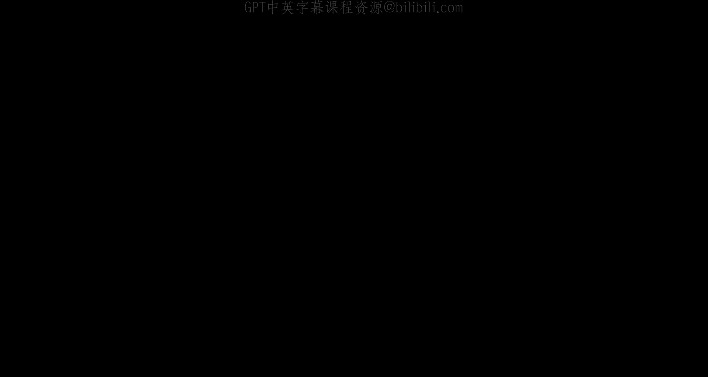
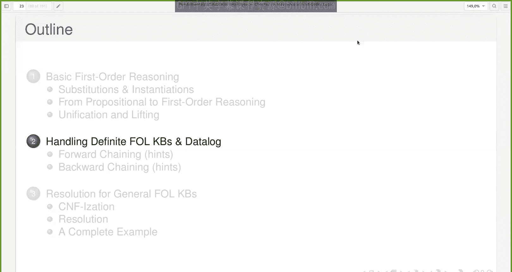

# 意大利特伦托大学《人工智能基础｜Fundamentals of Artificial Intelligence 2024》中英字幕deepseek p26 2024.11.15-CL20-2-CH09-ReasoningInFOL.zh_en -BV1uUkwYTEmf_p26-

Okay， so today， we start。Discussing how to actually reason。呃音乐。In first order logical。 Okay， so。

Not as humans do using in first logic， but how we can build the algorithms which allow to perform your queries or general satisfiability queries in first logic。

啊。I will first up。Give you some very basic first other reasoning steps。 So the main basic steps。

Then I will have a few。Some discussion about handling some particular subcases。

 which is definite first logic knowledge base， like a data。 Why is this important， I just hint them。

 but this is important because they are still used in some restricted domain。

And then I will show you how we really use ven general case and do auto reasoning in the firsterlog in the very general case。

 which is so this will be the core of this chapter。So let me start from some basic notion。First。

 let me introduce the notion of a substitution， which is a fundamental fact in logic written like a subster of AE or simply written expression。

 given an expression one substitute with the expression two。Okay。😊，So。😊，Depression， so this。

 I will use this notation here， this is just a formal theory that we not。So is a expression？

Which you obtained by simultaneously substituting every occurrences of a1 with E2 in E。So I take E。

 I take all instances a1 and simultaneously substitute them with a2。Isn't just a substitution， okay。

 nothing particularly fancy。There are two forms of。

Of subit term substitutions are the case where a1 in the two are terms。

 you substitute a1 with the term or can even substitute a formula with sub a sub formulaula with another sub formulaula。

Okay。😊，She。Okay。😊，And E。Can be other a term over formula， but of course。

 it can only be a thema in case of terminal substitution is a term because you cannot have a sub formulaula of a term。

Okay。😊，So， for instance。A term substitution， if I have an expression， y plus1 equal1 plus y。

And I substitute all instances， y with the S of x。Okay， then I have S of x plus 1 equal1 plus F of x。

This is a。Term substitution。If I have the sub formous institution that even x or odd x。

 and I subsit even of x as odd of x of x。Okay。I can can have the formula Auto X O X or auto of X。

You see this？Quite simple， okay。Oh。Is there anybody who is projecting a light here with some maybe with some wristwatch unwillingly。

Okay。哦， okay ， no more okay。诶唔。In general， you can have multiple substitution， so it can have。

More than one source something like a 14 a2 substitute one with the 23 with a four。

 and this is importantly that you assume that this is sultaneous。Mean。

 so there is no order priority between these substitutions。😡，Meaning， so for instance。

 if I say P of x or Y implies Q of x or Y and a substitute x with the one and y V2。

 I write this as P of12 and Q of12。Okay。Something important which sometimes cause a misleading。

 which sometimes can be mislead people sub when we have multiple substitutions。

 So more than one expression substitute with more than one expression。

 these substitution are simultaneous。So it is not that you assume one epi before the other。

And this is important if they share some element。😊，So for instance， if you have a P of x and Q or Y。

And you substitute X of Y with Y with F of B。😡，Okay。Then呢。This is。

 what do you mean they use contemporary substitute this。 So contemporary substitute X with Y。

And why with F O B。 So here you have。B of y。 And here you have be a Q of F O B。

Is not the case that you first apply。X， you get y， and then you substitute Y that you have just with the y here。

 okay？So。Similar time， so yeah， this， not this。Okay。Is it clear？So this is a common mistake。Which。

 by the way， noted that this notice is not in your book。😡，Okay， so this is a comment I added。ok。Okay。

 so if Fatita is a substitution list and E is an expression。

 then we are den the result of a substbutution of expression theta concatenated with a substitution。

 Okay， so these are just a notation。Okay， substitution is the fundamental element。😊。

Well a fundamental step。Yeah。Of a large amount of operation in in the first of the region。

First of all， we see some particular cases of a substitution。And there is a universal。Rule。

 which says that。If yeah， there's something， so gamma is in some set of patients。

And you have anyality between two term。😡，And you have a formula。Alpha， where21。Okay。

 a general rule is that you can inferair alpha。In which you substitute T1 with T2。

So if you know that two termss are equal。So you have a term1 equal to2 at top level as a 9 to all your in conjunction to all the remaining part of the formula then。

You know， you can substitute fully substitute T 12 because you are substitute something which is equal。

I ups into the same。 So this is， say is a term substitute rule。 So for instance。

 if you have S of x equal x plus y and0 different from S of x。You can alter that， you can infer。

 you can add x is different from x2 plus 1。Okay， because instead of S of x。

 you can substitute S of x with x plus one。Okay， I think it's quite intuitive， right？Isn't it？😮。

Another fact。Okay， is this substitute preserves validity。So or read another way。

 the previous formula is equivalent to the second formula， so that's nothing。

Another fact is that once this is decay， you can even drop the substitute formula。

So you can not only add the the form in which you substitute the term with the another。

 but you can also use it to substitute the original one。Well， they are equivalent， right？

So Suusat means that a formula。If if two terms are equal。A formula。

In which you take a sorry in which you take a term。

 a substitute an equivalent term is equivalent to the previous one。I think it's quite a intuitive。

 right？The equivalent means they have the same models， so the set of models does not change。

Remember that。To equal thermal， to equivalents of formula， just two different syntical。

 different ways to represent the very same set of submods okay so this means that you can free change one for the other。

Is it clear。Okay。So。😡，The very similar concept of the world with formula rather than terms with the formula substitution rather than terms so。

If you have a formula， blah， blah， and you know the two formula， play one。

 a better one and better two are equivalent。 so you know meaning。

That B1 if final be2 is part is an end with the rest of the formula。Which means that。

 in this context， you consider be1 and B2 to be equivalent。Then you can substitute。😡。

Every occurrence of B1 into B2。With B2 freely。 and again。The formula is valuable selling。

So for instance， if you have even x， if you only youre auto of x of x。And， you know。

Even of x or odd of x。Then you can say substitute。You can add all of S of x or order of x。

So meaning that you have a substituted event of X with。With all of SOx because these are。

Saade to be equivalent。Okay。Again， this is very per， so the two formulas are equivalent。And again。

 as before you can drop the original alpha， so you can substitute one formula with another equivalent one。

 which you changed switched you have a substitute the sum thermal sub cell formula inside it。Okay。

 so this is。Equivalent the former subt rule， equivalent for rule or equivalent internal substitution rules。

I think this is quite intuitive， right。Any question about that？Okay。😊。

Which leads us to a couple of important general rules， basic rules， one is universal instantiation。

Okay。Sstantially means that whenever we have a universally quantified formula for all x alpha。

 where x occurs in alpha。Then we can infer alpha。A formula art in which we have substituted。

AVable X with the term T。Well， if I say for all x alpha means that alpha odds for all possible。诶应。

For all possible values。Which X can assume。Okay。The main page， which means that I can say。

 I'm free to substitute。This， with every。Every term。

 a term we have some interpretation so will be represent some value。In my semantics， okay？

In my model， so this means that okay， if I say that this will hold for all possible values mediums also that it will hold also for the value of T。

Okay。😊，Okay。So this means that if I have， for instance， if I have a fx。

 a chem of X and gradient X implies add X。Means that King John and Gr John implies Kenfer King John and Gr John is implies every John。

 or King Richard and Gr Richard implies as Richard or King father of John。

 the Gr Father of John implies a little Father of John or King。

 father of Father of John and Gr Father of Father of John implies a little Father， Father of John。

Okay， so I can substitute to everything， even things that may not have much science。

Like if I say I could hear a term like Kim pointer and the gradey pointer and implies every pointer。

Why this makes sense because this is not a kinger， okay and this is not the gra so this is simply trivial true。

Remember that an implication where the premises falses out trivial little。Are we our。Yeah。

This person with validity。 Okay， this is quite intuitive， right。So if I subed that。

 we just say this holds for everything。😡，Then obviously there also for everything for every single instance so that I want to substitute this。

 okay？NotIn this case， I cannot drop on the forx。Don to confusion with the previous one。This is much。

 much a weaker statement on this。So I Eastern see general。

Florx sound is a general rule and instance it to some particular term。Okay。

I think this is quite obvious， isn't it？Okay， now let's get to something which is way less obvious。😡。

Which is the existential instantciation， pay attention now。Suppose I have。

An existentially quantified。Sometimes， exist X alphapha。Then。I can substitute。

This existentially quantifies， So a rule。Is that I can substitute。Exist X alpha。With alpha。

In which x is substituted by a。Fresh constant。A fresh constant， fresh meaning， a constant。

 which does not occur。In in the alpha and and in Gamma before。 So in the new world。First of all。

 it's not that you add this。 Okay， you substitute to this。😡，You subist do this。Okay。And the second。

C is also called a Sc constant。And existential instantteniation。

Is a subcase as of a more general rule that we'll see at the end of this chapter。

 which is called colonization， which is a fundamental step in auto reasoning。

So what is the intuition about that。It's just that you are giving a name to that the value。

 So it means， okay， exist X alpha， exist some。Object。Which verifies property alpha。I say， okay。

 let's call it to C。Okay， from now on， I call this element， which verifies this thing， I call it C。

They give you the name。And in fact the fundamental factor is that see must be fresh， so it's new。

 so you should not have have these constant before because。Since you。This is new。

 You can find an interpretation which will give give the value of this。All this C， exactly the value。

 which fulfills x。Okay。So the intuition is that if there is an object satisfying some condition。

 then we give it a new name to it， let's give it a name。Let's call it C。So for instance。

 if the x is x which is crown of x and on head of x jo， let's call it C， I will say crown C。

And on head see John。So there's a crown on the John's head， I call it to see。General properties。

This does not preserve validity。😡，So the two expression before I'm not。Equivalent。

But they are equivalently satisfiable。Eququi satisfiable。 So if one is satisfiable。

 the other is satisfiable。 Okay， well think about that。😊，So。😊。

This was satisfiable if there existed domain value such that if you map the instances of x to that domain value。

And all the other symbol in the given interpretation， this is true。Okay， but I simply say， okay。

 I introduce a fresh constant。And this means that if there exists such a value。

Let's the exist interpretation， which gives value。Okay。😊，This is different interpretation okay。

 because the first one， the first interpretation in principle could give a C some other value， okay。

 so this is not equivalent。But this is equally satisfyisfiable。The system model here， if in。

 if the a system model here。Why is this okay for us to have equity satisfied。

 exactly because in general we are dealing with satisfiability， not with validity？Okay。

And in particular， when we do entailment。Or in inferential。Okay， if we sub。

 remember that intailing B。😡，Save that the gamma and the alpha。

And exist x alpha does be beta means is the same as saving that gamma and exist x alpha and not beta is unsatitifiable。

But this is unsatisfiable only if and only if gamma and alpha x given C and not beta is unsatisfiable。

 which means gamma and alpha is equivalent to say is equivalent satisfiedfi。

 is equivalent to say that gamma and alpha x given C so you basically entails B。

So they are equally satisfied。This holds evenology。This holds。Okay。😊，So you press have entailment。

And this is enough for us。Okay。Well， this is something that we， we do already。Think of mathematics。

 mathematicians do this。Several times。For instance。Math， you say there exists some value。

Such that the derivative of x to the Y。To divide， okay， so theres inlic for a white here okay？

The derivative of x to the y， given the y。I x to the y is it safe？Does this value exist？Yes。

 we know for mathematics and mathematician， in particular E， is called this number E。😊，Okay。😊。

And in fact， D to e e to the x over dy， the E to the y over d is e to the y。You give it the name。

So when we know that exists some value such that。Okay， we just give it the name。Let's call it E。

There is a constant value， such that。诶。The length of the of the cycle is。X time the diameter。

We know that exist。 and this is always the same。 The proposal is always say， how do we call it。

 We call it pi。And so on and so forth。Okay， so and you can have many other examples， Okay。

 so keep in mind。Universal instantiation and existentiial instantteniation。

 because there are some basic steps which are typically combined with the most sophisticated steps。

And also combined with the some billionion reason steps that we have already seen in previous chapters。

A few facts about universal sensation。You can add the UE several times。😡，Okay。

 to add the new sentences。And the new set of formula that you obtain is logically equivalent to the previous one。

You just add the sound， which is already equivalent， so it be fair， so you add from the logical view。

 you add the nothing， you add no new information。Existential institutionss that is。

Le to three careful。Okay。First of all， AI can be applied only once to where you replace an existing。

Fact， we cannot apply this twice。Okay。The previous one is not equivalent to the to old one。

 but is unsatisfiable or satfi， if and not， if the previous one was satisfiable or unsatisfiable。

 if the previous one is satisfiable。So this means the new gamma can infer better。

 if only if gamma can infer better， so it preserves endment。Okay。Okay。Beware。Common mistakes。

Comemon mistakes。Remember， what is the form of。It's not that in general， you can sub the。

Whatever some university face formula with。So the university quantifies a formula that must occur in end something with the main formula。

Okay。Similar， the existent quantify foreign must occur in the end of this。With the remaining formula。

 and they should not have any。Migation up front， of course。So。Seeilly mistakes。In order to apply。

This rule， you should be。Careful that this sub formulaia quant formula not occur in end with something that in particular。

 you don't have any ne front。Because remember that a negative universally quantified is de facto and existentially quantified one。

😊，So if not so， well， if you should rewrite this。So for instance。

 you should rewrite a Fx alpha into X x not alpha and not exist x alpha into Fx not alpha。

Why say that？If I write4 or X P of X， reply。Exist呃 okay。Exist the。

In does it did not exist the Y Q of the Y。Okay， beware。 Let me arrive this as as a。As or。

And the red put negation inside。 Remember that a negator quantification is。

The opposite quantification。So be careful not to make these kind of mistakes。Okay。

 we'll get back to that when we see polymerization。Okay。

 so remember that these rules should be applied only in this condition here。😡，Okay， so。

Something and universally quant the formula or something and existentially quant the formula。Okay。😊。

Okay。So what he said， what can we do。One， there is some， some cases where we。

Can reduce first of reasoning to bullolean reasoning。三。Some of them， okay。

So what's the point remember the definition of a close the formula。

 a close formula is a formula where all you don't have free variables。 So when you have variables。

 they occur， variables occur only under the scope of sifiers。Okay。So we could say， okay。

 given a full formula， a full closed formula well knowledge based government。

Gamma is a set of formula， but remember that a setformma can always be seen as a conjunction of its elements。

 Okay， so sometimes it with a formula sometimes it will need say set of formula。

 sometimes it will say a simple formula。 they equivalent notion， okay。I could， in principle。

 convert the gamma and not alphapha2 P。And so the idea could be try to convert this into provision logic and use a such folder to solve it。

Can I always do that，Wow。No。😡，Donless they can do that。

So what is an intuia is that you should try to instantiate。Former for all possible grand termss。

So you should replace variable with ground termss and create all possible sensation of quantify5 sentence。

So if I have a fixed amount of constants， I could try。2 Eastern shape。All them。

Lower possible combinations。Once I've done， so the point is try to rewrite。😡。

A formula as a huge amount of formula of ground formula in which I instantiiateated all possible all quantified variable with their possible instanttens。

And when I have done all of them， so when everything is ground， remember what ground means。

 ground means that without variables。Every variable has been substituted by some constants。Okay。

 then that you can。Forever。Possible。AGund of predicate， you can introduce a fresh bullan atom。

 typically we say something like king John becomes king and the score John。

 or brother John Richard becomes brother John。Hhen reach other or something like that， okay？Okay。

 there is E theorem by Herbrand， a white famous theorem。Which says the following？

If a ground sentence is entailed by first orology knowledge base。Gma。

Then it is entail by a finite subset of the proposition knowledge base so in general。😡，で。

Trying to convert。To convert all embo logic， all possible formulas。

First of reform that can be lead to in incis， if in many sta。Well。

 her brand proved that if a ground science is entailed by a grand fortoology knowledge base。

 then it is entailed by the finite subset of the。So you need only a finite amount of instants for them。

To to show entertainmentment。Okay。😊，Unfortunately， the Vi asset doesn't。Okay， so if it is not。

So substantial， you can do that。But if half is not intended。 So if you try to do that。

And alpha is actually entailed by the gamma。 then sooner later you'll bump into。

 you'll be able to prove it。If you opt， you can loop forever， you can try forever to。To assess this。

 So this is。Coherent with the fact that。First the logic is seeminglydeciidable。So in principle。

 if alpha can be in by gamma， sooner or later， you'll prove it。Well sooner or later。

 it may mean also in the geological era。Supre time， okay， but if it doesn't， you， theres no。

 no guarantee that you are able to show it。 You are able to find a counter example。So。Okay。

 some example， okay？Suppose you have a very， very simple example。

 which is4 x a king of x and the gradient of x implies a of x， and you have two。Gund the prediccate。

 which is a King John and Greg John， and you have the rich his brother or John。ok。😊，Okay。

 let's try to instantiate the universe and in all possible ways that the ground all the constant that you have can be seen and then Susha you see that you have two possible instant of the universal Scin。

 which is King John and Great John implies E John and King and Greg Richard implies E Richard。Okay。😊。

Okay， so you can propositionize it where just see but you don't really need the propositionalize。

 you just have to look at every ground the atom as a boolean atom。

 so syntical different Boan atom seen as a。His names of Boan Atoms。Okay。But okay。

 conventional you cannot propose on item。And then。For instance， I can reduce every job。 Okay。

 every job can take。By this， Okay， why， Because you know that King John and Gr John。

 when you can referfer every John。Okay。Okay。First， fuck。But positionization in general is not rude。

Okay， why？ Because typically well， first of all， it because it generates。

Huge amounts of irrelevant parents。Okay， so if you remember。

 it produces also the irrelevant at like Gry Richardard。Which are not。去。诶。So for instance。

 this sentence here。AProducer also agree the richchat， okay， which is not relevant for our purposes。

 okay？In general， you have an exponential amount of possibleizationization where K is any repdiccate and n is the number of constants。

Okay， so you have a huge amount of business， which is something that you don't want to have。

Another problem with the propositionizationization is。

 but the real big problem with the propositionization is that it's the present of functions。

Orfin symbols。Okay， because if you have the functional father。You have in principle。

 infinitely many ground terms。Because you have John， you have father of John。

 you have father of father of John， you have father of father of father of John。

 you have father of father or father of father of John， as on and of all， Okay。

 so we have infiniteed many。Well， if you think they're successful。O。Successor of0。

 you have infinitefin integers。Social0， success or1，0，0， success success 0 and so and so forth。 Okay。

 this means that you have a new feed amount of。Of the infinite possibles sensation。

You could have a in which you increase progressive in the nesting level。我的放手。So for instance。

 for nesting level0 to up to in， you can use terms of function nest with nesting depthput。

 So you try every every step to。Be the propositionization of your knowledge base。U meetinging up to。

Nest in depth key。Of a key as a maximum nest depth of dances。

So you first try to instant it with nesting step0， then you can try to instant to up to nesting step1。

 then you try to instance it up to nesting step two and so on， so F of F F of F okay。

 so it can be progressive in that。If sooner or later， government itself， then。Then this is。

 you'll find a conation for some decay， okay， so you'll find unatitisfiable for some decay due to herborn theorem。

 but if this is not the case， you will go ahead and completely。

And this is not surprising because you know that。First all the reasoning is semi decidedid。Okay。

And this comes again， to the。Church theorem。Theorem。

 well you say church church touring not because they they fund it together。

 but they substantially fund it。Susstantially， contemporarily。They retain the very same subst。

 the very same the the same year contemporaryor， so it's just called as a touring church theoremment not because they work together。

 but they contemporarily fund it。Okay， inter meat is semideidable。In general。

 propertyization is not a good idea。😡，So you can do much better than propositionalism。

 propositionization， it can work in some very particular cases where first。

 you know have you find a domain。And typically， you dont you don't have functions because fashion。

Make you die， make your proposition die so you just have an infe or a coach。Okay。

 so these general terms and then we go where the really interesting part is。

So we don't typically use professionalization。Instead， we use unification。

Unification is the fundamental。Reasoning that。Okay， first of all， okay。

 first let me say something which is called generalized modelpon。

 which is something that we use frequently in some simplified scenarios。

Vdia is just combine propositional inference。With the universal' translation and the existential extension。

 so the two rules that we have seen before。奥环。We have an ocean which is I told you about Aristotta's mod prominent synlogismma。

 all men are mortal， Socrates a man， thus Socrates is mortal。Which translates into。

Forralx manex implies mortal x。Okay， but the main Socrates。In case multi Soates。

 which looks quite intuitive。 But what have we done to do that。What we have done substantially is。

That if you look at that。We have applied。University sensation of the general rule here。

So what is this like？This is， so why can we obtain that？😡，In terms of what we have already done。Well。

 what we have done， we can do here is take this。For all x pihi alpha formula。

And is that X to Socrates。So from this formula here。

 we can derive main Socrates implies mortal Socrates。Okay。

But once we have main Socrates in taste smart Socrates。By pure bullolean reasoning。😡，Okay。

 you can bullionize if you want to if you don't like But remember， every ground of every grand at。

 you can just see as as a name of a Boolean at。 Okay， you just apply standard or modest bonus。

On top of that， Okay， you see this。Okay， this art leads us to。

A rule which is called the generalized modstrs， which is the followinginger。

Suppose we have in this scenario， we have a K formula， Alpha1 F 2， Alpha 3， Alpha K。Prime。

And then we have a general rule， say alpha 1 and alpha2 n， bla bla alpha K implies better。讲咩啊？

Suppose exist a variable to term substitution data。Suchday。Forever。诶。🤢，For every indexer。

If I want Peter。Is identical to a。1 theta alpha2 theta is identical to alpha2 theta。

 Butla Al K prime theta is is the same as alpha K。 So is a substitution such that if I apply the subsit to both formula。

 para is。Those instances are pairwise identical。What does it mean？Applies if I apply substitution。

 the same sub to all elements here。What type F is alpha prime theta， alpha2 theta。

 blah blah alpha K theta。 And here I have alpha1 theta and blah blah alpha K theta implies beta beta theta。

😊，Okay。😊，But if they are wise the same？Then I can say， I can tell。Inter， infer， better data， yeah。

You see this？Okay， here， I forgot to say that all three variables are in is assumed to be universally quantified。

 so there is a form form here okay。So。He does substitute university def unit terms， remember。

That is a substitution。For instance。诶。From axis X， King X and G X implies every X。Okay。Okay。

 by using and we have King John and Fx Y Gy Y。Okay， we can east and see X with John and Y with John。

So we have this three term， this universal rule here。

 and we have the John is a king and all everybodys graded。Okay， we can instance it。

 we can apply a substitution that x is John。And also， why is John？

And we obtain that the King John and Gry John implies every John。

 But we know the King John and Gry John， for which you can infer every John。You see this？You said。😊。

Okay， GM。So generalized models partners is widely used in some subcase of knowledge base。

 First of W is， like there is a pro data on production rule systems。 You may know。

 But in the 80s and 90s， this where root based system were very， very popular in。In。In a is。

So you have a set of rules， specialized rule that we're able to。

Define to describe a formalize what a given domain works。 And then you can， you could try to infer。

Information out of that。 Okay， and see typically。They were expressed in languages like parole and indeta alone they were reasonably simple。

 Everything could be in by just application of this very basic rule。Okay。

 so they used to be very popular at the time， now there are no more but。哦。

This still something important in AI with some applications。Okay。

 now it's time to introduce the real。Interesting part。 But I think I can have a break before。 Okay。

 so let's resume at 40。Look good little everything。Yeah。好。Research。Yeah。

The amount of for all MPA and mission learning。Aing design。really it。我们这你明给你。嗯。I see。Okay可以。那不。是谢。

Yeah。Oh。6。Yes， job。没有。To enter2 everybody anybody entered。Is anybody in？Yeah， okay。嗯。对。So。😡。

Uification， unification is probably one guys pay attention with this variable。

But not that it' less important slide， you should not pay attention， but of course。

This is particular one because this is unification is the fundamental step。

In every time you want to do anything in a first order resume。Okay， so the point is the following。

Suppose you have the two tuples of a formula。😡，Alpha 1 prime at alpha 2 prime， blah， blah。

 alpha K prime and alphapha1 as the2 alpha 3 alpha k。An idea of unification between these two twos。

Is to find a valuable sub data。Such that。For all index。Oer。

I prime theta is the same as alpha I theta。Okay。😊，So you substitute variable substitution means that you take variable。

 you substitute some variable with some term， which can itself be a variable。Or something different。

 Okay， but。You take a valuable answers you this with the term。Okay。If this is the case。

 or so if such substital should data exist。This is called a unifier。For these tuples， yeah， okay。

And we say that unify alphapha beta。Equal theta， if alpha theta equals better theta。Okay。😊。

This generalizes， of course， to a tus of formula okay？Is this clear？

Notice that generalization two+ is something that if you think a two plus as a conjunction。

 then you see that this corresponds to a identificationification one single formula。Are with her？So。

 for instance。If I what is the unifier of can you say unifier of no John's X and no John Jane？

No look transparency。What is a unifier， viable substitution， come on。

Do you find North John X and North John Jane， what is your substitution？Da， yes Wov Jane， yes。

That's an easy one， okay？What about。Ns John X， knows Y， or J。Butral was age is a constant， of course。

嗯。수졌어？And。And why， and why， John， yes， right， John， yes。Okay， remember that these are conities。

 so the order doesn't matter here。嗯。😊，Slightly more difficult。No， sir。now John X knows Y。

 mother or Y。This is lot more difficult。系。呃。Thank。John why and well， John why it was' an easy one。

 but the other is。My little John， yes。Mother of John， okay。The same。So。

There are some which are three yellow。 Okay， like this one with this。

 And some we have to think a little more。What about this。Don't look intoper。Any clue， again。

 don't look in transparency。Any clue。There there is no unified in this case。W， why， because。

This will say that x sub， that x is this will say that x is subsjo， this will say that x is subs Oj。

Okay。Okay， these stats are。嗰 something嘅。Before unifying you should also read。ARename of variables。

 Okay， so why is this the case， Well， Su remember that。When you have free variable in this case。

 it is as if the free variable will be imply universally quantified。Okay。😊，Okay。

 so this could be say that right look like a forral x known John X and the4 x known x or J， okay？

But remember that。Yes。The following fact。Okay， so can that you can rename them。

So well substantially you can rename those variables， Okay。

 so for all x something is the same of for all y something or for all dead something， okay。

Volleyable names do work count。So the idea is then when you have these two。

What you can do is a standard step， which is called standardizing partner。Okay。

 rename variables to avoid nameing claciers。So this isque to say all4 x， John knows X。

Which is the same as saying for all X1 knows John X1。So I rename them， okay。

 for instance call this one x1 and call this x2。And they say unify knows John X1 and knows x20j。

 which means that I can easily unify them by substitution， okay？Well。

 substantially the key point is that you can simply just remember that you can rename variable provided that the new variables names are new。

Okay。So name variable do not count provided they are new variables。😡。

They don't the same new variable doesn't occur anywhere else。Okay。😊，Remember。

Variable names do not count， provided there is no name variable name cles。Okay。

 so this is a step which is quite common we see this in several steps。Okay， okay， so I just。Push。

 sorry， I push the wrong button。Okay， the first there are。First， some consideration。

Which is that unifiers are not unique。Okay， so given two formula， you can have more than one uniform。

So if you say unify knows John X and knows Y Z。You may notice that you have two unifiers here。😡。

One is that。Why John why with John and act with that。

I will say they are free because you can also have why John and Dad relax。系。But also Y。

 John and X John and then the John。Okay。Or X and there the same constants if you have other constants around。

You see this？Okay， this leads us to some。Oh。The finish one。

Which says that some unifiers are more general than some other unifiers。

And say that given alpha betta， the unified T to 1。

Is more general than a unified the2 for alpha and beta。If it exists a third unifier。テタ three。

Such that Theta 2 can be obtained by applying 33 to theta1。Okay， let's see example one。

I would say that why John， so this unifier here， given this two formula alpha and and beta。

This unifier here， what is it okay， is more general than this unifier here。😊，Why is this the case。

 Because if I apply this unifier？If I take this unify here and I instantate that with John。

 I will obtain exactly the very same。So I substitute Y with John X with that。

 and then that with John is the same that applying unifying X with John and that with John。

You see this？So what is the key point here， for some reason we wish to keep when we do a unification。

We wish to。When if we apply unification and we infer for reason for model components。

 you unify that formula， would you like to keep the resulting form a model general as possible？

As general as possible。Why， because more general formula is more informative than the less general formula。

Okay， so since we entail。Unify the formula。We wish that the unified formula shouldn't be in。

As general as possible， the most general ones。Which we could infer。 So it's our interest。

To find it the most jail。Unifier as possible。 Well what is， what does it mean more general。 Well。

 typically， if you take a variable and you map into another variable is more。

 The result is more general that you take a variable in and you map in the constant or application of a function to some constant。

 okay。Because it's if you substitute variable variable this， the remaining is not restricted if。

If you apply a substitute variable with a ground term。

 then the result is much more restrictive because it forces matches only with that particular term。

Okay， is it clear？So。😡，There's a theorem。😡，Was probably I think in the 60s or something like that。

If exists a unifier， alpha beta。Then there exists a most general unifier for alpha better。

So there exists unfi， which is。More general than all the other unifier or or equivalently general。

 which either equivalent or more general than all other unifiers。So， for instance。Indeed。

 the case above why subively John and X that is the most general unifier for the the pairs ofphoia。

 not is that also taking dead。So most generallyified is not unique in general， okay？

It's not unique in general， it's a unique model of environment na。Okay。

 so it's not unique in general terms， but hes unique model variables， okay？诶。So for instance。

 y John and that sub with the x is again a most general unifier， but this is just。

 you can obtain this with this by just variable renaming。Okay。Okay， well， substantially。All。

 first order of your improve。Implement some efficient algorithm to perform unify。

 which means which is algorithm， which returns the most one most generalified again。

 I will say the most meaning that。One modo， the name of Adam。Okay， she's all right。

Returns the most genuine fiber between two two formulas or two lists of formula。Okay。

In first order approved， there's been a lot of research in using nice smart tricks to maximize the deficiency of this computation。

 because this is very a fundamental element in no first of the reing。

As we see in the second part of this chapter。We just give it a high level。

Representation of these two。So what is the point here。

 Unify maybe be applied to several different things can be applied to。To variables， to constants。

 to terms。To tense which mean application of function and constants。In general。

 we can apply even to cost a function symbol within any meaning that if they are the same symbol。

 they unify if they are not the same symbol， they do not okay。Well， to understand understand。

 this is not tricky because you can think。If you think as a function， as a constant symbols， S0 R。

Funal symbols that you see that this concept match。Okay， and should you apply to。Seets。

Or two plus order， not sorry， not said， sorry， order two plus of the。Of terms in formulaia， okay。

Okay。So there is this general function which unify X， Y and theta。诶。Such that X is either a variable。

 a constant。At least， well， I prefer saying two。 Okay， but okay， a list of expressions。

Or a compound expression meaning operate or meaning a function application of function to or of prediccate to some。

To some list of expressions， okay。This is a very， very general expression and same for why and Tita。

Is the list of substitutions that we have been so far。Okay。Right。

So substantially initially youvo unify。Function， So a thermal formula or list of formula passing an N list。

And then initially empty leaves and then your progress increase it again。

 we assume that everything is customer reference。Okay， in order to understand it， I first wanted to。

Tell what unfi variable means。So the very basic building block。Is this a sub function here？

Which does the following unified value， which takes a variable and whatever object and a given set of substitutions a returns。

Eus an a data version of this substitution if this match or fail if it doesn't。

So it returns an updated version of datata in which you add sub the in definedfin substitution。Okay。

 between the unifying between variable and this X or returns fail if it doesn't or no， if it doesn't。

Okay， failure or whatever。Okay， how does this work？If you already have。

That the sum value is instantiation that you already have。A substitution， the form of variable。

 something。Varable term here。In디た。Then you substitute the valuable with this substitute para。

And you recursively invoke the unification。Function over。This is P， U x and deta。

 not that a vi can be a complicated expression and complicated term。So your're custom book unifying。

So substantially if you have that variable term， variableses with the termma is already part of theta。

 this means that every occurrence of variable must be substitute to this term， so I invoke correct。

 since the term here while here can be a complicated term， I invoke the top level one。Okay。Okay。

 if there' is another case and。You already have x v。

 so x is a variable and and if x is a variable and you already have a unification for that。Okay。

 so what you do substantially is you invert， oh， I forgot to say something。

Uify alpha and beta is the same as unifying beta and alpha。So the order doesn't matter。

 so the definitioner logical definitioner doesn't doesn't matter， Okay。

 so you simply invert them in order。And you pretend x Y， you had call the uniformfi barta as x bar。

Okay， you should substitutes bar with value here。Okay。And invogue。And they involvevoke a recursal。

 actually。I would directly say here unify var because this call unify will automatically call unify v。

minoror improvement， okay？Personally， I would write a unify R， yeah。

 this is the same because if you involve this with a v， that you will go straight here。Then。

If a bar X。Is sorry if the variable occurs inside the term X。Okay。What can we do？

The answer is nothing。If x， so if x v occurs。InV occurs X。

Then you cannot have a unification because otherwise will have a recur symbol of infant interpretationetition。

ok。If you try 25 x with de of x。We have F of F of x。 And then next step of F of F of F of x。

 and then F of alpha of x will。We end upper into infinite loop。Okay， so we can we have bound to fail。

Otherwise， okay， at the end， if you are not in these nasty situations here。

Then we do the other thing。We substitute bar with x。Okay。

 so this is the the default so if you are not in those nasty situations here。

The obvious thing is to ins variable to X。Okay。A with her。Okay。

 so this is the basic idea how to unify a variable with something else。

Once you have this basic component， we see how to。How to instance it a general term with some other general term。

Recurly， and what we do is， okay， if Teta， the current tita。

 we have already called it and we have already on a failure that we have no chance。

Because we have a failed to unify everything else， so we have previously failed。

So we are term failure。Oh， I forget to say here we assume that v and x are different。Okay。

 otherwise that it will be obvious case okay but this is already in this case。

 so if x is the same of y then we can read already return Tita okay the term sub is okay because it already you don't need unify adding more substitutions。

They are already unifying。X and x are in unify。Alpha and alphapha already unify。Okay。Okay。

 effects is a variable。Then evoke infi variable with x and Y。😡，Otherwise。If why is available。Okay。

 unification is。It a method does not depend on the order， Okay， so just to try to do the opposite。

 in if I value y and x。So meaning if one of the two terms you want unify is a variable。

 invoke a unified variable with a variable term with the other。😡，Okay。

Not what purposeses both are variable？😡，Well， you have a substitution variable with variable。

 which is fine。 Okay， and the order way you do is simply depends on the only way which you call it。

 But as I say， here is。When I say that the most genuine fire。Is。Unique model variable renaming。

s depending on the order you call it， it may depend it may have a different variable。😡。

Different variable per variable ordering substitutions， but this again。Leads you to some。

Most general unifiers， which are identical model of variable or。Okay。😊，Then okay。

 so this is so long for the basic cases。Now， what if neither x nor y is a plain variable well。Well。

 what is it， So it may be a compound， so this could be an application of a function symbol。Okay。

 a functional symbol to。Or prediicacial to another prediicacial， okay。

So if x is a compound and and y is a compound， then you first unify the so you unify the operator unify the operator is trigger because if they are both constants。

 okay they are both constants， then you will define fine， you will fail。

So they will end in the new case here and return。Okay。😊。

So substantially if you have two operators and they are not identical。

Then they will fail all this tasks and then they will never going to save you。

So if you're trying to identifyify P of x with a Q of x， okay， and you try to you check P and Q。

 they are not identical and then they all fail this variable test here and they are a term of failure。

Yes， please。Now， at least we have not to get。I haven't explained it yet。😊，We're just explaining you。

Why。Why re this recursive call here fails if I just pass it to beed predicated symbols。

I haven't explained this step yet。Okay。😊，So if the operators are identical。

 then you unify the A is a is a compile is a list。Okay。

 which matches into the site of the next definition？Which I'm going to spend now， okay？Yes。

 are the arguments or applications of P of term1 to terrain。Okay。

 this is a standard notation when you have an application。

 we have operator and As where AGs is a list of arguments， which is a list。

So the operator are just symbols like to predicate through two functions。Q and B。Okay。

 and this is the list of towns expressed and。And。And wire rest。Okay。嗯。Okay。

 this is nothing else that the application of comparison to a list， Okay。

 how what happens when you wanted to compare a list。

 you compare the first element of the list if they match， okay。

 if the match apply to the remaining part of the list。So what is this。

 so ifX is the least and y is the least， then you unify the first element。And then you recursively。

 so you add a unifier， the unifier you obtained by unifying the first element。Okay。

 and then on top of that， you invoke recursively to to the sub list of the remaining parts until you get an empty list。

Okay， if none of those cases apply。So for instance， if one is a compounder。

 the other a variable of if one is the least and the other is something else。

 or if one is a listed the other is nu or whatever。

 then know these cases where these things do not apply your return failure。Among that。

 there is the case where there are two simple symbols， predicate symbols with which are different。

 two different to cost of which are different。😊，Okay， no other case of these failure fails。Okay。Okay。

 so this is an interesting year。あグ。There are many， many variations。

 of that so this is so I understand that you are probably not much used tool。To recursive reasoning。

 right？W are you not much。Okay， not much。 Well， this is a basic part。

 There are some basic schema about recursion， which is when you are comparing a list。Two list。

 you're applying something to two list。Okay， what you do is you do something compared to the first element of the released。

And then you do recursively something to the sub list。The remaining subist。

This is a standard pattern in in recursive applications on functional list。

 and this is actually the case。Okay。😊，Okay， just a。Take a look and try to understand that and if not。

 just come back in and ask， okay？Okay， I leave you some exercise find the most general unifier of the following formulas by the unified procedure or say there is no one。

I suggest always， if needed to standardized part them beforehand， so always remember。

Inja always remember to do that before。 So it's never it should never be the case that you have this invariable。

Into form just that you are unifying。Okay。😊，Then invert arbitrary pairs of the list of atomic formula formulas and apply unfi to them。

Try that。You see apart from the fact that this may look quite complicated。

 you see that the principle is quite simple okay， so the idea is that you have to pair is to check compare the so the elemental so you compare the elemental list the first with the first and second with the second and third with the third blahlah blah。

 blah okay so this is just a。Maybe if the complication is that that is recursive fashion。

 but if I say for all the elements of the list are much well much perwise and other than to the unification。

 it's probably simpler， okay。Okay。I think I can close here for today。 Okay， so see you on Monday。

 Okay， and。Oh， have a nice weekend， everybody。

