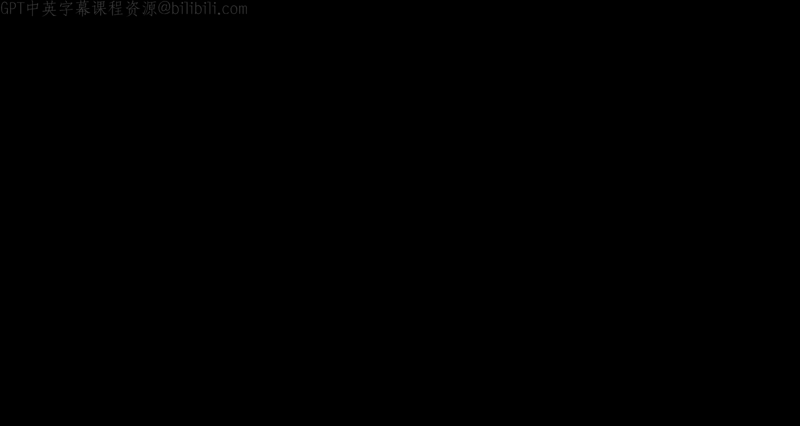
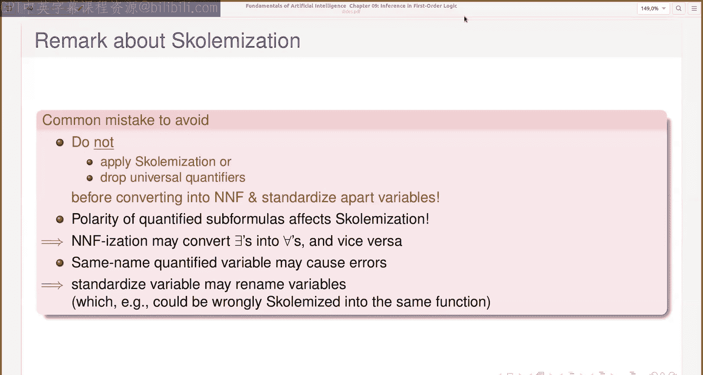

# 意大利特伦托大学《人工智能基础｜Fundamentals of Artificial Intelligence 2024》中英字幕deepseek p27 2024.11.18-CL21-1-CH09.ReasoningInFOL.zh_en -BV1uUkwYTEmf_p27-

嗯是。ok。So， last time。We've started discussing the forms of first reasoning them。

 so reasoning first logic。We have mentioned some very basic steps。

Including the notion of substitutions。And which means that which leads to some very basic steps like universal and existential inciiation。

 Then we mentioned。Generalized modest bonus， which is substantially a combination of instantation and investor instantation and modest bonus。

 the modest bonus。 we say something about how to。Propositionalize。Tal logic。 and saying that it's。

Except with very few subcases， this is not really feasible。Okay。

 and then we get to the the key element。Which is unification。 So substantially when you have to。

Formula groups of formula2 terms。Find a common variable to terms substitution such that if you apply this substitution。

 which is called a unifier to both terms， they are they become identical。

 And this is the fundamental step in the most automatic reason terms。Before now。

Before getting to the main block， which is the standard technique to perform for standard reason。

 which is resolution， well handle some particular subcases because we have already seen that JRL。

One of the biggest problems in inferology is that its reasoning in NefoL is sin decidable。

 so it's not guaranteed。That you have a solution。 So if it's if a format is en tailed from some group。

 it's guaranteed that sooner or later you are able to find it。 but if it's not， there is no。Algorina。

 which is guaranteed to terminate a1 you look， this is not， there is no intent， such intent。So呃。

People have a concentratedcentrator for some time to some restrict subcases。

 and this is what we analyze first in order to get to the hardest path。

And in particular we discuss about the definition of posttoological basis and data log。

 in particular with two techniques which we just hint。

 I mean we're not going to either the details of that but just give the high level ideas。

 which are forward checking and backward changing。For a chain sorry not one checking okay。Okay。

 we assume in this subcase， to the subcase that we have no function symbol。Okay， trust them。

Remember that functions are。The source of as inf logging to some extent。

 because you may have an infinite side amount of tails if you have a functions。

 you can beat the infinite amount of tail by infinitely nesting the same function okay。

So it's an increasing notion of a loan decidability， okay。

 and also we assume that we don't have any existential quantifier under the scope of universal quantifier。

😊，This may be a little bit more surprising for you。

 but this boils down as we see but the reason the assumption be will be clear in the next session where we see that when we have an existential quantifier under the scope of universal quantifier。

 a standard solution is that to generate a function。Okay， but since we don't want functions。

 there reason why so we don't want function from the original problem。

 but also from the encoding of existential quantifications。So。Okay。

 and if you remember the the notion of horn clauses and the definite closes。Okay。

 remember that we had the notion of definitely closes。

Which is closer with exactly one positive literal。Remember that。Okay。

 and substantial with the only one positive de liter， if we see a close as an implication。

 we can see this as a conjunction of atoms implying one another atoms。

 so the only positive de liter is the implied atom in the conjunction。Okay。滚。So for this。

 we can omit to universal quantifiers。ok。So and we assume that all variables are implicitly universally quantified。

 so if we assume that all variables are implicitly universalified。

 we can omit the writing explicitly there。The the quantifiers， okay。

And we remove and we assume we have removed a priori or the universe existential。

 quantified by existential instantciiation。Or remember， we can just name。

G name to the existential quantified variable provided this does not occur under the scope under the scope of any universal quantifier。

 remember go back to see existential instanttanciation so we have substituted existentially quantified atoms with。

With the。Oh。It's a constantt with the fresh constants， okay？She。Okay。😊，啊。Sstantially。

 they tend to represent the implication of atomic formulas。

 so they are the counterpart of the Boolean case that we have seen at last time。 So for instance。

 for ax king of x and G X implies a x K not king x or not grade X or every X。Okay。

So the positive literal plays the role of the implicate。Okay。

 the negative lit play the role of implicants。Okay。😊，Okay。Stantially why this is important， well。

 this is important because this is the formals which you use in important application AI you may map into。

 which is data log。Which are a set of first order def enclo without function symbols and the typically data loop has been invented to reason。

On relation databases， Okay， and notice that if this is the case。

 So if you have you are restricteded to this very particular subcase， inference becomes much easier。

And we see why you a couple of slides。This is clear， so the conditions。We are dealing with now， Okay。

 the the restrictive conditions， Okay， Okay， so here is an example which can be a passing catalog from your book。

Suppose you have the following statement， so below。

Says that is the crime of an American who sell weapons only twoal nations。Okay。😊，The country in Nu。

 an enemy of America， has some missiles and all its missiles were sold to it by Coroner West with an American。

Goal。Prove， prove that Colin West is a criminal。😡，Okay， so this is interesting case because。

Is a sort of a。Legal reasoning described in the form which can be mapped into that。🤢，Okay。

 by the way， you probably。Don't get it because they are too young to know that。 But this is。

 of course， a satirical。So to a famous story in the 80s about a colonial North。Who， saw the。

Who sold a misus to Iran？By having legally sold missilees to Iran and there was a biggest scandal in the 80s during thean administration。

 and this is of course a satire reference to satirical reference to that story， okay。ok。

We notice on this。We we can formalize this， but then we will notice that。In order to do that。

 we have to make some pleased assumption， which is part of in our mind， but they are not immediately。

 so a machine we not immediately get。傻。So for instance， the fact that if you commit a crime。

 you're a criminal。Okay， this is obviously to you， but this is not to the machine or many other things。

 Okay， okay， let's try to formalize this industrialial logic。Okay。

 it's a crime for an American to sell weapons to hostile nations， okay？Okay。

 so you can say that for all X， Y Z。 Okay， so who are the subject？ Okay。

 I just also give you an example how to encode something do for theological。 So you have to。Deal。

 we have to think， who are the。The objects are on the same。 Well， first of all。

 theres some person who sells。Misiles and who is supposed to be a criminal。

So let's coordinate with x。So。😡，Notice that this is since a universal center， okay。

 is' always a crime for every person， for for every weapon for every At nation。

 so it's universally quantified。So。😡，For all X， America X。For all Americans。Okay。And for all weapons。

So for all why， where and why。And。host nations。 So let's categorize this as of style。

 You can write this host nation， if you wish。 Okay， and for all host nations。 So for Z， the Ho dead。

呃。Okay， so you have， so for all American， for all for X， American X， for all Y weapons Y。

 for all Z hostile Z。Okay。These three predicates restricted the domain of our variables。

Characterize what are， what are our valuable。 Okay， so respectively， an American person。

 a weapon and inner style。 Okay， sells X， Y dead。 Okay， so some X sells some。

 something to some dead where sort of meaning an American sell some weapons to to some nation。 Okay。

Implies criminal act。Okay， x is a green in。To agree with this characterization。

 I just wanted you to notice a few。Steps sir。Okay， would。this thing can be writtenized for all X。

American。X implies。Forrow why。啊。What was weapon？Wapon why？Implies。For all the。Then， the。

Of star Zander。呃。Inlies。Okay。Just to know， I just wanted you to be aware。That when you write。

 a implies。B implies。 C implies。Blah， blah， blah。Okay， in bull logic。

This formula is equivalent to say A and B and C。E implies blah blah blah。ok。She。

So writing this or writing this is exactly the very same thing， notice。Okay。

 there is one step or more。You have to bring the universal qualification inside。

 but you remember that universal qualification。So if y does not occur in the formula。

 you can bring it inside， okay？So probably the scientist test maps more naturally in the sense that ever written on the board。

Okay。More naturally， but this absolutely the same the very same thing， okay。

So get used to these factors so that you have nested restrictive variables。So for all X of one kind。

 for all y of one kind， for all data， one kind can be returned。 for all X for all Y on that。

 kind one and kind do kind and the king blah， blah， replied replied， okay。So。

Get used to the equis of these tool。Fals， because youll find very quickly when you are formalizing for start logic。

 okay。Okay。Then the scientist is， no noh blah， blah， bh blah， blah。

Who is a web don't know who is blah， blahlah has a sun so？Okay。

Notice that in natural language you have the to。啊。This sentence here is many sentences。Okay。

So you have to take the sentence separately。So if the country No no has some missile is one sentence。

Okay。😊，The Cantornono who is an enemy of America， is another scientist。呃。

All the Miss over the country， No no who has sold it to it by Corona West， okay。

And colononial West is in America is another sentence。

So this format where this sentence here is quite intertricate with the coordinated subordinates can be partitioned into the end of some other sentences。

Okay， so when you want to encode this into logic， you have to be careful to the subies of language and to decomposition coordinated and subordinate。

ok。Okay， so they say no Noella has some missile。Okay， I forgot to say， sorry。The formula above。Okay。

 which is a quantifier can be written as since there no existential quantifiers I know and this a defite clause can be written as the negation。

 You can get rid of the universal quantifiers。Yeah。

 you can arrive these as a closer with the nenegator lit up front。Okay。

 do you see the equivalence of the two sentences？Sta。

 there is an implicit for all x for all Y for red here， okay。

 but since we are getting rid of all existentially quant。

You can assume without a loss of generality that all clauses are universally quantified。

Or variable So investment。ok。😊，Good。Okay， so exceed X owns no x and missive X。Exist X Missile X。

 Okay， I would probably reverse this as say exist X misses X and also no no X。

 So there is some missile and this missile is， there is a missile such that。It is owned by Nona。Okay。

😊，Okay， again， here， remember， you can existentially quantifyified out the。They are。

The you can apply the。Existential instantciation。 Okay。

 and introduce a freshen neuro variable M1 and say Os no no M1 and M1。Okay。

 this is application of existential instantation。Okay， are we there。

O is missile well sold to it by colon and West。 So fx。

 missile x and Os nano x implies cells West x no。Okay。

 all missiles who are owned by N were sold were sold by West。 Okay， again。

 this can bewritten in terms of Da clothes， not missileile X and not owns No X or cells West X No。

Okay， you see this？Well。Here， again， remember one year called。There are somelic。

Knowledge that you have to apply， which are not in the sentence because one sentence speaks about missiles。

Okay。Whereas the general rule is is a。Speaks about the weapons。

 but it's part of your knowledge that the mystery is a weapon。

This technology that a machine may not have， so you have to add some trivial。Statements。

 which are connecting。concept。Which whose kachesh is obvious to you。

 but this may not be known to the machine。Okay， in particular， that misses our weapons。Okay。

 for all x and misses x and implies weaponon x， okay？She。

You have to be careful when you encode something for neuroologically， because sometimes even if。

Sometimes the general rule。Represent some general terms in this day you have some less general term。

 So like weapon and you have some less general term， which is missile。Okay。

 and you have to add something which tells you a look， a missile is a weapon。Okay。😊，Yes， please is。

たで。Which one？Yes， this is definitely close， yes。No that do but that do。2， yeah， yeah， two clothes。

Yeah， there are two closes， yeah， two unitity closes。Okay。ok。Again， you need connecting sometimes。

So in any of America。Is should be counted as a style。 This is just to leap together。This。This notion。

 which is a general rule to the actual fact which an enemy of America Okay。

 so an enemy America accountss as a style again， this is an information that you have to add to match these two sentences Okay。

 so you have to say an enemy of America counts as a style for all X。

 enemy X of America place of style。Well， that is not a universal statement if you are a Russian。

Probably you， do will will not。Can consider this， right？

 So this implication in Russia or in in another Korea will not apply。Depens sir。

Very much on the context， you are， okay？So again， prox enemy X America and Glyos Starx。

 which translateating into not enemy X America or ous StarylX。Okay。Well， West who is America。

 whiches means American West， okay。The country or no an enemy America means enemy America。 Okay。

 so you have all the ingredients now。Okay。呃。What is forward chaining。

 I don't give a formal definition， but the very much intuition is that when you have。

ItDeite close us。You have all clauses which represent substantial implications of atoms， okay？

So what we have to do， you start from。Atomic atoms， try to match them with deite claw。And right。

 and as long as you have to match that they're all the anticcedent of a clause。😊。

Then you can imply the consequence。Are we there。So if you have A and B substantial generalized model problems。

 generalized model response is a iterative application of generalized model response， Okay。

 so you have atomic。But， you make the match with the premises of an implication。

And you get the consequence of the application as a result。Fine， okay， so。

Is generalized mother's bond， fashion。 Okay， okay， so。These are the the atomic atoms that you have。

 So American West Miss M1 owns No M1 enemy No American。 and then you can match them with。诶。

With the the。This rule here， right？Okay。So in a training。So what you can do， for instance。

You can infer something so。If you have a missileile。Promiss you L1， okay。

Sa miss one that you have before。Then you can infer weapon M1 by applying the implication。

 or is it a missile and implies weapon？Okay。嗯。From mis M1 and almost no M1， you can infer cells。

Wet M1， normal。Okay， what is it。Yes。😊，嗯。Okay， this one。Okay。From enemy No， America。

 you can imply that hostile no no。Okay。Or is it enemy。This one。Okay。😊，Through there。就谁。😊，Okay。

Now you have all the ingredients，1，2，3，4 to apply the main inference， the main rule。

 which is American X and weapons， Y and of st Z and cells x and the Y is I D plus criminal。Okay。😊。

Your apply is sheet。Youity America。Exer to West weapon a Y2 M1。在 to no no。So you can match。

Apply generalize water respondness and you get creamy our waste。So this is called forward training。

 Okay， so substantially is nothing else that the iterative application。

All a generalize the Mo White House。Use that， okay。嗯。

So substantially the the sense is that at every loop。

 you have the new atomic sensors if you canferb by generalized modest spawning。

Checking and then at every step you look against the goal because remember that your goal is proving that proving criminal West。

In this case。Okay， so West is a criminal。Okay。So。The technique is sound。

 so every inference is just an application of generalized models partners。

 So this technique is correct。 So everything that you is actually。诶。

A consequence sequence of the premise or something that you can entail from that。啊。ItFor definition。

 knowledge basic is also complete， definitely so。Every。

This technique allows you to answer every Q query。Okay， why because you are dealing with a decidable。

Submer subclass of the logic。So once you drop a functions and want is to drop。

Existential quantification under the scope of universal quantification that's boild down with the side of a fragment of sort logic。

Again， you may be surprised by this existential quant under the scope of universal quantification。

 but as we see， it's due to the fact that with the。😊。

Existential quantification and the scope of US quantification decly。Create some new functions。

 So to say。 So it's like， So if you say forx exist y。Such a direct means that y depends on x。Okay。

 so is a sort of a function or the value of y is sort of a function。

 even though you don't know which function is sort of a function or the values of x。

 So there is an implicit notion of function in an existentially quantified variable which occur on the scope of universal quantified variable。

Okay。We'll see that in detail in the next section， but just wait， be patient。Okay， so well， okay。

 So the knowledge base is if it knowledge base in alpha， it always terminateinated。

 But knowledge base， you cannot always conclude that。That can be in。Okay。

 so you can always reduceuse that， but not you cannot prove that something is not reducable， okay。Oh。

There are many strategies。The time is data reason is a reason also you can so it is linear the number of predicates and the exponential in the Rity over the predicate which is good right because I mean you can assume that typically predicates have a maximum R okay so two or three。

 so in practical application。Predors not have so many artists。 Okay， so it's a2 or three。Okay。

 so this， you can think this is a polynom， right。ok。

Sussttion number since the point is that you can instantiate。Every variable only with the constant。

Okay， so this means that every atomic。Every atomic atom with n constant sorry doity is P constant。

 okay in this case。And and， and and we are sorry。RRTTK。

 and there is an n number n of constant you can have n to the key possible combinations。ok。

So that's it。There are some strategies， so you can match a rule iteration K only if the prime was added to iteration K minus1。

Do you recognize this？Does it sound familiar？Match a rule on integration K only if the premise was added at integration K minus1。

Does it sound familiar as an idea？Something've similar it to something that we have already seen。

Sorry。No。Is the frontier。The notion of frontier that you have seen in search。Okay。

 so you are you don't need to redoing something that you have。already done。

 So if you have already expanded all the values of the current。

U can you should look too much only the most recently assigned ones。

Because we have already seen the possible extension of the previous ones， okay？

There are many different strategies。Matching conjunctionnc premise against no facts you can MP hard。

 okay。Okay， so substantially why is this important because it's using the database so in the database in which you can deduce statement from other statement data。

 okay， and it was very， very popular in the 90s in order to reason on expert systems。

Now they are no more so hot as a topic， but they used to be very， very， very。

 very popular in the 90s， little logo systems。Okay， and again， however， this describes you。

One typical approach to reason， which is for a search。 Okay， so start from the initial what you know。

And go ahead reduceuce progressively everything that you can deduce until you bump into the goal。

Okay。Or you exhausted your time？Okay。Okay。Is it clear。Okay， again， I instead presented the。

Opposite approach， Yes， please。去。Sorry。S。Okay， these is just。In呢。Well。

 I represent this in the form of clauses mostly before of next example。

You can differently use either。There are just the two differentnotations。ok。They're just。Okay。

 the reason I use that because the。Much more readable。I mean， we human beings， including students。

 tend to see much easier。The notion of implication， rather than en with the negative leaders and or。

And one positive little。 but it's just a notation。Indexing implementation sure you have a close。

You ever close us。Well， you have some data structure。I mean。Let me put it inside the machine。

You have some data structure。Which represents you a close。

 So what does it mean that is an implication or or like or a negative clause。

Since in this data structure， you will have to separate negative lit to positive lits to the single positive literal。

So you not have anything like the implication symbol， the old symbols right。

 you have a list of negative letters in the single positive one。

So is it an implication or is it a close definitely close？

Is a data structure which represents in north。Okay， so inside the machine。

 that isn't just a data structure。Whether it comes from。

An implication where it comes from a order of negative lit。Plus a positive one。

ItDoes't really matter， okay。I got impression。From my experience。

 that implication are more humor readable。So it's easier for people， including the students。

 to see an implication rather than to see a resolution between closes， between all。I mean。

 this is for me， teethith。😡，So that's why so let me rewrite this in a different way in logic。

There is no formal reason to distinguish for an implication to exist。Okay。

Because an implication is nothing excellent than a thisnction with some negative lit and some positive lits。

 Okay， iss just a syn so implication of just a syn sugar。So why we use them？😡。

We use them because we must tend more easily to see implications than these junctions。😡，If I say。

A implies B， this in some way to a human being， this suggested that there is a deri of B from a。Okay。

 if I say not A or B， a human being be intended to think this as a a case is split in。

 either not A or B。Okay， I the do。I consider that the case， not A and consider is be logically。

 they are the very same thing。Okay。😊，But。For human beings。

 it's more intuitive to represent this implication。 This is the reason why， for instance， that。

In some examples I will present。I will use an implication representation rather than a closer representation。

And the only reason for that is that it's more。I catch really understandable to human beings then closes。

However， you are a perfectly variety。 You can write disclose clothes if you Jewish。

 you don't know whether that was perfectly clear。What happens is that they are just matching in data structure。

Okay， whether so you have the list of the negative lit， the least of anteces and the consequence。

 okay， whether you think this as a clause or an implication is up to you。Okay。Oh。Okay， so。Okay。

 so we have already seen this。Okay， backward chain walk in the opposite direction。So， in general。

 these。Foror reasoning and bad poor reason。 Po reason means I start from what I have。

 I go ahead until I bump into the God。Okay， the reason is I start from the goal。Check if。

Is there something by which I can introduce the goal， yes？

What are the premises which are necessary to achieve the goal， okay？Let's find them。

Are all those premises included do I have all premises， yes and no， if yes， I completed。

 otherwise I will have to try to obtain them。And backward noted that very often。

 we do backward reasoning。Also， human when you are doing plane。你 say ok ， if诶。

So I need this to be done by the end of November。Okay， in order to do this。

 the last step will take me to three days， so I go backward sometimes。Okay， so say in order。

 and then in order to do that， I have to do this。 And I have to do this。

 So in order to sometimes in order to to decide when we can start。

Doing something to achieve a given goal。We typically go backwards。Start well the goal。

 in order to get the goal， I from some goals， I take three days in order to get these three sub goals。

 I need two days each and go backward。Okay。And this is exactly what is I'm going to show you next。

Again， I represent this as implication， buts up to you to represent these as it closes。

I start from criminal West。😡，So how can I infer criminal West， Okay。

 there is only one way I can infer criminal West is matching。I try to match this。With this。

Definitely close here。 Okay， There's only one clause by which I can entail criminal somebody。

 So this means that I have to match with this。Apply the search we X West。Okay。

So I match with these premises， however， I instantiate this。Exit with the West。

So what I need to do is now。To match。This， okay。Okay， now American Western is something that I have。

Okay。Now。Weapon， something that says weapon， something that says sell X， Y， Z。

 something that says O Z。 I have something。 this is something that I have to find backwards。so ok k 。

我系本位。Well， it's something that the only occurrence of weapon Y was it is， is this one， okay。Oh。

 notice again， the number there。The name of variables issued。Not to match。

 So I have to instantiate this。 and they say， why should be instantiateated to M1。Okay。

 so I I add here。To my general list， I also add the Y to M1。Then， I have a sales。Okay。

 cells is more complicated because cells there matches only with the misses and on so。诶。Soum。

That bus be matched with the Nono and I add this to this list here， okay。

 and then I instantlymi M1 knows Nono and M1。Okay， which is something that I have。What is it。

I have them here。 I miss you。 M1 is I have it， okay。So now this instant it。

 notice that so far I was able to instant this。And the host style。Or style， where。

Do I have something which ends with those style， Yes， because I have enemy of Xamerica host style。

 Yes， because I have enemy known America。 So this matches with that Nona， okay。Okay。

 now I have concluded。Because I was able。To verify all the premises。Okay， so this is backward chain。

So， you start from。The end and then you go back， notice that you can do this only because you have definitely clauses。

S。Because。You have anything which are in the form a conjunctiongestion of that also imply。

Impcly atom。 And then you have。Starting atoms， which are just positive atoms。 Okay。

 and you have live goal， which is nothing as the imation of of the clothes， okay。

So substantially the two issues here that every loop。

 you pick a goal and one implication apply GM backwards in front of the list of unified the premises as a smooth goal。

You do that that firstcurive per， so the space is linear in the size of the proof。

Notice that you well， you can have infinite infinite loops。Well， if you have the function。

 you get you can have infinite dis sensations， so this backward training is something that is inferd also with the function sometimes for instance in logic programming in product。

 you have functions。Okay， one of the problems is that sometimes you can infer。

Gots that you have already inferred previously。😡，So you can repeat。Sub threees。

What is the solution to that， passionly？You have some data structure in which you cash all the goals that youfer。

Again， you have the problem that you may with the larger system。

 you may infer huge amounts of of goods。 So exponential remaining。 So you have to。

Do something is smart。Do you realize that we are getting。

We are refining something that we have seen in。Search， the first search。Again。

 graph search versus research search to search where inefficient we repeat things。You may have loops。

 yes， but with the search， loops are easy to detect， Okay， get back to the chapter the search。Okay。

We the。You can do cash。 Okay， if you have a complete cash， we get to do exponential exponential。

 You require this exponential space， but。What you can do is having forms of of incomplete caching。

 So something based of。Standard cachehi problems in which you have good chance。

 so if you use smart hashi tables in hassh function。

 you I good chances to get cache hits even though you are not guaranteed to that and keeping the mental memory reasonable。

Okay。😊，So why is this interesting， Because this is what。Was he was and。Still use that for anybody。

 we still use a productgue。Well。So。Sort of a。In your reserve， So okay， however， okay。

 if anybody is still using progue， that's what a problemgue does， okay。Any questions？Okay。

 I think it's time for a break。Let's resume at 30 and then we get into the real stuff， okay。

How people do automatic reasoning for real。不吧。对。Oh。But。嗯。有。And the9。Yeah。对。This is。好。

诶I but should start any。Thank。Yes。After those。好。Yes that。Of course。几能年。Cha。谢谢。😊，I question。じる。Just。

It。不要你什么。Okay。有。嗯，你是没有发。嗯。H。没我。She is。那个历史群环。嗯。被道。要家对。好。嗯。😊，谢谢。😊，嗯。也给你发下了一个信息啊。Thank。P。不答。Okay。

It's really stopped。Okay， so let's。Re start， and。Bussing from。

S which is some extent a little out of data。We gets you to the point， well。How actual auto is work。

Which is resolution in general。Okay。So for assuming you have a general knowledge base for orological knowledge base or no restrictions。

How can we do， how can we handle that？Well， the first fact。

Is that we signify so we reason with former in Gjuti Norma form。

And to do the and the fundamental step is to signize both knowledge based on and the。Theum。

The question。Okay， so first first auto logic format is in conjunctioning myform。

 I recall if it's a conjunction disjunction of quantifier free literals。Quantifier free literals。

 okay。So this generation liter circle closes， every liter is a quantified free atom reach negation。

And free volleyballs。Ocur。Are implicitly considered as。Universally quantified。Okay。

 so if there is some variable left inside， the you may assume you have an increase in4 x in front of it。

诶。Why is that Well they are much easier to handle substantial there are collection of collection of clauses Okay。

 so you don't need to do complicated reasoning on the cursive structure of the formula。

 in particular handling negotiations whatever you just have a list of a list or a collection of collection of。

哦哦，哦 form me啦。Okay。Which boils down to one fundamental problem。

 how to convert a generic first order formula。Which has with arbitrary bo structure。

 but also with arbitrary nesting of quantifiers into first order。

And there is a process which is sization， which is a generalization of the synization process that we have seen in。

With bulletan case， but with some extra steps which to handle the quantifiers。

 which must be critical。Okay， so let's see。The very first element。

Is that we won eliminate implication and bicondals。As with the Bud logic。Which means that again。

 we represent implication as not as disjunctions and by implication as conjunction of thesejunctions。

 okay， nothing particularly fancy so far。And then。What we do is to push ne。

I to leave it need a letter。Okay， we the use all。Operation。

 which we push negation side and those with the user way。

 we eliminated double double negations as usual。And when we have negated fors so negative exist。

We simply convert the negative for into exist of the negation and the ne exist with the for of the negation。

 And then we recursively expand。The。Re。What is the outcome of this process？

This is a negation normal form。A formula in which a first order formula in which which is consist only of ends ors and the f exists and where nes occur only in front of atoms。

Okay。😊，Not to the quantifiers again， may occur， but the nes。Negigation occur only okay。

 this is we have already seen remember an negation on the form in when reasoning bull logic， okay？

One of the fundamental features of a negation on the form is that all formula except atoms or non atomic formula occur only with positive polarity。

Is it clear why okay， you have dropped only you have eliminated implication by implications Okay first。

 then everything now is and or not， but then you have pushed down all all negations。

 So this means that all formula or subform except atoms occur under the scope of no negation。Okay。

 so a fundamental fact about negative numberform。 So the only， which is。

 the only sensible reason why we。In some situation， we use negative normal form。

Is the fact that all sub formula occurs with positive polarity online them？Okay， everybody。Yeah。Okay。

 so this is the first step， so it's sort of proper processinging with the form yeah。

The good news of this pre processinging is that it takes a linear time and step and linear time and space。

 okay？Okay。Yeah， you may say well may not take linear time if you sp acrossal leaf and the leaves。

 but again， if you have。Dger representation of the formula。Member。

Then it takes linear linear space and time。 Remember that。If not， go back to the Boolean case。

 Theres a lot of the bullolean case。 So I I。Typically。Assume that in auto reasoning devices。

 you use a dagger representation and so forth。Okay so that you can share common formula。ok。Okay。

 so this is the first part。So we assume we start now from a negative formula which is a negative number form。

And that。And then we get to the hard part， which is the remove quantifiers。

The first thing that we have to do is standardized variables， okay。In general， we may have flows。

 we can have a flow x P of x and flow Y P of Y。 remember。

 variable names don't count as long as they occur under different scopes。

I can write for all x P of x and X tax Q Q of x。Which is the very same as writing for X P of X and Q O Y access to Y。

 Q O Y。 Okay， so as long as it's like， you know， having the integrals， right So are mute variables。

But then if I wanted to get rid of them。I have to be careful。

 because if I get rid of the quantifiers that I should be careful， Pay attention， not to match。

Not to to。To cause nami conflicts， because the for x p of x and the for and the exist x co of x。

 those x are different。I mean， it's like writing a program in C， right？So you have variable。

 which you define it in different blocks。Okay， so the name is looking for each other。

But you have to be careful to be aware in this。Okay， but if I move the definition of X outside。

 then I have in trouble。ok。Okay， and here I have。 So the first step is that I get rid of duplicated names。

So I rename Vius of the same name。 So typically adding president。An index。 Okay。

 So for instance here， I can， if I have a4ex exist Y alpha and exist Y beta and the forex gamma。

Which is but Burtonly fine。😡，Okay。But since I want to remove these quantifiers。

 I have to give the different names to those x and ys so I realize this as well。

 I can keep the first one and then I say exist to y1 and a substitute to every instance of y with the y1 in better。

And then I for all x1 in the substitutevari resistanceesis of x with the X1 in gamma。Okay， and so on。

 So I rename about it in such a way that。Every。The result is that you have only。

One variable you have not， you don't have the same symbol on the scope called different quantifiers。

 quantified in different ways， okay。She。All quantifier use different symbols。Okay， so far。

 nothing particular things， they would say， but this is very important。Okay。And now。

 there is the most。Difficult step at all， which is colonization。

Schoization comes from the name of Tora Scotland， who was well a very famous。Would you show。诶。

Which you can think as a generalization of existent dis sensation。

 well actually you can think thatent has a very particular subcase。Of e scization。

What is the intuition？Every substantiallyly quantified variable。Is substituted by a function。😡。

Over the variables， over the universally quantified variables under the whose scope it occurs。Okay。

 so what does it mean if I say。Exist X for y。Exist static such that for all Y be of X， Y。Well。

 this exist tax。Of course， under the scope of no universally quantified variable。 Okay。

 does not depend on the values of universally quantified variable。 Okay。

 so I can simply accept you with the constant。Like like existential quantification。

Is extensions extension， sorry。Right， but if I say， be careful for all legs。Exist why。B of x Y。

 So if I say for x exists to y father of x Y， so everybody has a father。

The father of this individual is not the father of this individual。

 so if I say everybody has a father。😡，ok。Does all mean that they have the same father。Okay， so then。

The father or so the the why the y volume， which represent the father， depends。On the value of the x。

So I assume there's no bra no sibling here in this room， maybe yes， is there any sibling here？No。

 okay， so I assume that his father is different from his father okay， and so on as for， okay？

So the fact is they say， so they。The object， which represents。And the button。

Volable y depends on the object we represent the variable X。So is a function so to say or the values？

Of the value the volume black。🤧So。Videdia。Is that every existentially valuable existential。😊。

Is replaced with a fresh function。Who represents。A function which applies to all the universal variables。

Under whose scope。Existently variable， of course。Let me see for some example。

If you ever exist y alpha。😡，Okay。This y here occurs under the scope of no universal quantifiers。😡。

So as we have seen， university。This can be replaced by some fresh constant。Remember， fresh。

Should not be used any before。ok。That's call C or C1。 So you replace this with every。It。But if I say。

For all X， blah， blah， blah， blah。Exist why。Alpha， blah， blah， blah。 and this why。

Of curse under the scope of these fors。What happens， This means that the value Y。

Depends on the value of x。If I say for all x， blah， blah，h exists y。

 this means that the instant of this y depends on the value or the instant of x。So。

Every instance of y is replaced by a function， a fresh function。 let's call F1。

 F worth 3 or whatever， depending on the value of x。F10 x。So for instance。

 if I am that for all x exist y farther of x Y。I substitute in the。

In every instance of y as a function。F F1 of x， which imp means the father of x。ok。Similarly。

 if I have more than one qualificationification， I have a function of two more argument。

 So if I have a x for all X1， x2， blah， blah， blah， exist y。😊，Blaular alpha。

 then I replace now alpha replace Y with F1 of x1 x2。Because it depends on the scope of Fx2。

 remember that for all x1x2 is just a shortcut of for all x1。Dot for all x2 dot， blah， blah， blah。

Okay。😊，It depends on X X。 so I represent this as a colon function。

 which I call is just a name I give to the to the functional relation that they。

That is there from the variable to the functional dependency。

Of why we respect to the values of exic too。I just call it， give it a name。😡。

F1 and this since I give it the name must be a new name。 does not occur。

 She not have been dysfunction， She not。Previously。大上。Even more complex So far is I existed。

 why onet them？😡，Proole X 1 x 2 exist Y way 2， Pro x 3 exists y 3 alpha。This is complicated。

But default， this is completely a panic completely， but it follows the same reasons。Okay。

 so I dropped this extension。Cification， this depends on nothing， so。Y1 is substituted by a constant。

 let's call it C1， C or c1 or whatever。Why2。Depends on。诶。On a universal quant the x1 a x2。Okay。

So you substitute Y2 with the F1 of X1 x2。Y3 depends on x1， universally quant X1 x2。

 but also universally quantified like S3。This means that y2 is very than as F2 of x1 x to x3。You see。

😊，So well， for instance， as I say before。If you have a for all x X is y farther Y X for all x。

 further S X， X。You can substitute with the strong function S of x。

 and which imp means the father of x。Okay。Okay， remember that S must be afer。Function，Yes， please。

What。Sure。No， remember that okay， the fundamental fact is that。诶。Constant functions should be fresh。

So it's just the name you give to the so since you know that it must exist value。😡，So in fact。

 if there is depends on no quantifier。You just give a name to the variable， okay？Just give me like E。

 remember the one such that， but let's give it a name because excessive。

Existential size that exists to one。 It may be the case that exists more。

 but the interesting part of existential say that exists to one。Okay。

 so let's give it a name of this one。So if you say you told me， you tell me。

 I know for sure that exists some element of such that。 blah， blah， blah。 Okay， let's call it people。

Pluto papaina， go go， okay don duck， whatever main name may you you like。

Give it a name well sometimes okay， if your courseor under the scope is not simply an individual。

 but its something which depends on something else。So you give it a name to the function。

This functional relation。Okay。😊，Yeah。😊，It's just people's just a name。It's just a fresh。

 It's just the way you call it。Okay， you know that it system。Okay， that thing that you know exists。

 give it a name。😡，Is the way you call it， in fact， the fundamental fact of this process is that names must be new。

😡，Should not be a and not when I say it's new， it also means that you。You don't reuse it。

So once you have done it with one process of substitution， also the next variable。

 will you give another name？So if you have a roleex exist， why exist then。

If you give a name for X for Y， you give an name F1 of X。For that。

 you should give in the name of F2 of x。ok。そう。An obvious consequence of this part is that different variables should be associated with different functions。

ok。Fresh， the fundamental fact is that the name function should be new。Okay。

 so it just the name you give it。😡，ok。😊，You know you give it to that。Okay。Now， what。Oh。What happens。

Now you have only universally quantified formula left because all the existentially quantified formula have been substituted。

Okay。And although， those are universally quantified。

But then you remember that university quantifier can be involved in role。

 so this there is no is not important the order by which they are quantified once you have only university quantified。

 so what you can do is。They're not the universal quantifier。Which means， implicitly。You know。

 when you have clauses， those are increasingly universal quantified。😡，Okay。Are we there？

A note is that once you have a list of x1 x23， well you say， but if I drop to the quantifiers。

 I lose also。The order by which of those are investor quantified， yes。

 but it doesn't matter because you can earn for Rox for all Y， blah is the same as for Y， for Rox。

 blah blah。Okay。Are we there？哦。Once we have Dans。We still remember we have something which is。In ne。

 in negation on the phone。But the what we can do now。We can apply the standards in the physicians。

Mion put now you have a formula。We have got rid of the quantifiers。Okay。

 we can treat allatoms as if they were。M dont send and applied the sign。Again， what you can do is。

Either applying a custom to the demomoral rule。F。Good news preserves equivalence。

Bad news blows up space。Dponentally， or we are apply there what。

Is actual done is the applied sighting sization， so the labeling one。Okay。

 which we label sub formulaula with fresh Boulionna atoms and we are the records that finish as Es。

Okay。是。ok俾一定。There is something not exactly correct in your book。Okay， of。

Rss and Woig are very famous guys， but there are automatic reasons about the topic， Okay。

 so there are something which is not 100% precise。There is one step more that should apply here。Well。

 you shouldn't do that at either here or at any resolution that you do after all。

 but is much better idea you do now， okay， which again standardizing part。Why？Why is that。

 Because after sization？😡，You may have that ans， so remember that the ans are distributed。

So you may have that different conjuncts have the same variable。University关废ible。Okay。So in。呃。

So you have two close， so you may have the two closes share the same variable。😡。

Which in principle is correct。Okay， but it iss dangerous when you resolution。Okay， so what you do。

 you just standardize apart again。So rename body。Why can you do that？Well， because。

So if alphaphabeta closes and the share variable， remember that for all distributes with。So4x。

Alpha beta where where x are cos both in alpha beta。

 you can re this as for all x alpha and for all x beta， but since names do not count。It not matter。

 you can introduce a fresh， rename the variable。Okay。😊。

Universal quantification distributes without rules。Well， in general， when you do wre。Now。

 why I saying that？But in principle syn。It's not restricted to be used with a resolution。Okay。

 so in you could you signization for whatever you may want to do。

But since that 95% of applications of synization is because you want them to apply a resolution out of that。

是有 resolution you need。The two closerrs should not share my。Remember。

 otherwise you get something strange， see the example or unification that we have seen this time。

So just restandize a apart is always safe to do that。Okay， and do that。And that's it。

Well see some examples now。Well the point is。What is the outcome？😡。

The fundamental properties of the result。This preserve satisfiability。

So the result is not equivalent。 Okay， Oh， I forgot to say that when I。I say scization。

 like existential instantization， scization does not preserve equivalent。Ass calledlim miser。

Autom formula is not logically equivalent to the previous one， but is equi satisfiable。

Why is this the key？You introduce new atom， and you force。A given interpretation to that。

In the previous case， before introducing that， you could even。

Have a model in which that function could have been maped to something， to whatever。In this case。

 that function is marked to something very precise。Okay， so。In the previous case。

 there could be models， valid models which map the that column function in whatever you may want。

 it will have been irrelevant in this case a one the map where you map a one is very relevant。

So that's why you somewhere restrict the number of models。At the key point。

Is that the colonization pres this viability。So if there was a model。

Which satisfy me the formula true。That exists the model， which makes also the formula tool。Okay。

 one in which。Restricts the value of this colon information to do exactly that the meaning you give to the relational to x and Y。

Okay。😊，No。Is it clear， so there。Satisfiability perserving， but not equivalent is preserving。

But so isn't this a problem， well in general， no， because what we are interested is establishing the sat media of the formula。

So the outcome， so if the outcome of failure。Is satisfiable Then the original one was satisfiable。

 If the outcome is unsatisfiable， the original one was unsatisfiable。 Okay， so remember。

 remember when I made this distinction between equi satisfiability and equivalence。😊，And say， okay。

 that's important because there are many transformations of formulas， which preserve satisability。

 but do not preserve as clearance。Okay。And this is very very important。😡，Because you have much more。

Formula， which。The formations。AndW whichch you can use and if you are interested in satisfiability。

 which is what we are interested。This doesn't matter。Okay。😊，So。It preserves satisfiability。

 but it also preserves enment。 Yeah， okay， that's obvious because you can see the entailment as the unsatisfiability of the knowledge base and the negation of the query。

😊，Okay。😊，So cool。Great， we were able to。不是。To transform。A formula。Getting rid of quantifies。

 remember that in general， in reasoning， the alter of universal existential quantifier is the niimmar of reasoning。

 okay。Because all these they see stuff I blah，lahlah blah blah， blah。Okay。😊。

We are able to get rid of that， but just introducing fresh function symbols。

 which is something that we can handle。And now you understand why。Indeite closes。

 not only we didn't want to have functions， but also we didn't want to have existential quantifiers under the scope of universal quantifiers because that would mean implicitated introduce functions。

So we get rid of function and we arrange them with extension files， no good， okay。

 so that was the idea。Is this clear， everybody？Okay， so let's see some example。

Consider this very simple formula。Everybody who loves all animals is loved by someone。Okay。

Or beware of polar of of universal existential amifiers。Now， look at the structure of this evidence。

Everyone。And then one scientist， which restricts the。The notion of what everyone means。Okay。

Is loved by someone。Okay， so this means for all x， So you need a variable to represent this entity。

 everyone。 So for all X。Sly which restricts the domain of this ax。He's loved by someone。

So this means that for all these acts exist as somebody who loves it。Okay， so for all X， blah， blah。

 something which restricts X， okay。Implies exist Y loves Y X。Okay， now let's see。

 what is this something。This answer is who loves all animal？Okay， so this means for all why。

Animal Y implies loves X， Y。Okay， beware of these kinds of sentences because typical mistake。

Typical mistake is writing for all X， for all y。😡，Animal Y implies loves of Xx implies exist Y loves。

So， the for all why。Is， is not。A prime is of the world scientist。 but is the prime。Or the olympicant。

Do you see this？Beware on coordinate and subordinating in the natural language。Again。

 translating natural languages in English or whatever language in logic is tricky。

 sometimes beware what depends on what。And， in particular。This sentence。The40 why。

This all here is part of the premise。 is part of the center， which characterizes。で。The subject。

This means that for all y occurs in the premise of implication。嗯。The prime is the implicant。Okay。

A implies B， A is the prime B is the consequence okay。Do you get this？And you get the different。

So what is the polar okay。What is the polar of this y here， or this for all y？😡。

What is the polar of this Y， positive or negative？Oh， this for lie。Is it positive or is negative？

Who say is positive， raisen hand。Whi is negative， raise hand。I's negative。

Because a course has the premise of an implication。For allx。The， this formula here is。

The parameters of implication。そう。For all x， there is some formula which characterizes x。Okay。

 let's analyze these。This scientists in it in English。诶。Every one。So the main scientist is everyone。

 blah， blah。Is loved by someone。Okay。This blah， blah is something which characterizes this everyone。

😡，The subject， okay。Are we there？And question， no， we'll see someplex perplexed faces here。Okay。

 so this means that this part here is the sort of a predicate over x。😡，Okay。

 so something which heistic X。And is who loves？All animals。There is a formula all of an Xer。😡。

Who characterizeizes old people who love so animals？Okay。

And this can be written as ferral Y animal Y b Lava oxide。You see。😊，But this is part of the premise。

What implication。Okay。So， this means。She。Keep an eye to this one， this exist why here， okay。

 keep an eye in the process that we apply now。Okay， so， okay， do we agree on this formula。😡。

The fact of this formula represented the scientists in English。Right， everybody。Okay。

 lets let's signize it。Eliminate implication beconals。 Okay， so this implication here becomes a not。

And not all， okay？So sorry this implication here， sorry。😡，ok。Becomes a not or。 So this becomes a no。

 and this becomes a neator out for worldwide wine。ok。You see。😊。

And then this implication here becomes an negating the animal。Do take any formula me。

I've used the explicit square parenthsesis here just to make it eye catching what I'm speaking about。

Okay， in general， everybody uses standard parenthsesis， but here I used a square one just to look。

 hey， this exactly this parenthesesis， this a a formula here。Okay， if you probably have some editor。

 which gives you call also to parenthesis， okay， this is very， very useful in general。Okay。

 so you see that getting rid of a implication， you have this one。

This implication here is written as an and the negation of this。Square the formula。

 which is the premise。You he。😊，And the square that sub formula。

 which is itself an implication can be a norm。Well not the animal， the animal is negated。You see。😊。

Yeah。A implies B written as not A or B。Nothing else than that， just a donner to talk twice。Okay。Good。

 now let's push in what we have some negations occurring here。😡，Let's push negation inside。哈哈。

And this is something shocking。Because this is not for all。Becomes and exist。Not for all， blah。

 blah becomes exist why。Nigation of these these。Okay。By negation of this or。

 this becomes the end of the negations。Okay， so we dropped the double neations and we have fourex exist to y animal Y。

And not loves X， Y， or exist Y loves Y X。Okay， keep an eye。

Keep an eye to why well sorry now this was an undesired pool， okay？The forral。Was converted。

Interneist。Why。Because that role had a negative polar。Its codes。 So a premise of。

When you have an implication， if for the。If their premise is universally quantified。

So if the premise is a universal quant formula。This means that this universal quantifier of course with negative polar。

So it's like when you have an implication， a condition and you make a condition stronger。

 you make the whole scientists weaker。Okay。So the more， the more you restrict the。

The assumption of the implication。The less informative is your im， right。

 because it reduces the applicability。Over there。作。😡，If you have a theorem。😡，Okay。

 if you restrict a lot to the premises then。The assumption under which this occurs。

The more heuristic is assumptions， the weak carries the result。Okay， the less informative visit it。

 Okay， everybody。So beware or where push universally quantified。Because this。

Every as a positive occurrence。Okay。😊，This all as a negative occur， because it's part of。

Is a part of the sentence whichu。The domain or the other main variable。😡，Which it means， of course。

 as a premise。And this means that is as a negative occurrence。Beware。只er。Is it clear now？

See there' some discussion， Well， it's good we have some discussion， I mean， but is it clear now？

Everybody。Okay。Now， okay， you know， this for reason that you have an existing Y here and exist to Y here。

Before you get rid of variables， we have。Rename them。Okay， well。

 that's the easy part to just add the new index。 Or if you wish you can do exist one， Y1 and Y2 here。

 whatever you want。 Okay， give it different names。Okay。And now they just embar。Scho I forgot to say。

 the process of adding them。These functions sub existential 2500 with the function。

The variable function called the Sc function。Was calling constant or calling functions。

 Remember that the constant can be seen as a function with zero element。Z oddity， okay。

You call this sc function or sc constant and that the process is called scization。Okay。

 let's scmize it。诶。Okay， you have X here。Now， y here occurs under the scope of this x。

So you drop the X y here and you sub the F of x。😡，F of x here， you same。Similarly。

 you have the x y1 here and you substitute with the geo。😡，Call it GFG， F1， F2， F3。

 people Pluto Paparino， whatever you may want it， okay？Just give them different names。Okay。

notice is that the scholar function very often have implicit meanings。So， F is。

An animal which is not loved the bis。😡，Since思。We have who loves all animals。

 but this loves all animal occurred as。A negative sentence。You could write this。

As there exists to some animal who is not loved by。Inmpclusively， okay。

So either so if I say the if so for， if John loves all animals， okay， as a prime is， then the blah。

 blah。I can rely this as no saying either that exists an animal which is not loved by John or something different happens Okay。

 so this F of x is the animal so if exists an animal， if existed an animal who is not loved by the X。

 then let's call it the G of x。Okay。I mean， mathematicians always do that。😊。

Every time they bump into something that they prove that something exists to something that's such that they give them a name。

And if something depends on something else， they say， okay， the quality is given in a function。

Scho it。 remember everything， all this all the。Logic stuff，Was invented。

Not for doing automatic reasoning， they didn't have computers， Scotland did not have computers。

Was invented to formalize mathematics。So one's logic was called metamamatics。Okay。

 something by which you formalize mathematicales， then you see。

They very easy see that this formalizes typical steps mathematicians do in improving results。

And Jesusez says someone who loves6， okay？Is loved by some audience means that exists to somebody who loves him and they say。

 okay， let's call this person G of X。Probably。If fact John is loved by a different person that if X is Mary or X is whoever。

 okay？So it's very important that you understand that the D is not a constant， this depends on x。😡。

The person who love X。Depend on X。John is loved by somebody， Queen Zhao is loved by somebody else。ok。

Depens。Where are you leaving with that？Now we are ready， Okay。

 we have got rid of all existentially quantified， so we are ready to drop in quantifiers as well。

Goat。😡，And then。😊，We signifies propositionally。Okay。

Animal F of X or loves G of X X and loves X affect or loves G of X X。Your book says you're done。

I strongly suggest make another one step more， which is this one。And。

Standardize a apart and every close rename variables。Okay。Otherwise。

 you get into you may get into trouble。 I mean， this is not wrong。😡。

This is not wrong y because for all x alpha x and bet of x is the same as the for x alpha x and for x beta x。

 okay， this is not incorrect。But if your plan is then to use a resolution afterwards。

Then my suggestion is do that。😡，Otherwise you may get into trouble。

Or you may have to do that on the fly while doing a resolution。

 which is something that you don't want to do。Over with her。呃。Okay。

 I just conclude with fundamental mistakes to avoid。Do not。

Applies customization or drop investor quantifiers before converting into NNF and standardized part。

So do those steps I mentioned in strict order， the strict order I mentioned。Okay。Why is that。Well。

 beware of polarity again。Yeah。The polar was quantified sub formulaula。😡，Effects scization。

 so anization may convert exist into fours in each asset。

So before something which appears to you to be a Uni for all。In thenF will be in exist in which S。

 So something which will be。Size that appears to you as a fraud originally， so you may apply。

 so you may scize or drop a US modifier on the wrong variables。Okay。

Seemely quaifies what a may cause variables okay so you don't know which so you may map them into the same variable if you existentially。

 if you drop in which of s you can map them into the same cost and function though they are the same。

So do standardize a apart before trading。Eliminating quaifiers。

So this is a rule of thumb fundamental。Okay， you see that。Bad effects。What if you do this wrong？嗯。

Okay， again， we have this formula here。I suppose we stupidly。

Do quantify elimination before doing N NF and standardizing apart。Okay。Yes。Okay。Sorry。this。fun。可以。

Sorry。诶。What would you do that Okay， so apparently here we have two universally quantified variables and an existentially quantified variable。

Okay， so the only thing that will， in this case， will correct it。coize this， but we incorrectcorrly。

Considerci visa as universally quantified。Okay， so we write this as animal Y B loves of X Y and loves G of X Y。

If we identify them， it will have these two functions here。

So why will occur as a universal function rather than as a constant， a calling function， perfect？

You see。😊，Why was this？😡，Because the4 Y occurs negatively。 So it should become exist text， not act。

Compare with the previous slide and see that the mistake is quite clear。So。Remember this。

Diffpicical mistake。To avoid， okay？With this， we can close now and see you on Friday。

Wedsley really will have a lab。Regular谂。Okay。Follow his bucket。嗯。

