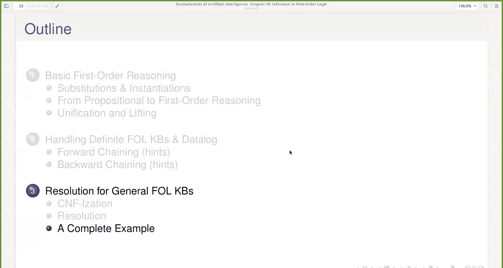

# 意大利特伦托大学《人工智能基础｜Fundamentals of Artificial Intelligence 2024》中英字幕deepseek p28 2024.11.22-CL22-1-CH09-ReasoningInFOL.zh_en -BV1uUkwYTEmf_p28-

Don't be ready maybe a longer ball。Okay， so。Just to recall last time。We started discussing the。

Automato reasoning for the logic for real。And a fundamental st is to the cization of formula。

 first order formula， which does not mean simply。Writing your stature， but。

But also getting rid of quantifiers， so CF in the first orderal logic。Is a CF where again。

 former is a conjunction of disction of lithal， and those are called closes。And， importantly。

Every lit is a quantified free atom or its negation and when you have a free variables。😊。

They are to be considered as universally quantified。Okay。

 so meaning that you may have a constant and and the function inside。Okay。

 so just to recall very quickly， I。What we have seen time， fundamental steps in synization。

 the first fundamental step is reducing everything into a negative normal form negative normal form have a role per se。

I mean，'s not only used therefore sization。They have a very important role in many。

 many other sort fields of logic and the automatic reasoning， However。

 negative normal form I recall is a form when a form is a combination of conjunction conjunction disjunctions and nes only in front of atoms Okay。

 so is a conjunction disjunction of lits arbitrary combination conjunction liters and again the。

And an FS is the use one one， so you first get rid of im and by implications。

 then you push negation onward inside by exploiting the duality of and or operators and electricity。

 also the duality of foreign and exist operators。Nothing particularly fancy。The key point。

 a key property of immigrationig normal formula is that every sub formula。

 which is different from our atom， occurs only with positive polarity。Okay。

 this is substantially the reason why people use them。Okay。That's a fundamental fact。

I recall that this transformation can always be done in linearly。

 provide that you use a dagger representation， in particular when to handle the ethanipse。Okay。

 nothing thanks。Very important。 although this may look less important。

 a fundamental fact is the standard to standardize apart variables。

 meaning you should not sense you are getting rid of quantifiers。

 so you should not have name clashes。Between variables。

 So you remain variable in such a way that you have only one instance of every variable。 Okay， so Su。

 if you have two instances here。It's perfectly okay that you have an existist with the same name and for for all two different with the same variables and even that you have an exist text and a for X somewhere okay because the quant variable are mute to some extent。

 but since you want to get rhythm， you rename them。😊，Okay， so for instance。

 inter typically are the same index x1， x2 or whatever。Okay。This said。He is the fundamental task。

Is always the hardest thing to understand from for many people。

 how do I get rid of existentially quantified variable？

The is sub to them with some particular functions。Also called sc functions。

 or column constant remember that you can see a constant with a zero art function as a zero a function。

 okay。Of。As a function of the universally quantified variables under the scope of whose quantifiers。

😡，The valuable course。 Okay， so if。You have exist why something and Y occurs under the scope of no variable or no universally quantified variable。

 Then this is early into a fresh。constantstant， which is called calling a constant。 Remember。

 always use fresh constant with fresh symbols， novel symbols。Okay。

If an existential quantified variable occurs under the scope of one forold。😡。

Or university quantify variable then。Or the you can get rid of the exist。

 but you have you substituting the Y with a fresh function of the variable x。Similarly。

 if it occurs on the scope of two variables， the function will be under a function of the two。

Varables， and even if you have in general alterns of for in existence。You look back under the scope。

Look。Which variable， which universal quantifier。AmI is this viable under scope of？

That's the question that you have to ask。 you， you are to ask yourself。 and then one。

 once you find this， you just make it。A sub every universe existentially quant with the a function。

 a call to a function over the variables under who is sc？The crust quant bottom it was。Okay。

 so this may look complicated。 but This as an intuitive meaning。 So if you have a for all x1。

 for all x2 for all x3， well exist y。Means that exists to why forever。For every combination of value。

 for every value it means for every value of y over axis。Excuss to me your wire。Okay。

So this means that the value of you give a name into such a venue。By the name at which is not。

A name extend alone， but this a name is a function over the value of axis。Okay。

 that's the intuition of a this process colonization due to Toth Sc。

 who was a very famous logician who invented it。ok。

And then once you have get rid of an existentially quantified variable， then you can drop。

 you have only universal quantified variable and you can drop the quantifiers why。

 because remember then when you have a universal quantified variables， the order by which。

Their call doesn't matter。So for Roex1 forex2 is blah， blah is the same as Fx2 for Roex 1 butda okay。

 so it doesn't matter to keep track of the order of those variables so once you have got rid of existentially quantified one okay。

Oh。And then okay， what you do is signifies propositioning with a remark， I want to stress。In general。

 this is perfectly fine。With。Oh。If you don't， if you stop here。Then this theoretically correct。

But if you want， as you see， use this for resolution， I strongly suggest you to do one step more。

Which is standardized apart。The variables of different clauses。 This is perfectly safe。 Why。

 Because remember that for all distributes with the with dense。So you can rename the variables。

 which occur in different clauses。Okay。If you don't do that。

 you may run into problems into mistakes with the resolution。So do that。

So properties of force in that preserve suchfi， but not validity。But okay。

Because scization is satisfiability， but not validity， okay？Not the equivalent you should prefer。

But the good news is that sat and preserve enttaillement。 So this is all we need。😊，Okay。

 so we don't need really need to transform a format into something which is equivalent。

What we need typically is to transform into something which is。Satisfiable， if only。

 if it's satisfiable or the perception intelligent。Okay。So so long嘅 so far。

I think that we quickly saw that also we saw this example last time， right？I think so okay。

 So just to give you an idea， beware of this。Beware of these when you translate pastor。🤢。

English sentences or genrera， metal language sentences into logic。

 beware of coordinated subordinates。Because if you don't recognize that a quantification is in the coordinate rather than a subord。

 then you may get bumped into mistake。In particular。

 everyone who loves all animals is loved by someone。This says， everyone。

And who loves all animals is a subordinate， which。Which is sort of says something about with everyone。

Okay， so the main fact is everyone is loved by someone。So everyone。

Under some restriction is loved by somebody。By someone， Okay， so。This says forx。

Something which restricts x implies x to one Las Y x，And this who loves all animal。

Says such a that to for all animal lovebs X， Y， but notice that this for is parked。Of the prim is。

 not other the world scientists， this is a very， very common mistake， you made。ok。😊。

Because at the end of the day， this means if you have a universal quantification。

 which is part of the prim of the implication。It will end up to be an existential quantifier。

Not to fight the formula。Okay。So。For instance， if you eliminate implication by implication。

 you push inward negation andcur what you have is for x exist Y animal Y and not loves X Y or exist Y loves Yx。

Which may be surprising。So particularly you may be surprised having this exist y here。No。Okay。But。

 this is。Something depending on the polarity， remember， beware of polarity。

This is getting the understanding well how Pla's work is fundamental in getting things right。

Is it clear so far， everybody。Okay， then okay， as usual you standardized variable before because you have the occurrence of two y's here。

 different ys， so let's call it way1。And then you scize。

 So you have two you existentially quantified formula。

 So this means that it you introduce to existently quantified variables。 Sorry。

 So this means that introduce to scholar function。 Let's be the effects of G X， okay。Okay。

 so animal effects and not loves FX， so you substitute y with F of x and here we should do y1 with the geoX。

Well， if you want， you can try also together some intuitive meaning to this function。

 okay so an animal unloved by x who is not loved by x or you have actually somebody of who loves Gx。

Okay。呃。And then when you do that。You simply to drop universal quantifiers， so that's easy。Well。

 this is not in conjunctioning because it's the end the door， so you rewrite。You were write。啊。

You write times with or。 So you distribute times with or。 And apparently， okay， this outcome。

 So this two closes。Are perfectly fine。 So this， what you have done is perfectly correct。

But if you want to use resolution， I strongly suggest you to do something more。

 which is not in your book。When your book makes a sort of me discussion about standardization of art blah。

 blah， my stronger suggestion is add。Make。Rename variables so that to close do not have variables。

 universal25 variables in。Why you can you can do that， yes。

 you can because these are implies the universal quantified variables， okay， you remember。That。

Universal quantification distributes with ends。So， it can be。Safely do that。Are we fine。Everybody。ok。

Again， remember。Do those steps executinging this order。Don't apply。

 try to do a place or drop university quant before。😡，Doing N andFs。Okay， why and standard why。

 because you can mess up with the polarities。After an a， some existential can become universal。

 some universal can become existential， okay， and so you do you may apply sc function to something which will end up。

To be free variables and not apply science function to something that the should。Okay， so。

Beware of that。 So do the moral is。😡，Do that。 Ex disorder。By the way。

 the first year I taughted this course。I did not add this。I didn't see to。

 to make the remark and dinosur。The first round those exams are suggesting me to add this slide because many people made this mistake。

 okay？So we are war。Okay， so this was an example of exactly this case of school imization。Okay。

 I think we got here last time， right？ok ， so诶。I introduce another example here。

Which is not a definitely closes。And again， is。Semiooned by Ra no。

I leave you by time Ill let you think that well， what I used to do is that leave this。Typically。

 I ended this a class with this。Okay， so that you had a time try to formalize for the next time。

 but last time I didn't have the time to propose this。So。😡。

Try to formalize and signifies the following。Example。

Everyone who loves all animals is loved by someone， which is actually the scientist that we saw。

Anyone who kills an animal is loved by no one。Okay。Jack loves all animals。

Either Jack or curiosity killed the cake。Who is named tuna？Did Kioski keep the cat？

Of course he a joke based on this curiosityos to the famous child motto in the USA。诶。So by the way。

 by your intuition， isn' this the case？Can you deduce this， forget， first of all logic。

Think as a human being。So can we deduce the cr kder cat？Yes， okay。

 the intuition works more or less like that， okay。😊。

Everyone who loves all animalss is loved by someone。 So Jackie loves all animals。

 So Jack is loved by someone。So。Anyone who kisss an animal is loved by no one since Jack is loved by someone。

 You cannot have kids anymore。 Okay， so either Jack。And the Jacobque indicate。ok。But either all。

 okay， but since we know that， okay， there is an implicit again。

 there is a same implicit notion here。Kathy is an animal。Okay， again。

 remember that you have to add the formalization， okay。

 because when you have a sentence is like that， there are some implicit knowledge that the human being have。

 which you have to add。Okay。So either Jack of curiosity the。

 but we know from the previous lecture that Jack cannot。

cannot kill animals or cannot have killed the cat。Okay， and at the end of the day。

 so so this leaves only curiositys to have killed the cat。Okay。😊，Okay。

 so intuitively this is intuitive deduction a little bit sophisticated， but to some extent。

This can be done， okay？Okay， so now let's get。 so keep this example example in mind， then we see。

How to do general resolution。Okay。Remember Bo resolution。

 Bo resolution is something which you have set of lits， sorry。

 I have two clauses and you have two closes and in the closer you have a rent。

So you have a literal which occurs course positive and another in one clause and the opposite the complementary literal which occurred in the other clause。

 Okay， and the outcome by margin is a close， which is lots of margin that closes dropping the result。

😊，And possibly avoiding duplications， emerge duplications， okay？Remember。If not。

 get back and look it back。Now we are in now we are in。You have first order closes。

 so something is one， so very two closes where you have lit in which you have the free variables and an arbitrary returning number of constant functions。

 okay now。Suppose you have。We have in theses， there are two。Lieral， L I and MJ。Such that。

A lie and M J。The negation of one is equal to results with with the other results means。Remember。

 sorry unify， sorry， unifies means that exists most general unifier。

Data such that La data equals not M J data。 Remember that unifier is a variable to parameter substitution。

ok。And is's the most general one。Meaning that。呃， if the历史。

The notion of more general is Tita1 is more general than theta 2 if。

You can build theta 2 as theta 1 plus some other datata 3， okay。

 so you can substantially means that it it instants much less variables。

And remember that the MG is a unique model of a evening。ok。So you have only one MG mod okay。

Is it clear， remember that if you not， go back and see it？Okay， if this is the case。So是否则。

This is the case。 So exist。A unifier， almost genifier data。 such that。L1 Tita is。

Is the same as not a M1 M J de。Okay。😊，Then what I can do， I can apply T to both clauses。😡，Okay。

 if I apply theta to both clauses， I have L1 tita and MI rat Tita， so I apply Tita to all the litals。

 but then I have two clauses。Which have inside them have one literal。😡，And its negation is。

 of course， in the other close。So that can apply Bu resolution。And Bu resolution means。

Means that I can get rid of L I mirror the two clauses and get get rid of Eli J and M N A。

 so you can apply T at all。The itita， I just put the guitar at the end here。 Okay， and then you。啊。

You apply to all the litals yeah， I mean notice that I always implicitly assume that duplicated liter are automatically removed Okay。

 so if you have some common literals here after the resolution notification。

 you have some other identical lit， you simply take one of them。

W chacular occurs much more rarely than in the first orological than in Bo。Logic。Is this clear。

Is okay。Okay。So， let's make an example。The usual one， not main Socrates， not main X or mortal X。

So every man is mortal in the So is a man。Then what you can do here。😡，Okay， there exist 1 M U。

The one which substitutes x with the Sos。Such that main Socrates and and not main Socrates occur in the formula。

We need to close this。 Okay， don which you can apply。 So after you have a applied the data。

To both when you not that apply teacher to this doesn't change anything。 Okay， you。

 you have not men Socrates or motor Socrates， which。

Proropposition can be propositionified at producing mortar surfaceness。Okay。Is this clear？ok。Now。

 this leads us to。Gene general proof system。So in order to prove。

To prove that gamma entails alpha in first logic。Where gamma is a set of clauses and the Naal is symized。

You， to convert the gamma and not alpha to sins。Okay。

And then you apply repeat delivery resolution ruler to the pair of clauses in in gamma and not data。

 Okay， you iter apply them。So every time you can apply a solution， adding in new clothess。And dealer。

 either。Three possible thing can't happen。You generated the empty clause。😡，If you remember。

 you generate the MP clause means that you have the original set gamma and not alpha it taste false。

 remember that the MPCl means false。Okay。😊，So gamma and not alpha test false is the same or saving that gamma in alpha。

Okay。So you you are。This is the lucky， the lucky one。😡，呃。

A second one is that no more resolution that is applicable。So you end up in the situation。

 the scenario when you have done all you could。You could try to resolve。

 and then nothing more can be resolved。 And you didn't。呃。Where this issue assumes。

Assume that the first step it hasn't happened， okay？Okay， you you have。So no more social step。

Eappens， so this means that。You were not able to generate a contradiction。ok。

Which means that the set of clause， gam and not alpha is。Is it satisfiable？Okay。😊。

So that there is no way of finding a quo。Doesn't it？Okay。

 this is in general not likely and you have no guarantee tool。

If this is the case that you end up in this situation。

What the most what very often happens instead is this one。

 so when you deal with semideidable things or in general any be complete or and hard problems。

 you should also always consider a third option， you exhaust the time or you exhaust memory。So。Well。

 not is that。Memory is not that unlikely， exhausthausing memory is not unlikely because typically what you do is generate a huge amount of clothes So if you don't have any control way control way of doing that。

啲别嘅啲。Things blow up。Its very so the typical problems that firstdo the improvers have is that they tend to blow up in memory。

Okay。Just a hinter。 I have。I strongly suggest you do if I give you either if I give you some exercise to solve or in general。

 if you have。To to solve something on my hand or if you are going to implement some strategy。

In a solution。Always apply a solution to unique closes first。Okay， so when you can。

So if you have to choose a binary to pairs of closes。To which apply something？

Always privilege Uniilos Angel general， always privileges smaller。 If you don't have a unilos。

 always privileges smaller closes。Why。😡，Well。Unnioses。

 every solution step we do you Uniilos produces a closer， which is shorter。

Stealy shorter than the previous one。Because if you're a solve closer with the key lital arts with the unlo。

You'll obtain a clause， which is more informative。At bullly more informative， okay。

 which has k minus1 lit， so the smaller the closes， the more informative they are okay。

And then more likely you get your bump into into。Then simply close， okay？In Jara。

 try to resolve to resolve。To make the resolution types， which produces the smallest gloves。Okay。

 in particular try to reduce the size of clauses so if you have units do apply with units if you don't have units or at least try to merge to resolve shorter clauses okay because they are more informative。

And they are more likely to produce unique clothess， which again， you can reuse for。ok。😊，嗯。Yeah。

Interestingly， for complete deite clauses， Remember the cases that I've mentioned before。So。

It definitelyite close。 So it means data， prologue， and blah， blah， blah。Remember。

 these forward checking， backward checking and chain， blah， blah， blah， Okay， these are not。

Can be easily。Simulated and by standard first all through progress。

Why if you decide that choose positive unit。😡，Closeses first in a def search schema。

Then what you have is a forward checking。Okay， why is that， Think about that。😡。

If you have a deite clause， you have a list of a negative clause which represent the premises and one positive one which represent the consequence if you're sold with with against one positive literal。

This means that you reduce。The list of the premises of implication。Of there。

Is it clear what I'm saying？Which is exactly what。So if you do more with these laws substantially。

 if you do this multiple times。😡，So you take a deite close and you try to。Unify against Uniiclos。

 This means that， you reduce progressively。You fair the goal of the implication。Okay。

 so substantially these mimics of forward chaining。

If you should start with the negative clauses and within 10 minutes among then you privilege you privilege unit ones。

 what is a unit one is a God？A unique negativety closes a goal。Is the。

It's an in of what you are with definitelyite closes， a goal is a unit latereral。

And a negative uniler sorry。Okay， so you can't do it you。If you respond with that。

You end up having a disjunncction negative litals if you resolve one by one。

These negative clause again not imply the clause， you progressively reduce those goals and you progressive have the premises of those goals。

 you see that you are mimicking the idea behind backward training。Okay， then of course。

 you can have more precise strategies。Okay。😊，So。A solution is ref complete in the sense that if there is a sub data such that。

Gamma ens a theta alphapha， then it will return Tita。If there is no such data。

 then the procedure may not determine。ok。What typically happens with the first order of your improvers is that they。

Have very sophisticated control strategies in order not to。

Cause a huge amount to produce a huge amount of clothes。Okay， because of course， you。

 if you apply pair wise or lit which can match， you can in general。Blow up。In Sa。

 think that in general。Every， if you are。Every farwise combination can。

So you may have a qua number of pair combinations of clauses， okay？

So every every step you can produce up to a quadratic number of closes at every step so so you can really。

 really enlarge the size of。Of the closer database。Out of control。Okay。

So consider the the example of Colonial West。 Okay， so I record it。Well， the the user star， okay。

 prove that Colonel West is criminally given the previous formalization， okay？Okay。Just to recall。呃。

哎。Okay， I don't really do the the。The representation。 Okay， okay， you you。

Not is that this was a data so。What do。What we did before。

 which was just to getting rid of the only applying the。

Exential instantciation was nothing against than colonization。So substantially。

 if you apply colonization to some data log， so when you don't have functions。

 you don't have and you have don't have existentially quantified variables under scope of US quantified variables。

 what you produce is just。You just the constant， scholar the constants。Okay。

 scization just produces strong cost， which is actually what existential。Isttanciation does remember。

 remember that anticipated， look， existential instantation is nothing else that a particular subcase over a more complex process just cause colonization。

Okay， so。What we obtain。If you take all these implication here。

threeview you obtain exactly the example that we've seen before。Okay， so in particular。

 is a crime for an American to sell weapons or reduces not American X or not weapon Y or not to style X or not sell X Y or criminal X。

No no has some missile reduces you all no no M1。 M1 is a skull constant represented the missile Miss number one。

 So it's the name。And one is the name of the missile we are speaking about。We give it a name。

 So you know he has at least one missile。 Okay， let's give it a name， call it M1。Okay。

This is colonization。U。All the missile owned by No were sold by Con West， okay。

 this reduces not missile X or not own no x or cells West x no notice dotted the standard pattern negative details or positive lit at the end。

 which is staian implication an implication between atoms okay。Miile weapons again。

 this is implicit beware when you formalize that you typically have to add some of your implicit knowledge。

Okay me说 out。If one scientist speaks of missiles and the other speaks of weapons。Okay。

You know that the missileile is a weapon。So you have， but you have to add this， otherwise this。

So there's no way that there resolution order。But I saw the missile with the weapon。Okay。

' just an resolution solid， is just a synthetic。Recognize as some predicate。

 identical predicors and unifies them。 Okay， so it's used that to have to add。3 beyond。Axioms。

Like not a missile or weapon X， Okay， not missileile X or weapon X。 Okay， remember this。

An enemy of America count as of style， yeah same as before， one scientist speaks of all styles。

 the other speaks of enemies of America well， and if you have American these enemies of America can play。

Means hostile， of course if you are a rational of N Koreans， this is not the case， okay？

West is an America America West， the can own and non America。 Okay。

 so you have this set of definitely clauses， Okay， of simple clauses。And then you can re them。

But be smart。Don't do silly silly things like trying to merge like。

So don't try to merge the known unit clauses。In this case。

 just always match with with unique close in this case， you do something which is very similar。

To some extent， this is a mixeder strategy， but this is looks very similar to backward to backward analysis。

 Okay， why you start from the goal， you want to prove that West is a criminal。Okay。

 so you would to solve。With the only one who has a criminal。As a positive， okay。

So this means that you obtain these clause here， not Americans in which you drop criminal。And。

Ex sub with the West。Okay。X， and here here is absolutely West。 Not is the disclose as。

This goes as five elements and now this goes as four lit okay。So you have reduced the premises。Okay。

 now let's try to see， okay， this is a negative one。

 So let's try to satisfy all this notes that this simply the list of sub goals。To survey that okay。

 and then you have to unify or want to be one。 Okay， first of all。An easy one。

 not American West or blah， but I know that Western American， Okay， so I get rid of that。

We enable not weapons。So I get rid of American West，3 lit now。Okay。Now。

 is there something that I can infer automatically。 Well， weapon Y， not directly， but I can。

 if I don't have actually a direct a direct unit to fold it， but I can， if I don't have any better。

 I can unify this with two。 if you unify if you solve a close with the two。With the two clothes。

 binary clothes， you keep the same size。Because you lose one electron you get that you want。😡。

Susstantially哎。I want to。To notice。The effect of these resolution steps。

The federal distribution resolution step is that。You substitute a weapon with the missile。😡。

What does it mean？The second cause is more informative than the first one in the sense that it has a prim which is more precise。

Says missile。So it's more a jail because not a missileile， okay， so litigation is not a me。Okay。

 a missileile。Okay， this means Miss Y and cells where implies hostile one。 Okay。

 so you have made the prime is a little bit more more more restrict。 Okay， more specific。

Okay I'm not a reasoning for so I'm instantiating this general rule to a more specific rule so that I can match it with the missile now I'm ready to match it with the missile X okay and then I drop the lit missile X and I substitute with every instance of y with M1。

Right。Okay， now。Now I'm mist the problem because I don't have anything with style and I don't have anything。

I have no unit with the cells on a style Here you have two choices。This is one possible one but you。

Either a Soviet against hostile or a so against the sad。This is taken by your book。

 I would have done the opposite quite sincerely I would have first so why because this is three lits。

And this is two litals。So personally， I would have reverted in order these resolutions。Okay。I mean。

 this is correct， okay， perfectly correct。Okay， just as a strategy。

 I would have since I had two chances he added to resolve with against three。

 three literal clothes in order to get to resolve cells。

 or the other chance was to resolve with two literal clothes， I would have done the first。This one。

 first。Okay， however， that's perfectly fine。Okay， now so you you get rid of cells and you gain notice that this case。

 you resort against the three close， so you increase the size。

So you pass from a two close to three closes， so miss is M1。

Or not so not mis M1 or not almost no M1 and post diamond1Lucki now these two literals here can be easily resolved against a unit1 you can do this in any order you may like okay so you get your resolve mis M1 with mis1 great and on no M1 or no M1 Okay fantastic so。

啊。So you get the point where you say not hostile， no， no。Now you say， okay。

 I don't have a unit which says O style。😡，But so I have an implication of the style here。

 so I solve it against get and they get not an enemy known America。ok。诶。Okay。

 then what you do here is。At the end， you have the two lits， which are。Exactly one。

 the opposite or the other。 And so at the end in fair folds。

I can give you by exercise to see what happens if you when you are here。

You resolve with against your style。Okay。But you see iss very very。Okay。Is this。 So you see。

A can also。Give you by exercise。Videdia of selecting positive unity closes first。😡，Okay， you have。

 So you start resolving things against positive。So you don't start from a goal。Okay。

 but you start for instance as a ER， you start first as a Soviet this against the American West and then with weapons。

 okay， I don't have a weapon， but I have a missile and so on and so forth， okay？And you see that we。

Okay， this selecting negative closer first is。For a backward chain that you have is similar。

 but is not exactly that。What you can do is to mix it because the real important thing。

 So water is smart。As smart would do。It's not be driven by some strategy， but let you say， okay。

 every time you have a unit， you resolve it。Let's solve it you in the first， okay？Okay。Okay。诶。

I think we can have a break now and get to a second example。

And let's assume that third of the campaign。Checkck。Okay， everybody。嗯。不说。对。alreadyready did this。Yes。

啊。对对。But。Okay。就是8辩。对。Yeah。So。Which。No。对。So they we发。可出了吗？Yes。But。Thank。不。对。Yeah。No。Yes。

They already start。Okay， so。嗯。Again， let's recall the。Who else to give the cat sample。诶。

Unfortunately I did not give you the time solve by yourself， but you can check this。

 you can try to redo that。Okay， we know the first one。 Okay， because it will， are they seeing this。

So the everyone who loves the O animalsmo is loved by someone can be written as in two clauses。

 animal F of X or loves G of Xx， and not loves X F of X or loves G Xx。Okay。

Anyone who kills an animal is loved by no one。Okay。

 I leave you by exercise to see that this is substantially。啊。嗯。This leaves no sc function。

 but everything is universal quantified。 You can think of this as a forex。诶。Nice who kills an animal。

Now， I just wanted to point this out。Anyone。So for all X。😡，This scientist。

 who kill an animal is something which says something about this accent。Okay。Is loved by no one。

 But now love by no one means no one loves it。 So this is a universal quantification okay。So so far。

 all the universal quantification。Then there is the subcase who kills an animal。Remember。

 this is a premise， this is something which qualifies x。Okay。But now， in this qualification。

Kiss some animal。Okay， so the prim is。The animal is existential quantified。

 but since this is implied so it isn't the premise。

 then it will after scmization will become a universal quant。So apparently， these two sentences。

A some senior。 Okay， but the note that the premise here is universal。

And the implicate is existential， so this is existential Scotland， a universe in Ne premise。

Becomes an existential。 So two columns here。In this case， here you have。

One the implied sentence is a universal。Okay， no one。No one is in yoursa means everyone doesn't。

No one remember， no one does， it means everyone doest。Okay， so Unisa。

And then here is an existential case some animal， but is an apprentice。Okay， so we've become that。

A universal。 Try that， do that and see。So again， bewares for。

When you translates into English synthesiss into intertlog。Jack loves all animals， Okay。

 that's an easy one， not animal X for all X， animal X implies loves Jack X， so that's an easy one。

 okay。Either Jack or Cur was to kill the cat。With name to Sustan this， this is coordinate。

So these are substantially two sentences。Okay， so means keys Jack tuna or keys curiosity de tuna and tuna is a cat。

Did curiosity keep the cat， Ki curiosity。Tna， okay， the cat。 Yeah， notice it again。

 The cat imp me does not mean a generic cat here is the cat。说明度呢？The cat is tuna。

 so the question is really crs kill the cat。 So the goal is to kill scs the tuna。

So you negate it because it's a goal。Okay。Okay。Well， no， this is so this is Ama。😡。

This is the formalization of your book。Question。s。好。Our goal becomes we。You rene it。Yeah， because of。

开。Now， the point is we want to infer kill curiosity Q tua。

 So this means that we negate it and they check that overall， combined with this。

 this is inconsistent， okay。You can always， you can notice that you can also do the opposite so you can drop this。

I can' ask you， okay， you fair。Okay， so when you do you want to do infer sampling resolution。

 you can do two things， add the goal and the negd goal and check the folds。Or。

Do not add the goal and try to confirm the goal。I will suggest the first one in general as an attitude because the goal tell information allows you to resolve the goal is a unit so it can allows you to gives you a direction of the search okay。

In particular， if you are using an automatic reasoning tool， gives you a direction of the search。

 so you know your goal is to to find something which kills you curiouss the to them。Okay。

In then end you will need something which resolves against the key curiosity to。Okay。Okay。

 now I want you to。 now， let's so this is the formalization that your book does， okay。

Oh can you read it a little more， Can you read it？More or less， yes。Okay， so。Not kill curiosity。

 Okay， so here， for instance， the obvious thing is not here you have a goal， for， well。

 you can do that in any order you like。 The typical thing is。Regardless。

 you want to go for or backward。When you can try always to resolve with units， okay。

 because it allows you to simplify things， you can do other things， but you may end up in much。

 much bigger resolutionsolving resolution steps， okay。Okay， now key scoos the tuna。Kiths， okay。

 I wanted to see that we pay if you pay attention。 now， keys curious de tuna。Okay。

 these easily resolves nuts or not keys K， meaning it easily resolves with keys Jacktuna or keys Tiuna。

Okay， so this means that your new goal now is not kills Jack Tuna。 sorry， It kills Jack Tuna， okay。

Okay。Now， well， you don't have it directly。Something， okay。

 here you can do either solve this with not key X tuna， and then you go back or you can go forward。

 Okay， so this ist time。 you should try。To resolve with units as a strategy。

So you have an obvious resnt which is tu is a cat and cattics implies animal a。

 so you say animal tuna。ok。Now you have laps Y X or not animal dead or key， not kill X died。

 you can be unified with animal tuna。 So this means that not laps Y X or not kills X tuna。Okay。

 so not yet this in instantiation substantially， right？The all all these。Of this sentence。

Now you're ready to resolve the keys jack tuna with the not loves X Y X and the not keys X tuna。

 and you have a not lovely Y X， So not the loves Y Jack。Which is Su she says， nobody loves Jack。Jack。

Which we know is not the case because Jackie again is somebody who likes animal so is loved by someone。

 okay？Now， let's see the other side。I want you to pay attention to those steps。Not loves X。

 F of X or loves G O X。 You resolve this with animal X and loves Jack。

 and you fair not animal F Jack or love G Jack Jack。 Okay， so you were able。 so here is not a unit。

 but you didn't have a unit here to resolve。 So you， you generate it to close。

 But now not animal F Jack resolves with animal F Jack。Okay。

 and the infer allows you to this means actually is intersed with Jack。are you getting No。

 laughs G Jack， Jack。So this means that this can be resolved with Y with somebody with the GJAC。Okay。

 so this can be resolvedd and this ends with the folds。Is it okay？This is okay。 Que to everybody。

 Everybody think that this is okay。Yeah， you may say that is it okay。

 is it from your book so it should be okay， no， this is wrong。There's a mistake in this resolution。

Okay， so find a mistake this is from your book， find a mistake。Oh， I understand it。

 can you read first？I understand that this is me now。Not to be。

I may put this into slide different slides So this and get the picture big gar。我。On the first。

And the first first of all。Yeah。😊，好。Yes。This one。你第二个说的。Now， this perfectlyified。

 this one is perfectlyified。Yes， please。Which way， sorry。The first of all， yeah。Sorry。Yeah。😊。

There this one。Oh。Which solution are you speaking about， which other solution that you're speaking？

This one。Now， this is perfectly fine。This is just a purely bulloleion resolution。

Kiss cures tuna against the kids resolution against Ki Jack tuna。

So substantially we says if you want to prove the curiosity kill the tuna。

You should prove that the jacket did not。K where there a goal， So you approved deation of it。

this is perfectly fine。o yes， sorry， don' see you sorry， yeah。Which one。Where is it， sorry。Yes。啊。啊hu。

😮，Okay。So what what have we done here？Now， so Stan， now this is。

 I would say this is correct because not animal。 we are so of animal with animal， right？

And we simply associate X with Jack。Okay， if we do that， we well， here， we obtain nothing。

 and we have love Ge of Jack Jack， which is fine。 Now， this is fine one。 This is correct one。

I we have。This one， you see。Yeah， that's the point。Okay， so you say these are a solution here， right。

 yeah， indeed。What are we。Doing loves Jack。 So the result is loves Jack。Not loves X， F of X。

 but in order to do that， we have choose to say X with the jack。Oh。Jack X is same with Jack。

 but X issue is the same F of x， no。We cannot have this。Okay。Good catch。Now， what was the problem？

What causes this problem？What was the mistake Ras and Norway didn this？Youive the example。 Yes。

 please。是。They didn't standardize apart。Okay， the junior standardize apart。 Okay， so indeed。Okay。

 so I forgot， is aCF resolution correct， is the ref below or correct， the answer is low。

There is a missing standardization apart。 Okay， look， look at the the change here， if I click。Okay。

 you may notice that I left some blank spaces here。Somewhere。Okay。Because we have plenty of access。😡。

Which are not。Interesting ones。 Okay， so you should。

 you have a different closer with the X variables。We should not do living them， so we rename。

For instance， this one， so this is the first axis so you can rename go to this。X 1， this x 2。

 you this is S 3。 Okay， actually， we all need only one。 So this was only one who occurred here。

 Probably you don't see it。But here there is a slight change from here to here。

And this is to index one here。Is tiny， you may not see from the okay。

 but if you look at those slides there are okay。This is a light evaluation。Now。

 this resolution instead makes perfectly sense because we have it。Ex。Resola with a letter jack。Okay。

 and the， the sex。Here results with So this x1 here resolve with F X。ok。

And now this is perfectly applicable。You see this？Okay。Soう。冇啊。

Do standardize apart before doing a solution。Okay。😊，Okay， what are， okay， there are some strategies。

Okay， they say as I said I mentioned before。诶。There are plenty many strategies。 Okay。

 if you know these。Large bibliography of papers。In order to。Describer。

Describe the most efficient resolution start because， know， resolution is very general。

 and it very much depends on how you pick the closest to the。Okay， I just invite you。Davies。

Do a stupid thing。 Try to resolve always the biggest process。With each other。Okay。

 you immediately realize how big。TheThe resolution gets。 and even in the colon and West。

 if you try to resolve the Os， if you leave a unique resolution as the last step。You may get a much。

 much bigger growth。Okay， but thank you much。 So notice again， I insist that these are。多 examples。

Okay， a natural。Proble coming from some industrial verification step can have hundreds of thousands of clauses。

Okay。So you can imagine that you need summers smart strategies or you cannot afford to generator。

The answer of， of clauses。Okay， there are some strategies which are adopted， okay。

Just a a hint to them Okay， in general， the typical attitude is called saturation calculus。

 and the suggestion means you start from a given set of clauses， again。

 implicitly universally quant clauses。😊，And you progressively resolve pairwise all those which can be。

Pvis result in order to obtain the the new update the new site and one okay。

Then then you take all in no one， you can apply the。The new ones resolve the new ones。 and you。

 you'll get an N2。Notice that you should use smart tricks in doing that。 Okay。

 so you go and go and go and go and go and go and， you go ahead。You go ahead in this way。Well。

 under some restrictions， so you don't reduce the same resolution twice， and blah， blah， blah。

This is revolutionationally complete in the sense that if。If the regional site is inconsistent。

 then sooner or later。有了。You a bumper into creating the new clothes。Again。

 first auto logic is semi decidedidable。 So the opposite doesn't apply。 So if this is not。If it。

 if it doesn't， in force， there is no guarantee that you will stop。

 You may end up go ahead to infinite。 Remember， the problem is always the fact that you may blow up with the functional translations。

Sure。Yeah。Typical problem。 Re rule is very proific in the sense that you can。

generateenerate a huge amount of causes， most of them completely no， completely irrelevant， okay。

And also， it can may generate the same course in many different ways。

People have investigated a lot of arrest to， lots of tricks to to do to guide drive a resolution。

 Okay， so the idea is， we have a rule， which is resolution rule。 Try to。Devisice strategies。

 how to infi。Well， one popular one is order resolution， which says so you defined a。Esta ordering。

 so。Something a criterion by which for every pair of possible。Atoms， you may generate。

You can set an order。You can decide whether this come before or after that。Okay。

So this the cr by which you say that a na precedes another matter， for instance， you， first of all。

 you'll give an order in between the prediccateates， okay。

And amount predicates given the same predicate， you give an order between functional symbols and then you may decide that for cost comes before application of functions and so on and so forth。

 okay， give some criterion up to you to which you one by which you probably pairs of atoms。

 you can always say whether one comes before the other of each of asset okay？You decide the cr。

 so there' have been。Quite a lot of literature in describing what is the master order to do that and then。

Resolve also always maximally glass。 So always。 so when you have there。

The choice of the pair of literals that you can resolve always take the path which are。

 so take the one which is higher in the order and with the second。

 which is and amount the possible lit which resolve against it， the one which is higher in the order。

是。You get this， No， okay， so you can order every apple。Okay， you have a criterion， whatever。

 which tells you which order which for every pair of atoms， no matter how instant is it。

 you can conclude whether this， who comes first。Ins the order， okay？Well， I mean。

 we have plenty ordinary criteria in our life， I think through the sography。

 what is called alphabetical order。By which you all the names say。In list of people。Okay。

 so if you have a list of people， you can order them according surname first and then first name second。

Or we can order them by buying。Let's say fiscal code or whatever。 Okay。

 you have a criterion by which you can order。Same for atoms。

 so suppose you have a curriculum by which you can order every pair of atom。

 let's say and every pair of different atoms， you can say whether this comes first or this or the other comes first okay。

😊，You a crino make which you order。So the idea is that when you have to pick。The big。

The next pair of a resolution。Take the highest atom。The in the order。

And then among all the and look for the。For the highest attoman and find the highest one which resolves with it。

Okay。So you sort oflygaic order， will be by the first rent and the second rent。Okay。

 so this is a cr which produces some good ideas。Another。techniqueique， which is quite popular。

 is what is called the hyper solution， and deals with the。The for of。啊。

Of distinguishing between positive atoms and negative atoms。And we can see， we distinguish。

From clothes， which are always。Always contain only positive literals with those which ever negative literals。

Okay。We call the one with at least one negative literal， we call a nucleus。😊，And the。啊。Well。

 with some strange reason。Okay， this are not a typo。Okay。

Nuci is the pura is the Italian way in English text。

 they are called a nu in the in English text so so this is so they are not written as nuclear as we say nucleus nuclear okay。

 this is probably because of invented I don't know who invented this statue。

 but probably he or she was an Italian so they are called the pura is。It doesn't stop， okay。Lookucly。

Those ways which have at least are negative literals and electrons。

 those with positive literals only。定得你啊。Is that general strategy is that a resolution can occur only among one nucleus and the one electron。

A。So substantially， what is the intuition， you take an electron and try to get rid of her or his or her positive negative lits。

Okay， so if you do that。Okay， so if you think about that if you want to solve them。

A nuclear with an electron。 Okay， you get rid of。At the end of the day。

 you'll get rid of one negative interval。From the electron， okay？So if you exchange in the electron。

 you' exchange one negative lit with the sum positive electron。

So the resolve and if you take it we respect it to them。If you consider the nucle， okay？

At the end of the day。After the distribution resolution step。

 the nucleus will have one negative lital less and possibly more positive litals。😊，Okay。

So video is that to repeat this iteratively until you get an electron。

 so you get rid of positive literals。😊，Okay。You see this。In general， you have the some。

You have something which has positive as some negats。There and one by one。

 so if you resolve a nucleus against an electron， we will have a closed。

Which has one negatively lit less than the original nucleus。Okay。Plus positive， some positive。

It draw more。 Okay， and then again， if you resolve against this against against the positive。

An electron， you have another。Another， one negatively little less plus the positive and so on is a fourth。

 okay？Until you get an electron。 So the idea is that progressive you getting rid of。Of negative lits。

Well， when you do that， sometimes this represented。

 so the resolution of one nucleus against the sequence many electrons is written as one step。And Su。

 you can see this as every negative literal in the nucleus is restore against the one positive lit in the electrons。

 and then you have the merge the result。诶。I， frankly。Don't know why they are called out data。

 But my conor is that this is。Sort of。Me Mehor with with。Chmiry and the ionization。Okay。

 so in the sense that you have a new clone in order to compensate。The charge of the nuclear。

 you need many electrons to to make to deionize it。Okay， now this is my conjector。Of his name， okay？

So and it can also be considered as am。As a way of memorizing this。

 so for nuclear you are the electrons。In order， you know that in order so nucleus must be in order to to balance this car needs some electrons。

 Okay， so ion one ion。Compositive ions needs acquiring captures electron from around in order to make make it。

less事。To reduce his charge， this is my conjector， but I don't know really the real reason for that。

Okay， so exercise so the example of colonal West using hyper resolution strategy。So for example。

 curiosityos and tuna using hyperreposition strategy。Okay， I leave you this。Example to。Well。

 I can give you a complete example， which is not very much different from that of tuna and Ki the cat umbrella。

I think this was something that I gave to an exam。 if I remember some years ago， okay。

So consider the form four formulas。For X for Y tried Y and loves X Y implies exist Y loves Y。

 So you see there are some similarity with some similarity with the。

 I think this is a simplified version of the tuna in the cat one。Fex tried X and loves Markx X。

 beats Mark Paul or beats John Paul， tried the Paul and F X X Z Ch Z and beats X Z and for Y not loves Y Z。

Well compute the synization of gamma， scizing and standardized variable。

 and write a full resolution first of the query beat。I just wanted to point out that。

A resolution in France is not a refut。Re solution infinite is something which you infer beats jum all。

 Okay， refput is the one in which you negate beats jumpm all and improve falses。 Okay。

 so just when you want， just a tiny。Valuation or。Deinology。 inference means you something。

Refuute means un faults。It particularly by navigation of the gold and the ref field。Okay。Okay。

 so again。This is very similar to the。This step here is very。

 very similar to the one of curiosity in the cat for all。 again， child here。

The funny thing of child here。Is that is a。The fur all is part of the implicant。Okay。

 so course with negative polarity。Beware of that。Be careful。Right， this can end you。

If you don't realize if you don't analyze the sentence in English。

 you may end up producing the wrong first auto logic formula。You get this。So in particular。

 you have to remember that the scientistss okay， so this is already obtaining infial logic。Okay。

 notice that again， you write an implication， you push navigationation in。

 and then you have to close， which are very， very similar to those in the previous case and here the next one is this one because we didn't say this explicitly remember。

Bom。This is sort of dual there， so here the existential quantification is in the premise and the universal one and the universal one is the implicate。

In the consequences， so this exists here， so if you write the O， this imagegator exists。

 which gets becomes aro dead。Okay。Which means that at the end that this is a completely universally quantified formula。

No column functions here。Why， because this implic for all here。

 so this exist here occurred negatively。Okay， this means that。And exist。

 which of course negatively ends up to be a for all。

 a for all which of course negatively ends up to be an exist。And those escal。Factction， okay。

Sorry if I insist， but beware of polarity。Okay。Okay， so and then when you。Well。Again， you can。

Do whatever inference you want。 So remember when I say infer。😡，Write a resolution influence of this。

Of course， you may have many possible solutions， Okay。

 becoming depending on the order by which info or even different ways， sometimes。

I found out that people solved the problem I gave with a different。Solution， meaning。

 not only meaning resolving different order。But there were more than one way to group of action to refer it。

The point is， you get the same result， but you may take less half page or four pages to fill it。

 depending how smart you are。Okay， so for instance。Here sorry。

 you have to go back and forth here to see， but you can infer this one。So you see that for instance。

 you can infer。These two。ok。Up to you So to prove the way of doing this。 Okay。

 so you can for infer this these two here。And de a child F of Mark or loves Ge Mark Mark。

And then you fair this one。With number 6。 So one6 is the one which I just inferred。

 and so on earth is really hard to follow。My suggestion is try to do this in different ways。Okay。

 and。Apply different strategies。My suggestion is always try against units。😡。

And when you have more than one which ins against unity。Do that。

 which the one which produces the smallest clothes。This is a general rule thumb。

 is is not always the best but in general is a good rule of thumb。🤢。

If you don't have it more specific。Okay， I think that's it。I think we can close it now。

 maybe I I will tell Pauloo， if you can anticipate or we can well。YouYou have a longer interval now。

 and I call Paul and then hell tell you when you start。Next week， so these signs the first or logic。

Next week， we start with planning。Which is different from application。

 But as you would see lots of relation with the first logic。 So we'll use。

Some sified a version of the story logic to。To perform a very important task in AI。

 which is planning， by the way。Will just scratch the surface of of a planning。

 There is in a dock course， like automatic reasoning is just scratched。一。

There's a course autota reason in which you see boomno is in much more detail。

You you see what actually people do nowadays？To solve the industrial application auto user。

 which is a satisfiability model of theories， which is like。A variant of atoologic， but linking them。

By a fixed interpreter with the。By you introduce some fixed interpretations as symbols of known。

Someub theories， like arithmetic。Arays， big vectors and de symbols， strings。List data style。

 So the and associate。The logical reasoning with the adoc procedure， which is solve the specific。

The specific theory， and that's a satisfiability model theory， and which is that the。

The $1 billion market application okay？Because this is what Intel Microsoft， AWS， blah。

 blah used to verify that code。So encode everything to logic and run an listening disorder on top of that。

Okay， so that's automatic reasoning。Next time will， as I say， we'll go through planning。

Emplaning is another。Real world， very， very important application。

 And we see that the formalization planning has some。Strong relationship with with logic。

 particularly with the first logic， in part equally the satisfiability model of theories， okay。Okay。

 thank you。 And okay。I let you to Paulo。 and then I call tell you Paulo to come for。 will， well。

 youll have 20 minutes of a break。Oh。Yeah。

