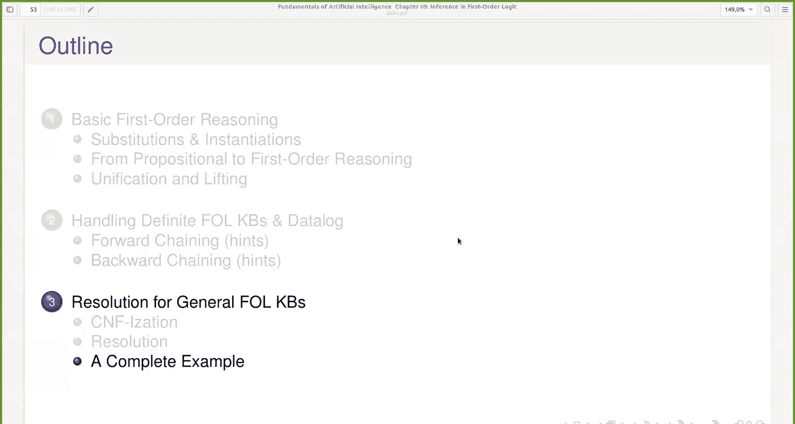

# 人工智能基础：CH09：一阶逻辑中的推理


在本节课中，我们将学习如何将一阶逻辑公式转换为合取范式，并应用归结推理规则进行自动证明。我们将详细讲解斯科伦化过程、归结步骤以及实用的求解策略。

## 概述：斯科伦化与归结推理

上一节我们介绍了将一阶逻辑公式转换为合取范式的基本概念。本节中，我们来看看如何具体执行斯科伦化，并应用归结法进行推理。

斯科伦化是将一阶逻辑公式转化为不含存在量词的合取范式的过程。其核心在于用**斯科伦函数**替换存在量词变量。

### 斯科伦化步骤回顾

以下是执行斯科伦化的关键步骤：

1.  **转换为否定范式**：消除蕴含词，将否定词向内推，直到只出现在原子公式前。
2.  **变量标准化**：重命名变量，避免不同量词作用域内的变量名冲突。
3.  **消除存在量词**：用斯科伦函数替换存在量词变量。
4.  **删除全称量词**：删除剩余的全称量词，所有变量默认为全称量化。
5.  **转换为合取范式**：将公式化为子句的合取。

### 斯科伦函数替换规则

*   如果存在量词变量 `y` 不在任何全称量词 `∀x` 的辖域内，则用一个新的**常元**（零元函数）替换 `y`。
*   如果存在量词变量 `y` 在全称量词 `∀x` 的辖域内，则用一个新的**一元函数** `f(x)` 替换 `y`。
*   更一般地，如果 `y` 在 `n` 个全称量词 `∀x1, ..., ∀xn` 的辖域内，则用一个 **n元函数** `f(x1, ..., xn)` 替换 `y`。

**公式表示**：`∃y φ(y)` 在 `∀x1...∀xn` 辖域内，替换为 `φ(f(x1, ..., xn))`，其中 `f` 是新函数符号。

### 斯科伦化的性质

斯科伦化**保持可满足性**，但不一定保持逻辑等价性或有效性。这对于基于反驳（证明不可满足性）的自动推理方法（如归结法）已经足够。

## 归结推理规则

现在，我们来看如何在一阶逻辑子句上应用归结规则。

### 基本思想

给定两个子句 `C1` 和 `C2`，如果它们包含可以合一的一对互补文字，则可以进行归结。

**定义**：文字 `L` 和 `¬M` 是**可合一的**，如果存在一个最一般合一子 `θ`，使得 `Lθ = Mθ`。最一般合一子是能使得两个表达式相等的、最具一般性的变量替换。

**归结规则**：
如果子句 `C1` 包含文字 `L`，子句 `C2` 包含文字 `¬M`，且 `L` 和 `M` 可通过最一般合一子 `θ` 合一，则可以得到归结式 `Resolvent(C1, C2)`：
`(C1θ - {Lθ}) ∪ (C2θ - {¬Mθ})`

**代码描述**（伪代码）：
```
function resolve(C1, C2):
    for each literal L in C1:
        for each literal ¬M in C2:
            θ = unify(L, M) // 计算最一般合一子
            if θ exists:
                resolvent = (C1 - {L})θ ∪ (C2 - {¬M})θ
                remove duplicate literals from resolvent
                return resolvent
    return None // 无可归结的文字
```

### 归结证明过程

要证明 `Γ ⊨ α`（在前提 `Γ` 下结论 `α` 成立）：

1.  将 `Γ` 和 `¬α` 的合取进行斯科伦化，得到子句集 `S`。
2.  反复对 `S` 中的子句应用归结规则，将新产生的子句加入 `S`。
3.  可能出现三种结果：
    *   **生成空子句 `□`**：这意味着 `Γ ∧ ¬α` 不可满足，从而证明 `Γ ⊨ α` 成立。
    *   **无法再生成新的子句**：这意味着 `Γ ∧ ¬α` 是可满足的，因此 `Γ ⊨ α` 不成立（在可判定的情况下）。对于一阶逻辑，此过程可能永不终止。
    *   **过程无限进行或超出资源限制**：一阶逻辑是半可判定的，对于不成立的蕴含关系，归结过程可能永远找不到矛盾。

## 实用策略与示例

在实际应用中，盲目归结会产生大量无用子句。以下是一些有效的控制策略。

### 归结策略建议

*   **优先进行单元归结**：首先尝试用**单元子句**（只包含一个文字的子句）进行归结。这能更快地缩短子句长度。
*   **优先归结较短子句**：在可能的情况下，优先归结较短的两个子句，产生的归结式通常更短、信息量更大。
*   **子句标准化**：在归结前，确保不同子句中的变量是**标准化 apart** 的（即使用不同的变量名）。这是许多错误的根源。
*   **支持集策略**：将目标 `¬α` 的子句及其后代作为“支持集”，只允许支持集内的子句之间或支持集子句与原始子句之间进行归结。这类似于反向链接。

### 示例：Curiosity 杀死了猫

让我们用归结法分析一个经典例子。

**已知事实**：
1.  每个爱所有动物的人都会被某人所爱。
2.  任何杀死动物的人都不会被任何人所爱。
3.  Jack 爱所有动物。
4.  要么 Jack，要么 Curiosity 杀死了名叫 Tuna 的猫。
5.  Tuna 是一只猫。
6.  （隐含知识）猫是动物。

**目标**：证明 Curiosity 杀死了 Tuna (`kills(Curiosity, Tuna)`)。

**证明思路（归结法）**：
1.  将上述所有语句（以及目标的否定）形式化为一阶逻辑公式，并进行斯科伦化，得到子句集。
2.  将目标 `kills(Curiosity, Tuna)` 取反，加入子句集。
3.  应用归结规则。一个高效的策略是：
    *   利用单元子句 `cat(Tuna)` 和隐含知识 `¬cat(x) ∨ animal(x)`，得到 `animal(Tuna)`。
    *   利用子句 `¬animal(y) ∨ ¬kills(x, y) ∨ ¬loves(z, x)` 与 `animal(Tuna)` 归结，得到关于杀死 Tuna 者的新子句。
    *   与关于 Jack 爱动物的子句以及“爱动物者被爱”的子句进行归结。
    *   最终与“杀动物者不被爱”的子句产生矛盾，从而推导出 `kills(Curiosity, Tuna)`。

**关键教训**：在归结步骤中，必须注意对变量进行**标准化 apart**，否则可能导致错误的合一和无效的归结。

### 高级归结策略

*   **有序归结**：为原子公式定义一个全序。在归结时，只归结每个子句中在该序下“最大”的文字。这可以大幅减少搜索空间。
*   **超归结**：将子句分为**电子**（只含正文字）和**核**（至少含一个负文字）。超归结步骤允许一个核与多个电子同时归结，一次性消去核中的多个负文字。这可以看作是一个宏推理步骤。

## 总结

本节课中我们一起学习了一阶逻辑自动推理的核心技术。

我们首先深入探讨了**斯科伦化**，这是将带量词公式转化为无存在量词子句集的关键步骤，其核心在于用函数项替换存在量词变量。接着，我们介绍了**一阶归结规则**，它通过寻找文字间的最一般合一子来生成新子句，是自动证明的基础。

为了高效应用归结法，我们强调了几点：务必进行**变量标准化**；在搜索策略上，应**优先使用单元子句和较短子句**进行归结，以控制子句集的爆炸性增长。我们还通过“Curiosity 杀死了猫”的实例，演示了如何将自然语言描述的问题形式化，并运用归结策略完成证明。



最后，我们简要提及了**有序归结**和**超归结**等高级控制策略，它们在实际的定理证明器中用于提高效率。理解这些基本原理和策略，是掌握逻辑人工智能中自动推理能力的重要一步。