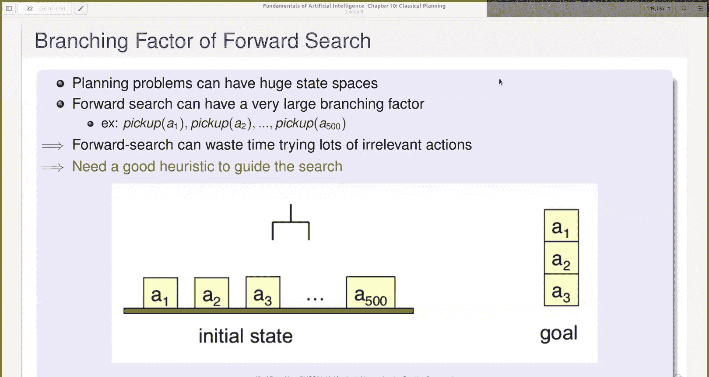

# 意大利特伦托大学《人工智能基础｜Fundamentals of Artificial Intelligence 2024》中英字幕deepseek p29 2024.11.25-CL22-1-Ch10-ClassicalPlanning.zh_en -BV1uUkwYTEmf_p29-

嗯。So today， we start。We is playing。And。しし。Yeah are注意。See each other。little we of your book。

slightlylight change in the spectrum，The context is more or the same。啊嗯。So， we。

And the main is playing， which is $。Oh。Yeah。A what for classic。What are。

Thanksie coming in with that in that。If you like。And in the next chapter。

 the we beyond asking and something more sophisticatedator。

you had aucplicationation slowly we stopping with the classic light or plastic event。Okay， so。

I first knew you serve the very massive portion of planning。Oh。And as far as the time。

 the support planning got the boost of that。St the language。W would you speak again。Which is then。

The how certain like question。So four， actually four back larger any。And this is where。You see。

See can part it to record the intersection for ethics and research。We we see them up the total to。

And then okay， you see something you also。P company rock。There's some pizza about other。

So thank for very basic emotions。你诶咩当啊。On the I the synthesizing the sequence of actions。

Whi soccer from。Just。こ course。Okay。This plant is the service supposed performed an agent。And the。

Starting from as a state interested of the world。W。St。So nothing particularly different。

What we see yourself。Except it is the same into。Okay。

Because you planning if she because she planning as。Under so many robots， many industrial issues。

 many automated devices that。Yeah。And that is我。Because a summer。S。First the shining。

So design among topics by some office。AndDevic。哦。As say。

If you have relation to what receiving search agents。Go back to the chapter3。

Another fundamental factor is that states have a factor only in some cases a even factor representation。

Okay， so we see people want think we're not the same genetic of that。Now we are careful what。好。No。てだ。

Many anything so you can see use any content。In shop the winter class。と fasterた。命的。你俩修那完美的一副疗效。

Remember the。Yeah。Next7。Co。Lots of can。The right of the box。so笑。The doctor only that。

We may have actions on di sequences of。 so that the state is di across state action。4。

But that's static so there's no changing the environment in be senior agent。ok。So。

A about playing is a strange you。So given again， interesting。嗯。Thats。Those want to speak。

You have a certain actions that you can perform。And you accept these achievements of something which normal。

If the funding claim changes the acceptable action can be under some cases。What're saying is that。

Ouction order。诶捞住全。Oh。So。I should have a。Oh。Or5。So。Yeah。

 so if you see planning as a decision problem。诶所知。Oh狗。

People only don't decide to me know plastic hearing。So whats things actually is the problem。

We actually one of the plane episode。And this is Profe is disciple。And。You are culture student。是打乜。

Yeah。😊，If know that when you have financial symbol， this means that youre going aren for investing。あ。

Next。I started investing on。Or functions shall c this department this。Such things can be complicated。

You think actual these because quickly decide。What is。InSp。Have we didn know first that。Exace。そ。

How屘复到。The key between。So please， and。Okay。So。F Olympic。Yes the class problem where。我 love file。

Something which you may take you。Share the solution。Oh I the。She can。Or you' got more that show。

With advice you get further than。I。ex。Yes，'s。And I that。えとさ。发。I I at at the second。Yes。

Face is a problem which should depend on gender on the second。Its the hard this bus。Let's see fully。

Okay。mean。ま。Okay this be like。でこれああベト。I couldn honor the on the threshold。We。

This place said is the classroom problem which you can solve。Just point on this。

Your remember memory without posttraint。T constraints on the， on the。And this means this doesn't。嗯。

That just。啊。The当呃。So planning is not。And these see the should you have。

I have simple problems with Kevin。Sp sure on the plan。你反样你考虑下我问可有。帮。We you do the dollar Illinois。

我 so you know now开发。Very simple， which requires a mis。算什么。

So this means that in order to verify the specific plan。Ex pleasuresure。诶因为你我知会咗佢到你会。ok。😊。

So just to say。I the class of this space is the one which can be quant reason。To。系咁有房嘅。

I forward forward。Okay I want to get into punch this。The is much harder。嗯。喂为下所。I right。

So if feel really aware。C for them with the you really realize the Q is much， much harder。Thank you。

Okay。Oh。So。E。🤢，The source of is。では。There go。Yeah。没 should。You to find it about them。哦。

Of stage models。 So you， you may have you piece for installation。Make sure know your sequence。What。

This as the circum。成班嘅确实班系。食机。They咩其 or通新诶。Then out about okay。Is the council experienced。

comese soon。If you don't have questions。So that basis。This the check。They want。Please。あ啊。一那来那。

Fness rejected they with。The orange。说一。Okay。Okay。上。Re wants to stand language。Yeah， thank。

Yesday for planning to the future language。She's。你想闭。And。So if you are designing a planner。

 you want to use by you have to。Why does I。Okay。这点呢。我。This it started for the motion of steam。いて。

I a consumption of food grains。Okay， we chart around the actual list。So呢家。that's the big sign。Yeah。

 he say。Exact。Yeah，诶Your person。Don can。这都不能。I。Whether use handle or stand out。Thank。Be extension。

 if she can use。Yes。First。It it is a conjunctionnc。Sustanent is ground。Oh。诶啱面。

The things in the bottle。啊。Just。Okay， so I find that。Your doctor。And this state is a cool juncction。

Of over switch。No noise。实佢得到噶。打家。Noious。Oh。Oh。In the states。喂对的啊。It actually。

That's why Yale is fictional。That， yeah。should you please trust。Yes， don't。So what do are the good。

They， which provides up tool。这样的是开 are。So that's some example， what this box about。At I X， Y。哦。

I should the next way on。Let's say we not or known our models。黄了。And I'd like to see。そ。And then we。

Not poor or not typeme is not。Stock swim。Because。Yeah。系。It's a father of friendship。Its not。

It's not affluent because it explains that function。Chose the far。哦。Pians。I picture。That。Thatt。

So they退声 here。哦。So。Okay。Is what called。 So P is special。Okay。1 is close border assumptions。

It says that everything which stop measuring so stop， everything is stopped。

Sp second can assume lots of their values。Actually， yeah。Yeah think that。What。Ca。我不道。嗯不。

It also make that a smaller assumption that you。3 second。F。Alsosome thank。F news。I that。Okay。So。

See anyone， talk one talk。So。So these are actually。Okay。And the cost the sea I know the sea。

But around see the。You。Fuffy。This teacher。Make。Mily。ど。不。就开始发。I sorry。

Remember you said any those pictures。No，诶。Sscribe the capital city。Racts or obstacle reduction or。

こがアクショ式。ThePlease more that。Re that。Elect。Okay。Go to change the value。Thank， yeah。

And a little question all the others。A monthly interview。我。should。6。Buts what connection。Yes。

Photos of that。These Bibleibles。Tff thats5。Thection。

At least of preition and and one set the preition of and the fact。我か。诶三三个啦。also。

 the privileges are going cool。So， the definition and effects are。

Projuns of related violence stock here to have。So we opening us。I know。If you don't have a day。

 it not diagram。At bottom。あ。Okay。Those I havevolleyball。

Here the new piece assumptions that there are。Yes什。So when you have at H I。This will you excellent。

Extra from。W to say。F that X Y center are universal。 So it means it use a for。Okay。诶。😊。

Those actually。にかして。Oh。So let's stand the。Okay。Suppose very simple just。

So we declared to that the form is in action。Thiss a suggestion。你 fine。Great slide。哎这个就近。あボ？こさ。

From to。ok。Please signal me of course off。sorry， guys。I the。The source apple。

And there has a list of recognition and effects。Recognition。

It's a conjunction of e glass when this case the are positive you can have。And。In this case。

 you have a blank。 so he are blank。So example。airport。And we are assumptions that。Sir。So。し。

He is correct。哦好好。Thank，And。He。The all。The here is that。st of flying嘅。Yeah。

From the airport 4 to the airport2。That。Please do more than the source network and now it。ok。

quite keep that right？Without case safety boxes。 So those are viable solid these。

 this actually goes the be from。按打了。Each to achieve that very you will give us that。

And what they show they use lower case methods for variables in the and upper。Ora。Co。It定是。Okay。

Please mattress。How could these contract。AndSo I know this。 this is something that thing。

It's not the dis in your book。You kinds of。The conditions shall un。I just say something。Oh。

So you're saying that。Like。The form。And two is now。St down circles。So that one is call them short。

 right。Okay。Okay， they sitting the type of building。So。You can talking man。即。打呢个资。

Thank have to match this with some of them。And the is that。pay。I。I。

I should be saying that we should expect that please。S。そ。At each other。Actually。TheOkay。嗯。

谢些 measures啊。Thisiness。哦。Its floor possible value and of the final。Probably。

What you doing is said you need succeed。And I trust going on conduct。Cheese。辣。😡，电通话。

I think number one here is cost lot can handle the cool airplane。San Francisco。

 what is the San Francisco Air is thek。诶一啲水失写嘅打。To basically and。Some sexual stories are now。

It is there And at1 San Francisco。wants the。And it's。Okay，I think that's many seconds， right？Good。

Make。Hold it out。Fer。唔系什么。1高。啊。And the influence， the influence。S。Yeah。What。ちくさい。Don取。

So this is the English then now explain。ok。So the intentiontuition is is that the recognition mark on order make。

啊。あ。Okay。So this is kind device the state the actual evidence。Important。Action。So kind of kind of。

All in the states were。Not。What。Yeah。诶C点。打。第个啊。The title。肥出啲。Ladies， I it way too much。Okay。

At least said。The fact。Represent the action。E actually。

the state of law and decided the I to do not the execution of executing。We back how this works。

Good to Sir。This space actually。What is nothing about the。It's just within change。

It allows to clarify whats going on。So this foot underneathstand。大 should be。啊。但啊 the。At least。

What the prosecution regard？In the in。What is the。Lisa。The least on。うでね。Thankss。Yeah。

What's in country。You positive in the faction means that。That。Nction。Out。你得。Do like诶。あ。Oh。

In fact that if you。Now， of course hate。Yeah。TheEx。比错。Okay。To。Yeah， we have。fin我书大诶。Good，2。收一。

ActuallyI'd like to think as the result of S。The on right。Okay， we are using the simulation。Describe。

呃。して。Which draw。I。Other。我。B。啊。Yeah。think the state of member the state is a project。Yeah。think or me。

Ohs。are them for try。Thats same example。 Make same example as before。It is same。

We have the file action。 and this is interesting weeks。对对。Action。

Sportose you are in the following state。Cheese。呃关。Beyonds name always now。

That's something to asked about。Yeah。Many other things。Okay。Thank。Oh。十时诶上课。嗯。5。Yes。Thank you thanks。

Get different。It is the oldest action。What。Whats。Okay。来，我就。Is to drop。s道。で？I draw， and。Good。Do。Yes。T。

Change。Okay。First。It's the clear I think this quite， okay， I not to notice。Yeah。Then not出。

I don't have any。P the of。Whats your done。Okay。Theres something。The not。That's a so for all。

They're not useful， you can make it real think。For back the science。我我把人个删意。Okay。

Just that you have a component。真你睇见啊。And好的。8 sand explaining before。Hecept the。Right。

This is the matrix。Yes。Yes。 so we careful the possibly just。きちゃっと。Okay， so much weather。八。

We don't distinguish it the case when。哎哎哎。are faults， Where are forth。Okay。This is。Pture。

Or is the this started。You a head。I mean。どち？So。Okay。It is also a form of other reason。

 especially makes the sense。Three should be to。Before。我属你家。No。诶。Oh。Or so we make this session。

This for。So we care about。 So we are。At time we don't wondering them what this store。

This is you saying。问题点我都时做。Okay。Good， everybody。Sometimes we can。

S be are with the pre and as a fundamental amount of os。To be careful。发 I俾。I think。Yeah。所回。Thank you。

F。呃。I hopefully off the obvious way。It's course。Okay。😊。

So you can think that's also that sort conversation。There is something to satger。哦大ello。No。B。

Or something。相てす。Then is。I like with the logical reason with a reason the logical reason about that。

Has an increased motion over buying short。What we measuring。Okay， but we have shelves。

So this step something happens the next step something else。So。はこの終した。

TheP planning did not consider annes。The emotional don see。I我度。3 secondss。Iが motion。It increases。So。

The time sensitive are implicit interactions with the foreign intensity。

So the prelam always sort fast by。In fact。僕のスです。不。I think that's not。P。W。don't have a rehab motion。

You don't know how much time has passed。はい。そ。Every the time we deal with us we are remember。All。😊，ら。

Okay。Yesroom。Okay。F。Yeah problem。Just I accept the actions。Which defines the binding domain domain。

第第二。Keep hold the actions。我。Okay。Oh， excellent。Yeah。This should。Okay。Note that there are just。

That's opposite option。And see on the little round left。ok饭。Okay。Yeah。

You know the company from being the link tool so I just。An initial thing。诶。All right。

 you should take。It should。So its a going。不是大。Okay。佢我过。掉 theacy。Of。spec does not。加的反4。

This fact means that the others are either either before or around rather。不意思。嗰水啊俾你 in the class。

Let's explain me。Focus on the award。Okay， good。Because what a assumptions。last。Just。发算啊。あ一緒。Okay。It。

Go the junnctures of mouth。Obviously， there runs not。Do you。You。Conjuional drugs。Okay。Ch。

And vulnerable。到是哪。Okay in that rules。Bs are exist。And you think you're like why exist？Let me say。

Elects， elections。I seen Bibleible。Wow。In阿。Go。I don please。you。Do you have a wallet。I about。Yes。

 first。What it。Re。Thatax for everything。ああ。It step for。See thank you。It's why。Yesた。

you have seen this correct and I don't see why this is natural。The系。The question was。Why in the goal。

Fible be fine。Ex。But。W。To us an answer to this question。 maybe I can understand。Okay。

No increase is increase一。Ex。The small white。W suspension？Yes。Okay。搬到嘅。ok， this is sir。finish。多好。

まこれでの。Okay， so why？Okay。easyas to。So suppose you can let your and solve them that。What is it on？

productionduction wise。Yes。Good。嗯。哦。は。Yes。Okay。おしいです。Yeah。No reservir was how does that。し。

We where rules are exist。Re。か者さんを。Yeah。stop。Okay。对可以啊。So late Sunday work。

It's one way of seeing this。In the general case。嗯。That's where I see that is a box extension I should use is that full some。

If because remain possible candidateulating these things。 Yeah， that's true。Okay， this is actually。

The color。こです。Com remember。The difficulty between actual and end goal。Thanks。😊，I positively。

Pro more connected， you you think it's how。Even aggressive where。S。Wch are these actions。

And litigation on the board。所以这个说到话。Since you sort wanted。ification。

If you want a mistake and you apply those action。But应该。Okay， so。You should buy think。

On one side of the please。好想加晒。They all supply。你发啲放咗嘅。要啊。OfSome former represented proceed。

 some former represented actions。系。I gave it special。Co。Yes。To actually communicate。

Investplification please be。Thanks。So one is diversifiedified。

 the other is strange because there are sort on the opposite side。关电。我。这。The fuck want that。

So the word that you have is a prevent process are an initial state。

And have you can apply these sequence to actions。F。You can't this。She said the family on block side。

こ。The actions and all teachers。Yeahello。Oh。think about the query。

S not the query between on the knowledge base， okay？这 about how we说 it。Re make the motivation and。

so we go。喂。If this， don't wear an extension。Yeah。We。If I to in。Okay。😊，That can solve discussion。

Ultimatelyically。The cool。And。Okay。どもしたいね。The option on the side and the we state on the other side。

ここにサと。三。Sation。Keep5。I keep we that back。Thank。Teach。3。You want to show next。What big。IT to make you。

Okay， and why。Why is this is existent。但是总得我好细。Again month from flood。Itpectial。即系。

P invest type commission。Yes。Okay。快。でした。Okay。Is it your clear。 So， I mean， this is just。

I just want to make sure that you should not right this。And let me see practice。ジクさと？P say。

Actually San Francisco。ok。Andplain秘。Exibility is the sum of green the infrastructure system。Well。

 but the situation should be if you。And on the on save your cargo。On your kind swa。Okay。看到的。Book。

father。Okay， and egg。For some， make our region make rich。

Is that this is something we should not't have？I want to go in my car as we can also please describe。

Becausecom。Light。Let me explain。For something I。my plane my is。Yeah。

You don't care means that you want to climb on the bus。Okay。Take station。

Do you care which each bus is， is it。Sure you are classes。诶三把山。

Again get that some massive some some coverage between network。cleaning station。Okay。Whatた。

P one2 surprise for in。So we saw that it is representing many possible goals。Impossible states。

 sorry。Okay。Why。elses。The fact that21 is in San Francisco my Francisco I don't which explain Francisco。

Okay， for something by。C speech social software system。ok。😊，I break now。说的就是。F。Oh。Ohsh。T。系。Oh。对。But。

Oh。あ。Theres。这发的。Yes。Okay。嗯好。感谢。Okay。就是暂时。Okay。Sa he's nothing else than such problem。Oh。

There's always its standard components， which is any selection initiative state。It a second。Okay。

Excuse me。Actions， so it's not even as explicitly step there。

A list of actions given which you can instance。 So the the list of action is increasing。

 Those mean all the possible associations。Oh you extra。啊。Yeah。Conferluence。But every so。smart isだっけ。

Yeah。Read slides。So there's other thing be seen as a。St and talk with them。

The the auto up there the auto in there at least。So that's question。I text， which is long hair。

Checking weather and the are equal safety matches。Just the。一讲到。Actually， can。

But what the measures you see。こ。Its direction。Your。Okay， so a more general example。Those pieces。

 So have the main car of transport。しは？Initially you have that here， but one it is syn。

Let me say for second。 So what is the cargo。 She who is the cargo。

 believe they plan and two are place。And you。B死。Pbalwa is impossible。

One plane one is the first system。And。Oh， it's a。That simple one got go on next Jeff。かき。

Let's draw the Congress。placesla。What are the cost， so。Not the CP or recently since。

Coful he case network。谢谢。The clinic is。That said the cargo is again。Please。Great。shop。あ not。the。Yes。

他个。Okay。So the I think up。The the car is also。The second。Or I mean， I。I got the comments。

The is are there。The office。A recent level。Yeah。搞。打扰的。The file is actually very same。Okay。

What can you。Awesome sure。You see， you see。the law one system。Dplified。

Because we can one uses upper system and the one uses upper system。Okay。

It's like one of the certificate。多肉差不多忘了。People。All right fine。

You the one we want to just okay yes because I suicide。Okay， on the whole the actions are verified。

And you the very safety thing with the public tool from Jeffica。You may want。This is this。

They're not。Really necessary secrets。P。So all we need is that this comes before this and this comes before this。

So the load Cwa comes before5 by by one and department comes before under the Cwa。しだシとどしと。Before5。

And the flag comes before I lose。Okay。any Austria their，So special。Every possible called the or the。

It's not just。Okay。You can this。J K and oldest one system five mark opposite J K and five user for system and gold。

s going one one。Yes。Okay。It should execute。嗯。And the box thing so there's all。

A actual all these same thing is actually just according to the designer。Thank you to this。

Ex easy refine。Every。Extract his brain。Like this。This saw any solution。诶。Ex check the sts。

Before I enough。Every呃。this actual。WeRe that the next matches。So did this step。

I need my exercise as very excellent your service。Okay。Okay， here is not there。你s么。Sle。Oh sponsorer。

Flaly should thought okay， first we have to move on。Two types。One school I this slide。Yes。So thanks。

F and the threat theel and the inter is still is complete in the trunk。

The goal is that the spas are relaxed。哦。ButFor frankly， I would add one more。One more。

You have to do this and study and say that flag is on the track。

Because I don't think that she needs to the world that is a future however。嗯。So。

Do you have attraction。Wch is a rule noted for location。

Which is the conclusion that the opposite into information。

And there is not that that do no more than。ItStarts all the country。Look。Crown。Okay。

 so you say that after the object。And their message is the dollar。Yeah。What。In the teacher here。

 Here is。Remove this。ち。啊。Okay。well， this must be something specific。So that should be bias。做债。Oh。

Because you have。Okay。So this is。哦哦哦哦。Saed the tire。电噶。Okay。I ground。います。Actually。

The entire key must be on the ground， and you don't you don't need to have this。No。

 this is something interesting think you are。There are some actions。I just like。So。哦。Some action and。

I。怎么有帅。Some explicit concept from。ああ。国籍。A你上马的。Some S S5。So in this case， this is explicit。

Re movies general。G。Yeah。I is terrorele， only。It's got a ground。Okay。

Ex to fast exclusively me this title。W。Seeme。no。六几十。Yeah。W percent。Okay。So each you can actually。

 you can also define。Aes reaches job options to see。So。Ch。

They actually genetic not completely something。This is this sort method actual。Car owner， my。That。

Like precisely choose your。Okay， so not see it。What at this。It'sOkay。Please。This is that。

Its a partnership to say who is that general action student。So this。Chris。他这个。

Stire and blank ground is。These section。Professastic piece。あ。Yeah。啊。

Some orange powder on your accent。It like Facebook not like。It to stop just stop there。What you that。

The type is no more ground and。Okay。To of so it it just a well。The basic justice I means。

 in fact that in general， we should remember that。When problem。

 you may have a lot of action and nothing to do with。我8岁。Hello。And。Actually， it's more important。

They called this some， which could be patient be applied used better。After the pre you got。嗯。听日他。

Okay， so there possible the completionia is may have。Its not something you want。

JustSa it that you chair。You诶。You are。Agent S。Hes always specific not。

Today action choose the action one。So。TheW solution， in this case。

 is to remove the flat from the from。I fromax。On the trunk。You put on the sparrow and the sper on a。

F best for Jason should make a methodology。あ哎。The fact you should not also。On the。Next job。Okay。

Not to gain a busy study once explain about general。诶。Is to。You can work to your。

 so it's not relevant one。This comes before weeks and this comes before weeks to。

 so both the first two actions are executed before the third one。Do。breakfast first to are。

So this again， please。It's a total total total grammar， which can。I so a question over。这样。ok。

This is a。Because。Yeah is very classic。Cle salt。Everybody question we die in the 90s。

 but he has seen this。Pro solving that。All that。Okay， so is。Cl生 we间。

Los some of the people in by a handler and the chemical handle has lots all the remote blocks。

So well， this is like。Beche。Yeah， there's lot of these of people that okay， the CR people are box。

TheThe the are eight on the table， eat on the table。Okay。B is three R， and C is three R so。Oh。

Before he having a。and。I。I not somebody's askke to say that。He。

What you be from point your exc you top exit for your life。And你 say。Ex job。They。And。嗯。你啊。

Here this distinction。Okay， so there is an space action。Actually。

In fact you say that to it why should。Con this。Okay okay， the fundamental so but。对这呃法律个实的地方明白白。

オjectェタオです。The name object there's different。F box。So that you to specify。Why a message。Okay。You say。

 oh， okay， the per is that。Based on accent。And least are so cannot this case。不。Oh。Check。

And why the offers course？まYeah。Okay。not， they're all different and the fact that fine。No。

 excellent here。So。OhNext， I。哦。It's not action。And。So why okay。Okay， is。第三个。嗯。lic see the大。

We don specify。This has increased the。Okay。People。Oh。Somebody。Why you think the session。

 what you speak。Yeah。The block。People。Yes please。The highest not is。Then you' right this。But。

 the execution yes， please。W is。是的。哦。What was that。诶。当。Okay。Okay。Okay， so。

Okay what you say is correct。So。She。呢市场。stop up。Oh。Table does not mean that's。

You move something the table slowly。Yes。系。F。けござた。Can thought opposite escape。你冇听好。He。Okay，あ。Yeah。到。

Youre not to make a stupid。这样。Okay。Because。我不这。So these you have to distinguish。

the cable is sit because you say。It on on next， and should be clear。

 and the piece block can be reflect。I。Okay。So what possible show me is that okay notice it now you need。

笑啦。Ex size isn。し。So呃。C。Thanks you are your first。Yeah。这希的一部分啊。People see。F。并系工作呃。move啲 people to先。

Theも给 from。Not the is well。啊啊。The scroll the find it。Thank you action from people is not necessary。

Oh。So you something many of sign it to the lecture。You can have。Okay。

I have a very different banana of job， so you can have that。Okay that'。What has is just。

The object in these screen are justifiable or have same。

So actually shall reach some element are constant。你系。So you are the table donた。I the people。一十万。

You define action an actual。Sler。You can台吧， sorry好。ok， this写爽。Instrict problem。It a solution。Oh。

What difficult。It's very easy。And。I。这不是能知道。So。诶仲有啊。运营的。不会去大。哦。If you come back pay so。Yes。你啊。

Look at at。St do stop。Very job。你。See what that you like this section， this section this section。

 and then they see。Do use the lecture。You。The team action is there so。啊定手输嘅点影噶。You all right。Okay。

You I inspection。It。Yeah。Obviously， these are not。But and we should didnt say。Of course。

But the mattress they all when your answer is not more out。我懂了。Emission name。

Sweat one and Sw is very seen。And I feel like， well， let's going to straight there。

But that's actually the same as。对。So strategy。R your search you start from interesting。

 So for instance， the state where A1 is an airport A and a date to is airport A。And又 use。嗯。

Use an accuracy。Where does it belong to you， So if you not action。sorrySide 18 degree。Good。

Today you go it。Okay。Yes。Good5。好嘅诶。Okay， yeah。What。Yeah。So。This is。Essentially expected。

Gaxy nice to such。ちょっとしす。The only part here is that you don't have a generic motion of steel then the we can go from steam block states too。

ああ。The state is a national fund and influence。Okay， thought that not。Where and I go to the state。

 where state is defined。嗯。The result speed is nothing else than the。C。gross a一 light there。家。Yeah。

value simple。あし。Okay。So lot。Oh。Different approach is that it works called the network stop。嗯。

So just let mention that there。You。 So if you put them money basically， you can go back。Oh。So。

 point is。We need to be who plane you want to should be at the school should be at the airport。あ。🤢。

Okay。と。でスト？Oh。And the user vest。Okay。不同。Book。Intering。So。Pt understand。Yes。People like。Okay。Okay。

Additional that it。What is this。I aware aware。我公司に。对中。If I flat in this school you one a。诶你玩。I nice。

Oh。Okay。性能力大的肯定。3。Could得啥意。啊。He complete。Okay。Oh。So。So but a little for error。

So you go back and see some candidates。咁实十个。I couldn' have bunch of cold and go back。Thank you。

To initial state。So that be this case。广大 part。A goal state or some else state。Theyll see。It。よしよ。

Good back some states issues and then course。诶。诶。You for。St and。s。due to the cross state。对。Okay。

You are。Oh。Different and this。好了。Ex or that。啲种夫。Thank have。ピさ。Beない。You think， sometimes。What。Ss。

So thats one。Thank个阿姨。喂如我。People at ask questions。S amount of time and each action。

 some the time you want to college when you should。全部呢有人。Please you got next okay。When。

 when should I stop。Right， so I will。Make some of the namefall。Okay。

 if too order to work out this part than need three days。

 in order to work out is rather about than three days， order to accomplish this part need four days。

 I feel that。My bigger。I if， okay， see that。And， okay， I will post on。On January 1。

I'm not thats the same one。Christmas hi， everyone。是吧。I will be with my parents to solve life。I said。

 okay， oh， I car。Thank以上です。Okay， so this is that corner。Okay， well。

One little is something that one does。But。な。Un。Cl what help。So that be a strong， right？

Absly like stop。そだ。POkay， so I need to be there。And two hours solve these means。Well。I don。

To are the train the most suitable train we should actually。Okay not。Okay。

So I just understand we need to be there。一冇 backward。not when you responded。He said name also百 story。

For what circumstances are you think？I know how to stop here。What should I。So I。有的。

So I need the way I can I finish my classes。So what's the best thing。Okay I can。

There is a last the for。Okay， they always are least explain us。我。う。So sometimes we play high。

 sometimes we。Okay。What is school and what is that？Oh control this。T to discuss about that。

Poal search。哦。What these these。Thanks for that。Inact。What个扣。So。you guys。Oh。嗯。So。Yeah。Can it。Okay。

Stle picture un next。ち。ですあ。So some pre conditionss。Refect。快啲。这是在第道。In the choice。

And then want city know。You say that must decide。哎我去。See， your girl state， you I。Good。The question。

とて。You should up。系。さき。So， this is。L the side。Okay， so you have the degree of the currency。一。

I think election。Okay。你看啥。And this just that blend。きのこだのかしら。So we。All ingredients。对个一个。

In the value of the。That's your thing。With。You have lecture。H。M your。Okay， that。他て。Beyond。Yes，白。明白。

Theてであ。Yeah， cold test the。Yeah。非常的多。If you，啊你家觉到佢冇理用啊。W。Is extension。It isn't necessary。Okay。不不道。

It seems that you can use all the stickies。We have seen each challenges， right。Okay。Oh。哦， don be。で。

We need explain a full of stuff。The outcome was can get。我 put嘢发。T点。は。有得。Go this gotで。Thank。

The secret flag。A very much can。The you。So。The actually know。Okay。あ我。是。Okay，Right。Okay， so。我 you对。

Well， breakfast is the best and the best first， remember。So start。

Of course all because are yet to pick stronger。Of course she can also that。Co。Okay。I该。Ex。嗯。

Or coast gas， I don't really mind store。Chinaina。Or。Good back。So that first。Thisless。我的啊不分。The one。

So something understand that people plane the plant。T。Complete if a product has a solution。

 then they will work lot so you can part into that sooner later。So。And。The clock explanation。说出来。你吗。

Search。Right， the phone are很 loud。Especially why is special。ああ。Okay okay。

Thats first and green selection is also the structure。Yeah sound。In social。

But thats complain this is because the。You。If。Good有 look。What bus are planning。你先唔是不 change得。

It's f I think that you got you in the stack。And有没有会wi法。Thanks Mr Jack。And this is not。

Not the big problem。request with the。I forgot say something。It just breakfast。Which is the fine the。

Okay。Oh。This is， however， in the breakfast。やば。Is it。W。Co。

 which is not significantly different from that first， So is the same order。か。

The smaller and theres the advantage of。I start the end。Oh。Is how what you do to get to the。Okay。😊。

clear。Oh and it prove quite memory。 actually more than remember the campaign。别的。F search。And fucking。

It was scientific。诶啲。That a search。Yes， basically， store。Sub one。Next slide。Oh。

Of you know how long you architect。Butど。Something telling which one you already or which threshold of the already。

You。Yeah。Ex kind。We got this。That is such。I probably look at the search that you。Okay。

So it pay all of the case that you know。あ there。That first has a pretty visual one that。Okay。哦。Yeah。

Here's this line that。What do you？Proken with the former search。Hes the。Can you。Rify。

And so of instance， that if the new certificate conceal menu。When you before。

Then that you have many many possible choices then we。you start。

So consider if the goal is speaking one and the two the one over the two and the two over three。

 and you have a 500。Do。You may have a huge amount completely system。喂。😊，而家个大说法 you住出发。系。I such。We啥。

With the huge of steps。Okay。Okay。What community is a good， a good factor all。

the middle fact for a full search is having a new duties that people choose the next step？Okay。Oh。

Okay， close that list。Okay。你使用 finding what you have。Okay。Everybody。

