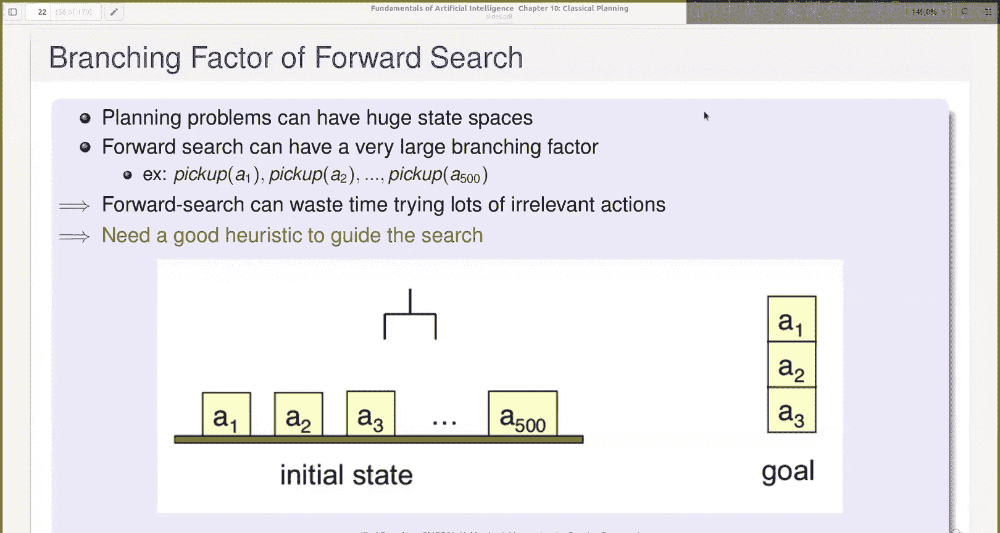

# 人工智能基础：10：经典规划


在本节课中，我们将要学习人工智能中的一个核心领域——经典规划。我们将了解什么是规划问题，如何形式化地描述它，以及它与我们之前学过的搜索问题有何联系与区别。

## 概述

规划是人工智能中一个重要的研究领域，它关注如何为智能体合成一系列动作，使其能从世界的初始状态出发，达到一个期望的目标状态。这与我们在第三章学习的搜索智能体有密切关系，但规划通常处理更结构化、因子化的状态表示。

## 规划问题定义

上一节我们介绍了规划的基本概念，本节中我们来看看如何形式化地定义一个规划问题。

一个经典规划问题包含以下几个核心组成部分：

*   **初始状态**：世界开始时的状态。通常表示为一系列基本事实（ground literals）的合取。
*   **目标状态**：我们希望达到的状态。它被表示为一个可能包含变量的文字合取式。
*   **动作集合**：智能体可以执行的操作。每个动作由前提条件和效果定义。

### 状态与闭世界假设

在规划中，我们通常采用**闭世界假设**。这意味着，任何在状态描述中没有明确声明为真的事实，都被假定为假。这简化了状态的表示。

状态 `S` 可以形式化地表示为基本事实的合取：
`S = fact₁ ∧ fact₂ ∧ ... ∧ factₙ`

### 动作的模式

动作是规划的核心。一个动作模式 `Action` 通常包含以下部分：

*   **动作名称和参数**：例如 `Fly(p, from, to)`。
*   **前提条件**：执行该动作前必须为真的条件。它是一个文字的合取。
*   **效果**：执行该动作后世界发生的变化。它包含一个添加列表（执行后变为真的事实）和一个删除列表（执行后变为假的事实）。

一个动作模式可以形式化地描述为：
```
Action: Fly(plane, from, to)
Precondition: At(plane, from) ∧ Plane(plane) ∧ Airport(from) ∧ Airport(to)
Effect: ¬At(plane, from) ∧ At(plane, to)
```

## 规划即搜索

规划问题可以被视为一个搜索问题。初始状态是搜索的起点，目标状态是搜索的终点，而动作定义了状态之间的转换。

### 前向搜索与后向搜索

解决规划问题主要有两种搜索策略：

*   **前向（前进）状态空间搜索**：从初始状态开始，应用所有适用的动作，生成新的状态，直到达到一个满足目标的状态。
*   **后向（回归）状态空间搜索**：从目标状态开始，反向思考哪些动作能导致该目标，并考虑这些动作的前提条件作为新的子目标，直到所有子目标都被初始状态满足。

前向搜索直观，但分支因子可能很大。后向搜索可能更高效，因为它专注于与目标相关的动作。

### 规划与一般搜索的区别

虽然规划可以看作搜索，但它有其特殊性：

1.  **因子化表示**：规划中的状态和动作使用逻辑符号进行结构化、因子化表示，而不是像一般搜索中那样使用原子化的状态编码。这使得表示更加紧凑，并能利用领域知识。
2.  **大量动作**：规划领域通常定义了许多动作模式，通过实例化可以生成海量的具体动作。直接在前向搜索中应用所有这些动作效率很低。
3.  **启发式信息**：规划器可以利用领域结构的启发式信息（如忽略某些前提条件）来更有效地指导搜索，这比通用搜索中的启发式更强大。

## 规划领域描述语言（PDDL）

为了标准化规划问题的描述，研究者开发了规划领域描述语言。PDDL 提供了一种描述动作模式、谓词和类型的语法。

以下是 PDDL 中一个动作定义的示例：
```lisp
(:action fly
 :parameters (?p - plane ?from ?to - airport)
 :precondition (and (at ?p ?from))
 :effect (and (not (at ?p ?from)) (at ?p ?to))
)
```

## 规划实例：货物运输

让我们通过一个简单的例子来巩固概念。假设我们有一个规划问题：将一件货物 `C1` 从机场 `A` 运送到机场 `B`。

*   **初始状态**：`At(C1, A) ∧ At(P1, A) ∧ Cargo(C1) ∧ Plane(P1) ∧ Airport(A) ∧ Airport(B)`
*   **目标状态**：`At(C1, B)`
*   **可用动作**：`Load(c, p, a)`, `Unload(c, p, a)`, `Fly(p, from, to)`

一个可行的规划（解决方案）序列可能是：
1.  `Load(C1, P1, A)`
2.  `Fly(P1, A, B)`
3.  `Unload(C1, P1, B)`

## 规划中的挑战

在实际规划中，我们会遇到一些挑战：

*   **框架问题**：需要明确说明动作**不会**改变哪些事实。PDDL 和大多数规划模型通过“默认不变”的约定（即只有效果中提及的事实会改变）来处理此问题。
*   **分支因子大**：由于动作众多，前向搜索的分支因子可能非常大。
*   **目标的可满足性**：目标可能是一个合取式，需要同时满足多个子目标，这可能需要交错执行多个子目标的达成步骤。

## 总结



本节课中我们一起学习了经典规划的基础知识。我们了解到规划是为达成特定目标而合成动作序列的问题。我们学习了如何用初始状态、目标状态和动作集合来形式化定义规划问题，并探讨了规划与搜索之间的关系，特别是前向与后向搜索策略。我们还简要介绍了 PDDL 语言，并通过一个运输例子演示了规划过程。理解这些经典规划的概念是学习更复杂、更真实的规划方法（如下一章将涉及的内容）的重要基础。