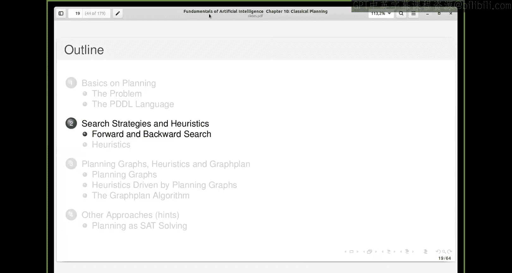
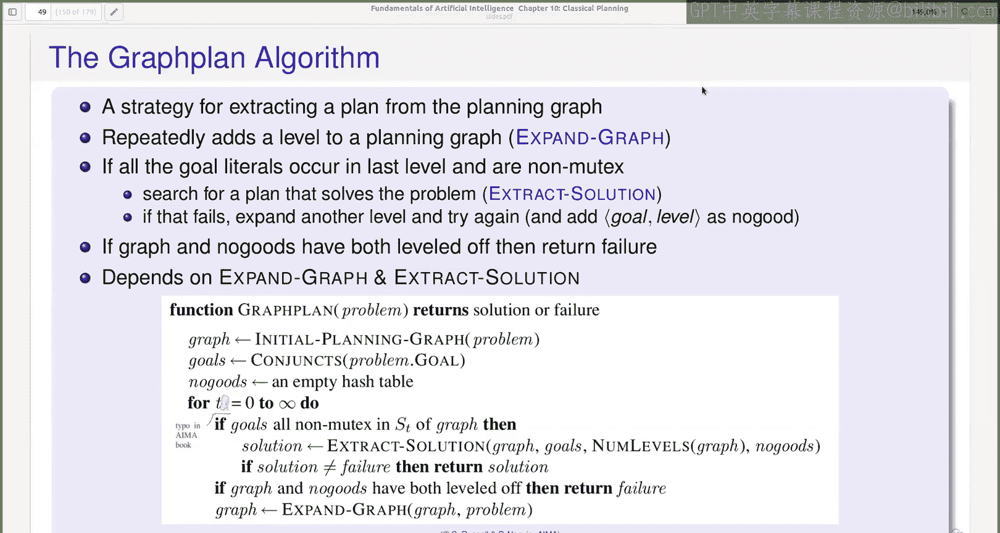

# 意大利特伦托大学《人工智能基础｜Fundamentals of Artificial Intelligence 2024》中英字幕deepseek p30 2024.11.29-CL23-1-CH10-ClassicPlanning.zh_en -BV1uUkwYTEmf_p30-

Okay we stop。O， so。哦。If you remember last time we introduced planning。

We have introduced the description of the problem planning。

 and then we have described the PDDL language which is a standard for classic learning。

 it's all deterministic static environment and blah， blah， blah， okay。

Then we and we have substantial say that。The fact playinginga is nothing else than the search problem。

So yes， we have defined the ingredients of a search problem as we see， so we know what the state is。

 what the initial state is， what the goal test is， what is a result of an action means what。

An actual means。Okay， what how you pick connections？

We have all ingredients to see planning as a search problem。Actually， a very。

Computationally demanding search problem because I recall that is's not even in N So well， okay。

 assuming N different from P space Okay， so is P space complete problem or even worse in general understand the assumptions that that NP complete problem。

Okay， so what to do， We have。What's going on now。呃，嗯哼。Okay， so。Sorry， Im home here。Sorry。😔，嗯。😮，嗯。呃。

Just one second。What's going on？Very okay， seems to work now， Okay so。诶。Sre。对。

Okay。So it works now。 Okay， so。We have seen it that substantially may have two possible strategies。

 so there are two main strategies in planning。One it is forward search。

 So starting from the initial state。And searching。And going on until applying actions until you bump into a goal。

 state which verifies the goal。Okay， so this is what is the most immediate。

Search instantiation of the classic technique research that we have seen in previous chapter in chapter three。

Okay。So intuition， as I say， So if I start here， I applied action and and I and I foresee which state I'm getting from an initial state。

 if I apply this action， blalah and here you can apply all the standard techniques， the first。

 very first， whatever。U。Backboard search， you said that you start from a goal or also known as a regression。

You start from a goal， I would recall that a goal is not。state。

 but can you represent a set of states。 Okay， so typically it's parametric。

 So you may have some valuable in， which is assumed to be existentially quantified。 Okay。

 and then you。Go back。 So you say， okay， what。So if the result is so we。Okay， which actions。

My current goal state。Can be the result of look。Okay。

 which is compatible to be a result of some action and if so， what would the previous state be？

In such a way I obtained this current state and he said or， sorry。

 not which state could be which sub goal could be because in general。

 a goal represents a separate states。Okay。😊，So and I go， in this case， I go backwards。

I just recall very quickly because we saw last time for search is。

This can be mapped into the standard search and using the standard algorithm that we have seen in chapter  three and four。

You can have a you can have a breakfast or breakfast the first the usual one typically we don't do a breakfast or breakfast why because they require exponential amount of memory。

Again， I recall that。Sometimes you can have something intermediate， so for instance。

 we could have iteratively deepening。which gets to some extent the best of the two approaches。

 even when we mention a star， we have actually we have mentioned in chapter3 that we have a variant of a star which require polynomial memory。

 okay。Ween in the version of this diet， which should require bit fully harm that。In JL， however。

 the main techniques are deaf at first。Or or gra search， which are sound。

 They're not jaring complete because they may enter the infinite loops。

 but we we know that with under with the classical planning。

 So under the the fact that we don't have the functions。

 we don't we have a deterministic action blah， blah， blah。

 we can easily implement loop checking procedure， like we mentioned in chapter 3。

 So this is becomes a complete。 and what is most important， it requires polynom available。

 Part linear one。Okay。Bad news about。For for search is the father typically you have a。

If you do completely blind search， so if you are not targeted to goal。

 don't know which direction you are doing， you simply have a branching factor which are huge okay this trivial example。

 but okay so if you need piling three elements， you if you are trying blindly。A search。

 and you are trying picking on them。 You have a branching factor of 500。 So we have a something。

5 under to the end， which is something horribly。And uselessly complex。

So substantially what is most important that you need some newest。

 regardless the strategy that you are adopting， you need a good when you are are to pick the next move。

 you need。Adopting a strategy which allows you to go into the direction of the goal。Okay。诶。Beg， okay。

 last time that we get to here if I remember correctly， right？So， backward search。

What is backwardwater， Okay， in order to。To perform a bettercca research。

 we need picking the candidate actions backwards。Okay， so。What is the point， Okay， so we have egoy。

And。Suppose that the goal G is the result of applying action A。

What are the conditions by which this is possible？Okay， so this means that we'll see how this is。

The picking of。So assume for now that we have picked the an action， which is compatible。

 I'll see in the next slide what I mean with that。 Okay， but suppose this is the case。

What does it mean to for me to？Compute a sub goal。From which applying that to action you would generally bump into the current goals。

 well， if you say to that。Predecessor， which is a sub goal of a grand goal G via grand action。

 So we assume by now that we are speaking of grand action and ground goals， okay。

We can do better than that， but let's start from the simplest case， okay。So what shall we do。Well。

Again， remember that we distinguish about in a state in a goal， we may have negative difference。ok。

A like so remember that goal is not a state。Okay， we can have a negative neutron。

 we don't want this fluid。那个了。Okay， so we have to distinguish between the positive and negative literals of a goal。

And so the positive de lit of the source goal。Okay， is given by。

The positive litals of the current goal。From which， I drop。They are the least。Of an action。

Why is this the case and I add the positive lit of the preconditions。

Similar thing for the negative gauge， so the negative lits of G prime。

Are given by the negative liter of G， to which I drop there。The literacy in a delete least。

 so that of which are made negative by the least plus the negative preconditions。

 why is this the case？If I apply， think it to theve case， okay？

So if I apply to the port de literal G。😡，Okay。If I apply an action。

 so they must be compliant with the precondition， so in order to apply a。

 G prime must contain the positive precondition of A。Right，Otherwise， I would not have。

 I could not apply action A to the prime。 Okay， And if I apply action A to the prime。

 then as a result， I will add。It Nira， which means that I came safely。Think that the， the positive。

Leers that I have the。呃。The positive little that happens the in the target goal。

Which app are part of the。Of the other list of the action have been introduced actually。

 by the action。Okay。So。Is it fair？Is the reason clear？The same。Appens。

 happens with with the negative one specly。Okay， so the point is why I do this， what I assume。

So that of course， the negative recognition condition of a must be part of the negative。

Must be defified that by G， okay， otherwise I would not have applied。Not private action。 Okay。

 and if so， I， I would have introduced those which。action which are part the list。Okay。Okay。

 you may say， okay， is there any objection anybody can make。This。Well。

 you say you drop the one which are indeed least on the other list here。

 but if what if principle maybe the goal was maybe those litals here maybe already be there。

It's not necessarily the case that some little have been added。第三万。By by the action。

 maybe they were already there right so an action can cite a little which is already true cite true some little。

 which is already true or can set a little to force a little which is already false Yes， of course。

 but in doing backward， we consider the weakest the most general what we are targeting is to find the most general goals of goal。

ok。😊，The most the weakest possible are the most jealoussome goal that we are， because why。

 Because we want to target。To find the goal， which has the highest chances to match with the initial state at the end of the day。

 okay？So， this is perfectly safe。这种。Is this clear。You understand this step？Okay。In jail了。

That both G and G prime may represent the many states， Okay。

 so you remember that these are just a set of lit which may match。

Which assign to value only to a tiny part of of the。Or the atoms or the flus。 Okay。

 so this means that。This leaves because this leaves the faculty or the no relevant leaders are assigned and they are kept them assigned。

So we' we are not interested to say anything in the goal。

 which deals with Atom which are not of interest for us。Okay。So let's make an example。

Consider that you have a goal in the previous case where at C1 in San Francisco and at C2 in GFK。

Okay。Okay， consider the ground action。 Okay， I under a ground here because in general。

 you can do better than this sometimes。But suppose you have this grant action。

 So you have you have a plane one， which is currently in。

In San Francisco Airport and who has carried。Where the container C1。On San Francisco。

The precondition are in are that in one C1 is on plane P1 that plane P1 in San Francisco。

 that C1 is a cargo that P1 is plane and San Francisco is airport notice that this。

These are the type prediccate remember or the sort predicates。

 which are always maintained at the same okay。So they they they just keep the value。

 So San Francisranci Francisco is an airport now and。

 and will always be an airport in no allow planning Pro， regardless the action that we do， okay。

And the fact is that at Ca， San Francisco and not in C1， we want。Okay， so。嗯。

What what is the the effect of what is the。The match。If we do that， okay， so we produce the goal。

Notice that in this， we may know。No assumption whether C1 is in P1 or not。 Okay。

 so there is no assumptions for any。Anything is war， is fine。I don't care。 Okay， so if we apply this。

 this statement， what are the positive fact in in our goal， Okay， first of all。

 we must add all the the precondition。 Okay， first of all。

 these matches because we have function here。 So we add all the preconditions。 Okay。

 of positive precondition in C1， P1 at P1， San Francisco， and then cargo plane Air。 Well， that's。

By standard， okay？And and also， So we add all the the positive condition and we。

From the positive part of the goal， was it。嗯。We， we drop those which belong to the the other。 Okay。

 so we， we drop from this。 we drop at C1 San Francisco， because this is obtained by our action。

What remains here is at C2 D K。Okay， which is not touched in some way by our action。

 but is still part of the goal。 So which is still needs to be satisfied。 So we have achieved one。

Elemental， and then negative parties contains no positive elements here， okay。So。

Not is what we have had。 We had achieved the one part of the goal。

At the cost I introducing some sub goal to be in this scenario apart those which are fixed， okay。

 apart these four here which are fixed sorry these three here which are fixed。Okay。

 then we need now to be the condition that the car is on the play one and the play one is San Francisco and this is something that we need we need achieving Okay。

 for instance with a flight as the result of a flight from wherever the plane one was before that。

 Okay， is is clear。ok。Again， notices that。Gep 1 and G prime represent many possible states。

 For instance， is completely irrelevant。 What the fact that the cargo number3 is in P2 or not。Okay。

 so there are many few that are complete and relevant， okay here。we are not considered Okay。

 so if our game is to bring something which we desired to the airport。

 the San Francisco airport is completely relevant if some other thing is in in Amsterdam airport or whatever right or whether there another plane is somewhere else Okay。

 so we。The goal， the goal part， and that's an interesting part of the goal， the goal part。

Pains you to so backers， thank you to keep you focused on the relevant。

Through anything you wanted to achieve。Okay。We have a mention here that。

Nock is this assumption that we have made， so we have made a consideration about。

A ground action in particular， The fact that we had a particular plane， which is plane number one so。

Code that， that particular plane， which will have some code。 Okay， is in San Francisco。But in Ja。

 you can do better than this。What you can do is not consider。

 So remember that what we have the actions that we have are。Our action schema are。 Okay， not actions。

 let's say。 So we are not in not necessary ground。So for things do we care which plane are we speaking about？

So we want our cargo to be in San Francisco。Is it relevant for us which plane brought it？There。No。

Okay， so typically you want to instantiate action schemata， the least that you can。

So to keep as general as possible。Okay why， because if so you keep the sub goals as general as possible in general。

 when you're reasoning in goals。😡，You could to try， you could。

 you want to produce sub goals which are。As general as possible。😡。

Okay because the more general they are， the more likely you are able to match them with initial God sooner or later。

Okay， with the initialia state， sorry。ok。So the key point is that keep。

Instaniate when you have an actual scheme， method。Estima story。

Essentialteniate only what is necessary。That's a rule of thumb。

 keep the A schema that you are reasoning on as general as possible if you're keeping the。😡，诶。

If you' are doing this， you will keep the goal the result in some goal as general as possible。

What does it mean？Okay， well in general， use the most universal inifier okay。

 this is a rule of thumb that most universal fire remember that you don't have functions or it's quite easy so substantially。

In the case of classic planning， this means if you are able to keep a variable a variable。嗰啲诶。

Keep it divided。Okay， if， if you don't need to static available to constant， keep it available。

 Maybe rename it to because sometimes you need just to avoid the name clashes， Okay。

 but keep it available if you can。Remember， valuable goals are。I does are modified in which way。一护。R。

Quantified。Go。Partaribles are quantdified how existential university。So。😊，Who says existently？Okay。

 we' say huge Universityity。Existention goals that are quant existion。

In action they qualified universal。Okay， so what does it mean？You don't want to play number one。😡。

It's just enough for you to say that it cheese something plain。Okay。

 a goal does not say I need the plane。😡，I need the plane number one to be to have my load go。 No。

 I just say there some plane with my， my load my， my baggage there， and it is in San Francisco， okay。

Is much weaker， In fact， this is existentially fine。Guys， keep this in mind， goalss。In gold。

 variables are implic existentially quantified。In actions。Vars are imp universally quantified。

 that's fundamental。ok。Now。So when。Use the most genifier。

 as I say just to try to keep variable of variables as long as you can。Well。

 this means that sometimes you need to renaming them in order to avoid the name crashes。

 but this is something that now we know very well， right？Okay， now consider， for instance。

 again the goal the previous case。In general。Remember that move the load was done by variables， okay。

So we had the unload some par access， some plane P， some airport A， blah blah blah。Okay。

 we need the in order to match the goal， we need a partial instance， so we need at least see one。

 we need the carriages C1 and we need our airport to San Francisco。Okay。

 so we need this with the general schema。At least for unifying the。

The first variable with the C1 and the third variable with the San Francisco。

 but we don't need to instantteniate。The plane。We can keep a playing available。Give it another name。

 Okay， just to avoid。Always rename it just avoiding variable name flashes， okay。

 but you can keep it div。Okay， so instantiate only what you need。Is to safe partially。

 so unify to make them constant， is to say to constant only if needed explicitly。

Typically because you need the mention that I'm with with some pieces of the gold。Which means。

That the plane remains available here。Okay。As a result。What does it mean to。Do this。This means。

This produce a sub goal。Again， take all the preconditions。IP 1，2，3，4，5，1，2，3，4。

5 are you take the preconditions。Okay。Then sub8 C1。 Okay， so this defects since this part here。

Are no more part have being obtained by by as an effect of the action。 You can drop， drop to it。Okay。

 and of course you can keep， you must keep this， which will actually be another way， okay。

What is the fundamental difference from the previous one？And now lean is a viable。😡。

So exist the plane such。 So your sub goal that you have obtained is exist the plane such that which is in San Francisco and which contains my cargo。

 Okay， this。Those one do not count， okay， C1 is a car somes Air well we keep them implicit。ok。

Not is that it's much， much more general than than this one。

Because this requires a goal that requires that exactly plane number one。

 that plane must be in San Francisco。😡，Why should I care that it is exactly that plain to me？To me。

 the important fact that there is a plane with my cargo in which in San Francisco。

Who cares which plane is it？Okay， so this is a much more general goal。You see。

And this will be much easier。😡，Do it， do make it match。With some other。诶。Action or even some states。

 okay。So the more genre I maintain my goals。The more likely I will be able to make them match with the functions。

 with actions or with initial states。Okay， so keep always what is called the weakest preconditions。

 Okay， so make。Est seeiate the action， the missed is possible。But use the most jar new file， okay。

 which means using the most jar in fire。😡，Which in case of plastic pain reduces simply2。

Do not to the rule， do not in safe variables to constantly， if not necessary。😡，Okay。

Maybe rename variables if needed， okay？But valuable are still good are we there？This is fundamental的。

啊。Okay， so the key point is you don't need to produce a sub goal for every plane。Okay。

 because if you did that， you， if you。I that it， you have to produce a sub properly play one another subgraph for play two。

 another sub for play3， blah， blah blah， which is completely irrelevant。

 why should I care which which plain Im speaking about。Okay。你 싶은 다刀。Okay。In general。

 when you are proceeding from gold， regardless the fact that you are speaking of a classic planning。

 when we are doing the backward。Backward search we should and we are looking from starting from a goal。

 we can decompose it in some goals。Were always looking for weakest preconditions。Okay。

 so the weakest possible precondition， which leads us to our goal。

This is not all not all in planning， it is a general rule of thumb which applies for inform verification as well。

 you are doing a software static analysis and you are going backward from a undesired state。

 so typically you are tracing a bug。Okay， you， you'll get to a state which is。Not desirable。

 And you're trying to trace back to see what where the bug is。Okay。if for your。

If your current state is a result of an instruction。Softer instruction。

 I mean you build the sub goal， the substate， which is the most general is possible。Okay。

 to trace back until you bump into the actual。Problem。So just to say that this is not only planning。

😡，This is phone notification， software static analysis， anything which in general， you。

Even automatic reason。The CSP also sometimes you do from some desired goal to backlog。

 So everything which which you get， you targeted go stage or set the goal states and go backward。

Okay， keep。The instantiation as general as possible， always use the weakest pre condition。

Rul of thumb。Okay。Okay， we have omitted so in the previous slides。

 we have implic to make an assumption that is we know exception to apply。Okay。

 so how do we pick this action？What is a criterion by which you say， okay， we have a goal。

 which are the candidate actions which could have led？Well。

 there is a rule of thumb that is to consider irrelevant actions。

Just to notice I've made a don't look to the last year's slides。

 I've made a slight modification here， which make this good because I realized that last year's slides were not clear so uploaded the most recent slide version of this slide okay。

Okay， download， sorry。Did you say upload， Yeah， Okay， sorry， download， of course。U。

Oh no you can up slide。Okay诶。So。You need a relevant action。

What is doest mean relevant for an action to be relevant。

 so substantially it could be the last step in a plane for go G。Can be safely。

 So what does it mean means two different things。At least one of the actions effects。

Must identifyify within an element of the goal。So it must have produced something。

 so should got to be a relevant action， which does nothing。Okay。

 so at least one positive action should be part of thegon。And must not undo。

Desire lit us of the gold。ok。So it can be。😡，So the intuition is that if you have a goal。

The action we think could safely be the last action of one plan leading to that。And of course。

This means that so this says you must have done something good to achieve the goal。

So this is it should not have done something bad。Okay。

 this is what inform of education we say a liveness property and fairness and a safety property。

I would say that's quite。Clear， right。Okay， in general we call the last one。

 the last step is if a action verifies the only the last element is called a consistent China is consistent。

 so it doesn't do anything bad but is not relevant same it doesn't do anything good。ok。

So this is the weakest spot out there。The minimum that you require so it doesn't make damages。

 but it also does do something relevant useful， okay。So these means。

First one means do something useful， which is the goal， this means does not do anything harmful。Okay。

 at least it just says。Don't do things are for things， okay？Okay， so again， consider， for instance。

 the goal again of having S C1 sample on the at C2 GK。ok。😊，So。😡，Although the C1 P1。

 San Francisco is good， is relevant because well first of all， it does something good。Okay。

 so it produces at C， San Francisco。And it does not。😡，Violate any sort of this。Okay。😊。

Although the C3 Prime San Francisco is not relevant。Although it doesn't， it doesn't damage。

It doesn't do any damage， okay？But if you say load C P prime in GFK。This is not consistent。

Notice that， of course， consistency is a weaker version on relevant， so if it's not consistent。

 it's not even relevant， okay。Is it clear？Sotansha， you have to be relevant actually。

Which do not harm and do something useful。Okay。Good bad news of。Backward search。

Be search on the plus side， backward search typically keeps the branch in factor lower。

Why is this case is it Well， typically because you have a less matching。

Actions and are the fact that you are able。 So you， you typically you have less candid actions。

 If you are driven by the goal than the one， which is we could apply。

 And the fact that you have a relevant， you have a notion relevance。I important because you know。

You need to pick an action which has some role there， not only which is consistent。

But also which has a road。Does something， helps improves things。😡。

The problem with the backward search is so if we apply the blind searcher， purely blind the search。

Typically， back for search would be better than for search。Okay。

 and typically because it has a branching has smaller branching factor。 So you are。Think about that。

 There are goal or。Have you ever a。Maybe you have to bump into scenarios which in describing how a person works。

You say about him or her， he or she is goal oriented。

 and typically you say that in a positive manner。As a compliment， okay。

 you say a person who is goal oriented typically is considered a good achiever。Is it。Okay。

So either you are doing， what does it mean to be good oriented。

 either you are doing backward research， so you are doing backward analysis。Okay， or you。

When you do for search， you are focus you are。要不打个他。Of going to work。

 So you don't take sideway moves， which lead you farther。Because the direction of the goal。I mean。

 what we are speaking， we are speaking about artificial intelligence。So automatic planning。

 but notice that everything that we are speaking here may also apply to human planning。

 to human intelligence。Okay。😊，Although in human behavior， there are other factors。

 which is we have a different cost functions， for instance。Different。

 there are also emotional costs which we don't consider in a machine。ok。😊，Oh。Did say currently。

If you wear。Discussing。Planning in in the 90s。There was a harsh discussion between the party of backward the backward guys and backward search guys and the four search guys。

 okay there would be。Quite harsh discussion about that。 Okay。

 like Gfi Gibilini and thenve seen no things， right or。Lets the Aliba' Roman or whatever。 Okay。

 nowadays， typically since people realize the big importance of heuristics。

 which is the topic of what we are speaking now。People realize that being able to develop smart heuristics is fundamental drastically reduces the costers。

For world searcher is much more suitable for a uistic search。

So typically most planner nowadays use forward search+lingistics。And what is heuristic？😡。

And I think some of you asked to me something about that in chapter， probably you and you， right？

Okay， so how do we get， do we have a general rule of thumb together get into the heuristic？

when we have a problem， or this is fundamental yeah， and there is。Actually， well。We call a star。

 okay。For instance。It is a best first algorithm in which you combine the cost we achieved so far with a euristic。

Okay。And if you remember， you have amissible optimistic heuristic， remember。

 amissible means optimistic。😊，You get there。 So you， the coaster is never overestimated。

 This is a rule of thumb。Fundamental hypothesis that we make。啊。As I said。

 we don't do we don't do really a star， or not exactly a star because a star requires exponential space in most cases。

 but there are。呃。Pnomial space。Techniques， which are sort of compromise between depth search automatic tracking search and the realisticuristic。

 or even better， you can decide to。Use the best。You can decide to have a compromise between those techniques。

 Okay， for instance， you can use iterative deepening。The kings， Okay， and so。

The heuristic evaluation of how far you are。 So if you are， if you。Have a branching factor。

 you have n states in front of you kind states so and this is presumably nearer into the golden than this state and is nearer than this state。

 then you pick this one。Well。Which is actually what you do we do。Why if I go there？

If I'm going to this direction， okay， so if the goal is there。

Why do I go this direction rather than go this or move this direction this direction？

Assume there are no obstacles in the middle and the path is plain。Why， because。

We know that from our implicit。Dramatic knowledge。That the straight line。

Is the shortest path which are link to points。So if I want to go。Oh。Forgettting the case where。

 So imagine there are no， no chairs here。 We are just plane here。And I， I have to go there。

The implicit reason because if I want to go there， is I take this direction。

Is that it allows me to take the shortest part to that thread。Because I were implicit。

Gmatical knowledge。Knows that if I go there， instead of going there， I will get。😡，Theyre shorter。

Surely， okay。Here。So substantially， you estimate in order to decide that the next choice。

 you estimate the。To pick the next action， you estimate the actual。Coasta。

To reach the goal from the outcome of your action。Notice that this can be made as a compromise also of the cost of that action because if this action requires more effort than another。

Well then I will have to compromise the two。Okay。😊，So。

So I need a function and a USD function H of S to tell me an estimate optimistic estimate estimate of the cost。

Of origin gold from state S。The standard attitude is。Produucecer and relax the problem。Okay。

So you typically relax constraints。What does it mean to relax constraint means。This means to that I。

Makeick。I made this more optimistic because if I relaxed constraints that there are some action which are not so every action which are applicable in the real problem are also applicable in the relaxed problem。

 but not a bit。Okay， so of course， there。The path to reach there is optimistic。Okay， if I do that。

Okay， I think okay I have a break。Now， okay， let's resume at 45 okay？几我出发，你话都两万啦小咦咩咁你话咗下，做一。你把咗公。

In the。Or a norate internet in。B the moment to佢发书。佢哋教咗 but this was like。Okayアケ。S。OK。

这亏你第厘米地了不同大在在那里睡觉。2 point per year psychi。Why not？Okay。

 you the regulatoryulator shortly it会 proceed your with all。发。的今 mean。比如。Okay。C， crystal per case。

 A percatethe or case， per cap。啊。Check。当 shouldn be什这。都不。不。一个他的。It year know if。She。Oh。Okay。

咁 we give all发 to say诶。たこ事。李 모르겠습니다。re magic input absolutelyuzz。Yes。必须。ok。So we were saying。

Euristics。For a star， but actually for planning forms， which are not exactly a star。

 but we are less Me intensive than a star。We need heuristics。

 you need optimistic heuristics function。And how do we compute them？Well。

 the typical thing is to produce relaxations of the planning pool。Okay。

Res are obviously optimistic by the by nature， because a solution of。

The original problem is also solution of thes problem by definition， okay。

 not which averse in general。So how do we do that？In general， again。

 everything can be seen as a graph， okay？At a very high level。

 but typically a hugely big huge graph so it typically is not convenient but。P theoretical level。

 you can think to this as a graph。Okay， so substantially you add these boils done to add the as to a graph。

 Okay， so if you think this as a graph of states。You 안的。Fake extra possibilities。

 Fake possibility of。Marking it。Origin a state from another state。Okay， so this makes this。诶。

Easier and this makes this optimistic。What are techniques to do， which are standard techniques。

 One is ignore some of the preconditions。If you ignore some of the precondition。

You make it a X problem， make an easier problem。Okay， and this means that youre。

 you can try to solve。A problem， which is typically easier because there's less。

 it's less difficult to， to apply some。Someummer on。Actions。And so， this makes optimistic。

Another one， which I'm going to speak is ignore the latest list。Euristic。

 so consider only positive lits。Ignore the fact that some。Action can can negate。Some extra。

Some interesting elements of the gold。Another standard technique is clustering abstractions。

 this is very， very popular for recent informal verification。

I whohoever will take the course of automatic reasoning and。For investigation。

 we realize there are lots of。Common ideas。Between the planning ward and the formal graification board。

 so there are many similarities。And in fact， there's been lot of cross fertilization between the two communities。

Sstantially， the main idea is to reduce the search space， so is to collapse states。命运的。Ignore。

Less relevant flu。What is the intuition here is that probably less relevant fluids are easy to achieve。

 so let's focus on the relevant， the hard to achieve ones and then trust yourself on the fact that onces you have achieved the most relevant ones。

 then you can refine your plan in easy ways in such a way to find extension。ok。Well in jail out。

If you ignore all precondition， you'll get over optimistic。Youistic， right so？

So essentially every action is applicable in every state。

Any single goal leader can be satisfied in one step。Or there is no solution。 So this is very。

 very fast， but is over optimistic。 So this is an extreme case。

 which is not of practical interest What is much more practical insight is ignore some selected。

And less relevant preconditions。Okay。There are some algorithms that you can estimate。

You can estimate the relevance of or some literals。Or some flu accor to achievement。

 depending on the analysis of some。Some either for the synical analysis of the structure or the actions and so on and so forth。

 or you can employ。Doomain knowledge of that。😮，Notice that this is something that we always do。

 we humans do。😡，Okay， if you have to do a plan。Okay， again。

 take you the example of suppose one of you lives in Dona。Okay。I think there are some people to Okay。

 so what is the plan to go home？意思。Walk to the walk to the bus。 F number 5 bus。

Get back to the station， fetch training。Fet your train， get to Ver， get to a bus to your home。Okay。

 what are the critical choices， The fact that is a must。At a reasonable time， the father is a train。

At a usual time， okay， the fact is a bus from Ver thing。

So the prerequisite is that there is some train at the station at the given hour， okay？

The fact that for instance， you need to be there。Or the fact that you have to load yourself or get into the bus or walk in the station。

 get down the stairs， back go up the stairs and choose the right platform， whatever。

Are technically necessary。But it can be considered very。Much less irrelevant。Okay。

 because you trust yourself that once you know that。

You trust the fact that once you know that there is a train in a suitable time， a reasonable time。

 and there is a bus which allows you to get there in reasonable time。

 there is another bus in Verona which allows you to be back home for dinner。Okay。

 once you have this critical。Preconditions， the fact that you are able to to in。

 look what where the platform is choose the platform， I right platform。

 I get on and off the train is something that you trust yourself， okay。

So there is a knowledge domain。Which allows you to describe to produce an abstract plan。

 which you can easily refine on the fly。Okay， so I think is actually like getting into the bus or exiting the bus or whatever or something which is。

You can trust， you can do easily。ok。There are some which instead are critical。

 maybe there is no checking whether they actually exist to train from Verona to train to their own in suitable time。

ok。😊，So there are algorithms that can analyze the structure of the actions， the problem and。

Itteratively compute give a score。Give us core to。To the single lits。

In such a way to decide which are more critical， which are， which are less。Okay。Oh。Funny enough。Well。

 I'm very fond of this because I， this was my master phs。Well， last millennium and。Interest。

 you may not know that techniques used by Google。To to build the indexes。

 to build the rating of the pages， the ordering of the page。

 where at a lot of similarities with those algorithms。

I don't know the very spiral from those agreement or not explicitly or not they get there independently。

 but they are very， very similar to algorithms in which which were introducing in planning in a hierarchical planning。

The times。Okay。So let's make an example。Again， remember this example of the sliding tiles， okay？ok 叔。

The excellent problem。What is in action， So how happens that you can slide from a T T from S position S 1 to position S2。

In order to do that， okay， T must be a tile， S2 must be blank and S1 tile must be on state1。

 and S1 S2 must be as。Addtion， okay。The result is that now t is S2， S1 becomes blank。

 T is no more on S1 and S2 is no more blank。Okay， so this is a planning form realization on the action of moving in from position one to position S1 the position2。

 do I agree？Pite easy， right？Okay。Do you remember that when we mentioned the case of search？

We mentioned some simplified some heuristics to do that。1。Was the number of misplaced tiles。

 So how far are we Well， count the number of misplaceive tiles。

 This is very optimistic realisticistic。Okay， how can you obtain that。Okay。

 if you remove the condition， blank is to。And e as one as two。And he consider an action。

As the only condition to be to be tile。And S2 is blank and you are on S one。 sorry， sorry。

 T is style and you are on T。Okay， so you just。Just computing the number of places which are not or typess。

 which are not in the right places。You see。😊，Because every action seemsimpson means like flying into a new place。

 but also occupy a place which is not necessarily blank。

 which means exactly the number of misplace styles。

If you remember instead the meaning of Manhattanattan distance。

What is the mantan distance from the sum of mantan distances from all the misplaced tiles？This is。

Can be reduced to the fact that you omit blankness to。

 but you keep edges because you can have only moves which are adjacent。

 So this means that moving from say from here to here。

Even though you don't care whether these places are already occupy okay。

 so you have a removed the blank， but it discounts to four， one， three， sorry， one，2，3。

 which is actually the map in distance。Of the place。 Okay， so you know today one to one。

We have translated what heuristic that we already have seen in our example。

 into a plain heuristic obtained exactly by removing preconditions。Okay。古仔。

Another typical and very interesting one is。Ignore the list heuristics。Okay， first of all。

 this based on on on a stronger assumption， which is often reasonable。

 which is that both the goal and preconditions of of actions contain all the positive interest。

 So they all interesting。A relevant factor are what is positive。

You want to achieve some goals and the action depends on what is true。

 not only what is false does not have any counter touch if this is the case。Oh， notice。

 we assume that instead action have a delete list， okay。We remove。We removed it it。

 So a way of representing of relaxing the program is to。Remove the delete。

What this mean if you remove the latest， that means that every action achieves a goal。

Without an achievingieving it。So what count is substantially to make a plan which allows you to achieve the lit of the goal one by one。

 ignore the fact that maybe some action can undo some other goal。Okay。Of course， this is it， this is。

Optimistic。Because if you have a delete goal， you think that you have obtained something。

 but then you have to introduce some that then some other element that you don't have。

Some other element that you have deleted。ok。😊，啊。130里。

Means that every action which allows you to achieve a goal gives you a monoonic progress towards a goal。

Okay， every time you， you。Increase at least by one of the the number of litals of the goal。

 which is satisfied。Even their relaxed diversion of course。Okay。This means substantially。Okay。

 this r problem is still an API under。But。This works extremely well， this due to this monotonyity。

E climate techniques， since it has a monoonic progress。

 it works very well to use e climate techniques。Or in general，tochastic across。War very well saw。

Bick。Try to find a solution。To the rocks problem bytocai Lucca search。Looks。

Very quickly and then use this plan， try to achieve this plan。

In the sequence of action in the real world。What happens is that。

Is that sometimes you will have to delete some some so you will have to add some extra plane type to reintroduce the deleted actions。

Okay。This was very。Popularlyなん。A few years ago， and it tend to be very effective on some problems。

 So here， okay， well this is。2005 people pair my offman。Again。This shows us so the relax players。

 it shows that you go straight to the computation of the goal goes to strike it to the goal that I don't want to insist on what this means。

 but。诶。He was able to solve many problems without a local miniman。Stan their relax world was very。

 very turned out to be very very easy to solve and this was very。

 very effective this was a tool which was called a fast forward。By Oman。

 and it turned to be state of the art for many， many years。In planning again。

 I don't want to insist much of that because of Professor Rober， if you take the planning course。

 will tell you much more and much more to a much more deeper extent to this。

Another very popular topic is the state of abstraction。

Which is introduced a minute to one abstraction to states。And， typically。

The typical way of doing that is ignore to。So decide which plants are relevant and which are not。

And sold the simplified version of the fruit。What is the intuition you take。

 you generate a plan for the relaxed version in which you take。Less interesting influence。

You ignore the presence of less in fluluent， inluent， both in precondition and the delelation。Then。

 of course， depending that you find。😡，Its not more likely not a suitable plan because you have to add something。

 add something to achieve the next pre conditiondition the actual。

You know precondition button if you have chosen properly， the precondition。

It typically means that those fluents are very easy to cheap。そ。You can instantiate。Aclaim。

So if youre playing those action typically drives you in the right direction and then you can add on the fly the search。

 you can add some extra actions in order to achieve the less importance of goals like when you plan you go to Verona you。

Then your low level planning， you have。You have imp to explain the fact that if you are in a Piodantte and just got down from the bus and you need to take a train。

 you have to walk through Piodantte， go down the stairs。

 go up to the other stairs and get to the right platform， okay。

 but this is something that you can nearly deterministically。You do you， okay。Is okay。So this is one。

As I say that here， there isn't。🤧Only。I've only scratched the surface or the many。

 many techniques there are just to give you an example。Suppose you again the air cargo problem。

 but you have 10 possible candidate airports， 50 planes and 200 pieces of cargo。Okay。

So how many states can you have？Well。The planes can be at 10 possible different airports。

 so this means that you have the time and time。10 to the 50。Posibilities。Then。呃。

The piece of Chicago cargos can be either in the airport or in an airport or in a plane。

So substantially， you have 50 plus 10 to 200 possible states。So this is time to the 400 states。Okay。

 I'm not familiar with this numbers with these numbers。

 but I guess that the number of atoms known in the universe are probably less than this number。嗯。

So what you do， so you understand that this is pretty out of reach of any reasonable planner。However。

So suppose that you know that old packages are at five airports。Okay。

And all packages at a given airport have the same destination。

 So suppose you know from knowledge domain that this fact。How can you reduce this well？

You can drop that flu except for those involving one plane and one package at each of the five airports。

Okay， so you。So， substantially only。OrYou have only some it。😡。

ButThe only way we deals with the fixed number of airports。

 So what you have here is that the number of airports now are 5。 Okay， sorry。

 then the number of planes are  five。You don't know which airports are there。 Okay， but。

 but you know that the planes are 5。 Okay， and you know that they。They are all the pieces of cargo。

Are at at either one of the five airports or。So already fine planes or one the1 airports。

 you don't know which one， but now that's the interesting part。You don't know， of course。

 you can think。As if all the car all the piece of a car goes。

Going from the same place the same place。Can be the consider only one cargo。Okay， only one order。

 so if you organize that think well。Okay， so knowledge domain me best you the fact that the actual。

Be so what cargo can be。Clased in five blocks。Okay， so this means。The things are the five now。

 you have a five。5ive are possible。Clluters of cars。Okay。

So what does it mean that you have this number， which is 10 to the 11 states。 Well。

10 to the 11 states， is not that bad。 Okay， is 10 billion 100 billion states。 Well， okay。

 it takes some time to compute， but that's not traumatic。

So nothing even largely comparable with this number with something that is beyond something that you can imagine。

Okay。In jail， the abstract solution much shorter than ground solutions。Typically。

 so what you have here。 Well， you may had some some deterministic actions is very similar to the idea of。

Of the the bus to Vera Keys， right。So you can go， you can do and undo。 Okay。

 so there are some obvious steps load and unload。Okay care。Okay。

 low and low is something that you can do。 so you can achieve。

In this case you have to do block for every block of cargoes。

 you have to do one load and one load for every element piece of element of the cargo， but well。

 this is something that you can do easily。Okay， so you can refine。This eventually。Okay。

What is in general techniques to theistic？Sometimes another fact is that typically you can。

They compose problems。 So divide and conquer， okay。そう。

If you have more than one problem can divide if you a complex problem。

 you can try to divide and conquer the problem into some pieces and then try to solve them independently。

Okay， there is one last solution which was embedded in。Later on， which was。Really。

 a game changer in planning。Which is the invention of the planninging graph。

Or and led to some very nice heuristics and a very important macro organgon。

 which is called graphfflam。Which I wanted to introduce now。啊。🤧Okay， Bnie。Planty graphs。

 the role of playing graphs are twofold。 First of all。

 they are very good to build a good heuristic for other strategies or。😊。

You can implement into an algorithm， not which is called a G plan， who was very。

 very popular up two years ago。And。Who is not really an algorithm， but is a family the of algorithm。

哦。Pometricric on summerrs on the way you implement the summer subberine。本題オ just sortと meターる。

A general strategy on top of which should be diagrams。I minute later than I thought， okay。

 so I would need to introduce what a planning graph。Bt。So pen graph is a data structure。

Which is very， very rich of information once you build。

And which can be used to give better heuristics estimates， very good。

And can drive an algorithm or a meta， I would call it a meta algorithm。

 a general strategy on top of which you implement a search， which is called graph plan。He was very。

 very popular he was coceding sometimes in the late 90s he was very， very popular。The good news。

Is that day。Given the maximum number of steps。This data structure is poly normal size。

And it represents a sort of over approximation of the search tree。Which you know， uses a playingshot。

Sstantially， every candidate solution must comply with the planning graph。Okay。

So there is no solution outside the plan of force， not every。

Not every path in the planning graph is a solution， but this is lower approximation。Okay。

 so is and the good news is very good over approximately。 actually allows you to cut lots of。😊。

Impossible candidates。And and can be beat very quickly because it's putting on S size。Okay， alone。

 it cannot answer if a goal G is reachable for initial speed， so as I say this is a no approximation。

So not all paths in the graph solutions， but for sure。Everything which is not a solution。

 a part in this graph cannot be a solution。 So if。If you see that a God is not reachable with this graph。

This is not reachable also in the region plane because of its over approximation。And also， what is。

Very good， it can estimate the most optimistic step number to reach a goal。

 so it can be very used to derive and a mixuristic H of us。And he's very good and he's very cheap。こ。

How does it work？Okay， let me give you a definition first of a planning graph， a planning graph。

Is it directed a grass。Which is built for and organized into levels and levels of state action state variables。

 action variable， state fueling state variable action variable， state variable。

 action variable and so on， or that term layers of states with the layer of state variables actually which represent substantially sites of belief states substantially with the state of。

Candidate actions， layers of candidate action grant actions。Okay， so the level is 0 is。

Contains every ground fluided holes in the newstate。The level is here。

 So the first layer of action contains every grand action。

 Not this grand fluent and grand action piece， it builds only on grand elements。Okay。Ground action。

All the grand action which have all the precondition in S zero， which are applicable in S zero。

You go ahead move this way。Recurively。And you end up saying that。At the ice level。AI。

 so the I action layer contains all ground actions。

With the precondition in which have the precondition in the layer S， so which can be applied by any。

If all the literals in SI were there， you could apply safely， you could apply it。Okay。

 notice that a state layer s can contain literal influencefflu in the negation。Okay。

Can be contradictory， general are a supers。And there in general。

 all action which are applicable in those states。And this means that the layer of SI+ one is all the facts of all the action in AI。

Okay。Importantly， every layer of s can contain both fluent and dis negation。And you beat this。

Until until S N equals Sn minus-1 notice that S N N S1 is not simply the list of literals。

But also it contains some constraints， which I'm mentioning later on。Okay。

 there are some actions which are a fundamental fact。

 they whent mean actionss I not only mean the instantiation of the action schemata。

 but also what is called persistent action。So every every fluent and every negative fluent has a persistent action means which is simply the action which maintains that value。

Okay。This simplicitylic， because if you remember an action， we maintain implicit that all。Actions。

 which are not considered in not changed by the application of action， maintain dayooth value。

So there is an implicit action。Sometimes the occur maintenance section or frame actions。

 which means imp， they maintain the value if not specified otherwise。Okay。And then， fundamental。

The grass。Is augmented with motex links。 Mutex is a word that you may。

 you should start learning because you find it very frequent。 It means mutual exclusion。

So when you have two boion facts， a motex between them is that they cannot be both true。E largege。

 this is the corresponding of the mind。Not end of two things。 Or if you profile the or of the knots。

Okay。Mutal exclusion。Moooer exclusion constraint。 They are very， and you can have between actions。

 So two actions cannot be applied to conemp。 These two actions are incompatible。And also between flu。

So these literals influence and de negation， these literals are not cannot be。

Part of the state of this level contemporaryt。Fundamentally， a graph plane， a pengraph。

 deals only with grand actions and ground。Fluence， okay， no quantified or general flus with her。Okay。

 so this is a general definition， what is this in practice I I introduce you an example and then will I will clarify this progressively。

So suppose you have this very simple planning problem， which is initially you have a cake。

They have to predi ham a cake and eaten cake。Okay， and the goal is that you both have a cake and you have satisfied because you have eaten a cake。

 okay？And you have two action。 So in practice the English formulation that you have a cake。

 you would like to eat your cake， but still have a cake left。Luckily， you can't bake anyone。 Okay。

 so you have two possible actions。 E a cake， which has as a precondition that you have a cake。

It's a fact that you don't have a cake anymore and they have a eaten in the cake。

The action is to bake a cake， the is that that you originally can you bake a cake only if you don't have a cake and the fact is now you have a cake。

Okay， quite simple， very， very basic toy problem， okay。Okay， initially。

 I assume that initially you have， you have a cake。Okay。Okay， so there is also one。Extra is。

This is also no assumption also there's a mismatch here that you haven't eaten a cake， assuming。

Otherwise you would have already had the goal， okay， so there's a missing one here。

And the goal is that you want to reach a state whether you have a cake and not eating a cake。

So this the first layer is ever cake and not eat cake。Then。You have three possible actions。

 so you have given the fact that you have a cake， a baked cake is not applicable。

So you have only one。Action sta， but you still have two persistent actions。Which is ever cake。

 you still have a cake and not eaten a cake， you still have not eaten the cake。Okay。嗯。No， sorry。

 okay。I forgot to say， so the point here Dr。naake is remember that the US when you have only initial goal。

 you have the least assumption that negative everything which is not the precise state is in the。

Is is negated。 Okay， so this is why So she is you say nothing but eaten that you， you say that you。

 you have eaten。 Okay， so say as a go as a state， say ever cake means ever cake and not eaten cake。

Okay。Forget Moex for now。 I will discuss about mo access later。 Okay。

 so let's consider only actions and。So what happens in the second layer？

What are the possible outcome here。Or in layer1， once you have a this action， so you may have them。

Well， first you have the persistency。Okay， so have a cake and not eaten cake is still there。

But then you have one more。So you have as result that not have a cake and eat a cake is something that you have。

Oh， yes， please。No are thes， yes。Ininyl once， okay？ok。Okay。

 so you have all the possible details here。ok。No。So you have a state again。

 forget for a while the mots。俾。😊，Well， the only obvious thing that you I can tell you already now in the Mutex is that obviously a little itss negationary mo exclusion。

So there's always a mo text between a lit and its negation， okay？

But I'm going to discuss this later on。Now， what can you apply now？Well。

 you still can apply eat cake， Yes， because you have have a cake I on the list of the lit。

 You can get states here。And， and so you can produce cake。

 But now you can also have a baking cake because now you have not have a cake as a possible。

 So you can produce act also bake cake。As a result， what you have is okay。

 you have all the fluids again because well of course you have the persistency actions and then plus baked cake producers have a cake and eat cake producers not have a cake and eat a cake。

 So these are the possible combinations。ok。😊，As I say， ignore motor exclusion for now， okay？

Mouttor institutions are thoses， sorry， those acts that I have mentioned here。Okay， now。

I've shown you how to compute the next states。Dta means of state action， state action， state actions。

But there is something that I say， so when can I apply actually actually， So do I have a mots。Well。

When I introduce Mutex， So there are three kinds of motex。Moex between actions。Of course。

 it's a recursive， motor recursive。Defin。So you define motex between flus in terms of what of motes that you have of the incoming actions and you define the muttes of actions in terms of the moexes or the flu。

The baseline is that the mutex there are some baseline mutex between flu， which are。

And literally his negation are inutex。Obviously。This is the base of induction。我 너무木多听大。

This said you have two very forms of mutexes between actions。Which are the following。

Two actions at the same action level areuttics。If one at least one of the three conditions holds。

So if they have inconsistent effects。Okay。Two actions。

Whi have produce litter which are motor inconsistent that are in the mood ex， they cannot be。

Hold okay， so if an action produces。Producers have a cake and other producers have've eaten a cake and not have a cake。

 they cannot be run temporarily。Okay， so that mutual controlled victory。ok。😊，🤧So。

If these two guys here are in Muex and this is produceducis， this produced， then of course。

 these are in MuTex。Well， similar scenarios in consistent of precondition or compete。

So if they have precondition， we aretting in Muex。Okay。

Then of course they cannot they are motex So if one needs that I don't have a cake and one needs that I I need to have a cake。

 then they cannot。Or contemporaryorarily， Okay， so they are contradictory。Okay， that's the easy part。

 Infer means that one deletes a precondition of the other。 So if。嗯。If one action deletes。

A precondition of another action。 then you then you you have。Then they are imuts， okay？嗯。Okay。

Well notice for instance， then this is this one okay， so assume that this negation of these。

 this is something that adds the negation of these。

 which means that is incompatible with the prim okay。Okay， what does it need。So what is that the？

If you don't have a index。In principle， they may appear in a solution plan。 Okay。

 I just want to remember you that in principle。A plane is in a given state， an action。

 to action which do not interfere with each other。can be。Running Parliament or one after the other。

Okay， in any order。Okay， remember what I already mentioned the notion of partialian plan。

 okay if I do two actions which are completely dependent。Okay， see I。

putut this object here and he leaves his pen。 Okay。

 these are two actions which are completely independent。

 and they do not interfere each with this other。 So they can。

 I can assume that both are running this timet， meaning that either they are running parallel。

 or I run mine and he runs his or he runs his and I run mine。 Okay， in any order。Okay。😊，So。

When I have more than two， more than two。Action， which are compatible。

 This means that I influenced by Carolina。Either in parallel or one before the other any。Okay。Now。

 what happens when what is the。Mutex condition of the lits， okay？Well。

 and obvious these fact is that they。Are one theation or the other。Ob， okay。

Two lit are also in motex that all ways of achieving them are perwise in motex。Okay。

So it means all the ways。I can achieve， including the persistent actions， okay。

Always I have to achieve have aache。Okay。Ising moex。With则。Or the ways。

I have to achieve eat cake or have cake。Let's see some example。Okay。

 get back to the example I mentioned before。Why I draw here， well， no I。

 they also know where you draw here to moex between these reactions here。Well。Okay。

 there is always an implicit mo exclusion between the persistent actions of inconsistent brutal inconsistent elements okay。

So this is an implicit left implicit， okay， so there is also a motex between these two okay， sorry。

 not not between these two。嗯。So。😡，As I said， inco ecosystem effects。

I have two persistent actions and indicate。Now， okay。

Notice that eat cake is inconsistent is a moex with a ham cake because they produce mooli。

Inconsistent outcomes effects， which is havevoc， and they are also mutual exclusion。

With not eating cake because they produce brutal inconsistent okay？So。For instance。

 have cake and eat cake are incompatible and also eat cake with the Nottingham cake is incompatible。

 Arexas okay？Okay。诶。For instance， interference， one deletes a precondition of the other。

 but notice that sometimes two actions are in motives for more than one reason。ok。So， for instance。

 they。A big cake here。Well， let's say let's because in the first that have kick you are。

Is in muttex with eat cake？诶。Because why because。Sstantially， this deletes one precondition。

 so there are an incompatibility between these two。Okay， you say， okay， we already know their in。

 as I say， sometimes。え。A copper apparel action is in costita for more than one reason。Okay。Also。

 a big cake， you。Is inconsistent with it cake， why because。So okay， the competing effects， Okay。

 no I was looking in the wrong line。Okay。Other example， they have ecosystem preconditions okay。

 so for instance， bake cake and eat cake are mo incompatible here because they have one requires not have a cake and the other requires have a cake。

Okay， so there are just three reasons。For this， okay。

 you can notice that all of those are inconsistent。Not， this there are some missing。

Mising mo access for， there is an arc from here to here， also， which is not mentioned here。Why。

 because the precondition of this is in motex with the precondition of this。You see。

Then also same for it cake here。Okay， and these two are。嗯。Not eating cake。 Why because of this。

 So I don't remember this one。 So this， the position not。

A cake is inconsistent with the not eating cake。Why because the way of generating this is。

Is inconsistent。 No， Okay， sorry， this is an inconsistent。 So this is not an action inconsistency。

 This is。tating ecosystem。Okay， because they let's wait for the next slide。2 lit。

At the same state level， have a mo solution。If they have inconit support too， well that's obvious。

 Okay， so A P and not P are always inconsistent。And。And they。

And all the way you can achieve them are per mos。For instance， have a cake。

Have a cake and where is it an E cake。Are areimutex， why。

 because the only way of watching you have the cake here is the persistence。Okay。

 whereas the only way of having eaten is eat cake。Okay， but since they are two are mos。

 then they inherit the the mos。我哋。Okay， notice something interesting。Which have a cake。

 a eaten cake are not in motex of the next step。喂。Well。

 because typically the more action you add in the arena。

 the more ways you have to obtain the literals。Okay， so she。States are in Mutex because of this rule。

嗯。All ways of achieving them are parawise bo textex。 The more you go ahead the in the layer。

 the more ways you have to to achieve the goal。 So you the more chances you may have that there are some which are not moex。

So I anticipate a fact about graphs。The more you go ahead with the layers。

The more leaders and the more actions you have。The less。Mutex exclusion you have。

 So going ahead in the graph。Increases the number of the flus and of action which are present and decreases the number of muttexes。

 the set of mutexes。Okay， why because I execute this condition here。Okay。😊。

Because you introduce more way of obtaining things。You see。😊，嗯。Now it gives us a way。

 so what we said before was a definition the graph plan。😡，The planning graph。 Okay。

 what we are introducing now instead is a now good。Create。A graph。And as we know。

 as you understand it， it increases。啊啊。至らせよね。initial layer as all lit Indonesia states。Remember。

 all details means that you are the negated literals for those which are not part。

 so remember that there is a closed the world assumption in。あ、今であ。In the representation states。No。

Suppose you have created all layers up to all layer up to eye。And you need generate。

 so this means in particular that you have created a layer S。

Now you need to create the actual layer AI。Okay， for a reaction schema。

 which way to unify its precondition。To no mutualrusive literalness。Okay， no motor exclusive means。

To litter， which are not in moodex。Okay。Intelele node the E to AI。So you are the node。Which。

You have an action node of corresponding to one possible ground action。If the preconditions are not。

 the ground precondition are not in context。Okay。ButFor every liter NSI enter an action node in AI。

 okay， that's quite standard。And you add the the moveex between the newly start action nodes。

 So you add the the moveex of the。The action between the action that introduced both the installation of action schemata and the persistent actions。

Okay。😊，Or notice that here we have assumed that the all leaders have the motex constraints， okay？

Note is also that S zero does not have moex constant because it contains only it not it never contains a lit and its negation。

 and doesn't have any previous value。哦。Now， create state layer。诶。S I plus one， okay。Forever。

For every action node。In a。You add to layer S， all the fluids in the other lister， linking them to a。

And you add the to SI， the negative flu over the Dell list link in 18 substantial。

 you add with their sign all the the。All the results of other actions need which areas out of an action。

Remember when you have an action you can see this in ways either that it produces some lit or it produce an add lister and a delete list within 10 minute that the set of lit is the conjunction of the positive atoms if add the list and plus the conjunction of the negated ats in the deal list okay so that just two equivalent representation sometimes it' useful。

To refer them as the digital East is sometimes a useful to to them。

Ass a conjunction of neutral drugs， but they are the very same thing。Okay。

So you are the all effects essentially of the all the application of the action。For every low loop。

 you have the corresponding little tosi l it to a， of course。

 and then you have the mota between the little nodes in a satma okay。

What you do there until S equals S。Or you have reached your because very often you。

You don't want to go ahead， so if you had the Tower of Hannoi。

 probably you you would with 20 disks probably you want to stop earlier than this scenario， okay。

 so you want to impose a boundary to that。Noteice when I say when si plus1 equals sii。

 I don't mean only that the set of lits is the same， but also that the set of us is the same。

So it means that when you are after deterration， you have reached a fixed point。

What does it mean that these are times。 So if I I plus one has。

The same lit than as and the Mo address。Since the algorithm for being the actual layer is deterministic。

You mean that you have the layer AI plus one will be identical to the layer AI？Okay， but then。

If you build the layer AI， this means since the algorithm for building the next layer is deterministic with respect to AI。

 this means。That the layer of S plus2 will be identical to AI。

 so this means that what is you have reached the fixed point。

So you should not go ahead because you are done， so you not go further ahead， so what you get。

 if you go ahead you'll go on producing the same very same layer AI and the very same layer SI。Okay。

 with the sameticis。Are we there？嗯。Okay， sorry， I forgot to have the second break。Okay。

 can we have a quick break and I also let you relax， So guys。

 I invited the beginning of this course to prepare me。To tell me when to stop thatdo。

 please do that because sometimes I think to what I'm saying that I don't realize that we have a past。

ok。😊，Okay， let's。Let's resume that's five to five eight。Okay。Hey， you both in a mini grass， but。

Yeah you can join the dynamictic one。Yeah。Okay。No。The pro Mr or no。嗯 good。嗯。Okay。嗯。Okay。そう。

We have seen how to build a planning graph。Okay， a few observations。Properties。

So the set of the physical is that the set of litals and the set of actions increase monotonically and they are finite。

 So they are finite because we have only finite decisions Okay。

 and they increase monotonically Well that's the fact that the litals are monotically is obvious because you have the persistent actions Okay。

 so you have at least the same set。🤧OfSo every every letter that you have state I I。

 you have O a level I plus one， but you can have more because the newly introduced lit can can cause new introduced actions and which means that introduce。

New literals， Similarlyly， actions can the possible actions increase why， because they， again。

 the set of literals increase since the set of literals。

 the more liter premise candidate premise we have， the more actions are applicable。Then， of course。

 this actually increased moreically。Sooner or later。

 well reach a layer when the literalance remains the same and so the action remains the same and each other。

Mutexs decrease moreically。And they cannot become less than  zero。 Okay， what does it mean， sorry。

 I need clarifying what this means。This does not mean that the number of literal demes decreases。

Because you since you have a new action action action actions and the new。Li us。

 then you may have also new newex。This means that。A mo。A moex between two actions at a layer。

Can be no more remote text in the next layer。Okay。Okay why is this the case exactly for the reason that I mentioned before right so since one of the sources of mutexes between literals are the fact that all the possible way of generating them。

R모s。And since the number of actions can increase， it may be the case at a given level。

You have one more way of producing a given literal。

 which is no more incompatible with another literal。

So you may have the this so if you don't have a motex between two existing literals。

 you don't have a motex also in the next step but if you have a motex between two literals。

 it may be the case that you don't have it anymore or in the next step。There are some， of course。

 some lit which are always inex so for the A and not A okay。The P fee1， okay。But risk can decrease。

 but since the moex can decrease， also the moex between lit can decrease。Alsowesome。

Given same the same pair of actions， also a muttex between a parallel of action which was there cannot be there。

 could not be there at the next step， why because you remember that the motexes depend on。

Also on in incompatible premises and maybe the case that some premises are no more incompatible in the next layer。

 okay so if two actions which are ready there at the given step are not in mo Texas。

 they will not be in Mo Texas in the next step。But if they are inex。

 they may become no more inut text in next step because you may have that some lit arts lose the index。

Are we there。Okay， this gives a semantic of this decrease monotonically。

 it means that some mo access from already existed liter or already existing action can be no more。

There at the next time， okay？Even instead， some， if you don't have a moex between two existing lit or two existing actions。

 then you will not have it then in the next time as well， okay。Wither。

So when you reach a stable state， so stable state means a state layer in which you have the same liters and the same mutexes of the previous case。

 you can stop as because the next one will be absolutely identical。Okay。And then what happens。

 Look at that。If one of the goallit us is missing。And then it once， you have these。

These set of litals look at that。If you have one or such a goal which is missing。

Or the goal co with the goal。 If one of this goal is missing， this means there is no way of thinking。

Okay。Which means。You can stop and say， okay， there is no solution of this。Well there's graph， okay？

If instead， there is。One of the goal leaders is in conflict。With another goal little。

Means that even go ahead and there will always be conflict。As I mentioned。

 a Go graph is a supersight of all the possible represent a supersight of all the possible path executions。

 okay？Means that you can stop and conclude you have no way of obtain the plan。

If instead is compatible， then you cannot say， okay， there is a plan， then you have to do something。

So this is a super set of the candidate solution that you have to do。

To do something with with this graph。Notice。It must be the case。

So if stopping if this wouldn't be the case， so if the external a graphing plan would mean a graph plan would mean that the problem has a solution。

 assist building the graph plan is polynomial。This would mean。That。The。

The problem will be polynomial， but we know that。That planning is space complete。So obviously。

 this means that。cannot be unless B equal P space。Wech will get twice the price。

 one for proving that P equals in a P and one for proving that in a P equals p space。ok。Is it clear？

傻。$20 million rather than one， maybe in two different areas。 So if you want to prove that。

 I suggest you to prove it in two steps so that we get to twice twice the the million dollar the $10 million price。

Okay。okay， they say。A consideration。A turninggraph is poly no the size of the problem means that a graph with n levels。

 A actions and L literals has a o of N a plus elsewhere。

The time complexity is also o of n times a plus L squared because you have to angle them all。

What does it mean given end the purpose construction the planning graph is very fast so you see this algorithm deter deterministic algorithm is very easy to achieve and once you have the ground distance sensation of the actions so this is quite fast to achieve okay。

And as a substantially no。No search is just a quadratic you decide whether you can apply some action or not。

So it's very， very fast。Okay， now I know what I have， what we have。

We have this data structure with nice data structure。 What can we do out of that？

We can do two things。The first thing that you can do is use it for heuristics。

And the second is instead doing relief for planning。Well。As I said， graph line。

 every path in graph line is the sort of over approximation of the certain possible path。Okay。

 for sure， all the solution if any is there， but not all of them are there。ok。So。

But today the gu line， the playinggraph provides a lot of useful information， okay？

Every layer represents a set of possible belief states， okay。

Meaning that the two litals two lital connected by a mutex belong to different belief states so a set of set of candidate states。

啊。So substantially， a litter which is not appearing in the final level of the graph。

 cannot be achieved by the plane we have already mentioned there。

So if the goal liter is not in the final level， the problem is un solvable。

 so if we are lucky enough that this is the case that we can conclude with it is not solvable。Okay。

 another fundamental factor that this is very important for heuristics is that the level。

Well let's say SJ。Where a given little appears for the first time。Is never is a smaller or equal。

Then the level， it can be achieved by a plan。You see this， right， because this。

 the way you achieve your。For sure， And the way you enter a little， it means that you have。

 you have applied。An action to that。Okay， and this is an optimistic way because you didn't know whether you you could apply detection action there。

 Okay， so you cannot， so is a super is a superet of the positive application because you don't consider all the mood the motor and compativibilityities Okay so it's an optimistic way of achieving。

问工。Right。😊，Which means。That this is optimistic。Its an optimistic criteria by which you can。

Evaluate how much does it cost to obtain a given literal？Okay。😊，With there。Okay。

 this called the level cost of the little so substantially means。

That this optimistic estimation or when the lit L will appear。The lower cost a of a little。

 let's say， G in the graph。So it's an estimate of the course to achieve it from us。

 So you can use this as X X of G of the。This is amissible。

This aremissible because it's optimistic Okay， Not that in general。

 you have to evaluate the level cost of the state， not unless the literal okay。

So we see this in Ex state as line。啊。So for instance， have cake as level as zero。

 it means as cost zero because you have this from the beginning。

 eating cake at cost one because you need at least to apply the eat action。

But it's not necessarily the case that you apply the action because you can also apply the persistent actions。

 okay？So。So it's optimistically， at least one。ok。In general。

 a planning graph emits several action per level。Incompat，So which are compatible。Okay。

 this is something which we have to。To cope with this in general， good for algorithms。

 which is called this is because this produces partial partial order plane。

Rather than total other planes and this is typically a very good thing because it allows to produce in much less steps planes in much less types substantially it allows you to explore the fund to action if two actions I。

If two action are not mutually incompatible， so they are substantially independent。

 why you can pretend they are done in parallel or in whatever order you may want。Okay。

So if let's say， I need a wearing。And putting on my right shoe on putting on my left shoe are independent。

 Okay， both as a effect as a cause and theyre not a mutual exclusion like in the in order。

 I can consider this a whole action as putting on my shoes。Okay。

 so I I pretend this is only one only one step。Okay。

 why do I say that because substantially I can produce them in any once I have my plan says， okay。

 I can do the both parallel means that in practice I can do a serial plane even if I have only two hands and I can put only one one shoe at a time。

 I can。I'm free to put that in any order， okay， so I can consider this and this into one single step。

Beware。Okay， this is good in planning in Ja， but beware for the estimation of using the as heuristic。

Why is this the case， Well， substantially。This is an over approximation。

 so the fact that very dependent is in this plan in this graph line。

 but it may not be the case that are really independent in the actual planning。This。Okay， if so。

 it can make a。You can make the， the counting of steps。Too optimistic。Okay， one。

One thing that you may want to do sometimes is what is called a serialization。

At least you may want to do this in the。When comes heuristics， it says you force a mutual fuion。

Between every pair of actions， which are not persistented to actions okay？

Every action is a motor exclusion with every every sensation of an electroche is a motor exclusion with all the others。

 so you can perform only one action instead time。This is called serialization。

 this forces you to produce。Total order plans。And is a better estimate of the heuristic because if you don't do that。

 on the heuristic can be a little too optimistic。This says， okay。

 remember that a goal is a conjunction a lit， not a single lit， okay， so how do you combine them？

Okay， so how do you combine the。They are。The information that you have for the minimum step to update this goal。

One is the max level heuristic。So the maximum level cost of the sub goalsals。

 so take the first step of the period， take the maximum them。This is， of course， amissible。😡，However。

 again， this is quite optimistic。Okay。Level some heuristic。The sum of the level cost。

Not that this is not not numissible。😡，And Ya means only for the goals are independent。Okay。

 but it may work well in practice and then set level euristic is level which all goal leaders appear together without a pairwise indexes。

And this is the one which is considered more accurate。Okay， so most will use this one。ok。

 so you see一。What is the takeover of that？the graph plan tells you a lot of information is very reasonably cheap to obtain。

Okay， and tells you a lot of information， which allows you to。那行了。

Which allows gives you a lot of information that you can exploit in several ways。

 in particular to drive the heuristics。But is more than that。And what the more here is。

Is the graft lane algorithm。Graphful anomy is not really an algorithm， but is a familial algorithm。

Depending on the kind of。Search technique that he uses a submarine。Okay。

 it's something which allows you to drive。A planning search is a sort of mid algorithm。

 which allows you to drive somese algorithm。Which is a follow in whats as follows。啊。

Sstanial idea is strategy to form incrementally building graph plan and to extract a plane out of a planning graph。

呃 okay。How does he walk？As I said， there is。你只咩大嘅你般啲衫 how you building summer summer诶。

The first is you build thethium planning graph given the problem。How many layers do you do？Up to you。

Up to the strategy， you can start with the level zero， for instance。

 only or you can decide that you start from a given depth to K。Okay。You start from some layer。 Okay。

 it'll be the。Dending graph， okay？Well， for easiness， you can think of this as a stopping with that。

 okay？啊。1。Okay， your goals are there Okay， you'll be the goal as a conjunction of the of the lit to the goal。

 And initially， you have a list of blue goods， which is。A given。

Is any information which say this goal cannot gold cannot be at this scale Okay。

 so I set this information that can exploit。屋企。This想日てがる。Step， okay。

So increase from t equal to zero to until you want Okay。

 notice that well until in because you have a right on inside so a given point you stop。

This is a way to represent a fixed point algorithms okay so when you go ahead until you reach a condition which is standard。

I don't like this kind of person， I don't like this kind of interpretation when I write a loop I I want to always to have the condition of determination inside the header of the group。

And I'm quoting them。Okay。And so this is the way we did okay。Okay。Okay。

 so you substantially what you you do， you add increasing the graph as follows。 So if the goals。

So if look at a step S， so the one we attribute be the so in the graph and if the goals then occur in the final layer of states and they are in none of them is in Mutex。

Then to try to extract a solution。And then， you try to。

Then you try to extract the solution after the graph。

 And this is the what I said that is a parametric。 Okay， it's parametric in the stack solution。

 So how a search algorithm， which is able to extract a plane out of the graphic plane at the layer。

If you have already noticed that it iss not impossible that there is okay。

 So is so this condition here tells you。Okay， that it's not impossible that the choronograph plan is ready contains a plan。

So， you invoke。A search planning strategy。 And this is the， what I say， the main。

Sub routineout which parameterizes these algorithm，呃。Okay。you sorry。Okay， so if you have a solution。

 then great， you are done。Otherwise。What is going on？Is the graph。

And the no goods are both 11 often them。 So you have reached the fixed point。

Then you return to faith and you haven't found a solution。Then you can return fail。喂。As I said。

 this means that if you further expand the graph， then you will obtain。Another layer。

 which is identical to the latest one， okay， so this means that you added no more information。Okay。

If neither of these solutions or not this is the good scenario where you find the solution。

 this is the best scenario when you say there is no solution。Then呢。You Steve can go ahead。

And then you do， you expand graph。 So this means that you expand。

You add one more layer or two or paint more layers or whatever you start， you may mean。Okay。

You are the more one more late and， so substantially。

Repely add the one layer extension by means of expand graph okay？

Before the goal leaders occur the last level andm nonimuts。

 then you you are ready to to look for a solution， even though you have a rich。 Okay。

 so maybe the case that there is a solution， even though you haven't level off。Everything， okay？

So extra solution， everything is parameter here in the strategy you use for E solution。If that feels。

Then you can expand another layer and try again。Also， you can add the gold level as a new good。 Okay。

 so you don't have a gold， why you do that， but simply you avoid to tell。

You give an information to the search strategy， or is it extra solution that look。Don't look。

Re solution to layer。 So you know， you tell you don't have a goal at at this layer。 Why you。

 why you don't， Because I have already seen that you don't。Okay。Not this is not strictly necessary。

 but this helps。Perhaps because it cuts part of the searchry on this exactt solution search。

So if fold the graph in the Bud have won level off， then return failure。

Not all this is depends on expand graph， okay， this is more or less deterministic apart of the fact that you can decide to run one more layer or two more layers。

 whatever， but in particular on extract solution。I have a question for yeah， okay。😊，是。不。no， okay no诶。

So you add the go there with some information which is this with theta solution。Okay。

 so is some information that you add to so you update the the。Lner woods， okay。Actually，okay。

 so it is not written explicitly here after it is just to say by voice because this is not strictlyly necessary。

 okay， but this is an information which may have served。If your search is based on the woods。

I have a question to you， all， that just sound similar to something that we have already seen。

SoSuppose， for instance， that this star solution does def。Or back truckracking switch。

Doest look familiar？Something similar to something that you have already encountered。No。

Does ringga belt anybody？Check。水。No， I'm speaking about a search。Doesn't look similar to something。

From the chapter  three chapter that we have already seen。No。Now what do。Okay。

 so we don't have much time so I'll。Break the su。It's a form of controlled iterative deepening。Okay。

 you see， so suppose that extra Ro is a search。Up to layers and。Okay。You don't find any solution。

 you are the one mallay and you do a solution with N plus money。ok。😊。

So apparently you repeat some search， but we know it is a form but is a controlled form。

 so the search is done within the planning graph。But the search within the first n layer。

Of the Peninggraph is the same as the previous step。You see this？And that's why， for instance。

 his SA is fundamental to use incremental SA。Remember， when I mentioned in sub solving that some。

Such constraint， but also some CSP contraint have an incremental interface。In you run a problem。Bush。

And the next so you find some no solution。 and then you push and pop。Some parts。

And then you write and you rerun and you taking remembering part of the search that in the previous。

Search， so don you don't review this for scratch。And this are fundamental。St is a fundamental step。

 So if。As we see。The extract solution。🤧Yeah， this is police support the is solution is。🤧啊。

En the problem into such a formula。We see how。And run incrementalement of silver of that。Okay。へ。

Then you see that this incremental because the only resulting formula will be we have the formula at the step n plus1。

 it will be very similar to the one at step n。You just have to poppeded。

The part of the goal on a step up。I plus 1 I， you have added one more layer。

 including one more layer， and you have added the goal。The satisfaction of the goal is I+ one。

So you pop a goal at a level I and you push one more layer and the fat is a goal。

 a layer I plus one plus you add them good and that's actually answering your question。Okay。

 you under something you say don't even try to look。For the solution。I prefer going another eye。So I。

 I already tell you the goal at at least one element， one liter of the goal。

 level I+ one is not satisfied。Meaning， as long as you can as you。Have assigned all but one。

Elements of the goal。You automatically deterministic assign the remaining one to false because I already don't lose your time to look for expanding that because you have already。

 in previous search， you have already found out that there is none。

Don't lose any search in doing that。And that's the issue of nanonogo there and what anogo is depends on what a search here。

 extra the solution searches。Okay。哦。Okay， so I think that we had enough。For today。

 my original plan was to finish this chapter today。 but I think I was。I use the optimistic heuristic。

 so I will complete this chapter on Monday， Okay， so see you on Monday。

