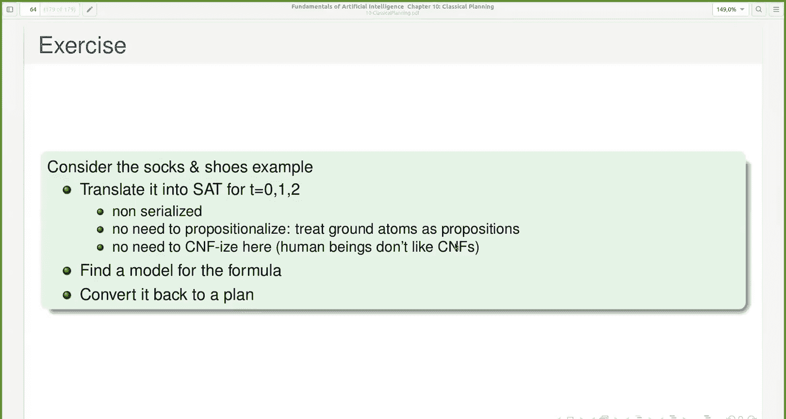

# 意大利特伦托大学《人工智能基础｜Fundamentals of Artificial Intelligence 2024》中英字幕deepseek p31 2024.12.02-CL24-1-CH10-ClassicalPlanning.zh_en -BV1uUkwYTEmf_p31-

Okay， so today， we conclude the。Chapter on classical planning。Last time we have okay， we。

Introduced to the Nohell planning graph。And we are seen that pen graph substantially allows you to build very quickly。

 very efficiently。An novel approximation of all the possible execution and valid executions of a plan。

Oh， planning problem。In some cases， it allows to conclude that there is no solution。

 while this is quite little optimistic but。In general， Ukraine， in some scenarios， this may happen。

And。Pgraph maybe is used substantially for two different issues。 One for providing information。

 which is to be the quickly heuristics and。So Iconic probably most important。

As inside a general algorithm， which is called a graph line。Is it Jenna。

I will call it general algorithm because not really an algorithm per say。

 but it's a sort of a meta algorithm。 So。A parametric algorithm。

Wwhich is parametering two fundamental steps okay how to expand a graph and in particular on the search person which is extract solution。

 So what does this do withve seen time so I go quite quickly Uniize the planning graph and you decide how deep as a starting point you want it you can even do zero okay so only the level zero。

ok。You have some new goods， which is an empty hash table of pair goal level， okay。

 and then you iterate。And what you do is that。If a。😊，诶。If you have in the most in the highest level。

 you have that all the goals in the goal lit occur and and occur in non moex way。

 then you can try to see。If there is。A solution。 So it potentially the graph is ready for potentially contain a solution。

 And so you invoke a natural search extract solution。

 I would have called it a search for solution rather than an extra solution， because it looks。

Extra solution looks easy， computational easy this is definitely not is a planning problem is a planning algorithm the but。

With a big advantage， it has a lot of restrictionss。 So you have room。

lott of candidatedid path proved apparently prioroli。Okay。

 so you have all the constraints introduced and all the you are limited， first of all。

 you are limited only to the fluidza to the action which are in the graphman with the planning graph。

 and second you have all the moex which are loan a priori to the graph to the planning so that you can drastically cut the search。

Okay， if you are lacking it for if finds a solution then great， you are done， you can conclude。😊，Yes。

Then if both the graph， so youre each at this step， both the graph then the goods have both level of。

 So there is no nothing new。Okay， so nothing new could be added。

 so the layers are you cannot expand it anymore without。And without adding any new information。

 then you return failure。 Otherwise， you add one layer。 Well， add one or more layers。 in principle。

 you can， you can do more。You may know this data。These are got them Ken。Be seen that。

As a form of iterativeivity deepening。Okay， so the point is when at caista。

From one point where you reach。You reach a level in which you can invoke an extra solution world。

 Okay， so you try solution for that T。 then no， then you try a solution find solution for for level T plus 1 and T plus 2。

 T plus 3， T plus 4 and so on a 4。 until you either。Find a solution or you reach a fixed point。

 so a point where you are guaranteed that you not proceed anymore。は。Yeah。Oh。ok 诶。Okay。

 I think that yesterday we got here， right？Yesterday， Monday， Friday。Okay。

 so if you consider if you remember the example of the tire problem。What you can do is so again。

 remember you have initially we have a flat tire and you have a spare tire and you have the flated axel and you have the in the trunknanglel what you can do is to remove some object from a place and to put on an axle。

And some are relevant function， just to remind that a typical independent problem。

 you have only a minor subset。Of relevant actions， most of them are not relevant。Okay， so this。

 if you look at the planning graph， it looks like something like that， so。Initially。Okay。

 so you have okay， remember， initially apart from， okay， we don't consider。In the Gulfland。

 we don't consider the。The type the type few。 Okay， so the fat that this attire。

 the flood that this an axle is an axle blah， blah， bla。 Okay， so these are fixed。

 so you can imagine them as a fixed line which you you can add below and they are not very relevant。

 okay。So they hold， so those predicates here。T are flighted， I spare。They don't。 they don't change。

Okay， so you can please assume I' below the graph， okay。And so we don't consider that。

 So initial the goal， you have that flat at flat Xxle and at spare trunk， Okay so。These are the two。

 So Le， you not use。At spare Frank， and X。 Okay， and of course， the other three。

Remember by a close border assumption， they are， they are fault。

 So you have also not at spare axle So the spare is not an axle， which is actually a goal。

 not the flat the ground。And not the thes on the ground。ok。So。Oh。

The goal is at spare axle is not in as zero。😡，Okay。

Which means that you don't need to call extra solution。So you have no way of obtaining graph at laze。

 which is quite intuitive2 say， so it's very rare that。

So probably if your goal is already satisfied at initial step。

 so probably the problem is not very very well formula， okay。Or at least it's three， okay？So。

 also the graphs and the woods are not let off so。有。Okay invoke the expander rough。Next one， okay。

You are the layer。Easy哦。Well， of course， first of all， you had all these persistent actions。Okay。

And so what can you apply。啊。Well， here you have the action remove spare trunk can be can applied。

Okay。😊，Why， because the recognition at the spare fnc。makes removal a spare trunk applicable。Okay。

 and also you can remove a flat exxle。Okay， is applicable as well。Because you're at Fl Axle。

Is there notice that the order， the relative order by which you apply these to。

This to ist relevant here。Okay， so if you are changing if you since that you have enough space on the ground。

 okay， so the order by which you take the wheel out of the axle and the flat wheel out of the axle put it on the ground and and the one in which you take the good wheel from the spare wheel from the trunk。

To the ground is irrelevant。ok。😊，Each or what。Okay， consequence。The consequence of。

Remover spare trunk is that the spare is no more of the trunk。 Okay。

 and that you have a new item here。 You have a newluent， which was not there。

 You have at spare ground。 Remember that it was negative before。Okay。The result of remover flat axel。

 Okay， is that。You don't have the flexs anymore at thatxel and that you have the flat on the ground。

Okay。So what about。What about the motorex。 Okay， Remove spare trunk， of course。

 is incompatible with a0。 Okay， because they， they generate opposite motorex here。

In the interfent mo access are oted。 Okay here in this graph。

 So there although there would have been。Useful， to some extent。 Okay， so these are。

 of course incompatible。 So this is incompatible as well。Also。

Remooted flat axle is incompatible with。Washy is it yeah， okay。

 this incompatible with well forget liver than， Okay。

 so this is just you are you needed to produce also rather the effects of and rather than a little because when you build in the graph。

 you don't know。That in actually is actually irrelevant， okay？So okay。

 but I will ignore the live overnight here。Okay， so as a result here， you have we have a couple of。

Of new。Of new flus at flat ground and at spare ground。是？😊。

So this means that the next type you have tool。😡，Proroppaate。

 so you have two more persistent actions。Here。嗯。In particular。

 you are now you have the potentially the same。U。The same。Action as before。

 because we have still have the the。The productquisite， typically remember。In a graph。

 actions and fluluenza are monotonically increasing。Okay。

 so obviously you have the very same action as before。Okay。😊，You have one more action。

 which is put on spare axle。 So you can with the spare on the axle。 Why。

 because now you have the spare on the ground。And the。And reflect access。In't the model there？

Can can be no more there。 Okay， so you have one action mode， which is all spare action。Okay。

 and then you beat the mo Texas。As a consequence， I let you by exercise to write down all the mo access between the fluids。

Okay。嗯。Okay， I think I went a little faster， Okay， so。By the way， here you can。At this level。

 you can emvoke the， I forgot to say you can emvoke the expandoography because of the。The was it。No。

 okay， so at this point Im sorry we are here at this point now you can evoke a span graph。Why。

 because you have the goal。The goal is on the let there。 And then。What you see is that。

You can expand risk layer， if you。So you can， you emvoke a spangraph here at this ladder， Okay。

 because the good are not。Level of。 And at this level here。You have E spare axle。Okay， sorry。

 I I forgot to click。You are here now， you have at spare assets， so you can invoke a solution。

Is there a solution now， yes， there is。Because you can remove a spare trunk and this generates not at spare trunk and at spare ground。

Remove flight a generating knot of flight。Axle and at spare round， okay。

Now you are ready to apply to the own spare axle。Okay。😊，Which generate a goal。Not is here。

That invoking a search solution here is way more efficient than invoking a a search from scratch。

 because this graph tells you that's the search engine a priori。That many。

 many possible application are not feasible。That are feasible four reasons reaching。

You don't actually need to search， but just。To be a propagational constraint of a Mutex constraint。

Okay。So。You can think。As really a planning graph as a sort of pre processing of the problem in which you bid a sort of。

Set of path， sort of directions。A set of rules and constraintsh。

 which drive you your search afterwards。Then when you're here。

 spanR can use whatever search engine you may want to set base SSP planning fast forward， forward。

 backward， whatever。 But the key point is that you have many， many， many constraints。So。

 first of all。I's not that you can apply every possible action。 Okay。

 so it already tells you which action you can apply which key you cannot。

 It already tells what which。Literal you can look at and which lit you， if not lit。Look at， okay。

If you say it， sorry， I meant fluent。 Okay， which fluent look at。And in particular， you。

You also have a set of constraints that as soon as you say decide that to try one action。

 it automatically tells you that you cannot try this other action because I autex and as soon as you state that fluent and poets。

 you automatically know that this other fluid doesn't hold。Okay， so this cuts you a lot of search。

As they say。The graph1 is not an algorithm inside this， you insert your favorite algorithm。Okay。

 the first the first search a star is the backward for whatever。 Okay。

 but this drastically reduces your search。我。I remember when a G plan was invented。

 I was a masters student and it was a really， really， really， really a back。I break through， I mean。

 gain the orders of magnitude in terms of the efficiency。ok。By exercise。I give you some exercises。

 of course， as I say， for planning， we are just giving a very high level idea what is planning is if you I recommend you to take the course of Professor Roary on planning explicitly which is where all this stuff will be。

Investigative with a much deeper detail。Okay。Exercise， I will consider the followingvari。

You add the flat traet to the gold。Okay， so which is quite。I mean。啊。Meaning。And okay。

 also write the no serialized of a new graph。Ex stack the plane from the graph do the same with the serialized planning graph for both serialize the planning graph and build a planning graph a serialized one。

And question？诶。Some fundamental factor， graph plane is not an algorithm， as I said， is a f algorithm。

Okay， which depends。Mostly on the approach used for an extra solution。One of the popular。

Very popular techniques we used with the graph plan was to include this as a S problem。

 as propositions of this probability problem， in fact。

 the very first version of graph plan was proposed as in combination with the SAT。S coding。

I will mention this in the last chapter just a hint thing。Some kind of encoding。

 So the idea is that every proposition for every ground action and fluent。

And closes represent the precondition effects and no operations and mo access。

Can be also format as a sort of backward search problem。For instance， so these are alternatives。

 okay？The key point is that the planning problem is restrictedited to the planning graph。

This is much so as a result， they search engine whatever it is such solve vector search blur。Is much。

 much。There's a lot of indication where not to search。They does not lose。

Time to search for potential parts， which cannot have any， any possibility of solution。

 So it allows you to ruinrune large amounts of sub trees， sub search trees。

 which I not hope to find to bring you to a solution。喂。Something important is the pering of。

Sudialize vessel analyze。In general， it's much much more efficient to produce partial order planes。

As they said， why should I abandon years？To serialize things when it may can bring me some solution。

 which is not serialerilized， but which I can。Addopt whatever order I want。So think about that。

If think the sub plan of bringing both wheels on the ground。Okay。So one。

 if you consider them every single action as a stepper。Then this requires you two steps。Okay。

 either taking the flat on the ground。First， and then taking the spare on the ground second or Vichaas。

And with so you have two layers with two layers of action， blah， blah， blah。

But you understand that it's completely relevant to the order by which you do those sorts of things。

 right？Okay。So。😡，In in partial order planes， you can see that your exploit with a relevance。So。

 you'll。You may think this as parallellyzing， you can actions in parallel。

More conveniently is not the case that you are doing them in part， even though principle you could。

 but the point is that you don't really care the order by which tools are taken。

So they can every possibility inter livings of those actions can are potentially good， okay。

So why she， so India is。Not to duplicate the steps。Comppressise in one step， all the。

Or the scenarios when you can have more actions， which in principle could be run in parallel。

Or in whatever order you mail like without interfering to each other。

 this is what we call the partial order plans。Okay。

Which eventually can be later serialized in any total on Japan， you know。

Whenever you have a partial airplane， you can decide to take whatever order you may like。

 which is compliant with the partial order。So actually either taking this before this or this before this。

 who cares？She。Yeah。Okay， if you comment about a partial order， versus total order。Okay。

A total order plan is a strictly linear sequences of actions。 Okay， so no。One。

 define I split I take this action， then I take this action， then I take this action， then think。

 blah， blah， okay。And this is ignored so disregards the fact that some actions pairs of action or groups of actions are independent。

 so can be run independently or even in parallel and if you had the parallel execution。

Partial order plan and what is which are typically what planning planners do。嗯。

Just produce a set of precedence constraints between actions。

 So says you have to run this action before this other action。そ。President Goslanson。

A group of presidents concerned， Okay， which you are。 So what is called in in the mathematics。

 a partial order。Okay。Once you have a partial order。You can take whatever total order you may like。

 which is compliant with this better order， okay？W。

Not is that a partial order former my director a psychograph， okay。What is the van。

 the advantage of a dug is that typically the longest path in the partial or can be much。

 much shorter。Then any total order。呢个是要。Collapse together groups of independent actions。Okay。

 which means that you need much， much less layers。In graphraph length and much， much less variables。

😡，In if you do use a CSP or something。Icod， as we will see in the next step。

 So the the more less the number of steps you are considering， the much easier is。

The search problem to solved。And this is trivia to convert eventually into total order。Okay。

 just to give you a very simple example here。The sockson shoes example。Okay。

 so you're are in the morning。And you are wearing， okay， nothing particularly difficult as a task。

 you have to put on a couple of socks and a couple of shoes。Quite standard action。

You may notice that。You may have， but。You can do this in many orders。Okay。

So at the start to decide which one you take this first left shock on a socks on a right shock。

 the only complaint that putting on the next shock is after start， okay。

 typically in planning we have some fake actions which are starting and just to synchronize。Ps， Okay。

 so the left putting in the left sock should be done before putting the left shoes and that putting the right sock should be done before putting the right shoes。

 Okay， but apart of red， you have all possible is6 possible inter meetings。Of this kind of actions。

So notice is that。This means that here you have substantially。啊。One， two。

 three layers of states and two layers of actions here you have six layers of state and five layers of actions。

So the serialized。Graft， when we have deep， we have depth 5。

 whereas the low cell lines will have depth 2。You see。This is clear。

 and these are completely equivalent because out of that。It's it's trivial， but I mean。

 when I say really is really trivial， it does not mean any search to do just take whatever alternative you may want。

To find no one possible social。 So this is the difference between civilized and non serialized。 Okay。

 the clear。But if you do encode， not a serializing code， and we waste a lot of layers in the。

If you do when you waste lot of layers， you also waste a lot of search， lot of variables。Okay。

So that's why typically most planets reason in terms of nocereride， so produce partial orderines。

Okay， a few facts about the draftman。When all the graphs and all the goods have been leveled off norus found。

 we can safely determine a the why meaning that there is no chance。Of having a plan。Okay。

 what is the intuition that lit s increase monotonically and are finite？Okay。

 so we eventually reach a level where they stabilize， okay， so。There are fact that。So if， okay。

 one principle of a monotonicity is that if you have a finite amount of possible。Combinminations。

Its a super a subset。 So the set of flu is a subset of a fixed。We find the set， Okay。

 and every time I delete you they I either increase it or keep the same。 So it's monoonic。

And this means that sooner or later。You youll finish with increasing， okay， because you have a file。

 you have all your finite number of that you can do similarly。

M taxes and no goods decrease monotonically， and it cannot become a less than zero， okay。

 so two eventually must level off。So this means that。Soer or later， you get with a stable state。

 So state where you。You get what is called the fixed point。You I right。

Ha anybody of you know you are too young， I think they taking the program of course with me。No， no。

 you're too young for that， yeah。诶。The point is that there is a kind of cycle。

A typical pattern cyclic behavior， which is called a fixed point。

So when you reach a stable state such that if you reapply another cycle， you get the same state。

And this means that forever， you always get to the same state， okay？

So this happens in some situation， particular when you have monotonistic conditions。Okay。

 and this is what you call the reaching a fixed point。

Reaching the point where if you repeat again the same action you will get。

Stuck into the same position。Okay。Is it the typical scenario when you have a more ethnicity situations？

When you have reached this devstate， if no one of the goal leader is missing or。

Or its muttex with another goalli。 Then it will remain so。Okay， so we can stop。

So if you haven't found a solution so far， you can stop。

 you can be sure that we cannot get a solution。Okay。😊，Okay。Okay， so I leave you some exercise。

Consider here the socks and shoes example。For my， the socksuction shoes example in PDdDL， well。

 that's reasonably easier we say。Right in the no last pen graph。

Complete the level cost for every student。Choose some states。

 compute HRS using the three heuristics that we have mentioned。I stuck a flame from graph in two。

Do the by2。Compare HS with the level they occur on the plan。

Write the serialized planning graph and repeat the steps 3 to6 with the serialized graph。

Do the same for the the air cargo transport example。Okay， Sostasha。

 you play a little with the concept that we have seen。

You notice that you'll notice a big difference between the serialized and non serialized。Okay。

 let's realize。And to blow， blo in size。Okay。😊，Whereas the no is much， much more complex。

Any question。Okay， I would like to conclude this chapter。

 making one very popular form of a sur planninging search。It's not the only one。But it was a。

He has been the probably the leading one for many years nowadays， sometimes it is， sometimes is' not。

Which is。The one based on such sorting。Once we have build planning graph， once we have build。

We know the depth1lahla。 How can we do extract solution。The answer is one possibility。

 and this was actually the very first idea。For some Garplan originally that was proposed as a sup。

Based plan to encode it into a such problem。In general。These works are follow。The point is。

 given a bounded planning problem。Why bounded？Well。Well， the first observation is， oh， come on。

But you say that planning is a peace space complete program。If you encode this to SA。

 which is a name P complete problem。In general， there system no polynomial encoding of that。

 So you mean an exponential encoding。And in fact， if you take a tower of annoi problem。

 you try to encode this into SA， well with sufficient big number of all these。

 like say with the 0 20 disks you you start being a very serious problem okay because this is exponentialinia in the number of disk。

Okay， so you may have the。Something like in the million of a million of steps to solve it。

You know the trick of easily computing the powers of two， right？2 to the 10 is 1000。1 24。

Rund it to 1000， Okay， so。2 to the 20， you a million。Two to the 30 is 1 billion and so on。

You can estimate costly the trick。Okay， so。They say。The point is that。In with the graft plan。

We put the bound， okay。We have found， so we extract solution， extract solution we have bounded。

Blening problem， okay。Bund is the number of steps， the number of layers。Okay。

If we have a band of problems， we can encode this into SA polynomially。Okay。

And solve it by such solving。 Well， if you remember。When we spoke about such solving。

 I mentioned one of the last lies I is the modern such solar。Have a very nice feature。

 which is incremental。s明。Incremental solving means that if you have the input of a formula is not an input in the strict science。

 but has a push a pop filter phase， you can add the close。Pop， you can pop and push clothes。

From the interface， I run solution。And the key point is that if you push and pop a limited amount of clauses。

 you save。Most of the closes， most of the search that you've done。 so you don't repeat。😡。

You can exploit the information that you have gathered in the previous search。

 and this dramatically improves the performances。The way this works is is。Will be analyzed in。

If the automatic reasoning occurs， okay， if you are attending it。However。Trust me。

 that this is the case。And， in fact，Increment such solar was breathing。

Exactly by both planning and its counterpart in front of verification。

 which is bundle model checking。Okay， they said。The idea is to encode the planning problem into a boole formula around sub shoulder on top of it。

Okay。And so in such a way that a model or a satisfying assignment or the formula corresponds to a plan to a valid plan。

And if no solution， so if the problem turns out to be unsatisfiable instead。

 this means there is no plan up to that level。There are many variation of the coding how we into this in the next slide。

This is streamy。Efficient with many problems of interest。So what is the general idea about that。

 okay。So you if Tax is the number of upper limit for the playing length。the maximum number of steps。

So for 0 to T max， you translate。都撒噶。The problem which is given by the initial state。

 the translation relations or the set of actions and the goal at step T。So introduce a boion formula。

The Ch F bo formula， which is the thencoding of the problem。

 we'll see that in the next we'll hear about that in the next slide。

Then you invoke a such soldier on top of it。And if this returns you a model。

Then you can ease start solution here， extra solution is the tri。Okay。

 a solution is just a table of translation。Out of that。

Sota is looking at this value and associated this to the state variable the fluent variables。

 the corresponding flu ground the flu which is associated Okay， let me。How does this encoding work。

 there are many， many variants of this encoding。But。Okay。

The first point is that you associate a boolean variable to every ground if youent on every grand actions。

Okay， well give the name you like， one possible convention is that you put these all within the scores or the steps。

At。TheThe pay。To every grand of given the step。The step of its perform。 So the action。

 the action at at P1 is one the flu at P1 San Francisco at step 3 can translate in the at P1。

 San Francisco 3。 So give it a limit convention， okay。手术大小院子。

You have one billionionnao for every possible ground。 if you went at every step。

And the same for an action。Flly P1 for San JKS step 3 can be labeled with a well bullet variable。

Okay。😊，Okay， how does this encoding words， The encoding is given by the conjunction of three blocks over closes。

 which you call it as step 0。The unrolling or transitional nation from step T -1 from。

For step I and the goal and the formula goal， which is represent the goal as step D。

 Let me describe these three elements here。Well any and goal are the easy one。😡。

Inta step 0 means that。Up step 0， the。Must be the flu of the state must be true。Okay。So for， at P1。

 San Francisco0 and at P2 JeffK0。And so here， of course。

 I forgot the end of the negation of the others， okay。State， I forgot。

Here I forgot to say that I also have to ne the others because of closed the world assumption。Okay。

The goal is just describes。The the goal of influence at a step for thing。Okay， so if， for instance。

 you depending of。The layer of the goal。 So if my。Gal step history3。 I will。

I will say that that influence must be true at or false at step at that giver step。ok。That's18。Now。

 what's the point of the transitional relation。Does usually， you have。Here we have a conjunction。

Conjunion over all the step。 So over step， you have。

 you have to introduce a new Booleion formula yeah。Which is a set of clauses in Gene F。

Representing the。The transition between step。T to step， D plus one。Okay。

 so representing all the set of pairs of， of flu。Which are one the successor of the other。

 such that every solution， every solution。Every resolution of this formula represents a pair of states。

One is step T， the other step T plus one。Such that the state of stepputy+1 is a successor。

Of stability， through some action。So you have to represent in terms of that of current and next state。

What are the possible evolution fluidza through some actions？Are we there。Okay。

 so this consistsing several。Kinds of of clothess。The first one。Says that in action at step I。

In order to be true。Means that all the precondition of this step I must be true。

And all the effects will be2 step I plus one。Can we do that， yes。

 of course we know the precondition of every action， we know the effects of every action。Okay。

 so for instance。Fly P1 from San Francisco to JeffK， step 2。Okay， means that。

P1 should be plane1 should be at P1， San Francisco2， So plane 1 should be a San Francisco， step 2。

And this is the premise。Okay。And the consequence should be that at P1， Jeff Katherine。Okay。

Can anybody please send me an email remembering that I issue the span other the negative influence here？

Okay。I forgot to do that。Okay， the nobs Sir。Are much more difficult to encode。

One of the biggest problem in a pen graph which people have encountered is how to。

Represent the fact that you are not doing， something that you are not doing anything about。Some food。

Okay。Because affluent。So telling that if nothing encounter nothing。

Is done which modify a given fluent。Then you have the same fluident。

 the same fluid will hold the ocean tape。Okay， there are many。

 many encoding different encodings to that。啊。For instance， one is。

This one possible coding is this one。The fluent forever fluent。And step I。

You can write the following formula， but this is notF， then you signifies it。

sometimes you use it right。To write complicated formula in no sin format。

 then you also you know how to sign it okay。So the fluent F holds a step I plus1 ethanol leaf。Either。

TheThis is the big over all possible actions， which cause。If I where F I S。Among these effects。

So either one of these actions is true。Okay。Or notice either this is not a strict。

This is a non exclusive law， Okay， so this you can have more than one。

At least one of the actions which cause。TheThe fruit F hold step F I or。F I holds。

In the previous case， and there is no action。Which causes？Notify。And another none of the clauses。

 which caused the negation of5 old。Okay。No。So what is the condition， so how high has it differentent？

Caolds new data and in state。Either。There is an action which produces this。Okay。Or there is。

 or it already holds in the previous state， and there is and none of the action which deletes it is applied of course。

Okay。😊，was there。So substantially， what you do is。For all the action。

 So either there is one action causing it or。If I hold hold in in a previous step， I and。

And the action which causing not F， I believe are not executed the step I。Okay。😊，And here comes。The。

The notice that you do that only for the flu， which so if you are restricted to the graft plan。

 you do that。Only。For the flu。Which actually occur in the graph plane。She are not adding flus。

 which should not occur in the graph line。And also， a fundamental fact。The motel constraints。

Are incredibly easy to encode。😡，ok。Why， well， just do a ne and all of the neations。

Or three prefer of the navigationation at the end。If I say not。Fly P1 of J K2。

Or not flight P once a Newar， too。Okay， you say。At step 2。They simply cannot。fly。

Contemporarily from San Francisco to GFK and from San Francisco to the Newark。Okay。

So this two action。Cannot be executed contemporly。At the same step。

The not A or not B is very frequent， iss called the Muex clause。

 saying that these two atoms cannot be true contemporary。Cannot be both through， okay？And this。

 you notice that you add a large amount of those constraints。😊，Sstanally， you are the one。

One such constraint for every action， which is motex。

Which is a motex in the grassland in the for pair of fluids。Which are in moex。

 if they are not obvious in moex。 So you don't need add not A or a。Okay。

 because this comes automatically for the logic。But if you remember you。

 if you add the moex in the graph plan， which are not derived simply by the fact that the data is ne of the other。

 but this is implicit， then you can add the mo cross line。Adding mocho range is a very。

 very important insight。😡，Why， because as long that you assigned one of these to true。The other。

Becomes a unit。And the unit is immediately negd。Remember how sub solving works？When you have a unit。

 determin step， it's immediately unit propagated。Deterministic it wants us all to do like that。

So automatically， one is set to true， the other is immediately set to force to be false。

Reter miniically。And this save you a lot of search。Okay。😊，Here out to everybody。

So this is in this case。😡，The presence of a large amount of mut access， dramatically。

Cats the cost of the search。Because。As long as you assign these to true。One little too true。

Another litter is immediately assigned to false。Okay。That lead。

 the second it would be eventually assigned to force anyway。

 but in order to understand that it cannot。That little could not be assigned true the third would have done a lot of search。

You have to use the search。Is that in this case， you are automatically。A side of value。

 which have no choice， no chance would be assigned the truth。Okay。

But would have taken a lot of effort。To the soft soldier to understand。

To find out that it can be assigned。Okay。This is really， really huge improvement in performances。

哦 ok 。Exercise， I give you by exercise or MSA。And colonies are much more sophisticated than this。

 Okay， you may also want to， for instance。This is the the simplest form of encodings which actions you have one lit for every grand action and one。

And one liter for ever flu， that are much more efficient ins。First in using嘅。

And look algorithm we can coding。 So if you have。16 possible grand actions。

You can either put 16 values， 16 billion variable， or use four boolean atoms。Okay。

Which decide and which value。So do a binary encoding or which value you are incoding。

 So for instance， if you have an instant say， if you have， say eight airports。 So the at。

The eight fluent has possible， say up to88 possible the airport or 16 or 32 or whatever， okay？

Other you can do one fresh bonanato for every possible institution。Which may be really many。

Or you can do it。Loarithmic andcoding or the algorithm。 So you say San Francisco is number 0。

 JFK is number one。 New York is number two and so on。 You build a。You use say。

 three bits or four bits to encode this number， okay。

 and they use a combination of those bits to say。Whether you fly from airport one for San Francisco to New York or whatever。

So you use a conjunction of a bit encode a little rather than。

A large amount of possible different litants， wool atoms， okay？

So just to say that there are much as smarter employees politics。

 but these are the easier to understand。Okay。😊，🤧H。Okay。

 so I leave you by exercise to consider the soccer and shoes example。

 which is really really very basic Russia。Does that mean two S 4 t equals 012？Well， North。Okay。

 notice that the fact that we propositionize。It's just that。Just a synthetic sugar， okay。

 because you can。Consider。You can pretend that every distinct grand atom is a bo use a boolean atom。

 okay？Sos just a see。Okay， so you don't really know what I could propositionalize。

It's not something that you really need。Okay， you just go， okay， this not on each other。

 not on each other not do。And simply the fact that is written synthetically different makes it a different data。

Okay， so you don't really need it， okay？Okay， if you want you， you can avoid using Cfs。 Okay。

 just let me tell you。CineF is good for solve， for computers。Not so nice for humans。

Humans don't like S very much。If I show you two equivalent formula， one written as implications。

 blah blah， and the other is written in CF， they' are absolutely the very same formula。

 but you read much easily than UF1。Okay。So we tend to we humans tend to reason in an oceanF。

But computers are very much much more to user with Cf instead， okay。So。Find the model托放咩。

And they convert it back to playing。 Oh， I just to mention。

I believe he's quite obvious views now that I explain this。How a solution。Is maximumim。

 So if a solution， I say that a solution is。At the P1， San Francisco is made it true。ok。

And at fly from San fsquitoes say phase step two is。Is true。 And the other force。

 I will take all the action we are through and put them in order。 and this is a plan。Okay。😊。

You see the translating back from a staff film to a plane is brilliant。ok。Okay， so I think that's it。

 Is there any question。Okay，1 for a break， let's resume to 45。

As usual today you will find the to recording。Okay， I close， I close the recording now。系。

