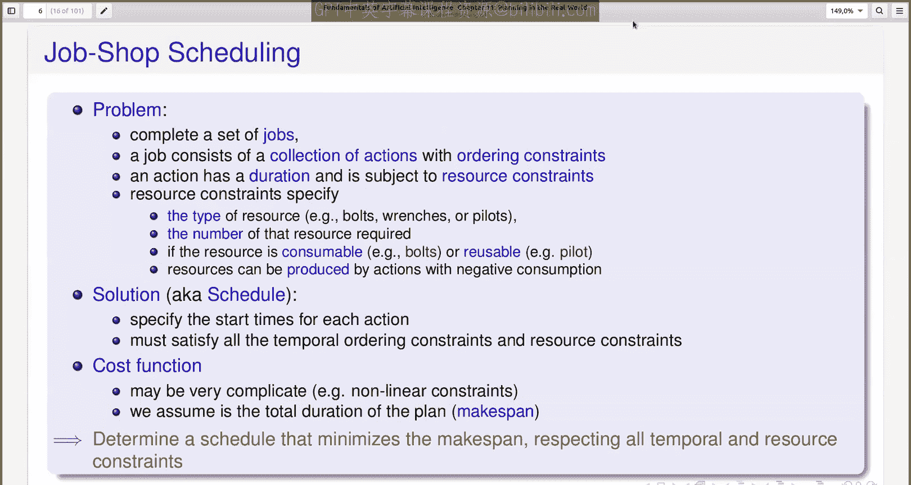

# 意大利特伦托大学《人工智能基础｜Fundamentals of Artificial Intelligence 2024》中英字幕deepseek p32 2024.12.02-CL24-2-CH11-GeneralPlanning.zh_en -BV1uUkwYTEmf_p32-

Okay， we stuck。哦。So today， we started discussion。 started。 started。Okay。

 today we start discussing the new topic， which is an extension of the previous one。

Which is planninging in the real water。 So we go。Wepon a little our horizons about planning with respect spectro classical planning。

 and in particular， we。We go into different direction notice that planning is much more than this。

 okay， way， way more than this， Okay， but I just try to cover a little the main direction of current planners。

And one is。Elarging， extending what we' have seen in Pla planning with two fundamental elements。

One is time。So having a place， which really。Consider time as the dark time taken to the plan to execute one action。

And deals with that。And also， and this is more generally related to something。

Which is called the shadowing， some topic which is called the shadowing。

 which actually was invented much before AI was invented。Okay。

 so shadowing is something that existed before AI。But now found a perfect interleaving emerging into AI。

And then， we try to see。Weiate to planning many of the things that we have seen in chapters4 and5。

 remember。Planning with sorry。Search without sensors。 Okay， sensor planning。

 which is also called conform planning。Or诶。A planning with the non deterministic steps。

 which is contingent planning or conditional planning and so on and so forth。 So we too。

The actual planning domain， many of the things that distinction of plane search that weve seen in chapter4。

 if I remember correctly。Okay。Again，We just scratched the surface here。

 you will see in in detail this in with much more detail all those topics with the planning course of Professor Alnery。

Oh。Okay， shading or playing with their sources， okay？So， so far。Planning is just a choice of actions。

 Okay， regardless the consequences， So only you are in a discrete war that you decide taking this action。

 take this other action possibly be instantiateated and won。HoweverWhatever。

 so action is just an atomic concept okay， so we do that and all the consequence for us is thes which change according to those actions okay。

A plan is much more than this in general。 and in particular， you。Every action has a duration。Okay。

D time。诶。Takes all sorts of thoughts about this is something that we'll see later， okay。

So in general， action occur at a certain moment of time。 Okay。

 they have a start and a beginning over an end。 Okay， and all action have a duration。

 an estimated duration。 Okay， you know how much time it takes。And。

If some action is supposed to come before another action。

 the second action has to wait until the previous one is terminated。

So cannot start before the one is terminated， so for instance。

 if action number two should come before after action number one and the action number one takes 10 seconds。

Okay， we are sure that you cannot start action number two than 10 seconds starting after the beginning。

 the start of action number one， maybe later。But for sure， not earlier。Okay。😊。

Something I would be quite obvious， right？Okay， and this is overall the computer since many action can be computed in parallel or sequential or can be executed in in parallel inpart order。

 then it's important also to consider at this time because if you have just a sur， okay。

 this if you have a servererized plan， this is just the sum of the execution that's。

Computationally easy， but very inefficient。But if you are able to inter actions。

 So if doing this action takes less than doing this action， but it can be run in parallel。 Okay。

 I I should consider the respective dependencies。Is such a way to optimize the usage of plane？但系。

And this where shadowy comes into plane。Okay， once I。I is resources。It's not well， you say， okay。

 I I can run the take the wire， the flat wire off to the ground from the axle off to the ground and take。

One action。Take you the spare one from the trunk to the ground， I came down this in parallel。Well。

 yes， if there are two people who can do that。If you have tool sources。Which can be used。Okay。

 if not， you have to sterilize them。if you are discharging changing the tire of many cars conly and you have only five people。

 you can optimize the path in such a way to optimize the time taken because you cannot do that all conarily。

Okay， so the fact that you can act， make or not make some actions conarily depends on the kind of resources you have。

Okay， clear。So in general， you may have the preconditions and effects。So far。

 we have seen the precondition effect just fluidence， adjust just sorry literals。 Okay。

 the the add and delete。 So precondition and effect that they are positive or negative literals。

 Okay， now you can include some extra information。Lo inferences， Well we are not touching this。

 but numerical computation and interaction with other software packages。 So you。You can have。

The planning can be， can be just air。A sub of something much more complicated。Okay。

 so just can run a subberine， but in a much much more complicated context which involve numerical computation。

 optimization， some logical inference and other。Okay。

 as we consider the first the the scheduling problem。And the second holder， the with the resources。

Okay， and in general of the approach is。A plan first。Shachedule later。 So first， find a。

Partial order plan。Ar order， that's important。 So a list of dependencies。Okay， not to the long。

 And then。Oh。Once you have this， you instantate the special order with the optimum possible instant。

 depending on time。And mosts。Okay。😊，Not。Time constraintsants， and in the second order。

 you can consider also resource constraints。Dep on the actual resource that you have again。

 if you have only one actor checking if two things to operation can be run by the same actor and you have only one of them。

Then this is something that you cannot do content in parallel。Okay。

 so if you consider this problem here。You know， there is something youre hidden。

 temporary hidden informational so what you see here is the。A classical dining version。

 or one more sophisticated problem。Okay， so you can see that initially you have a couple of chasiss。

 C1 in the C2。And you have an engine a1， which should be put in aSE1， which is suitable for aSE1。

Yeah， aging C means engine the。A given engine is suitable for a given shall see。

 So you cannot put the the the engine of a Ferrari on top of over 5500 or theant is 500。

 sorry of which of us， right， okay。Well。Yes。And again， wheels， the wheel W1 for sea number one。

 and the wheels W2 for number two， again， that not every wheel can be put in another car， okay？

You know， when you buy a car that you have， this is suitable for a given kind of wheels， okay。

 with a given form of attack and whatever， okay？Then， okay， you have a done a dance。

 dance you one dance2。 Okay， sometimes。By what is the meaning of done。

 sometimes when you have a complicated planning。You have some fake。Fluence。Like done for instance。

 which says， okay， everything is is done， so just they are put there adjusted for synchronized to establish。

 okay， this is done。And of course， this flus will be a consequence of some more sophisticated combination of flus。

ok。Like for instance， in action， for instance， we start from some initial state which is init and one fake initial state which is init and the fake initial final start which is end。

 okay in such a way to synchronize all action。Sometimes we do that。Okay。

 so Chasis one is done and the Chasis2 is done is the goal， okay？Okay。

 we have an action notice that so far we are just doing。Blaming嘅诶 classic嘅 bing嘅。Add engines。

 take an engine E andsis for HS C2， and the precondition that is the engine suitable for the giving Sha sea。

The CSs see and the engine origin is not on the sheea， of course。And as a result。

 the engine is in the shaee。Okay。😊，The actualction at wheel。

 very similar is that W is suitable for a given wheel to a given shalli。

 the wheel is we can think of W as a pair or the group of the four wheels， okay。

The weeds are for the given Shasis and the seear Shais there result that the wes are on the chasis。

Okay， the actual inspector says that the engine must be on inspector the see。And the engine。

 the inspector is on。On the given Shai， then we say that the precondition。

As that the engine should be in the chassee。And the width should be on the shesis and the N sea it must be shessi。

 of course， as usual， and the result is down。😊，If the is done here comes there。The fluent。

 the fake fluent done， okay？So okay， everything is fine。Okay， you see this。

If you consider all of this information， this is just a planning， a classic planning problem。See。

 and then you say that you do some action for typically and you'll put then and energy in1 and N G2 and there be using some other2。

不问了。You can in。 but then there's nothing like only that you can。Have more information。Okay。

 and we add， for instance， the information of durations time， how much time does it take？就是 that。

Okay。So。What。We know from the information that you have that putting engine to the Shasit2。

And you requires a 60 seconds， seconds minutes， whatever time unit， okay， and put the wheels。

 the group of wheel W1 over C1 requires 30 minutes。Instead。

 putting the wheels C2 over W2 over the C2 takes 150 minutes because they are easier to mount Okay。

 for some reason they they have。5 four olds rather than five olds or whatever， okay。sorry。

 five nutss rather for nutss or whatever， or they you have also to to use pay attention， whatever。

 Okay， so you provide V extra information okay。诶。I also forgot to say that putting the engine one is2 requires 60 second okay。

 did everything here。No。The action takes in general， the direction。So we say is that。

That if you pass D， the duration D， let's say the D is a duration。So you add this extra information。

Okay， similar to other wheels has the information。Okay。Well。

 notice that sometimes so the information can be other variables or something that you provide externally or something which is known a prior so we have a partial instant to action。

Okay， for instance， we know the expression takes 10 minutes， 10 seconds or 10 minutes or whatever。

1 time you whatever you're speaking about。Okay， so in this case。The ratio is not a variable。

 but it's a constant。哦。Notice something important here。We assume。

Planning that so far is just a symbolic manipulation。Knows the numbers。Well， this they say， come on。

 that's obvious。oh。This means that you have to provide an engine which is not purely logical。

Unless you want to encode everything in the piano in， which is foolish， Okay， so you need to。

Do something。 So a planner which is which he tends to use logically。

But you have two reaching with the sum。Arothematic capabilities。I mean。

 we are most of us are computer scientists， okay， most well not everybody here or related science engineering。

You have a background in which we are familiar with computers， okay。Most of them。

So for us dealing with numbers， that's not the obvious okay， well。

 come come on on the computer weick， well， is it obvious。

Provided that your age is not a purely symbolical reasoner， not a purely logical reasoner。

If you try to solve。Planning with the pure first logic while you're in trouble。

Unless you want to use piano rhythm， but you are dead computationally bad if you try that。 Okay。

 so that's the reason why if you want to do logic， you need something more。

Which is now we know satfiability model theories。Or costline programming or something which combines logic with something that in particular。

 originally。Okay。So something which is able on demand。

 it will associate some constant symbolic symbol。To some numericalmer engine。

When you have compute duration and you say 10 plus five。

 this 10 plus five are a logical constant and plus is a logical thing function symbol。

Which you have to associate to something。We have to associate with the plus。

Ariththematic operation and 10 and five are able to associate with a10 and five number。

Which is something that a logical reasoning alone cannot do。Okay。

 so beware of these things when you' are doing AI。Beware of that。Bridge between symbolic reasoning。

Okay， and numerical reasoning。Okay。😊，One of the fundamental linking between these two words is what's called satability model theories。

Okay， and this is one of the main topics of the automotive using course of the second semester。Okay。

😊，But they said。We。We need them dealing with the numbers。

Our planner although may seem obvious to most of you。Should be able to do ari。Counting。

Which is not difficult to have a piece of software which does arimeic。

 the difficult part associate them with the symbolicism。But， okay。Okay。So。Even more difficult。

We can associate to some other fundamental results， so well time is a results okay。

 but we have only one resource which is sequential blah， blah blah so can we know how to treat it。

 but then we can have other forms of resources。诶。And the resources are typically div into two categories。

Consumable resources and resources， which are just usable。So for instance， any spector？

So a person with physical or either a robot or a person who inspects。没什意思哎。Is。Some resources。

 which is used but not consumed。😡，Right。So one here he or she or eat is finished is work。

 then a capacity you can be reused to another work。Okay。Even a device。Can be reused。 Okay。

 a consumer consumable instead is our resources， which can be。

Can be consumed or can be used only once， the bolts。Bullogney。Okay。

 can be used only in order to use four boards or five boards in order to to connect the die in this case。

Okay， so these are for。For ball tires。Not the French car。嗯。Okay。

 so is a clearly distinction between resource which are consumable and other which are not consumable。

 They are just usable。 Okay， so for instance， in mounting。You use four 20 consumable boards。

But then you， you use， you must use one of us， which is the engine ho。 So this ho is the big。

How we code it？2。you put in and you use it in order to to mount something， okay。诶。Also。

 you use one wheel station。Okay。Is it clear？So。😡，A solution。If we consider。Only in the。

We consider see that time， we have a partial plan。😊。

A partialial time tells you just that some action can be performed before， before other。Okay。

 suppose that for some engines should be added before wheels。Okay。

Due to some mechanical rhythms okay so our plan is partial what the plan says that you can add the engine a1 over C1 and this takes 30 seconds then you add the wheels to C1 W1 to C1 this takes out the third center and then this must proceed C on the special which takes 10 seconds。

Same for Engine2 which different timings， not that any possible interls of those actions is possible。

Can be run part in parallel。 So the only issue of the partial plane is that。

This must occur before this， this must occur before this， this must occur before this， be。

Accurd before this， and this must occur this on this。But then。If you consider。

 if you don't consider time or resource， any possible imp giving is possible。

If you are considering your sources， this is not。At any possible a living is possible。

 What if you have only one only one wheel station。What if you have only one enjoying host？

What if we have only one inspector？Those， so if you have only one engine hostist。

 these two cannot occur contraemportly。Okay， if we have only two wheel station。

 this two cannot occur conorly again， if you have only one inspector， this two cannot occur conorly。

You see。😊，And also， you have to try to figure out that。Most obviously the best possible inter living。

😡，In order for reason， you want to minimize the overall time span。Even some constraints。Okay。

 so this builds to a more general problem which is shaing or more general sheing is a umbrella Ima saying a lot of sew。

 but this typically called job shop shadowing。Given a combination of jobs。

 which have some timing requirement， blah， blah， blah， blah。Complete a set of jobs。

Where a job is consists in a collection of action with ordering costline。As we before。

Where an action has a duration and is subject to resource constraints。

You must have thezoco available。Okay， the resource constraints specify the type of resources。

 recently have the bullets ranges， pilots， the number of that resource required。

If the source is consumable， based bolts or reusable， based in a pilot or inspector。

 and if a source can be produced by some action with negative consumption。 Okay。

You can produce some results on demand， and these typically represent as a negative consumption。Okay。

A solution which is also known as shadow。Consist in specifying the start time of action。

And master satisfy all the temporary ordering constraints and the resource constraints。😊，Okay。

 so you have to a solution is something that is complilyant with all timings and there strength。

Even more， so this is a decision problem。😡，Remember。

Well at least computer scientists should know what is different between decision optimization。

 decision means I found a solution。Optimization is I find the best solution according with a notion of cost。

In general， I tended to use optimization， the sense of minimization。

 so you have a constant and tend to minimize cost， but if you are doing maximization you just reverse the sign。

Put a negative sign front of it or where is more equal with the greater equal and your that。

So the cost function may be some very complicated。For instance involving known linear of and that's paying the deal computationally。

Okay， for instance， we。We make the simplest positive form， which is time span。

 so the overall duration of the problem。啊。So the goal is to determine a schedule that a minimizer the makes plan。

 respecting all temporal resource constraints of the program。So， thanks。He's the problem。And Im。

Afraid that I have no more time to go go go ahead。 So okay， I just introduce the problem。

 And next Pri will be Friday will。We'll go ahead with that， okay。

See you on presumably on Friday unless for the noise， okay。Thank you very much， everybody。嗯。

嗯。嗯。