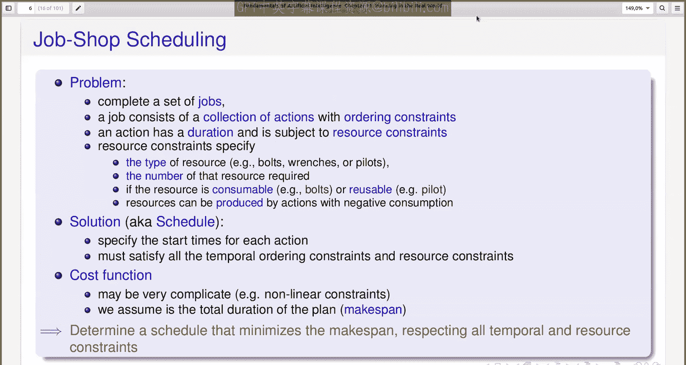

# 人工智能基础：11：现实世界规划


在本节课中，我们将要学习经典规划的扩展——现实世界规划。我们将探讨如何将时间、资源等复杂因素纳入规划过程，并了解规划与调度、搜索等概念的结合。

---

## 概述

上一节我们讨论了经典规划。本节中，我们将扩展视野，探讨现实世界中的规划问题。规划远不止选择一系列原子动作，它还需要考虑动作的持续时间、资源约束以及动作之间的时序关系。我们将介绍两个核心扩展方向：**时间**和**资源**，并引入**调度**的概念。此外，我们还会看到如何将之前学过的无传感器搜索（即一致性规划）和非确定性步骤规划（即应急规划或条件规划）的思想融入规划领域。

---

## 时间与规划

在经典规划中，动作被视为瞬间发生的原子事件。然而，在现实中，每个动作都有**持续时间**。动作在特定时间点开始和结束，并且后续动作必须等待前置动作完成后才能开始。

例如，如果动作A需要在动作B之前执行，且动作A耗时10秒，那么动作B最早只能在动作A开始10秒后启动。这个约束在计算上很重要，尤其是当多个动作可以并行执行时。如果我们能合理安排动作间的依赖关系，就能优化整个计划的执行时间。

**公式表示**： 若动作 `A` 在时间 `t_start` 开始，持续时间为 `D`，则其结束时间为：
```
t_end = t_start + D
```
若动作 `B` 必须在动作 `A` 之后执行，则需满足：
```
t_start(B) >= t_end(A)
```

---

## 资源与规划

除了时间，**资源**是另一个关键约束。资源决定了哪些动作可以并行执行。资源主要分为两类：
*   **可重用资源**： 使用后不会被消耗，可以再次使用。例如，一个检查员、一台机器人或一个引擎吊架。
*   **可消耗资源**： 使用后即被消耗，无法重复使用。例如，安装轮胎时使用的螺栓。

如果某项资源（如一个轮胎安装工位）只有一个可用实例，那么需要该资源的两个动作就无法同时进行。因此，规划时必须考虑资源的可用性，以生成可行的计划。

---

## 规划与调度

一种常见的处理复杂约束的方法是采用 **“先规划，后调度”** 的策略。

以下是该策略的两个主要步骤：

1.  **生成偏序计划**： 首先，忽略时间和资源的精确数值，只找出动作之间的逻辑依赖关系，生成一个**偏序计划**。这个计划确定了哪些动作必须在其他动作之前执行，但并未指定具体的开始时间。
2.  **调度优化**： 然后，在偏序计划的基础上，结合动作的**持续时间**和**资源约束**，为每个动作分配具体的开始时间，目标是优化某个指标（如总完成时间）。这个过程就是**调度**。

通过这种方式，我们将符号化的逻辑规划与数值化的优化计算结合了起来。

---

## 示例：汽车装配问题

让我们通过一个汽车装配的例子来具体理解这些概念。假设我们需要组装两辆汽车（C1和C2），涉及安装引擎（E1， E2）、安装轮胎组（W1， W2）和最终检查。

**初始状态**：
*   有底盘 C1， C2。
*   引擎 E1 适合 C1， E2 适合 C2。
*   轮胎组 W1 适合 C1， W2 适合 C2。

**目标状态**：
*   C1 和 C2 都完成组装（即 `done(C1)` 和 `done(C2)` 为真）。

**动作（经典规划部分）**：
*   `add_engine(E, C)`： 将引擎E安装到底盘C上。
    *   **前提条件**： 引擎E适合底盘C，且引擎E不在底盘C上。
    *   **效果**： 引擎E在底盘C上。
*   `add_wheels(W, C)`： 将轮胎组W安装到底盘C上。
    *   **前提条件**： 轮胎组W适合底盘C，且轮胎组W不在底盘C上。
    *   **效果**： 轮胎组W在底盘C上。
*   `inspect(C)`： 检查底盘C。
    *   **前提条件**： 引擎已在底盘C上，且轮胎组已在底盘C上。
    *   **效果**： `done(C)` 为真。

**引入时间和资源**：
现在，我们为动作添加持续时间和资源需求信息。
*   `add_engine(E1, C1)`： 耗时 60 秒，需要 1 个引擎吊架。
*   `add_wheels(W1, C1)`： 耗时 30 秒，需要 1 个轮胎安装工位。
*   `add_engine(E2, C2)`： 耗时 90 秒，需要 1 个引擎吊架。
*   `add_wheels(W2, C2)`： 耗时 150 秒，需要 1 个轮胎安装工位。
*   `inspect(C)`： 每个检查耗时 10 秒，需要 1 个检查员。

**资源约束**：
*   引擎吊架： 只有1个。
*   轮胎安装工位： 只有1个。
*   检查员： 只有1个。

**偏序计划**：
一个可能的偏序计划是：为每辆车先安装引擎，再安装轮胎，最后进行检查。即：
```
add_engine(E1, C1) → add_wheels(W1, C1) → inspect(C1)
add_engine(E2, C2) → add_wheels(W2, C2) → inspect(C2)
```
但两组动作之间的顺序未定。

**调度挑战**：
由于资源有限（例如只有一个轮胎安装工位），`add_wheels(W1, C1)` 和 `add_wheels(W2, C2)` 不能同时进行。调度器需要决定它们的执行顺序以及具体的开始时间，以最小化总装配时间（即**完工时间**），同时满足所有资源约束。

---

## 符号推理与数值计算

在规划中处理时间和资源时，我们面临一个核心挑战：**如何将符号逻辑推理与数值计算结合起来**。

经典规划器主要在符号层面操作（如命题逻辑）。然而，持续时间（如60秒）和资源数量（如1个）是数值信息。计算总时间或检查资源冲突需要进行算术运算。

**代码示例**： 检查两个动作是否在时间上重叠。
```python
# 假设 action1 从 start1 开始，持续 duration1
# action2 从 start2 开始，持续 duration2
def actions_overlap(start1, duration1, start2, duration2):
    end1 = start1 + duration1
    end2 = start2 + duration2
    # 如果两个时间段有交集，则重叠
    return not (end1 <= start2 or end2 <= start1)
```

解决这种“跨界”问题的一种强大工具是**可满足性模理论**，它允许在逻辑公式中嵌入算术等理论，从而进行联合推理。这通常是更高级课程的内容。

---

## 总结



本节课中我们一起学习了现实世界规划的基础。我们了解到，真实的规划问题需要超越经典的原子动作序列，必须整合**时间**和**资源**这两大要素。我们介绍了 **“先规划，后调度”** 的方法论，即先通过逻辑推理生成动作间的偏序关系，再通过数值优化解决资源约束下的时序安排。最后，我们指出了将符号推理与数值计算相结合的重要性，这是处理复杂规划问题的关键。下一讲，我们将继续深入探讨调度算法和更复杂的规划场景。