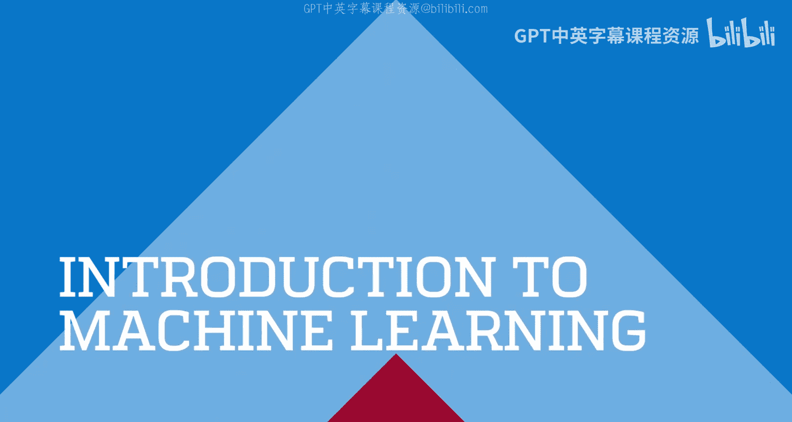
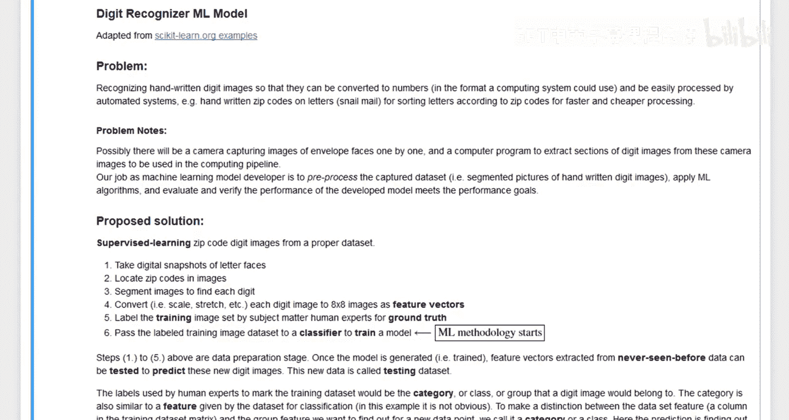

#  001：应用机器学习导论

## 概述

在本节课中，我们将要学习应用机器学习的基本概念，了解其定义、应用场景以及一个实际问题的解决流程。我们还将介绍课程中将使用的开发环境与核心工具。

## 什么是机器学习？

机器学习是一门艺术，它使用计算机和程序来解决计算问题，但无需编写明确的指令。机器学习算法在输入数据集上工作，然后生成一个模型，该模型可用于预测或检测未见过的数据。

我们将用于机器学习的输入数据，已经由领域专家进行了标记或分类。这被称为**真实标签**。

## 机器学习的广泛应用

机器学习在今天无处不在，例如：
*   网络安全
*   电子邮件过滤
*   产品推荐（如Netflix或亚马逊）
*   医疗诊断
*   股票交易

## 开发环境准备

在深入探讨问题和解决方案之前，我们先来看看我们将要使用的环境。

我们将使用Anaconda环境，它是一个Python3库的集合。我们将从Anaconda网站下载Anaconda，然后将其安装到我们的系统中。它支持苹果或Windows系统，但强烈推荐使用Linux。

作为准备工作，我建议查看Jupyter Notebook教程，以学习如何使用Jupyter Notebook。同时，为了后续参考，这里提供两个重要库的链接：Scikit-learn库和NumPy库。

*   **Scikit-learn** 是一个机器学习库，由来自大型组织或大学的成千上万的研究人员和工程师共同开发。
*   **NumPy** 是一个数学库，类似于MATLAB，内部高度优化，使用了C++库。与直接编码相比，它的实现速度非常快。

例如，当我们访问Scikit-learn网站时，可以从列表中看到它支持非常多的机器学习算法。

## 一个实际问题：邮政编码识别

现在，我们来看一个具体问题。众所周知，每年进出家庭或组织的信件数量可能高达数十亿。显然，需要一个自动化的解决方案来自动分类和处理信件，这样我们就不必雇佣成千上万的邮政工人。

想象一下，你想通过查看信封上的数字来对信件进行分类。你会如何解决这个问题？

这个问题的直接解决方案可以是：使用类似传送带的机器拍摄信件图片，然后处理这些图片以定位邮政编码数字，分割这些图像并尽可能提取数字。请注意，犯错是可以接受的，因为我们的预测系统会纠正这些错误。

随后，一旦图像被捕获，就从这些图像中提取特征，并使用我们的预测系统结合真实标签来训练这些图像。数据集中的一部分必须由人类领域专家进行标记，以便这些真实标签可以作为参考、基线，并作为学习程序的反馈。

一旦系统用这些标记的图像训练完成，我们就可以预测未标记的图像作为测试。

一个可能的系统部署场景是：一旦训练好的模型开发完成，就将系统部署在现场，然后收集信件图像，让其通过该模型，进而检测或预测数字是什么。

## 总结

本节课中，我们一起学习了机器学习的核心定义——即让计算机从数据中学习规律，而无需显式编程。我们了解了其广泛的应用领域，并准备好了以Anaconda、Jupyter Notebook、Scikit-learn和NumPy为核心的学习环境。最后，我们通过“邮政编码自动识别”这个具体案例，初步了解了机器学习解决实际问题的典型流程：从数据收集、标注、特征提取、模型训练到最终的预测与部署。