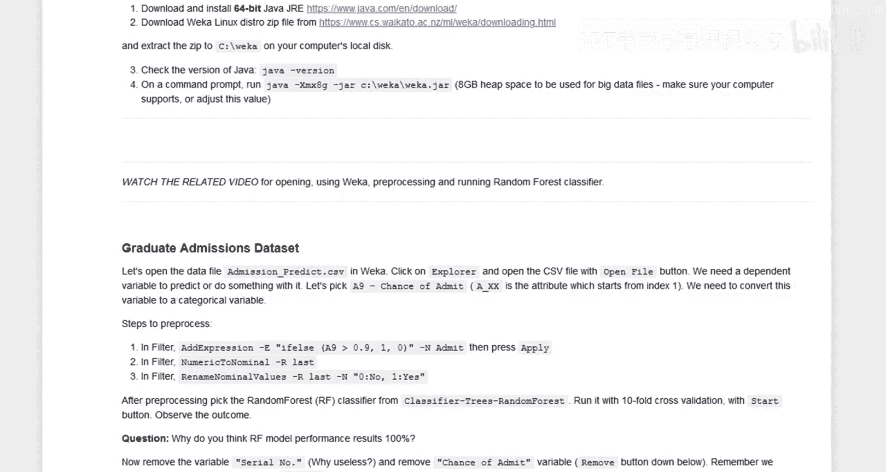

#  009：Weka工具导论


在本节课中，我们将学习如何使用Weka这一强大的机器学习工具。我们将从环境准备开始，逐步学习如何导入数据、进行数据预处理、创建分类变量，并最终构建一个分类模型。通过实际操作，你将了解Weka的基本工作流程和常见问题的解决方法。

## 环境准备与数据导入

首先，我们需要确保Java环境已正确安装。在命令行中运行 `java -version` 命令，检查版本信息。请确保安装的是64位版本，因为机器学习任务通常需要处理大量数据，64位版本能更好地利用现代计算机的大内存。

确认环境无误后，启动Weka。在主界面选择“Explorer”进入数据探索界面。

接下来，我们尝试导入一个CSV格式的数据集。在“Preprocess”标签页点击“Open file”，选择数据集文件。我们首先尝试导入“Human Freedom Index”数据集，但导入失败。原因是Weka对CSV文件中名义变量的格式有特定要求。

以下是Weka期望的格式示例：
```
region, year, pf_rol
'Asia', 2016, 5.5
'Europe', 2016, 8.2
```

问题在于，原始数据中“region”这类名义变量没有用引号包裹。Weka要求名义变量的值在表头或数据中用引号明确标识。我们需要用文本编辑器打开CSV文件，手动为名义变量（如‘region’）的值添加单引号，并删除文件中可能存在的其他格式问题（如多余的代码字符）。修改并保存文件后，Weka便能成功导入并显示数据的元信息和直方图。

## 数据预处理与特征工程

上一节我们成功导入了数据，本节中我们来看看如何对数据进行预处理，为机器学习做准备。我们将使用另一个数据集——“Graduate Admission Prediction”。

成功导入该数据集后，我们可以在“Preprocess”标签页看到数据概览：400个实例（数据点），9个属性（特征）。目前，我们感兴趣的目标变量“Chance of Admit”是数值型（0.34到0.97之间）。为了进行**分类**任务，我们需要将其转换为**名义变量**（分类变量）。

我们计划以0.9为阈值，将“Chance of Admit”大于0.9的样本标记为“将被录取”（yes），其余标记为“不被录取”（no）。这需要通过Weka的过滤器功能实现。

以下是操作步骤：
1.  点击“Filter”区域旁的“Choose”按钮，选择 `filters.unsupervised.attribute.AddExpression`。
2.  在表达式配置中，输入转换逻辑。其核心公式为：
    ```
    ifelse（a9>0.9, 1, 0）
    ```
    其中 `a9` 代表第9个属性（即“Chance of Admit”列）。这个表达式意为：如果a9大于0.9，则新属性值为1，否则为0。
3.  点击“Apply”，Weka会新增一个名为“Ad”的数值型列。
4.  接着，我们需要将这个数值型列转换为名义型。再次选择过滤器 `filters.unsupervised.attribute.NumericToNominal`，在配置中指定转换最后一列（`-R last`），然后应用。此时，“Ad”列的值变为名义型“0”和“1”。
5.  为了更直观，我们可以将“0”和“1”重命名为“no”和“yes”。使用 `filters.unsupervised.attribute.RenameNominalValues` 过滤器，配置字典 `0:no,1:yes` 并应用于最后一列。

至此，我们创建了一个新的二分类目标变量。

## 构建与评估分类模型

数据预处理完成后，现在我们可以构建一个分类模型。我们将使用随机森林算法，并通过十折交叉验证来评估模型性能。

切换到“Classify”标签页。
1.  点击“Choose”按钮，选择 `trees.RandomForest` 分类器。
2.  在“Test options”中，确保选择了“Cross-validation”并将“Folds”设为10。
3.  在目标变量选择中，确保新创建的“Ad”列被选为“Class”。
4.  点击“Start”开始训练和评估。

初次运行后，模型准确率显示为100%。这通常是一个危险信号，表明模型可能存在问题。回顾我们的数据，特征中仍然包含原始的“Chance of Admit”数值列。由于我们新的“Ad”标签正是根据该列生成的，模型直接利用了这个强相关特征进行预测，导致了“数据泄露”，这不是一个有效的评估。

因此，我们需要在预处理中移除“Chance of Admit”列。移除后再次运行随机森林，准确率下降到约97%，这个结果更为合理。

此外，数据中还有一个“Serial No.”列，它是每个样本的唯一编号，不包含任何与录取相关的信息。在机器学习中，这类特征应该被移除，因为它们可能导致模型过拟合（例如，记住某些编号对应“录取”结果）。移除“Serial No.”列后再次评估，模型准确率可能会有微小波动，这属于正常范围，也验证了该特征的无用性。




本节课中我们一起学习了Weka的基本操作。我们从环境检查开始，经历了数据导入、格式修正、创建分类变量、使用过滤器进行数据转换，到最后使用随机森林进行分类并评估模型。关键点在于理解数据预处理的重要性，避免使用会导致数据泄露或无关的特征（如原始目标变量和序列号），从而确保模型评估结果的真实有效。