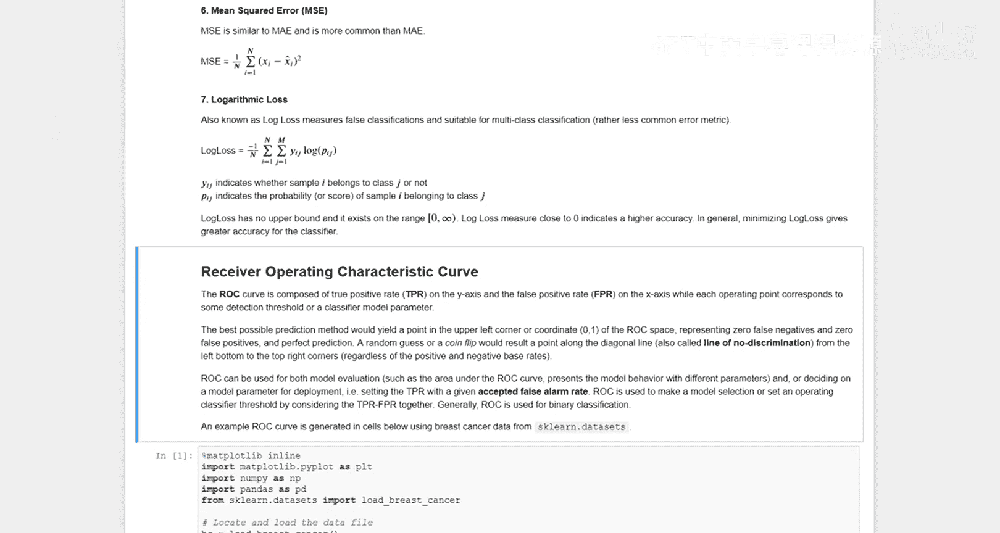

#  011：模型评估方法

在本节课中，我们将学习如何评估机器学习模型。模型评估的核心是确保我们构建的模型具有良好的**泛化能力**，即模型在未见过的数据上也能表现良好。我们将探讨不同的评估方法、关键指标以及如何避免常见错误。

## 模型构建与数据划分

上一节我们介绍了模型评估的重要性，本节中我们来看看构建模型时如何划分数据。

为了构建和评估模型，我们需要将数据划分为三个互斥的部分：
*   **训练集**：用于训练模型。
*   **测试集**：用于在模型构建后评估其误差。
*   **验证集**：用于调整模型的超参数（如果算法有参数需要调优）。

这三部分数据加起来应占原始数据集的100%。验证集有时并非必需，但当模型有需要调整的参数时（例如支持向量机中的gamma参数），它至关重要。

## 泛化能力与错误率

理解了数据划分后，我们需要关注模型评估的两个核心概念：泛化能力和错误率。

**泛化能力**是机器学习模型最重要的特性。一个最简单的分类器是始终预测为类别0。在一个五分类的平衡数据集中，这个分类器的准确率是20%。如果一个二元分类模型在平衡数据集上的准确率只有10%，那很可能程序存在错误。

在评估模型时，我们关注两个关键指标：
*   **真阳性率**：模型正确检测出正例的概率。
*   **假阳性率**：模型错误地将负例预测为正例的概率。

这两个指标通常相互制约。例如，在网络安全模型中，如果将每个文件都标记为有病毒，那么真阳性率是100%，但假阳性率也是100%。我们需要在两者之间找到平衡。

## 模型评估方法

明确了评估目标后，我们来看看具体的评估方法。

以下是几种常见的模型评估方法：
*   **重分类**：使用全部数据训练模型，然后用同样的数据测试。这通常能得到很高的性能（接近100%），但若达到100%则意味着**过拟合**。这是一个初步的检查。
*   **K折交叉验证**：这是最佳实践。将数据随机打乱，分成K个互不重叠的子集。每次用K-1个子集训练，用剩下的1个子集测试，重复K次。最终报告K次结果的平均准确率。
*   **留一法交叉验证**：当数据集非常小时使用，即每次只留一个样本作为测试集。
*   **分层抽样**：当处理类别不平衡的数据集（如癌症存活率数据）时，必须确保训练集和测试集中每个类别的比例与原始数据集一致。

最重要的评估目标是**预测模型在真实世界中的预期性能**。一些天生具有较好泛化能力的模型包括支持向量机、随机森林等集成分类器、主成分分析以及使用了Dropout和L2正则化的深度学习网络。

## 评估指标

了解了评估方法，我们需要用具体的数学指标来衡量模型表现。

以下是关键的评估指标：
*   **准确率**：正确预测的数量除以总预测数量。公式为：`准确率 = 正确预测数 / 总预测数`。
*   **混淆矩阵**：展示模型预测结果与真实标签对比的矩阵。它能清晰显示模型在各类别上的表现。
*   **错误类型**：
    *   **I类错误**：假阴性。真实情况为正例，但模型预测为负例。在癌症检测等场景中，这类错误成本极高。
    *   **II类错误**：假阳性。真实情况为负例，但模型预测为正例。这类错误成本通常较低。
*   **真阳性率、真阴性率、精确率、召回率**：这些指标可以从混淆矩阵中计算得出。
*   **F1分数**：精确率和召回率的调和平均数。在处理类别不平衡问题（如癌症预测）时，F1分数比准确率更重要，因为它能更好地反映对关键类别（如正例）的预测能力。
*   **曲线下面积**：用于接收者操作特征曲线分析，综合衡量模型在不同阈值下的性能。
*   **平均绝对误差**：回归问题中常用的误差指标，计算预测值与真实值之间的绝对差平均值。
*   **对数损失**：一种更复杂的指标，用于衡量分类模型的预测概率与真实标签之间的差异。

## 总结

本节课中我们一起学习了机器学习模型评估的核心内容。我们首先了解了将数据划分为训练集、验证集和测试集的重要性。然后，我们探讨了模型**泛化能力**的核心地位以及平衡**真阳性率**与**假阳性率**的必要性。接着，我们介绍了重分类、K折交叉验证等多种评估方法。最后，我们详细讲解了准确率、混淆矩阵、F1分数等一系列关键的评估指标，并强调了在不同应用场景（如癌症检测）中选择合适指标的重要性。正确的模型评估是确保机器学习项目成功部署到真实世界的关键步骤。