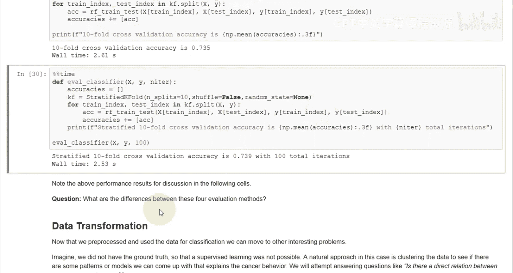

#  015：数据离散化

在本节课中，我们将学习如何对数据集中的名义特征进行离散化处理，具体方法是使用独热编码。我们还将探讨几种评估分类器性能的方法，包括简单的训练测试集分割和交叉验证。

## 数据预处理与可视化

上一节我们介绍了数据预处理。现在，我们来看看如何可视化预处理后的数据点，并快速检查预处理是否确实改善了数据集的质量。

## 名义特征的独热编码

在之前的模块中，我们通过分箱将数值变量转换为分类变量。同样，我们也可以将具有不同等级或类别的名义变量转换为数值变量，方法是使用独热编码。

以下是需要编码的变量及其原因：
*   我们将对名义变量进行独热编码，因为它们包含不同的类别等级。
*   我们这样做是因为我们将要使用的随机森林分类器偏好数值变量。
*   可以转换的变量是那些对象类型的名义变量。例如，“menopause”变量包含三个等级。

对于每个等级，我们将创建一个新的列。例如，“menopause”变量的三个等级（如“ge40”、“lt40”、“premeno”）将生成三个独立的列。虽然这些列在理论上并非完全独立，但这是将名义变量编码为数值形式的唯一方法，以便在数值分类器中使用。

在独热编码中，对于每个数据点，在对应的等级列中值为1，其他所有列中值为0，因此得名“独热”。

我们构建了一个名为 `one_hots` 的函数来执行此操作，并将其应用于剩余的四个名义变量。

**注意**：我们不会对因变量“recurrence”进行独热编码。因为本例中使用的随机森林分类器接受0、1、2、3等形式的因变量。对于只有两个等级（复发或不复发）的二元分类，无需编码。然而，对于神经网络，输出层通常需要进行独热编码。

## 分类器评估方法

现在，我们来了解评估分类器性能的四种方法：

以下是四种常见的评估方法：
1.  **80% 随机训练/测试分割**：80%的数据用于训练，20%用于测试。
2.  **留一法交叉验证**：每次留出一个数据点作为测试集，其余用于训练。当数据点很少（例如少于300个）时适用，对于大数据集不切实际。
3.  **K折交叉验证**：最常见的方法。将数据分成K份，每次用其中一份作为测试集，其余K-1份作为训练集。
4.  **分层K折交叉验证**：这是K折交叉验证的更重要的版本，适用于数据不平衡的情况。例如，在我们的数据集中，非复发事件（205例）和复发事件（86例）数量不平衡。分层方法确保每个折中复发和非复发事件的比例与原始数据集保持一致，避免某个折严重偏向某一类。

我们定义了一个函数来测试随机森林分类器。其中，`X` 是包含所有特征（除了“recurrence”）的矩阵，`y` 是“recurrence”标签。

使用80%训练/测试分割时，每次运行都会产生不同的评估结果（准确率在64%到77%之间波动）。因此，我们需要进行多次运行（如十折交叉验证）来收集统计数据，计算平均准确率和标准差。

## 参数设置与实验可重复性

在代码单元中，我们设置了随机森林分类器的参数：
*   `n_jobs=4`：使用4个并行作业。
*   `n_estimators=200`：决策树的数量为200。
*   `random_state`：用于控制随机森林的随机性种子。如果将其设置为一个固定值（如42），那么每次运行实验都会得到完全相同的结果，这确保了实验的可重复性。如果设置为 `None`，则每次结果都会变化。

运行十折交叉验证和分层十折交叉验证可以获得更稳健的性能评估结果。

## 总结

本节课中，我们一起学习了如何对数据集中的名义特征进行独热编码，以便在偏好数值输入的机器学习模型（如随机森林）中使用。我们还介绍了四种评估分类器性能的方法，重点强调了在数据不平衡时使用分层交叉验证的重要性。最后，我们探讨了通过设置随机种子来保证实验结果可重复性的方法。在下一个模块中，我们将学习数据转换。