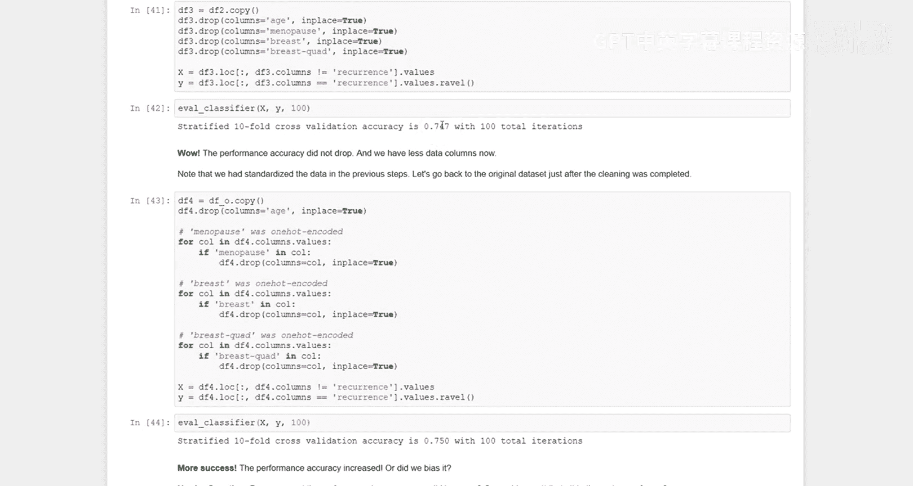

#  017：数据降维方法


在本节课中，我们将学习数据降维的概念、目的以及一种具体的实现方法——特征选择。我们将通过一个乳腺癌预测的实例，理解如何识别并移除对模型贡献较小的特征，并探讨这种操作对模型性能的影响。

## 概述

数据降维并非指删除数据点，而是指减少数据的特征维度，或者更实际地说，是对特征进行排序。其核心目标是识别哪些自变量或测量值最能解释我们试图通过模型获取的知识。例如，在之前的课程中，我们使用包含9个特征的乳腺癌数据进行监督学习，模型准确率大约在75%到77%之间。现在，我们希望知道这9个特征中，哪一个最能解释癌症的复发与否。

## 特征选择实践

上一节我们介绍了数据降维的目标，本节中我们来看看如何通过特征选择来实现它。

我们可以使用特征选择技术来找出最重要的特征。以下代码演示了这一过程：

```python
# 此代码块使用X和y拟合数据
# X包含全部9个变量，y是目标变量（癌症是否复发）
# 我们计算并归一化特征的重要性分数
selector.fit(X, y)
scores = -np.log10(selector.pvalues_)
scores /= scores.max()
```

通过分析，我们发现 **`degree malignant`**（恶性程度）、**`node caps`**（淋巴结被膜侵犯）和 **`inv node`**（浸润淋巴结数量）这三个特征为模型提供了最多的信息。

## 精简特征与模型评估

在识别出关键特征后，一个自然的想法是：移除那些贡献度低的特征是否有助于模型？接下来，我们通过实验来验证。

以下是移除部分低重要性特征并重新评估分类器性能的步骤：

1.  **移除低贡献特征**：首先，我们尝试移除 `age`、`menopause`、`breast`、`breast qua` 这四个特征。
2.  **评估性能**：使用剩余的特征重新训练和评估分类器，准确率约为75%。这与使用全部特征时的最高准确率（约78%）相比，下降并不显著。
3.  **进一步精简**：我们继续移除 `menopause` 和 `breast qua` 特征。
4.  **观察结果**：模型性能并未出现大幅下降。实际上，在某些实验运行中，性能甚至略有提升（例如从74.5%升至75.0%）。

## 性能提升的评估

当我们观察到模型性能（如准确率）有所提升时，一个关键问题是：这种提升是真实的改进，还是随机波动导致的？

由于机器学习实验中存在随机性（如数据划分、模型初始化），性能评估本身会有波动。因此，不能仅凭单次实验的微小差异（例如3-4%以内的变化）就断定模型得到了改进。

更可靠的方法是进行多次实验，并计算性能指标的置信区间。例如，我们可以说准确率是75.0%，并且有99%的置信度。当性能提升幅度显著超过随机波动的范围时，我们才能将其视为真正的改进。

## 总结

本节课中我们一起学习了数据降维中的特征选择方法。我们了解到，降维的目的是保留最具信息量的特征，这有助于简化模型、提高可解释性，并可能提升或至少维持模型性能。我们通过实例看到了如何计算特征重要性，并实践了移除低重要性特征的过程。最后，我们讨论了评估模型性能“提升”时需要谨慎，应借助统计方法（如置信区间）来区分真实的改进与随机波动。

---




**课程讨论问题**：
1.  请研究并给出一个实例，说明数据降维（特征选择）可能无效甚至损害模型性能。
2.  除了使用统计置信度，在什么情况下我们可以认为模型性能的提升是一次真正的改进？