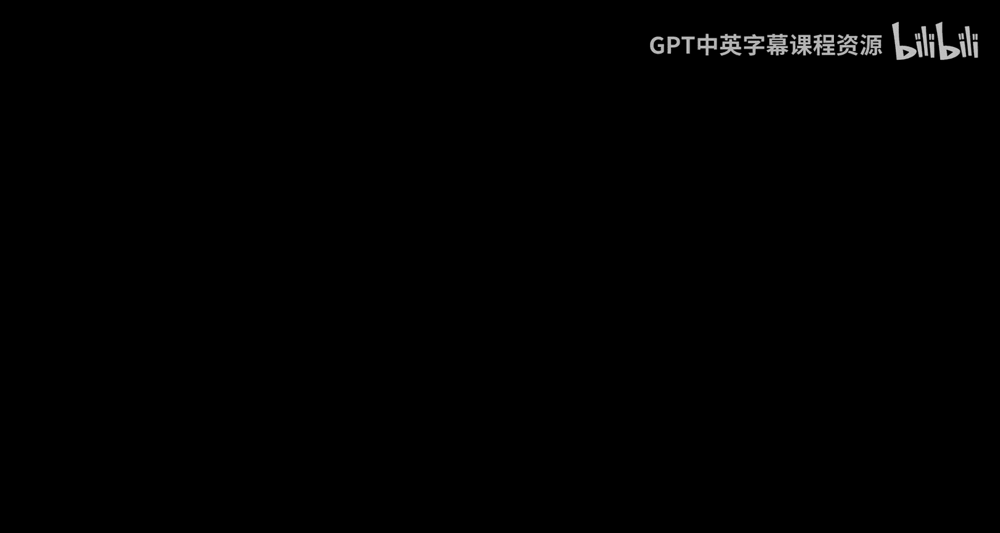
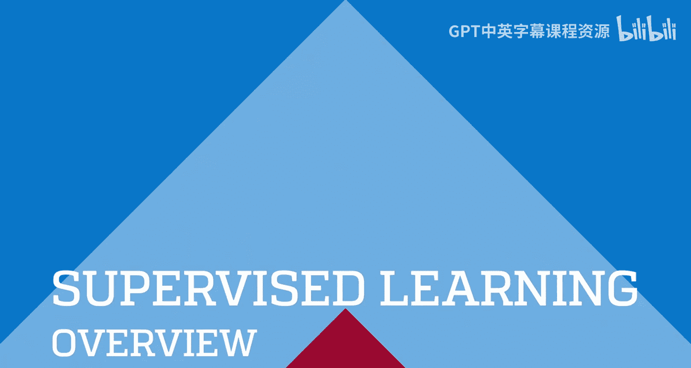

#  018：监督学习概述

在本节课中，我们将要学习机器学习的核心方法——监督学习。我们将了解其基本原理、关键组成部分，并通过一个实际案例来加深理解。

## 概述

机器学习和许多历史分析问题的核心是监督学习。在本模块中，我们将把监督学习作为主要的机器学习方法来研究。

## 监督学习的核心概念

上一节我们介绍了监督学习的重要性，本节中我们来看看它的核心运作机制。

监督学习是一种模型生成方法，其核心在于利用**真实标签**或**数据集标签**提供的反馈来训练模型。其数学目标通常表述为最小化一个损失函数：

`minimize L(θ) = Σ loss(y_i, f(x_i; θ))`

其中，`y_i` 是真实标签，`f(x_i; θ)` 是模型的预测。

为了实现这个目标，我们需要一个**成本函数**或**评判标准**，用于将数据拟合到模型中。理想情况下，最具竞争力的监督学习算法都建立在坚实的数学原理之上，例如**优化理论**、**统计学**或**函数逼近**。

## 实践：实现朴素贝叶斯算法

理解了基本概念后，我们将动手实践。本节我们将使用 NumPy 和 SciPy 统计库，从头开始实现一个**朴素贝叶斯算法**。

朴素贝叶斯分类器基于贝叶斯定理，其核心预测公式为：

`P(y|X) = [P(X|y) * P(y)] / P(X)`

其中，`P(y|X)` 是给定特征 `X` 时类别 `y` 的后验概率。

我们将在一个**人工创建的数据集**上演示其性能表现。

## 分析与比较：分类边界

在实现了自己的分类器之后，我们需要评估其效果。本节我们将检查包括我们实现的算法在内的**多种分类器的分类边界**。

以下是进行分析的几个关键步骤：
*   训练不同的分类模型（如逻辑回归、支持向量机、我们实现的朴素贝叶斯）。
*   在二维特征空间上可视化每个模型的决策边界。
*   比较不同边界形状的复杂度和对数据的拟合程度。

这样做的目的是为了深入理解分类模型的行为特性。

## 实战项目：文本分类

从理论到简单实践后，我们将面对一个更真实的挑战。在接下来的部分，我们将提出一个**阅读器新闻文本分类问题**，并使用 **TF-IDF 特征**进行处理。

TF-IDF 是一种用于信息检索与文本挖掘的常用加权技术，其计算公式为：

`TF-IDF(t, d) = TF(t, d) * IDF(t)`

其中，`TF(t, d)` 是词频，`IDF(t) = log[N / (df(t) + 1)]` 是逆文档频率。

最终，我们将在包含 **20 种不同语言**的 Stack Overflow 论坛帖子上测试我们的文本分类流程。

## 总结

本节课中我们一起学习了监督学习的基本框架，它通过真实标签的反馈来构建模型，并依赖成本函数进行优化。我们动手实现了朴素贝叶斯分类器，通过可视化分类边界比较了不同模型的行为，并最终将所学应用于一个多语言的真实文本分类项目中，从理论到实践完成了对监督学习的初步探索。