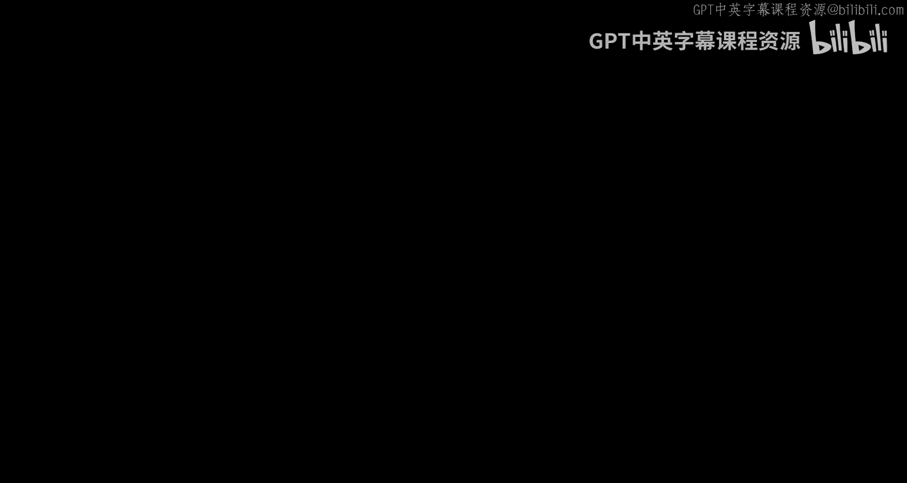
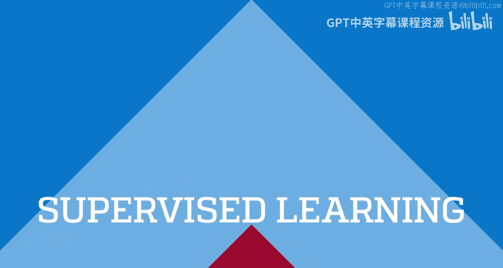
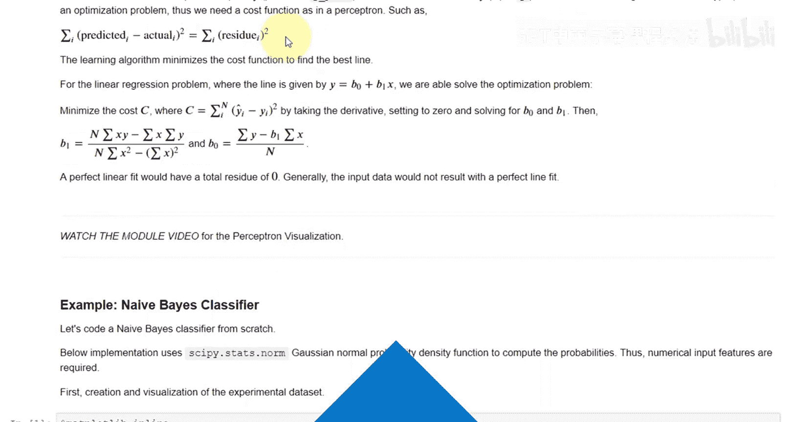

#  019：监督学习

在本节课中，我们将学习监督学习。监督学习是机器学习中最重要的概念和应用之一。它要求我们预先知道数据的真实情况（即“真实标签”），算法通过利用这些真实标签的反馈来学习，判断某个假设是否正确，并收集所有假设产生的误差。

## 监督学习的分类

上一节我们介绍了监督学习的基本概念，本节中我们来看看它的两个主要类别：分类和回归。

**分类**是预测数据所属的类别。例如，“今天会暖和吗？”的答案是“是”或“否”。或者，预测患者在未来两年内是否会因癌症死亡，答案也是“是”或“否”。类别也可以是“低、中、高”等多级。

**回归**是预测一个连续的实数值。例如，预测房价或气温的具体数值。在回归中，我们通常试图找到一条曲线来拟合数据。

## 多分类问题处理

对于自然设计为二分类的算法（如支持向量机SVM），当面对多类别问题时，需要特殊处理。

以下是处理多分类问题的常见策略：
*   构建多个二分类器。对于一个有 `k` 个类别的问题，需要构建 `C(k, 2)`（即 `k` 选 `2`）个分类器。
*   对这些二分类器的结果进行**多数投票**，以确定最终的预测标签。
*   在实际应用中，这些策略通常由机器学习库（如 `scikit-learn`）自动完成。

## 感知机算法

现在，让我们深入了解一个基础的监督学习算法：感知机。感知机是神经网络的基础构建块，也启发了支持向量机的诞生。

感知机试图找到一个**超平面**，将数据点划分为两个类别，因此它本质上是一个二分类器。

我们通过最小化误差来训练感知机。其误差或成本函数是所有数据点预测值与真实值差异的总和。

**感知机成本函数公式**：
`J(w) = Σ (y_i - ŷ_i)`
其中：
*   `y_i` 是第 `i` 个数据点的真实类别标签（0 或 1）。
*   `ŷ_i` 是第 `i` 个数据点的预测类别标签（0 或 1）。
*   `Σ` 表示对所有 `n` 个数据点求和。

在我们的数据矩阵中，通常有 `n` 行（数据点）和 `m` 列（特征或维度）。感知机寻找的超平面就是 `m` 维的。

## 其他监督学习算法简介

在深入感知机可视化之前，我们简要提及其他两个重要的监督学习算法。

**朴素贝叶斯**是一种基于贝叶斯定理的概率方法。它假设特征之间相互独立，并计算数据属于某个类别的概率。

**线性回归**是回归任务的经典方法，旨在找到一条直线（或超平面）来拟合数据，以预测连续值。

**线性回归成本函数公式**：
`J(β0, β1) = Σ (y_i - (β0 + β1 * x_i))^2`
其中：
*   `y_i` 是真实值。
*   `(β0 + β1 * x_i)` 是预测值。
*   `β0` 是截距，`β1` 是斜率。
*   通过最小化这个误差，可以直接求解出最优的 `β0` 和 `β1`。

请注意，线性回归的成本函数与感知机的关键区别在于：这里的 `y_i` 和预测值是连续的实数，而感知机处理的是离散的类别标签（0/1）。

## 总结

本节课中我们一起学习了监督学习的核心概念。我们了解到监督学习依赖于已知的真实标签，主要分为**分类**（预测类别）和**回归**（预测数值）两大任务。我们探讨了感知机作为二分类器的工作原理及其成本函数，并简要介绍了朴素贝叶斯和线性回归。在接下来的模块中，我们将更详细地探索这些算法的实现与应用。