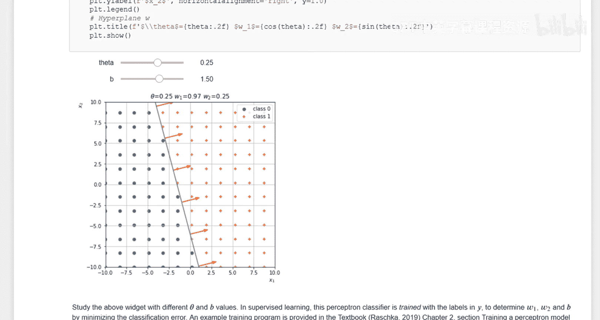

#  020：感知器算法及可视化实现


在本节课中，我们将学习感知器算法的核心概念，并通过一个交互式可视化工具来直观理解其工作原理。我们将探讨感知器如何定义一个超平面来对二维空间中的数据进行分类。

---

## 概述

感知器是机器学习中最基础的线性分类器之一，也是神经网络的基本构建模块。理解其数学原理和可视化实现，对于掌握更复杂的模型至关重要。本节我们将通过一个可视化工具，详细拆解感知器的参数（法向量 **W** 和偏移量 **b**）及其分类决策过程。

---

## 感知器的核心概念

感知器的核心是一个线性方程，它定义了一个超平面，用于将特征空间划分为两个区域。在二维空间中，这个超平面就是一条直线。

其决策函数 **f(x)** 可以表示为：

**f(x) = sign( W · X + b )**

其中：
*   **W** 是超平面的法向量。
*   **b** 是偏移量（或称偏置）。
*   **X** 是输入特征向量。
*   当 **W · X + b > 0** 时，输出为类别 1。
*   当 **W · X + b ≤ 0** 时，输出为类别 0。

这个超平面由方程 **W · X + b = 0** 定义，平面上所有的点都满足该等式。

---

## 可视化工具演示

上一节我们介绍了感知器的数学定义，本节中我们来看看如何通过可视化工具交互式地探索其行为。

我下载了一个感知器可视化组件到 Anaconda 环境中。运行该组件后，我们可以在一个二维空间中观察超平面。

在工具中，我们有两个特征 **x1** 和 **x2**。超平面由参数 **b**（偏移量）和 **w0**、**w1**（即法向量 **W** 的两个分量）控制。红色箭头指示了法向量的方向。

工具使用角度 **θ**（Theta）来控制法向量 **W** 的方向，其计算公式为：
**W = [cos(θ), sin(θ)]**

这样，**θ** 就成为了一个单一变量，方便我们通过滑块来旋转超平面。例如：
*   **θ = -1.55** 弧度（约 -π/2）时，法向量朝下。
*   **θ = 0** 弧度时，是起始位置。
*   **θ = 1.57** 弧度（约 π/2）时，法向量旋转了90度。

参数 **b** 控制超平面的偏移。当我调整这些参数时，工具会自动对空间中的所有点进行分类，并将分类结果（类别0或类别1）用不同标记显示出来。这个可视化工具完整地模拟了一个分类器的行为。

---

## 代码实现解析

了解了可视化效果后，我们深入看一下其背后的代码实现细节。以下是关键的几个部分：

**1. 超平面计算函数**
这个函数用于在给定法向量 **W** 和偏移量 **b** 的情况下，计算超平面上的点。在二维可视化中，它根据 **x1** 的值求解出超平面上的 **x2** 值。

```python
def hyperplane(x, w, b):
    # 给定 x1，根据方程 w0*x1 + w1*x2 + b = 0 求解 x2
    return (-w[0] * x - b) / w[1]
```

**2. 感知器分类器**
这是感知器算法的核心实现。它接收输入 **X**、法向量 **W** 和偏移量 **b**，计算决策函数的值并返回分类结果。

```python
def perceptron(x, w, b):
    # 计算 f(x) = w·x + b
    fx = np.dot(x, w) + b
    # 根据 f(x) 的正负返回类别标签
    return 1 if fx > 0 else 0
```

这段代码利用了 NumPy 的向量化操作，可以处理任意维度的特征空间。在二维中，**W** 和 **X** 都是长度为2的数组。

**3. 可视化与网格分类**
以下是生成可视化效果的关键步骤：
*   根据 **θ** 计算单位法向量 **W**。
*   在特征空间（例如从-10到10）创建一个密集的网格点（meshgrid）。
*   对网格中的每一个点，调用 `perceptron` 函数进行分类。
*   将分类为0的点（`p1`）和分类为1的点（`p2`）分别用不同的符号（如‘o’和‘+’）绘制出来。

通过这种方式，我们不仅画出了超平面这条线，还将整个二维空间根据当前感知器的决策边界进行了着色（以点的形式），直观展示了分类效果。

---

## 感知器的意义与延伸

感知器是神经网络的基础单元。它的核心思想——通过一个线性超平面进行划分——是许多复杂模型的起点。

虽然单个感知器只能处理线性可分的数据，但正如我们将在神经网络中看到的，将多个这样的感知器（神经元）组合起来，就可以通过叠加多个超平面来创建复杂、非线性的决策边界，以拟合“弯曲”或“波浪形”的空间。这在支持向量机（SVM）中对应的是“核技巧”的概念，我们将在后续课程中详细探讨。

---

## 总结




本节课中我们一起学习了感知器算法。我们首先理解了其核心的数学公式 **f(x) = sign( W · X + b )**，它定义了一个分类超平面。接着，我们通过一个交互式可视化工具，直观地观察了法向量 **W** 和偏移量 **b** 如何影响超平面的方向和位置，并决定了数据的分类结果。最后，我们剖析了实现该可视化的关键代码，包括超平面计算、感知器分类函数以及对整个空间进行网格分类绘制的流程。感知器作为线性分类的基石，为我们后续学习更复杂的神经网络模型奠定了重要的基础。