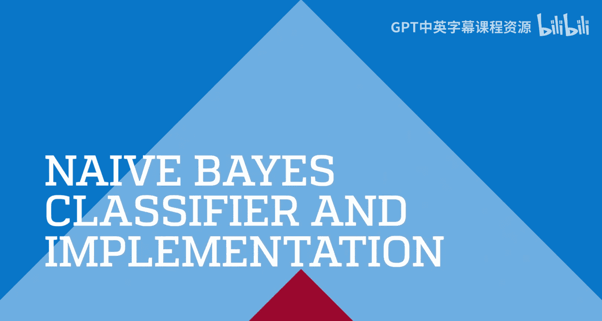
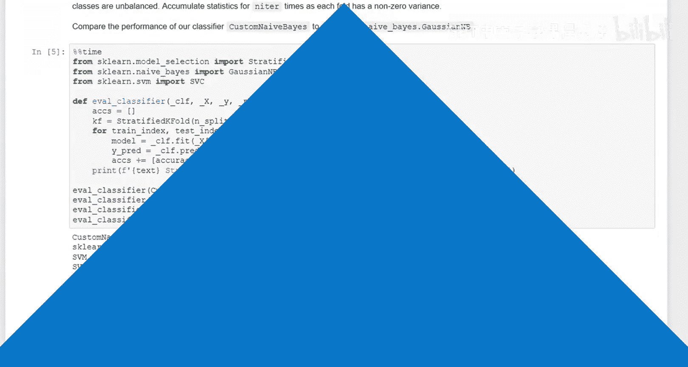

#  021：朴素贝叶斯分类器及实现 🧠




在本节课中，我们将学习朴素贝叶斯分类器的原理，并动手实现一个自定义的朴素贝叶斯分类器。我们将通过一个具体的数据集来演示其工作流程，并将其性能与其他经典分类器进行比较。

---

## 概述

朴素贝叶斯分类器是一种基于贝叶斯定理的简单而有效的分类算法。它假设特征之间相互独立，并利用先验概率和似然来计算后验概率，从而进行预测。尽管其“朴素”的独立性假设在现实中往往不成立，但该算法在许多任务中仍表现出色，且计算效率高。

---

## 数据集准备

首先，我们使用 `make_blobs` 函数创建一个包含5个类别和2个特征的数据集。数据点围绕不同的中心点分布，且各类别的标准差不同，这构成了一个具有一定挑战性的分类问题。

```python
# 示例代码：创建数据集
from sklearn.datasets import make_blobs
X, y = make_blobs(n_samples=[100, 500, 1000, 500, 100], centers=[[-3, -3], [0, 0], [3, 3], [6, 6], [9, 9]], cluster_std=[2, 1, 2, 1, 5], random_state=42)
```

数据集中各类别的样本数量不平衡，这模拟了现实世界中常见的数据分布情况。随机猜测的准确率约为20%，因此，如果我们的分类器能达到远高于此的准确率，即可视为成功。

---

## 朴素贝叶斯分类器原理

朴素贝叶斯分类器的核心是贝叶斯定理，其公式如下：

**P(C|X) = [P(X|C) * P(C)] / P(X)**

其中：
- **P(C|X)** 是后验概率，即在给定特征 **X** 的情况下，样本属于类别 **C** 的概率。
- **P(X|C)** 是似然，即在类别 **C** 中观察到特征 **X** 的概率。
- **P(C)** 是先验概率，即类别 **C** 在训练数据中的出现概率。
- **P(X)** 是证据概率，即特征 **X** 出现的概率，在比较不同类别的后验概率时可忽略。

分类器通过计算每个类别的后验概率，并选择概率最高的类别作为预测结果。

---

## 自定义朴素贝叶斯分类器实现

接下来，我们将逐步实现一个自定义的朴素贝叶斯分类器。该实现主要针对数值型特征，使用正态分布（高斯分布）来建模每个特征的似然。

### 类初始化

在初始化阶段，我们定义类的基本属性，包括样本数、特征数、类别数，以及存储先验概率、预测概率和似然的变量。

```python
class CustomNaiveBayes:
    def __init__(self):
        self.n = None          # 样本数
        self.m = None          # 特征数
        self.cn = None         # 类别数
        self.prior = None      # 先验概率
        self.predictor = None  # 预测概率（特征PDF）
        self.likelihood = None # 似然（每个类别的特征PDF）
```

### 拟合模型

在 `fit` 方法中，我们根据训练数据计算先验概率、每个特征的全局概率密度函数（PDF），以及每个类别下每个特征的PDF。

以下是计算的关键步骤：

1.  **计算先验概率**：统计每个类别在训练数据中的出现频率。
2.  **计算特征PDF**：为每个特征拟合一个高斯分布，描述该特征在所有数据中的分布。
3.  **计算似然**：为每个类别下的每个特征分别拟合一个高斯分布，描述在该类别内该特征的分布。

```python
    def fit(self, X_train, y_train):
        self.n, self.m = X_train.shape
        self.cn = len(np.unique(y_train))
        # 计算先验概率
        self.prior = np.bincount(y_train) / self.n
        # 为每个特征计算全局PDF
        self.predictor = [norm(X_train[:, i].mean(), X_train[:, i].std()) for i in range(self.m)]
        # 为每个类别下的每个特征计算PDF（似然）
        self.likelihood = {}
        for c in range(self.cn):
            X_c = X_train[y_train == c]
            self.likelihood[c] = [norm(X_c[:, i].mean(), X_c[:, i].std()) for i in range(self.m)]
```

### 进行预测

在 `predict` 方法中，对于测试集中的每个样本，我们计算其属于每个类别的后验概率，并选择概率最高的类别作为预测标签。

计算后验概率时，我们利用拟合阶段得到的先验概率和似然（每个特征的条件概率），并假设特征间独立，因此将各特征的概率相乘。

```python
    def predict(self, X_test):
        y_pred = []
        for x in X_test:
            posteriors = []
            for c in range(self.cn):
                # 计算先验部分
                prior = np.log(self.prior[c])
                # 计算似然部分（假设特征独立，概率相乘转换为对数相加）
                likelihood = np.sum([np.log(self.likelihood[c][i].pdf(x[i])) for i in range(self.m)])
                posterior = prior + likelihood
                posteriors.append(posterior)
            # 选择后验概率最大的类别
            y_pred.append(np.argmax(posteriors))
        return np.array(y_pred)
```

---

## 模型评估与比较

在实现自定义分类器后，我们需要评估其性能。首先进行简单再分类（在训练集上训练并预测），然后进行更可靠的十折分层交叉验证。

### 再分类准确率

使用自定义分类器在整个数据集上进行训练和预测，我们获得了约97%的再分类准确率，这表明我们的实现基本正确。

```python
# 示例代码：再分类评估
custom_nb = CustomNaiveBayes()
custom_nb.fit(X, y)
y_pred = custom_nb.predict(X)
accuracy = accuracy_score(y, y_pred)
print(f"再分类准确率: {accuracy:.2%}")
```

### 交叉验证与对比

为了更稳健地评估，我们进行十折分层交叉验证，并将自定义朴素贝叶斯与Scikit-learn中的高斯朴素贝叶斯、线性支持向量机（SVM）和径向基函数（RBF）核SVM进行比较。

以下是主要发现：
- 自定义朴素贝叶斯与库版本的高斯朴素贝叶斯性能相当，均达到约97%的交叉验证准确率。
- 线性SVM在此数据集上表现稍弱。
- RBF核SVM作为更通用的分类器，在此特定任务上表现与朴素贝叶斯相近。

这个结果说明，对于当前这个类别中心分离较好但存在重叠的数据集，简单的朴素贝叶斯分类器已经能够提供非常可靠且优秀的分类性能。

---

## 总结

本节课中，我们一起学习了朴素贝叶斯分类器的基本原理，并动手实现了一个针对数值特征的自定义高斯朴素贝叶斯分类器。我们了解到：

1.  朴素贝叶斯的核心是**贝叶斯定理**，并基于特征条件独立的“朴素”假设。
2.  实现的关键在于计算**先验概率**、**特征的概率密度函数（PDF）** 以及**每个类别下的条件PDF（似然）**。
3.  我们的自定义实现在一个具有5个类别、特征重叠且样本不平衡的数据集上，通过交叉验证达到了约**97%** 的准确率，表现优异。
4.  通过与Scikit-learn内置算法对比，验证了我们实现的正确性，并认识到对于许多问题，简单高效的朴素贝叶斯分类器是一个强有力的基线模型。



通过本教程，你不仅理解了朴素贝叶斯的工作机制，也掌握了如何从零开始实现一个机器学习分类器，并对其进行科学的评估。