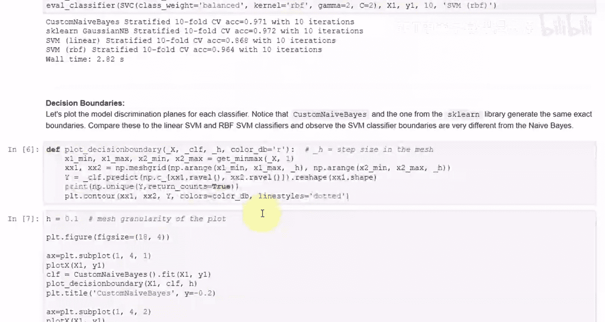

#  022：分类器的决策边界分析

在本节课中，我们将学习不同分类器如何构建决策边界，并分析这些边界如何影响分类性能。我们将通过一个可视化程序来比较朴素贝叶斯、支持向量机等分类器的行为。

## 分类器的决策边界

上一节我们介绍了分类器的基本概念，本节中我们来看看它们如何划分特征空间。所有分类器都会生成某种决策边界。例如，我们的朴素贝叶斯分类器能够基于特征X1和X2构建一个二维概率密度函数（PDF）。它会在每个类别区域构建一个PDF。

这些分类器如何工作？它们如何进行分类？回想一下感知器部件，它本质上是在数据点之间拟合一个超平面，然后将空间划分为两部分。其他分类器也执行类似的任务。

## 决策边界可视化程序

以下是一个名为 `plot_decision_boundary` 的程序，它演示了这些分类器的行为。我们有两个特征X1和X2。我们使用四个分类器进行实验：来自Scikit-learn库的自定义朴素贝叶斯、高斯朴素贝叶斯、线性SVM和RBF核SVM。

我们观察它们构建的所有决策边界。对于朴素贝叶斯，我们看到圆形的PDF。如果给特征1和特征2（即X1和X2）不同的标准差，这些PDF就会变成椭圆形。可以看到，自定义朴素贝叶斯和高斯朴素贝叶斯构建PDF的方式完全相同。后者只是计算更快。

## 线性SVM与RBF核SVM

线性SVM和RBF核SVM的行为则完全不同。线性SVM为这个小类别使用超平面，并为其他类别放置其他超平面。例如，在这个区域，浅绿色类别占主导，但在这个区域，所有浅绿色的点都被分类为深绿色。因此，我丢失了所有这些点，它们将被计入错误。同样，橙色点周围的所有点都被分类为橙色，我为浅绿色类别丢失了它们。这就是线性SVM产生更多错误的原因。

然而，我们可能更喜欢这种方法。这是一个非常通用的分类器。它将二维特征空间划分为这些区域，然后在其内部构建分类器（实际上构建了5选2个分类器），但这是划分超平面的组合结果。

## RBF核SVM的决策边界

现在，让我们看看RBF核SVM，它完全不同。它使用不同的核函数，其决策边界不再是超平面。它们呈波浪状，gamma参数控制着波浪的剧烈程度以分类数据。观察这里，这个区域内的所有点都属于深绿色、橙色等类别，其余则是浅绿色。因此，RBF核SVM犯的错误更少，但它不是概率性的模型，并且仍然会犯一些错误。

然而，它不做任何假设。它是根据我们拥有的数据构建的。而自定义朴素贝叶斯假设底层数据服从正态分布，并且特征之间相互独立。

## 泛化能力与过拟合

正如我们将要看到的，当我们使用不同的数据集（而非像这样的玩具数据集）时，情况会有所不同。这是一个玩具数据集，很容易分类，但它不能反映现实世界的数据。我们在日常生活中生成的数据集不会如此规整。

我需要像这两种（指SVM）分类器来更好地分类现实世界的数据。在后续关于正则化的模块中，我们将更多地看到泛化相关内容。我们将看到前两种（指朴素贝叶斯）并不是那么优秀，因为它们不够通用。而后两种更好，因为它们更通用。我们希望在分类器中具有**泛化能力**。

我们希望减少**过拟合**。我们不希望**欠拟合**，那意味着训练不足。但我们绝对不希望**过拟合**。这是我们监督学习中遵循的最重要概念。

---

本节课中，我们一起学习了不同分类器（朴素贝叶斯、线性SVM、RBF核SVM）如何构建决策边界。我们通过可视化对比了它们的划分方式，并理解了线性SVM可能因使用简单超平面而犯错更多，而RBF核SVM能构建更复杂的边界以适应数据。最后，我们探讨了分类器**泛化能力**的重要性，以及避免**过拟合**在监督学习中的核心地位。