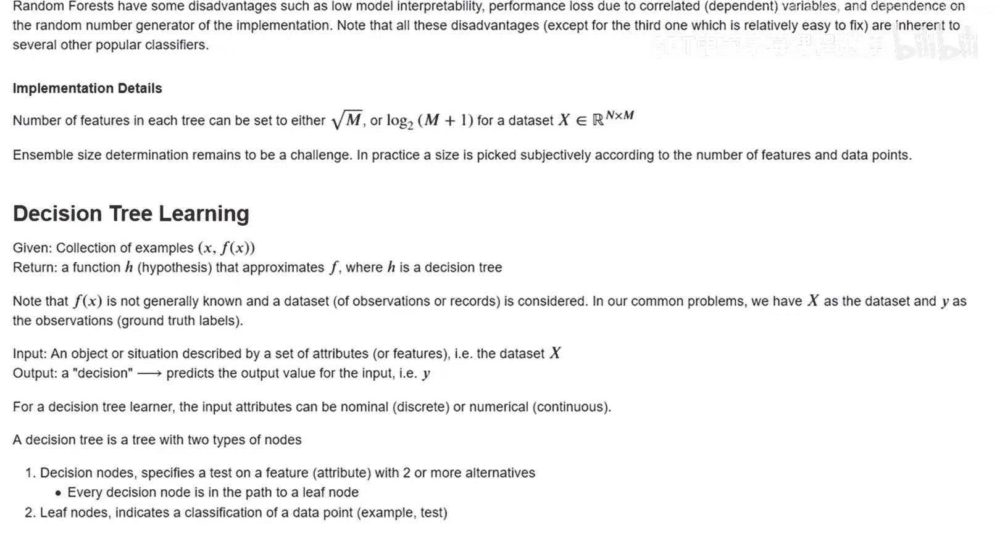

#  025：集成学习

在本节课中，我们将要学习集成学习的基本概念，了解它如何通过组合多个简单模型来构建一个更强大、更稳健的分类器。我们将重点介绍随机森林这一流行的集成方法，并解释其工作原理与优势。

上一节我们回顾了多种独立的强分类器。本节中我们来看看如何通过集成多个“弱学习器”来获得更优的性能。

## 集成学习概述

集成学习是机器学习中最强大的方法之一。其核心思想是：**如果方法得当，数量可以超越质量**。一个由多个简单学习器组成的分类器群体，其性能可以远超单个复杂而强大的分类器。

集成分类器不仅能并行工作，从而更快地产生结果，还能形成一个泛化能力更强、更稳健的分类模型。此外，根据近期研究，不同类型的强分类器也可以组合成一个群体使用。

## 集成学习的优势

以下是集成学习方法的主要优势：

*   **稳健性**：集成模型对数据中的噪声和异常值不那么敏感。
*   **高泛化能力**：模型能够更好地适应未见过的数据。
*   **减少过拟合**：这是机器学习中我们最希望实现的重要目标。生成的模型必须足够抽象和通用，以避免任何形式的过拟合。弱学习器更容易实现这一点，因为它们本身就是更抽象的学习器。

## 维度灾难与解决方案

以维度灾难为例。如果我们有一个包含100个特征的数据集（这很常见），并且希望每个特征上有5个数据点，那么理想的联合密度函数将需要 `5^100` 个数据点才能均匀且详尽地覆盖整个空间。我们知道永远不可能拥有那么多数据点。

那么解决方案是什么？答案是：**使用这些特征的一个子集**。此外，我们永远无法确知这些特征是否相互依赖，也就永远无法获得真正的联合密度函数。因此，当我们为每个弱学习器使用特征的一个子集，然后通过**多数投票**来汇总这些弱学习器的预测时，集成学习就发挥了作用。

## 随机森林：一种流行的集成方法

随机森林是一种非常流行且稳健的集成学习方法。其中的弱学习器是决策树，每个决策树都使用数据点的一个子集和特征的一个子集进行构建。

关于随机森林的关键参数：
*   **每棵树的特征数量**：通常使用总特征数 `M` 的平方根，即 `sqrt(M)`。
*   **集成规模（树的数量）**：通常使用数百或数千棵树，例如200或500棵。
*   **树深度**：通常使用较浅的树（例如5层），即“弱学习器”。

确定最佳的集成规模仍然是一个挑战。然而，预测结果对集成规模的敏感性非常低。随机森林需要调优的参数很少，即使使用默认参数（例如5层深度的树、200或500棵树作为集成规模、以 `sqrt(M)` 作为每个弱学习器的特征子集大小），随机森林也能具有足够的通用性，并且对这些参数非常不敏感。这正是随机森林如此受欢迎的原因之一。

请注意，随机森林使用多个决策树，每个决策树都是使用标准的决策树构建算法建立的。

在下一节中，我们将具体看看这些决策树是如何形成的，以及拥有一个决策树在机器学习中意味着什么。

## 总结

本节课中我们一起学习了集成学习。我们了解到，通过巧妙组合大量简单的“弱学习器”（如决策树），可以构建出比单一复杂模型更强大、更稳健、泛化能力更强的分类器。随机森林作为其中的杰出代表，以其参数不敏感、易于使用和效果显著的特点，成为实践中极具价值的工具。其核心在于利用特征子集和数据子集来构建多样化的树，并通过集体决策（如投票）来做出最终预测，从而有效克服过拟合，提升模型性能。