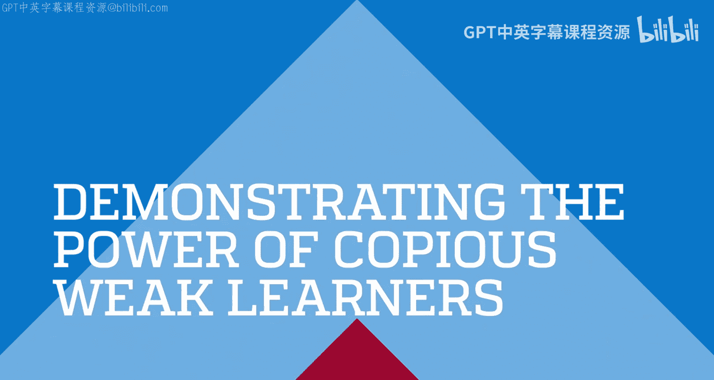
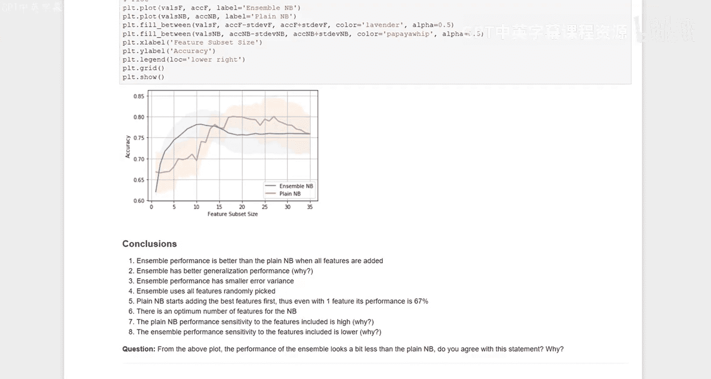

#  027：展示大量弱学习器的威力 🎯




在本节课中，我们将通过一个具体的例子，探索集成学习（Ensemble Learning）的威力。我们将看到，即使每个单独的“弱学习器”（Weak Learner）表现不佳，但通过将它们组合成一个“集成”（Ensemble），其整体性能可以挑战甚至超越常规的分类器。

---

## 数据探索 📊

上一节我们介绍了集成学习的基本概念，本节中我们来看看如何在实际数据上应用它。我们首先需要理解将要使用的数据。

我们选择了经过预处理的泰坦尼克号数据集。该数据集包含891行（样本）和69列（特征）。大部分特征是二进制的（0或1），也有一些是数值型的，如年龄和票价。与任何数据科学问题一样，并非所有特征都有用。我们的目标是预测最后一列“是否幸存”（Survived）。

以下是数据的一些初步观察：
*   **年龄**：年长者幸存率较低，婴儿和年轻人幸存率较高。
*   **性别**：女性（编码为0）的幸存率高于男性。
*   **票价**：票价较低的乘客（通常对应三等舱）幸存率较低。
*   **舱位等级**：一等舱乘客的幸存机会高于三等舱乘客。

这些观察为我们后续的分析奠定了基础。

---

## 基准模型性能 🏁

在构建集成模型之前，我们需要建立一个性能基准。我们使用多种常规分类器在完整数据集上进行10折交叉验证，结果如下：

*   **高斯朴素贝叶斯 (Gaussian Naive Bayes)**：准确率 **45%**。
*   **线性支持向量机 (Linear SVC)**：准确率 **80%**。
*   **带平衡权重的线性SVC**：准确率 **74%**。
*   **RBF核支持向量机 (不同参数)**：准确率在 **66%** 到 **73%** 之间。
*   **逻辑回归 (Logistic Regression)**：准确率 **81%**。
*   **神经网络 (Neural Network)**：准确率 **78%**。
*   **随机森林 (Random Forest)**：准确率 **84%**。

可以看到，随机森林（一种集成方法）在此数据集上表现最佳。这初步印证了集成学习的潜力。

---

## 构建朴素贝叶斯弱学习器集成 🤖

现在，让我们尝试构建一个由弱学习器组成的集成。我们选择**高斯朴素贝叶斯**作为基础弱学习器。关键思路是：每个弱学习器只使用特征的一个**随机子集**进行训练，而不是全部特征。

以下是实现的核心步骤：

1.  **定义集成大小**：例如，`n_ensemble = 100`，表示我们将创建100个弱学习器。
2.  **为每个弱学习器随机选择特征**：对于集成中的每个成员，从所有特征中随机抽取固定数量（例如5个）的特征，**不重复**。
    ```python
    # 伪代码示例
    import random
    features_for_learner = random.sample(all_features, k=5)
    ```
3.  **训练与保存**：用选出的特征子集训练一个朴素贝叶斯分类器，并将该分类器及其使用的特征列表保存起来。
4.  **集成预测**：对于一个新的样本，让集成中所有100个弱学习器进行预测。最终的集成预测结果通过**多数投票**决定。
    ```python
    # 伪代码示例：多数投票
    predictions = [clf.predict(sample) for clf in ensemble]
    final_prediction = max(set(predictions), key=predictions.count)
    ```

我们首先评估单个弱学习器的平均性能：准确率约为 **48%**，但标准差高达 **13%**。这说明由于随机选择特征，不同弱学习器的性能差异很大，有些可能因选中好特征而表现不错，有些则因选中无用特征而表现很差。

然而，当我们评估整个集成模型时，结果令人意外：性能反而**下降**到约 **39%**。这是因为朴素贝叶斯本身不具备特征选择能力，它对所有特征一视同仁。当许多弱学习器只被分配了无用特征时，它们的预测会拖累整体集成。这与随机森林中的决策树不同，决策树能够通过信息增益等指标主动忽略无用特征。

---

## 通过特征选择提升集成性能 ⬆️

上一节我们看到，无脑使用随机特征子集会损害集成性能。本节中我们来看看如何通过**特征选择**来解决这个问题。

我们计算每个特征与目标类别（是否幸存）的**相关性**。例如，“票价”特征与幸存结果的相关性最高，这与我们之前的观察一致。我们保留相关性绝对值大于0.02的特征，将特征数量从68个减少到35个。

使用这个**经过筛选的特征集**，我们重新进行实验：
*   **单个朴素贝叶斯（使用全部35个特征）**：准确率提升至 **76%**。
*   **朴素贝叶斯集成（每个学习器从35个好特征中随机选子集）**：准确率进一步提升至约 **78%**，并且**标准差更低**（约3.5%）。

性能提升的原因是：现在每个弱学习器随机抽到的特征子集，有很大概率包含对预测有用的特征，从而做出了更多有价值的预测。

---

## 实验：特征数量对性能的影响 🔬

我们进行一个更系统的实验：逐步增加用于训练的特征数量（按相关性从高到低排序），观察这对“普通朴素贝叶斯”和“朴素贝叶斯集成”性能的影响。

实验结果如下图所示（概念描述）：
*   **普通朴素贝叶斯（红线）**：性能对特征数量非常敏感。使用全部特征时性能反而受损，使用前25个左右的最佳特征时达到峰值。
*   **朴素贝叶斯集成（蓝线）**：性能更加稳健。在特征数量达到约15个之后，性能就进入一个平台期，不再剧烈波动。其误差的方差（由蓝色带宽表示）始终低于普通朴素贝叶斯（红色带宽）。

这个实验表明，集成学习不仅可能带来更高的准确率，更重要的是它能提供**更好的泛化能力**和**更稳定的性能**，对特征选择的敏感度更低。

---

## 总结 📝

本节课中我们一起学习了如何构建和评估一个基于弱学习器的集成模型，并通过泰坦尼克号数据集进行了演示。我们得到了以下核心结论：

1.  **集成威力**：通过组合大量弱学习器（如朴素贝叶斯），并采用多数投票机制，可以构建出强大的分类器。
2.  **特征选择的重要性**：当弱学习器本身不具备智能特征选择能力时（如朴素贝叶斯），先进行特征筛选（如基于相关性）对于释放集成学习的威力至关重要。
3.  **稳健性与泛化**：与单个模型相比，集成模型通常表现出更低的性能方差和更好的泛化能力，对输入特征的扰动不那么敏感。
4.  **与随机森林对比**：随机森林的强大之处在于其基础学习器（决策树）能够自动进行有效的特征选择，因此它对原始特征集的包容性更强。



本次演示表明，即使使用非常简单的弱学习器，通过巧妙的集成策略和必要的数据预处理，也能获得具有竞争力的、稳健的模型性能。