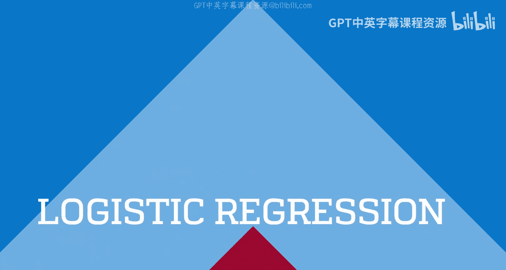
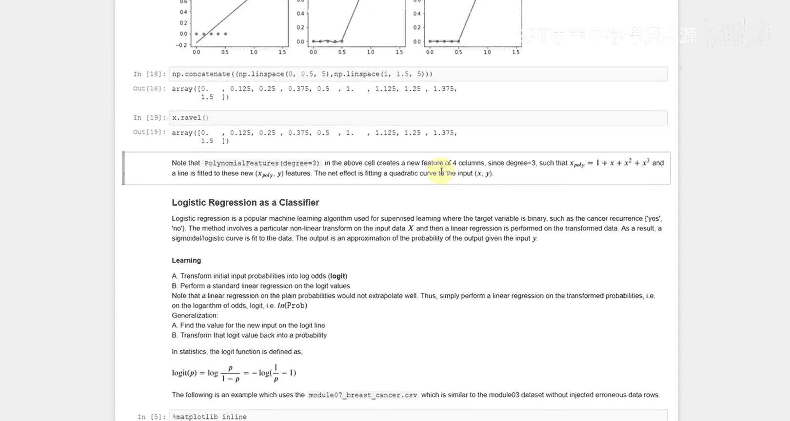
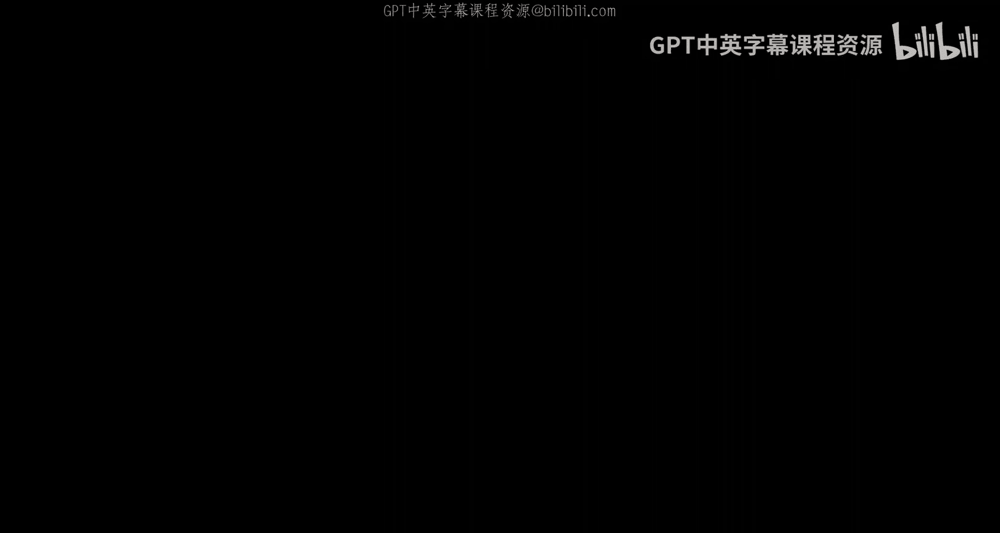

应用机器学习：6：逻辑回归




在本节课中，我们将要学习逻辑回归。这是一种用于处理概率性变量（特别是二分类问题，即输出值为0或1）的曲线拟合方法。我们将了解为何线性回归不适用于此类问题，以及逻辑回归如何通过S型函数（Sigmoid函数）提供更好的解决方案。

上一节我们介绍了线性回归，本节中我们来看看当目标变量是概率值时会发生什么。线性回归的预测线可能超出0到1的范围，这不适合表示概率。然而，S型函数可以将任意输入映射到(0, 1)区间，因此更适合此场景。

以下是逻辑回归与线性回归、多项式回归的直观对比示例。

*   我们的特征变量X取值在0到1之间。
*   目标变量Y是概率值，只能取0或1。
*   直接使用线性回归拟合效果不佳，因为其直线无法很好地覆盖0到0.5和1到1.5之间的概率值。
*   使用二次多项式回归有所改善。
*   将多项式次数增加到7次，拟合效果更好，但曲线仍存在不必要的波动。
*   逻辑回归使用S型函数拟合，其曲线平滑且自然地将输出限制在0到1之间。

逻辑回归的核心是S型函数，其公式如下：

`y = 1 / (1 + exp(-(a*x + b)))`

其中，`a`和`b`是需要通过优化算法确定的参数。这个函数可以将线性组合 `a*x + b` 的输出映射到(0, 1)的概率区间。

在代码实现中，我们使用`scipy.optimize.curve_fit`等优化函数来寻找最佳的参数`a`和`b`。以下是关键步骤：

```python
# 定义Sigmoid函数
def sigmoid(x, a, b):
    return 1 / (1 + np.exp(-(a*x + b)))

# 使用curve_fit进行拟合，popt为优化后的参数[a, b]
popt, _ = curve_fit(sigmoid, x_original, y)
# 使用优化后的参数进行预测
y_pred = sigmoid(x_original, *popt)
```

在使用机器学习库时，需要注意输入数据的格式。例如，`scikit-learn`中的线性回归模型通常要求输入X是二维数组（即使只有一列），而`curve_fit`等函数可能要求一维数组。需要进行适当的维度转换。

```python
# 为scikit-learn模型准备二维列向量
X_2d = x_original[:, np.newaxis]
# 为curve_fit准备一维数组
x_1d = x_original.flatten()
```





本节课中我们一起学习了逻辑回归。它是一种通过S型函数对二分类概率数据进行曲线拟合的方法。我们理解了它相比线性回归和多项式回归在处理概率输出时的优势，并了解了其核心公式和基本实现步骤。逻辑回归是构建分类器的基础，在下一节中，我们将探讨如何将其应用于实际的分类任务。