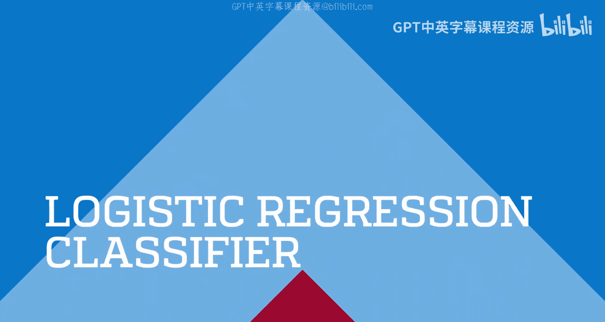
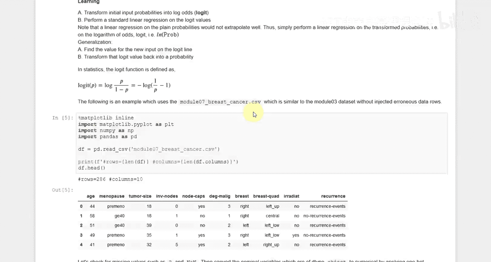

应用机器学习：7：逻辑回归分类器 🧠

在本节课中，我们将要学习逻辑回归分类器。我们将了解它与其他分类器的区别，并通过一个乳腺癌数据集的实际案例，演示如何使用逻辑回归进行分类、评估特征重要性并进行预测。

---

### 概述

逻辑回归是一种基于回归和概率思想的强大分类器。它不假设数据遵循特定的概率分布，而是通过优化问题，将一条S形曲线（Sigmoid函数）拟合到概率化的数据上。这使得它在许多实际场景中非常有效。

上一节我们介绍了其他监督学习分类器，如随机森林、朴素贝叶斯、支持向量机和神经网络。本节中我们来看看逻辑回归。

---

### 逻辑回归的核心思想

逻辑回归介于基于距离的分类器（如SVM）和纯概率分类器（如朴素贝叶斯）之间。它不假设特征的具体分布，而是直接对概率数据进行曲线拟合。

其核心是将特征值 **x** 映射到属于某个类别的概率 **p**。对于二分类问题（类别0和1），逻辑回归模型可以表示为：

**公式：** `p = 1 / (1 + e^-(β₀ + β₁x₁ + ... + βₙxₙ))`

其中，`e` 是自然常数，`β` 是模型需要学习的系数。我们取概率 `p` 的对数几率（log-odds，或称logit）来建立线性关系，然后拟合这条曲线。

我们将不深入实现细节，而是直接使用Scikit-learn库中的 `LogisticRegression` 模型。

---

### 数据准备与探索

我们将使用与模块3相似的乳腺癌数据集，但移除了有错误的数据行。以下是数据处理的关键步骤。

首先，我们加载并探索数据。数据集包含数值型变量和分类型变量（如“menopause”）。

以下是数据预处理的主要步骤列表：

1.  **检查缺失值**：我们检查数据中是否存在“NaN”或“？”表示的缺失值。
2.  **删除缺失行**：将包含缺失值的行从数据集中删除。
3.  **转换数据类型**：将所有数据转换为数值型，因为机器学习模型只能处理数字。
4.  **独热编码**：对于“menopause”这类分类变量，我们使用独热编码将其转换为多个二进制特征列。编码后的特征名会保留原始信息（例如“menopause_ge40”）。
5.  **处理目标变量**：我们的目标是预测癌症是否复发（‘recurrence’）。这是一个二分类变量（‘no-recurrence-events’ 或 ‘recurrence-events’）。

完成预处理后，我们检查目标变量的分布是否平衡。在本数据集中，复发与未复发的比例接近30:70，虽不完全平衡，但尚可接受。如果比例极端失衡（如99:1），则不宜直接使用准确率作为评估指标。

---

### 模型训练与评估

我们使用逻辑回归模型进行训练，并采用10折交叉验证来评估模型性能。

模型的准确率大约在70%左右，这与我们在模块3中使用其他方法得到的结果相近。逻辑回归在此处的优势不在于显著提升准确率，而在于其可解释性，例如能够评估特征的重要性。

---

### 特征重要性分析

逻辑回归模型的一个优点是可以通过检查模型系数（权重）来评估特征的重要性。

以下是排名靠前的几个特征：

*   **deg-malig**（肿瘤恶性程度）
*   **tumor-size**（肿瘤大小）
*   **inv-nodes**（受侵淋巴结数）

这些特征的重要性结果与癌症治疗领域专家的先验知识是吻合的，这证明了模型的可解释性。

---

### 使用模型进行预测

训练好模型后，我们可以用它来对新的、未知的数据进行预测。

假设我们有两个新病人的数据。首先，我们需要按照与训练数据完全相同的方式（包括独热编码）来构建这两个数据点。然后，将处理后的数据输入模型，得到预测的复发状态（‘no-recurrence-events’ 或 ‘recurrence-events’）。

例如，在我们的演示中，第一个数据点被预测为“未复发”，第二个数据点被预测为“复发”。值得注意的是，在第一个数据点中，“deg-malig”特征值为4。如果我们将其增加到10（一个更高的恶性程度），模型很可能会将其预测改为“复发”，这与该特征排名第一的重要性是一致的。

---

### 总结

本节课中我们一起学习了逻辑回归分类器。我们了解到逻辑回归是一种不依赖于特定数据分布假设的灵活分类器。通过乳腺癌数据集的实例，我们完整演练了监督学习的管道：从数据加载、探索、预处理（包括独热编码），到模型训练、评估、特征重要性分析，最后到对新数据进行预测。这个流程涵盖了使用逻辑回归解决分类问题的核心步骤。