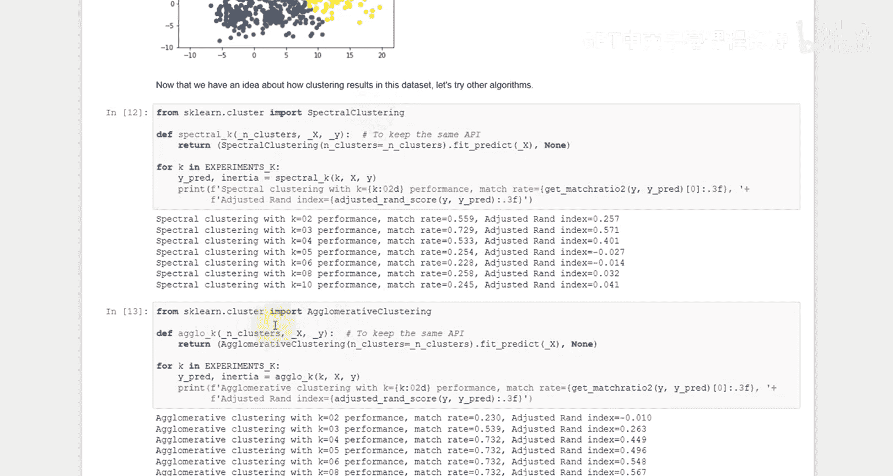

#  034：无监督学习实例演练


在本节课中，我们将通过一个实例演练，学习如何评估聚类算法的质量。我们将使用一个已知的数据集，应用K均值聚类算法，并探讨如何正确评估聚类结果，包括准确率、调整兰德指数和肘部法则。

## 概述

聚类质量的衡量基于距离度量。例如，在**簇分离度**中，我们计算不同簇之间的距离并取平均值。在**簇内聚度**中，我们计算同一簇内各元素与其质心之间距离的平均值。如果我们有K个簇，那么就有K个簇内距离。

在本笔记本中，我们将使用准确率和调整兰德指数来评估聚类得分。需要指出的是，对于聚类而言，没有一个“完美”的通用评估指标。我们通常需要结合观察聚类的外观、计算分离度与内聚度，以及在拥有真实标签时使用一些评分方法，来综合判断聚类质量。

## 生成数据集

首先，我们创建与监督学习中使用的相同数据集。这个数据集包含五个基于距离的簇（或类别），具有两个特征。数据点围绕中心点生成，并带有特定的标准差。中心点位置如下列表所示。

```python
# 示例：生成具有五个簇的数据集
centers = [[1, 1], [-1, -1], [1, -1], [-1, 1], [0, 0]]
```

## 应用K均值聚类

K均值聚类是一个优秀的入门级聚类算法，在许多情况下都能很好地工作。你可以指定想要的簇数量，并根据某些标准（例如应用某种初始聚类来确定初始质心）进行初始化。

K均值是迭代算法，需要运行多次直到质心不再移动（即收敛）。我们通常使用随机种子，因为它可以用于打乱数据点等操作。

Scikit-learn中聚类算法的API与监督学习算法类似：创建模型、拟合数据、然后进行预测。

```python
from sklearn.cluster import KMeans
# 创建KMeans实例，指定簇数量为5
kmeans = KMeans(n_clusters=5, random_state=42)
# 拟合数据
kmeans.fit(X)
# 预测簇标签
labels = kmeans.predict(X)
```

某些聚类算法的实现还包含`inertia_`（惯性）属性，它表示质心变化的程度。这是判断聚类是否收敛的一个良好指标。随着迭代进行和最终簇的形成，惯性会变得越来越小。

## 评估聚类结果

为了计算准确率，我们需要处理一个映射问题：算法生成的簇ID（例如0到K-1）可能与真实的类别标签不匹配。如果直接进行一对一比较，将无法得到正确的评估结果。

因此，我们使用列联表来找出算法生成的簇ID与真实标签之间的映射关系。以下函数利用Scikit-learn的`linear_assignment`模块（或`scipy`的`linear_sum_assignment`）来找到最优映射，并相应地更新预测标签，然后计算匹配准确率。

```python
import numpy as np
from scipy.optimize import linear_sum_assignment
from sklearn.metrics import confusion_matrix

def match_ratio(y_true, y_pred):
    # 构建列联表
    contingency = confusion_matrix(y_true, y_pred)
    # 使用匈牙利算法找到最优行-列匹配（映射）
    row_ind, col_ind = linear_sum_assignment(-contingency)
    # 根据映射创建一个新数组来更新预测标签
    # ...（具体映射代码）
    # 计算更新后的准确率
    accuracy = np.mean(y_true == y_pred_updated)
    return accuracy
```

我们将对簇数量从2到10（跳过一些值以动态缩放）进行实验，并计算匹配准确率和调整兰德指数。

## 肘部法则与惯性

教科书常提到使用惯性的**肘部法则**。下面是一个很好的演示：我们让簇数量从1增加到30，并绘制惯性变化图。

随着簇数量增加，惯性自然会下降。一个好的“肘点”（曲线拐点）出现在K=5的位置，这恰好是数据集中真实的簇数量。从准确率图上看，峰值也出现在K=5。

然而，这里有一个关键点：我们之前计算的准确率依赖于真实标签进行ID映射。如果没有真实标签，我们将无法进行这种映射，也就无法得到这个“漂亮”的准确率。因此，我们需要一种不依赖映射的评估方式。

## 正确的评估方式

为了进行正确的评估，我们修改匹配函数：一旦某个真实标签ID被映射到一个生成的簇ID，就不再更改。这意味着，如果算法将一个大簇分割成了多个小簇，那么只有其中一个子簇会被映射到原始的真实标签上，其他子簇将被视为错误分类。

当我们使用这种更新后的方法计算准确率时，会发现准确率在K=4时达到峰值，然后下降并趋于平稳。调整兰德指数则收敛在0.5左右，它采用了一种更复杂的基于列联表的计算方式。

这才是对聚类算法的**真实评估**。惯性图仍然可以为我们选择簇数量提供参考，它指示了K=5附近是一个合适的“肘点”。即使没有真实标签，我们也可以参考它。

## 其他聚类算法演示

接下来的单元还演示了**谱聚类**和**层次聚类**，这些都是强大的聚类方法，其效果取决于数据特性。

## 总结




本节课我们一起学习了如何评估无监督学习中的聚类结果。我们了解到，评估聚类质量需要综合多种方法：观察惯性图的肘部法则、在拥有真实标签时使用经过正确映射处理的准确率以及调整兰德指数。重要的是，聚类没有单一的“黄金标准”评估指标，必须结合具体任务和多种视角进行分析。通过实例，我们实践了K均值聚类，并理解了正确评估聚类性能的细微差别。