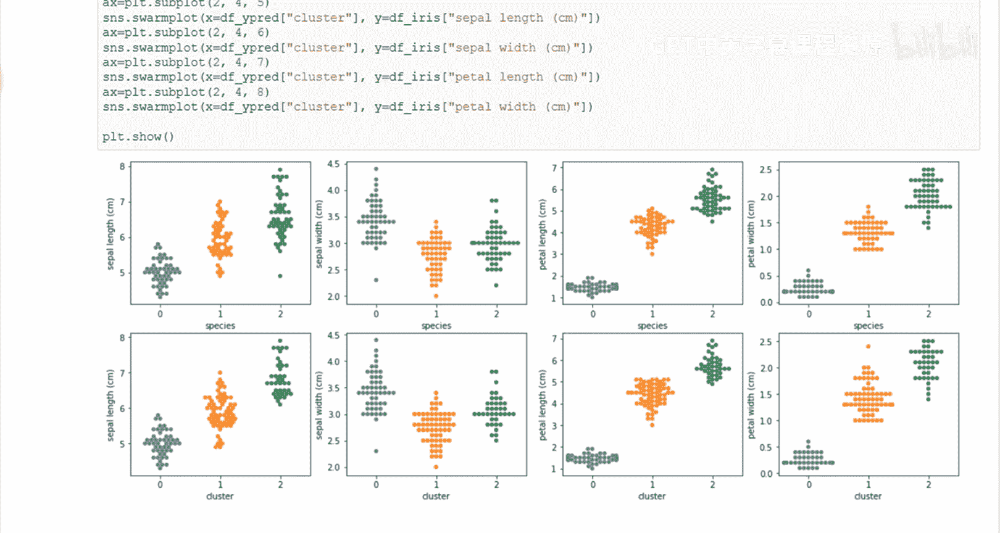

#  035：无监督学习可视化鸢尾花数据集


在本节课中，我们将学习如何对一个经典的真实世界数据集——鸢尾花数据集进行无监督学习分析。我们将使用K-Means聚类算法，并通过多种可视化方法和质量指标来评估聚类效果。

## 概述

鸢尾花数据集是机器学习中一个著名的基准数据集。它包含三种鸢尾花的四个测量特征（萼片长度、萼片宽度、花瓣长度、花瓣宽度）以及对应的类别标签。本节课的目标是，在不使用真实标签（即进行无监督学习）的情况下，探索这个数据集的结构，应用K-Means算法进行聚类，并评估聚类结果的质量。

## 数据集介绍与可视化

首先，我们来认识一下鸢尾花数据集。该数据集包含150个样本，每个样本有4个数值型特征，且三个类别的样本数量是均衡的。

以下是使用pandas和Seaborn库加载并查看数据的基本方法：

```python
import pandas as pd
import seaborn as sns
# 加载数据
iris = sns.load_dataset('iris')
print(iris.head())
```

通过绘制特征对图，我们可以直观地观察数据分布。从图中可以发现，`Setosa`（山鸢尾）类在花瓣长度和花瓣宽度这两个特征上，与其他两个类别（`Versicolor`和`Virginica`）有较好的区分度。而`Versicolor`和`Virginica`之间则在所有特征上都有一定程度的重叠。

上一节我们介绍了数据集的基本情况，本节中我们来看看如何通过三维可视化更立体地观察数据分布。

## 三维数据可视化

为了更深入地理解数据在特征空间中的结构，我们可以进行三维可视化。这需要将绘图后端切换到`notebook`模式以使用交互式控件。

以下是生成三维散点图的示例代码：

```python
import plotly.express as px
fig = px.scatter_3d(iris, x='sepal_length', y='sepal_width', z='petal_length', color='species')
fig.show()
```

在交互式三维图中，我们可以旋转视角观察。可以清晰地看到`Setosa`类与其他两类形成了明显的分离簇。而`Versicolor`和`Virginica`两类则紧密地混合在一起，重叠部分可能达到5%-10%。通过切换显示的维度（例如，将Z轴改为`petal_width`），有时可以找到更好的分离视角。

当然，对于成百上千个特征的高维数据，直接可视化是不可行的。通常的做法是先用特征选择或降维方法（如PCA）提取最重要的几个特征，再进行可视化。

## 应用K-Means聚类与质量评估

现在，我们进入核心环节：对鸢尾花数据集进行无监督聚类。我们将使用K-Means算法，并假设不知道真实的类别数量（k=3）。

首先，准备数据。我们将特征数据记为`X`，将真实标签（仅用于后续评估，不参与训练）记为`y`。

```python
from sklearn.cluster import KMeans
# 假设 X 是特征数据
kmeans = KMeans(n_clusters=3, random_state=42)
cluster_labels = kmeans.fit_predict(X)
```

接下来，我们需要评估聚类结果的质量。以下是几个关键的内部评估指标（不依赖真实标签）：

*   **簇内平均距离**：同一个簇中所有点到其质心距离的平均值。公式可表示为：`avg_intra = mean( distance(x, centroid_of_cluster(x)) for x in X )`。该值越小，说明簇内样本越紧密。
*   **簇间平均距离**：所有簇的质心之间相互距离的平均值。公式可表示为：`avg_inter = mean( distance(centroid_i, centroid_j) for all i, j )`。该值越大，说明簇间分离得越好。

我们计算了当聚类数k从2变化到5时的这些指标。观察发现，随着k的增加，簇内平均距离持续下降（因为每个簇变得更小、更紧凑），簇间平均距离也呈现下降趋势。选择合适的k值需要权衡这两个指标，类似于寻找“肘部”拐点。

此外，我们还可以计算**轮廓系数**等指标，或观察生成的簇在**大小上是否均衡**。例如，当k=3时，如果三个簇的样本数比例接近1:1:1，可能是一个好的迹象。

## 与真实标签对比分析

由于我们拥有真实标签，因此可以进行外部评估，这能给我们更直接的性能反馈。我们使用`get_match_ratio`函数（基于列联表进行最优匹配）来计算聚类标签与真实标签的匹配准确率。

对于鸢尾花数据集，当设定k=3时，K-Means取得了接近90%的匹配准确率。这是一个相当不错的结果，说明无监督聚类成功地捕捉到了数据中潜在的大部分类别结构。

最后，我们可以通过对比图来进行细致的分析。以下是生成对比图的思路：

1.  绘制基于真实标签的四个特征关系图。
2.  绘制基于聚类ID的四个特征关系图。

通过对比这两组图，我们可以直观地看到哪些数据点被错误地划分了。例如，我们可能会发现`Versicolor`类别中的少数几个点被归入了`Virginica`的簇中，反之亦然。这种可视化分析有助于我们理解聚类算法在何处“混淆”。

如果在一个真正的无监督场景中没有真实标签，那么我们就只能依赖于之前讨论的内部质量指标和可视化形态来判断聚类的好坏，而无法进行如此精确的归因分析。

## 总结




本节课中我们一起学习了如何对鸢尾花数据集进行无监督学习分析。我们首先探索了数据集的特征分布，并通过三维可视化直观感受了数据的结构。接着，我们应用K-Means算法进行聚类，并介绍了簇内距离、簇间距离等内部评估指标来量化聚类质量。最后，借助真实标签，我们评估了聚类的准确率，并通过对比可视化深入分析了聚类结果的得失。这个过程展示了无监督学习从探索、建模到评估的完整工作流程。