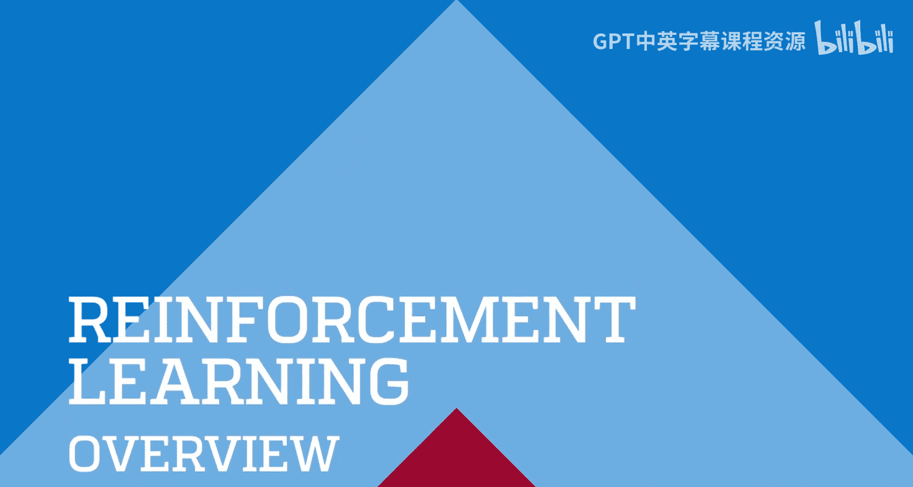

#  036：强化学习概述

在本节课中，我们将学习第三种主要的学习策略——强化学习。它将与我们已经学过的监督学习和无监督学习方法一起，构成机器学习策略的完整图景。

强化学习是人类在环境中学习生存时最自然的方式。当无法获得或应用“标准答案”时，如果存在一个环境，就可以通过在该环境中给予奖励和惩罚来学习行为准则，从而分别实现最大化收益或最小化成本。

强化学习是教会计算机如何玩棋盘游戏（如井字棋或国际象棋）的典型学习策略。工业界一个很好的强化学习例子是AlphaGo，它是第一个击败围棋世界冠军的计算机程序，这是人工智能发展史上令人印象深刻的一步，尤其是考虑到围棋难以估量的复杂性。

我们将首先通过定义术语和描述几个典型的强化学习问题（如井字棋和电梯控制）来介绍强化学习的建模和学习环境。然后，我们将列出几种技术来构建基于状态和动作的Q学习数学模型。最后，我们将实现一个Q学习器，来学习并精通地玩井字棋游戏。

---

## 强化学习建模与学习环境

上一节我们介绍了强化学习的整体概念，本节中我们来看看如何为强化学习问题建立模型。

强化学习涉及一个**智能体**在一个**环境**中学习。智能体通过执行**动作**与环境交互，环境则返回新的**状态**和相应的**奖励**。目标是学习一个策略，使长期累积奖励最大化。

以下是强化学习中几个核心组成部分的定义：

*   **智能体**：进行学习和决策的实体。
*   **环境**：智能体所处的外部世界。
*   **状态**：在特定时刻对环境的描述。
*   **动作**：智能体可以执行的操作。
*   **奖励**：环境对智能体动作的即时反馈。
*   **策略**：智能体根据当前状态选择动作的规则。

---

## 典型强化学习问题示例

理解了基本建模概念后，我们通过两个例子来具体看看强化学习是如何应用的。

以下是两个经典的强化学习问题：

1.  **井字棋**：智能体（玩家）在3x3的棋盘上学习如何落子。状态是当前的棋盘布局，动作是在空位落子，奖励可以是获胜（+1）、失败（-1）或平局（0）。
2.  **电梯控制**：智能体（控制系统）学习如何调度电梯。状态包括各楼层呼叫、电梯当前位置和载客情况，动作是决定电梯移动方向或停靠，奖励可以基于乘客平均等待时间来设计（等待时间越短，奖励越高）。

---

## Q学习：基于状态与动作的数学模型

在了解了问题示例后，本节我们深入探讨一种具体的强化学习技术——Q学习。

Q学习的核心是学习一个**Q函数**。这个函数评估在给定状态`s`下，采取某个动作`a`所能获得的长期价值。其更新遵循贝尔曼方程：

**`Q(s, a) = Q(s, a) + α * [R + γ * max(Q(s', a')) - Q(s, a)]`**

其中：
*   `s`：当前状态。
*   `a`：采取的动作。
*   `α`：学习率，控制新信息覆盖旧信息的程度。
*   `R`：执行动作`a`后获得的即时奖励。
*   `γ`：折扣因子，衡量未来奖励相对于即时奖励的重要性。
*   `s‘`：执行动作`a`后到达的新状态。
*   `max(Q(s', a'))`：在新状态`s‘`下，所有可能动作中的最大Q值。

智能体通过不断探索（尝试新动作）和利用（选择已知的高价值动作）来更新Q表，最终学到最优策略。

---

## 实现一个玩井字棋的Q学习器

掌握了Q学习的理论后，让我们动手实践，构建一个能够学习玩井字棋的Q学习智能体。

以下是实现一个简单Q学习器的主要步骤：

1.  **初始化**：创建一个Q表，将所有`(状态, 动作)`对的初始值设为0（或一个小的随机数）。
2.  **选择动作**：根据当前状态，使用ε-贪婪策略选择动作。即以概率`ε`随机探索，以概率`1-ε`选择当前Q值最高的动作。
3.  **执行与观察**：执行选定的动作，获得新状态和即时奖励。
4.  **更新Q值**：使用上述Q学习公式更新Q表中对应的`(状态, 动作)`值。
5.  **迭代**：重复步骤2-4，让智能体进行大量对局（自我对弈或与固定策略对手对弈）。
6.  **应用策略**：训练完成后，智能体只需在任何状态下选择Q值最高的动作即可进行游戏。

通过足够的训练，这个Q学习器能够学会井字棋的最优策略，达到永不输棋的水平。

---

本节课中我们一起学习了强化学习的基础知识。我们了解了强化学习是与监督学习、无监督学习并列的第三种机器学习范式，它通过智能体与环境的交互，利用奖励和惩罚信号来学习最优行为策略。我们介绍了强化学习的建模框架，分析了井字棋和电梯控制等实例，重点探讨了Q学习的数学模型及其更新机制，并概述了实现一个井字棋Q学习器的基本步骤。强化学习在游戏AI、机器人控制、资源优化等领域有着广泛的应用前景。