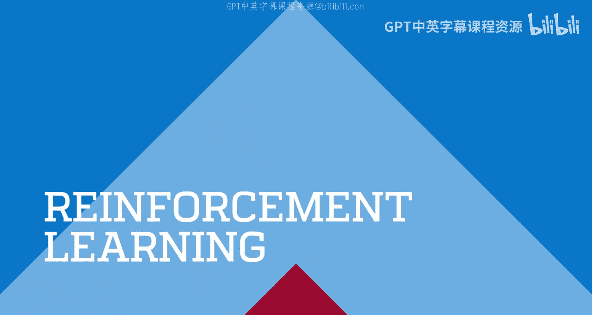
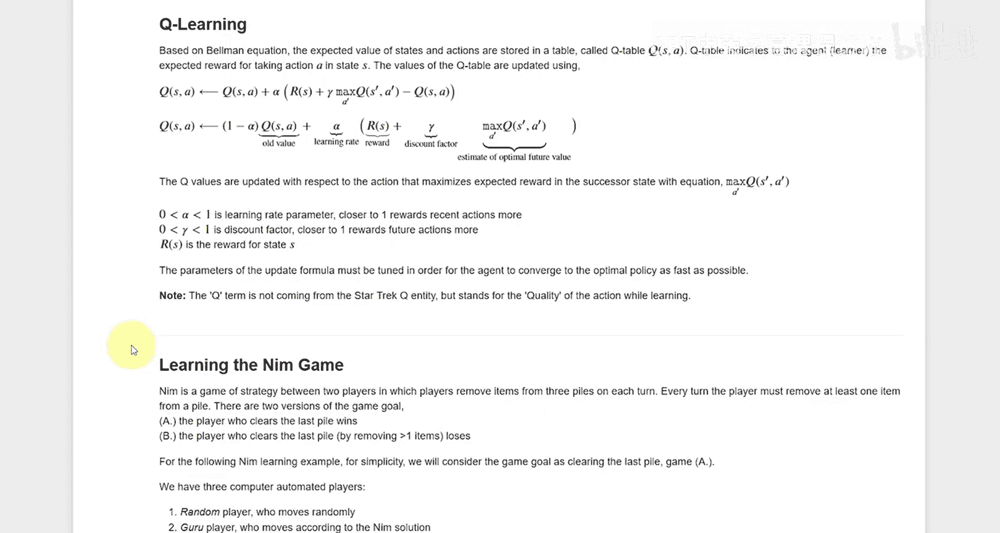

#  037：强化学习 🎮

在本节课中，我们将学习机器学习中的第三种主要范式——强化学习。我们将了解其核心概念、与监督学习和无监督学习的区别，并探讨其在实际问题中的应用。

## 概述

强化学习是一种通过奖励和惩罚来对环境进行建模的学习方法。它是除了监督学习和无监督学习之外的第三种主要学习策略。在监督学习中，我们需要明确的反馈来优化成本函数；在无监督学习中，我们学习数据的基线分布；而在强化学习中，智能体通过与动态环境的交互来学习策略。

## 强化学习的基本概念

上一节我们介绍了强化学习的定位，本节中我们来看看其核心运作机制。

在强化学习问题中，总是存在一个**环境**。这个环境动态地生成数据，并对我们的**动作**做出响应。环境还会根据动作的好坏提供**奖励**或**惩罚**，从而给予智能体反馈。

这与监督学习有相似之处，但我们并非从一个静态数据集中学习，而是从一个可以有限或无限的环境中学习。例如，在人生中，我们从家庭、导师和同伴那里学习，环境就是生活本身。而在游戏中，如井字棋，环境则是有限且明确的。

强化学习的过程包含**探索**和**利用**。智能体在环境中尝试不同动作（探索），通过接收的奖励或惩罚来调整其**策略**，最终利用学到的知识来最大化长期收益（利用）。

## 强化学习的要素

以下是构成强化学习系统的几个关键要素：

*   **策略**：定义了在给定状态下应采取何种动作。它属于“做什么”的范畴。
*   **奖励**：定义了什么是“好”的结果。它属于“价值”的范畴。
*   **价值**：预测了未来的累积奖励。它属于“模型”的范畴。

通过制定能获得奖励的策略，并收集动作与奖励的数据，最终可以构建出强化学习模型。

## 强化学习应用实例

强化学习在多个领域都有成功应用，以下是一些典型例子：

*   **井字棋**：在一个3x3的棋盘上放置圆圈和叉号的双人游戏。
*   **西洋双陆棋**：一种包含运气和策略的游戏。TD-Gammon是世界顶级的西洋双陆棋程序，正是通过强化学习构建的。
*   **电梯调度控制**：一个涉及多部电梯、多个楼层、乘客等待状态和运动方向的复杂优化问题。使用传统方法建模非常困难，强化学习是解决此类问题的有效途径。奖励可以设定为：每个等待乘客在每个时间步（如每秒）产生-1的奖励（即惩罚）。即使对于只有4部电梯的小型问题，其可能的状态数量也极其庞大。
*   **动态信道分配**：用于优化电信网络，高效利用带宽资源。

## 游戏中的强化学习

游戏是强化学习的绝佳试验场，例如井字棋、西洋双陆棋、国际象棋、3D国际象棋以及围棋。

不同游戏的可能状态数量差异巨大。例如，国际象棋约有10^53种可能状态，而围棋则高达10^172种。存储围棋每一个可能位置的信息是不可能的。

那么，像AlphaGo这样的强化学习程序是如何学习围棋的呢？关键在于，围棋中大多数局面看起来是相似的。强化学习器通过自我对弈来发现这些**模式**。它并不存储整个棋盘，而是存储棋盘上出现的模式，并寻找这些模式以最大化收益。

## 评估性反馈与指导性反馈

在机器学习中，对动作的评估方式主要有两种：

*   **评估性反馈**：反馈完全取决于所采取的动作。例如在优化问题中，我们最小化一个成本函数，该评估完全依赖于我们优化的参数（即动作）。
*   **指导性反馈**：提供正确的动作作为指导。例如在监督学习（如随机森林）中，我们拥有带有标签的训练数据。

值得注意的是，有些方法兼具两者特性，例如支持向量机，它通过解决一个优化问题（评估性）来进行学习。

## 探索与利用的权衡

一个经典的例子是**多臂老虎机问题**。赌徒面对多台具有不同中奖概率的老虎机，需要制定一个策略来最大化收益。

这里的关键抉择是：
*   **利用**：每次都选择当前已知收益最高的老虎机（贪婪动作）。这可能导致陷入局部最优解。
*   **探索**：偶尔尝试其他老虎机，以收集更多信息，可能发现全局收益更高的机器。

在诸如国际象棋的游戏中，当国王受到攻击时，你不能为了探索而走一步奇怪的棋。但在西洋双陆棋等包含随机性的游戏中，有时不走出最佳一步而去探索，可能带来长期收益，因为你不一定会因此输掉整局游戏。

## Q学习简介

上一节我们讨论了探索与利用的平衡，本节中我们来看看一种具体的强化学习算法——Q学习。

**Q学习**是一种基于价值的学习方法，其目标是学习一个动作价值函数 **Q(s, a)**，它表示在状态 **s** 下采取动作 **a** 所能获得的预期累积奖励。

其核心更新公式如下：

`Q(s, a) = Q(s, a) + α * [R(s) + γ * max_a’ Q(s’, a’) - Q(s, a)]`

其中：
*   **α** 是学习率，控制新信息覆盖旧信息的程度。
*   **γ** 是折扣因子，衡量未来奖励相对于即时奖励的重要性。
*   **R(s)** 是在状态 **s** 下获得的即时奖励。
*   **max_a’ Q(s’, a’)** 是下一状态 **s’** 的最大预期未来奖励。

学习率 **α** 不能总是0或1。如果过高，类似于过拟合，策略会频繁剧烈变化；如果过低，则学习速度太慢，需要多次重复相同经历才能更新Q表。

在接下来的章节中，我们将应用Q学习技术来学习尼姆游戏。

## 总结

本节课中我们一起学习了强化学习的基础知识。我们了解到强化学习是一种智能体通过与环境交互，根据获得的奖励或惩罚来学习最优策略的方法。我们探讨了其核心要素（策略、奖励、价值）、与监督/无监督学习的区别，以及探索与利用之间的重要权衡。最后，我们简要介绍了Q学习算法，为后续的实际应用打下基础。强化学习在游戏AI、机器人控制、资源优化等领域有着广泛的应用前景。