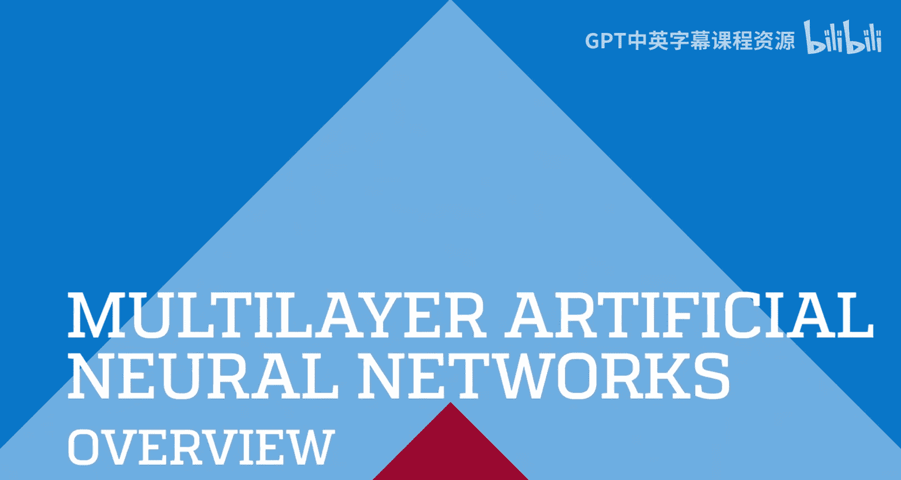

#  042：多层人工神经网络概述 🧠

在本节课中，我们将学习多层人工神经网络的基本概念。我们将从回顾单层感知器开始，逐步介绍多层神经网络的构成、其强大的功能以及在现代技术中的应用。最后，我们将概述本模块后续的学习路径。

---

在之前的模块中，我们学习了线性分类器感知器，其灵感来源于大脑的神经元。

当多个感知器组合在一起形成一层感知器时，就构成了神经网络。

通过以级联方式利用多个层，我们构建了深度神经网络。

深度神经网络通过学习，在图像和语音识别方面变得比人类更出色，因此变得非常流行。

从语音识别、翻译和视觉对象识别的发展，到药物发现、基因组学和自动游戏，这些成就都是由深度神经网络及其各种网络拓扑结构实现的，例如循环神经网络或卷积神经网络。

神经网络是通用函数逼近器，只要它们被输入大量相关的数据集，就能生成任何决策边界。

尽管神经网络是黑盒分类器，但它们非常强大，以至于有几项研究试图解释为什么它们比经典的基于规则的AI效果更好。

如今，大学和工业界都在大力努力，利用可用的海量数据、通过GPU实现的强大计算能力以及成熟的开放源代码框架（如TensorFlow和PyTorch）。

在本模块中，首先将定义单层和多层神经网络。

我们将提供输入层、输出层以及隐藏层的数学定义。

然后，我们将描述前向传播算法，该算法可以优化神经网络，使其输入与输出之间的误差最小化。

接着，我们将从头开始实现一个神经网络分类器，包含所有必要的支持参数，例如学习率或批次大小。

最后，我们将在我们频繁使用的手写数字图像数据集上验证其性能。

---

本节课中，我们一起学习了多层人工神经网络的基本概述。我们了解了其从单层感知器发展而来的背景，认识到它作为通用函数逼近器的强大能力，以及在现代多个领域的关键应用。我们还预览了本模块将涵盖的核心内容：网络结构定义、前向传播算法以及具体的代码实现与验证。