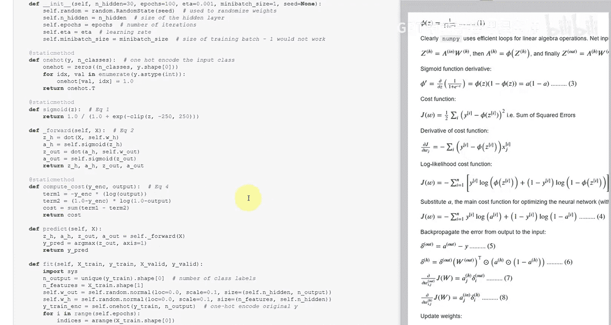

#  044：前向传播算法详解 🧠

## 概述
在本节中，我们将深入探讨神经网络训练的核心——前向传播算法。我们将学习神经网络如何通过调整感知器的权重来最小化训练数据集上的误差，并详细拆解其背后的数学原理和代码实现。

---

## 神经网络训练的核心：优化引擎 🔧

正如我们在多种机器学习算法中所见，神经网络训练的核心同样是一个优化引擎。该引擎通过调整感知器的权重，来最小化训练数据集上的误差。

接下来，我们看看前向误差传播及其优化方案是如何工作的。请注意，训练数据点和感知器的输出是**前向传播**的，而误差则是**反向传播**的。

---

## 激活函数的选择

我们将使用如**公式1**所示的非线性Sigmoid函数作为激活函数，因为它是可微分的。请注意，阶跃函数或ReLU函数是不可微分的。

> **公式1：Sigmoid激活函数**
> `phi(z) = 1 / (1 + exp(-z))`

Sigmoid激活函数、阶跃函数或ReLU函数是激活函数的常用选择。其中，只有Sigmoid是线性可微的。当然，ReLU和阶跃函数也有其他处理方法，但这不在我们当前的讨论范围内。

---

## 前向传播：计算激活输出

神经元的净输入由Z1给出，例如前一层激活输出与权重的点积。每一层都存储一组权重，其大小与该层相同。

激活输出a通过phi函数（如Sigmoid）计算得出。将Z传递给phi函数，即可得到激活函数的输出，如**公式2**所示。

> **公式2：激活输出**
> `a = phi(z)`

请注意，所有这些方程都由NumPy计算，其线性代数运算（如矩阵乘法或转置等）非常高效。

对于n个数据点，净输入将是如**公式2**所示的大写A Z。

---

## 计算导数以更新权重

为了更新权重（类似于梯度下降），我们需要计算导数。由于phi函数是Sigmoid，其导数非常简单，如**公式3**所示。

> **公式3：Sigmoid函数的导数**
> `phi'(z) = a * (1 - a)`

基本上，它就是`a * (1 - a)`，如公式3所示。

---

## 定义成本函数

成本函数J(w)是输出y与phi输出之间的平方误差之和。代入数值并求解，我们得到**公式4**。由于我们通过最小化L2误差来优化权重，这里的J(w)就是L2误差。

> **公式4：成本函数（L2误差）**
> `J(w) = 0.5 * sum((y - a_out)^2)`

我们使用成本函数J的对数，如上一个方程所示，因为使用对数函数处理起来要容易得多。由于优化基于成本函数J或其对数，它们将产生相同的最优权重。

---

## 反向传播误差

**公式5**中的delta误差是我们开始反向传播误差的起点。输出层的delta误差（即输出层的激活输出减去实际标签）被反向传播到输入层。

> **公式5：输出层误差**
> `delta_out = a_out - y`

在隐藏层H，我们应用delta乘以权重再乘以phi的导数，得到**公式6**。使用对数成本时，它将是激活值乘以delta，如**公式7**所示。**公式8**在输入层是相同的过程。

> **公式6：隐藏层误差**
> `delta_hidden = (delta_out . dot(W_out.T)) * phi'(z_hidden)`
>
> **公式7：输出层梯度（使用对数成本）**
> `grad_out = a_hidden.T . dot(delta_out)`
>
> **公式8：隐藏层梯度**
> `grad_hidden = X.T . dot(delta_hidden)`

请注意下标和上标。例如，这个特定的梯度在输出层，而那个特定的梯度在隐藏层，误差是反向传播的。

---

## 更新权重

最后，我们使用学习率因子eta和计算出的delta导数来更新权重。这就是反向传播的误差。

请注意，我们正在优化每一层的权重向量。在这个特定的例子中，我们有两层权重：一层在隐藏层，一层在输出层。

> **公式9：权重更新**
> `W = W - eta * grad_W`

---

## 代码实现对应

现在，让我们看看这些方程是如何与代码对应的。

我们有一个`NeuralNetMLP`类，它包含了我们从头开始编码的原始神经网络所需的一切。`fit`和`predict`函数与scikit-learn分类器使用相同的API。

我们有一些静态方法。函数名前的下划线表明该函数是私有的，不应在类外部使用。

*   **公式1**对应这里的Sigmoid函数：`1 / (1 + np.exp(-z))`。但这里还有一个裁剪操作，将其限制在-250和250之间。
*   `_forward`方法是网络的一次完整前向传播。它计算隐藏层和输出层的输出。`w_h`和`w_out`是每一层的权重向量，并存储在实例变量中。
*   **公式2**对应这里：`a`和权重的点积。
*   **公式4**对应`_compute_cost`函数及其这里的对数形式。第一项是第一个组成部分，第二项是第二个组成部分。成本是它们之间的差异。如果你比较公式4和`_compute_cost`函数，你会发现它们是一一对应的。
*   **公式3**对应隐藏层的Sigmoid导数。
*   `delta_out`对应**公式5**。**公式5**在`fit`方法中这里体现。这是批处理。我们使用批处理索引来获取训练数据，这些数据也被编码，然后计算delta。
*   **公式6**对应隐藏层的`delta_hidden`。**公式6**在这里是`delta_out`和`w_out`的点积，乘以隐藏层的Sigmoid导数。我们将输出层的误差反向传播到后一层（即隐藏层），并最终传播到输入层。
*   **公式7**对应输出层的梯度，等于`delta_out`和输出层权重的点积。矩阵的方向（如W和delta）可能很棘手，例如是否需要转置，或者应该是矩阵A乘B还是B乘A。在实现中，最好的方法是在每个单独操作中打印和记录所有矩阵的大小。
*   最后，**公式8**（以及7和8）对应隐藏层的梯度，以及输入与隐藏层delta的点积。可以看出，误差通过梯度反向传播。
*   **公式9**对应`w_h`和`w_out`两者的权重更新。两者都在这里用它们各自的梯度进行更新。需要注意的是，`w_h`位于输入层和隐藏层之间，而`w_out`位于隐藏层和输出层之间。这段代码针对的是单隐藏层网络。

---

## 总结

本节课中，我们一起学习了神经网络前向传播与反向传播的完整过程。我们从选择可微的Sigmoid激活函数开始，逐步推导了净输入、激活输出、成本函数以及误差的计算方法。关键点在于，我们通过计算各层的梯度（delta误差），并将这些误差从输出层反向传播回输入层，从而利用梯度下降法更新每一层的权重。最后，我们将所有数学公式与具体的Python代码实现一一对应，揭示了理论是如何转化为实际计算的。理解这个过程是掌握神经网络如何“学习”的基础。