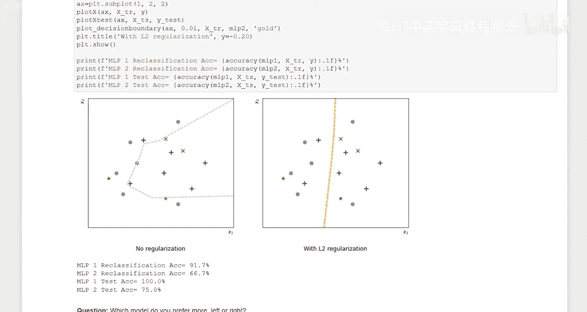

#  048：正则化实践演示 🧪


在本节课中，我们将通过可视化演示，观察正则化如何影响模型的决策边界，并探讨模型偏差与方差之间的权衡。

上一节我们介绍了正则化的基本概念，本节中我们来看看它在具体模型上的实际效果。

## 数据集与模型介绍

我们手动创建了一个包含两个特征的二分类数据集，以便于可视化。数据集中0和1两个类别的样本数量相等。

我们将演示三个分类器模型：
1.  线性支持向量机。
2.  使用RBF核、gamma值较低的支持向量机。
3.  使用RBF核、gamma值较高的支持向量机。

其中，**高gamma值会增加决策边界的曲率变化，使其更紧密地拟合数据**。

## 决策边界可视化方法

以下是不同模型的可视化实现方式：

*   **线性SVM**：通过从分类器模型中提取分割超平面及其系数进行可视化。在代码中，这体现为使用模型的 `coef_` 属性来绘制直线。
    ```python
    # 伪代码示例：获取线性SVM的决策边界
    w = model.coef_[0]
    b = model.intercept_[0]
    # 决策线方程: w[0]*x + w[1]*y + b = 0
    ```
*   **RBF核SVM**：使用网格和等高线图实现可视化。`plot_decision_boundary` 函数会为两个特征创建网格数据点，然后使用模型的 `predict` 函数和 `contour` 绘图方法，围绕这些点绘制决策边界。

这三个分类器将在相同的训练数据集上进行训练。

## 模型比较与偏差-方差权衡

训练完成后，我们得到了三个模型及其决策边界。核心问题是：哪个决策边界最能反映数据的真实分布？

尽管答案带有主观性，但通常可以认为：
*   左图（线性SVM）的模型**偏差较高**，因为它过于简单。
*   右图（高gamma RBF SVM）的模型**方差较高，可能过拟合**。
*   中间图（低gamma RBF SVM）在偏差和方差之间取得了良好平衡，其决策面在训练数据上看起来更合理。

如果没有关于数据和环境的先验知识，我们应该选择中间的模型。

## 在测试集上评估模型

现在，我们将测试数据集叠加到之前的图上。测试集是精心挑选的，但客观来看，加号类别的十字标记更靠近其本类区域，圆圈类别的星形标记也基本合理。虽然左下角的星形数据点难以正确分类，但中间的模型（RBF，gamma=0.05）仍然是更可取的模型。

通过对比，我们可以清晰地看到这三个模型的表现差异、其参数的影响，以及过拟合模型与合适模型之间的区别。

## 神经网络中的正则化效应

接下来，我们观察正则化对神经网络的影响。特征被进行了缩放，以减弱单个特征在坐标轴上的影响，使模型决策边界更趋向于圆形或球形。

我们使用了与之前完全相同的训练和测试数据集（除了特征缩放）。对比发现：
*   **左侧模型未使用正则化**，其决策边界紧密贴合数据点。
*   **右侧模型使用了正则化**，其决策边界更接近一个平面。

这里可以明显看出神经网络与支持向量机的区别：
*   神经网络找到的边界非常接近数据点。
*   支持向量机则致力于**最大化决策边界与周围数据点之间的间隔**。

因此，数据点的微小变化会极大地影响神经网络的决策边界，但对支持向量机影响较小。这就是为什么支持向量机通常是泛化能力更强的分类器。**在没有正则化的情况下，SVM表现尚可，但神经网络通常需要正则化。**

## 模型选择与总结

最后的关键问题是：选择哪个模型？这个小例子或许未能完全展示，但笔者认为，右侧具有正则化的神经网络模型拥有更强的泛化能力。在没有环境先验知识的情况下，尽管它在测试集上会犯更多错误，我仍然会选择右侧的模型。




本节课中我们一起学习了正则化在不同模型（线性SVM、RBF SVM、神经网络）上的实际应用效果。通过可视化决策边界，我们直观地理解了模型偏差与方差的权衡，并认识到在缺乏先验知识时，选择一个在偏差和方差间取得平衡的模型，或使用正则化来提升泛化能力，是至关重要的实践原则。