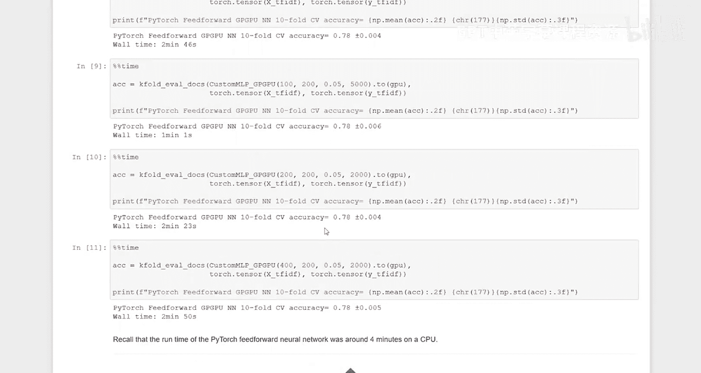

#  051：PyTorch应用演示 🚀


在本节课中，我们将学习如何使用PyTorch框架构建一个机器学习模型，并将其与Scikit-learn中的常规神经网络分类器进行比较。我们将编写一个神经网络，用于对Stack Overflow数据集中的20种编程语言进行分类。

---

## 概述

我们将使用TF-IDF特征，共40000个数据点。为简化处理，我们仅使用前1000个特征。首先，我们会建立一个线性SVM基线模型，然后构建并训练一个自定义的神经网络，最后探讨如何在GPU上运行该模型以加速训练过程。

---

## 建立基线模型

首先，我们使用一个线性支持向量机（SVM）作为基线模型。这类模型在处理此类文本分类问题时通常表现优异。

以下是评估函数和交叉验证的设置：

```python
# 使用分层交叉验证（尽管数据集本身是平衡的）
cross_validator = StratifiedKFold(n_splits=5)
```

运行基线模型后，我们获得了约79%的准确率，训练耗时约30秒。这个结果不错，但我们的目标是实现一个神经网络。

---

## 构建PyTorch神经网络

接下来，我们构建一个自定义的神经网络。我们的输入特征维度是1000，隐藏层大小设为100，输出层对应20个类别。

神经网络类的核心结构如下：

```python
import torch.nn as nn

class CustomMLP(nn.Module):
    def __init__(self, input_size=1000, hidden_size=100, output_size=20):
        super(CustomMLP, self).__init__()
        self.layer1 = nn.Linear(input_size, hidden_size)
        self.layer2 = nn.Linear(hidden_size, output_size)
        self.relu = nn.ReLU()
        self.softmax = nn.Softmax(dim=1)

    def forward(self, x):
        x = self.relu(self.layer1(x))
        x = self.softmax(self.layer2(x))
        return x
```

**关键点说明：**
*   **输入层**：大小为 `1000`。
*   **隐藏层**：我们使用了一个大小为 `100` 的隐藏层。你可以轻松地通过添加几行代码来引入第二个隐藏层。
*   **输出层**：大小为 `20`，对应类别数，并使用 `Softmax` 激活函数。
*   **内部激活函数**：隐藏层使用 `ReLU`。
*   **损失函数与优化器**：我们使用分类交叉熵损失（`nn.CrossEntropyLoss`）和Adam优化器。
*   **数据格式**：目标输出 `y` 必须为 `int64` 类型，所有数据都需要转换为PyTorch张量。

训练循环涉及前向传播、损失计算、反向传播和优化器更新权重。PyTorch的 `autograd` 系统自动处理了反向传播，即使网络有10层也是如此。

在CPU上运行该神经网络耗时约4分钟，最终准确率与SVM相近，表明神经网络在此任务上有效。

---

## 在GPU上运行模型

为了加速训练，我们将模型迁移到GPU上运行。这需要安装支持CUDA的PyTorch版本以及相应的NVIDIA驱动和工具包。

与CPU版本的主要区别在于，我们需要将模型和数据显式地移动到GPU设备上。

以下是关键改动步骤：

1.  检查并设置设备：
    ```python
    device = torch.device("cuda:0" if torch.cuda.is_available() else "cpu")
    ```
2.  将模型移至GPU：
    ```python
    model = CustomMLP().to(device)
    ```
3.  在训练循环中，将每个批次的数据移至GPU：
    ```python
    inputs, labels = inputs.to(device), labels.to(device)
    ```
4.  计算完成后，将结果移回CPU以进行后续评估。

在GPU（例如NVIDIA P3200）上运行时，训练速度比CPU版本快约两倍。此外，增大批次大小（batch size）可以进一步提升GPU的利用率和训练效率，这是因为GPU擅长并行处理大量数据。

---

## 总结

本节课中，我们一起学习了如何使用PyTorch构建一个用于文本分类的神经网络。我们从建立SVM基线开始，然后逐步实现了自定义的MLP模型，涵盖了模型定义、训练循环以及关键的实现细节。最后，我们探讨了如何利用GPU加速模型训练，并观察到了显著的性能提升。



通过本次实践，你可以看到PyTorch如何简化神经网络的构建和训练流程，并理解CPU与GPU在计算性能上的差异。