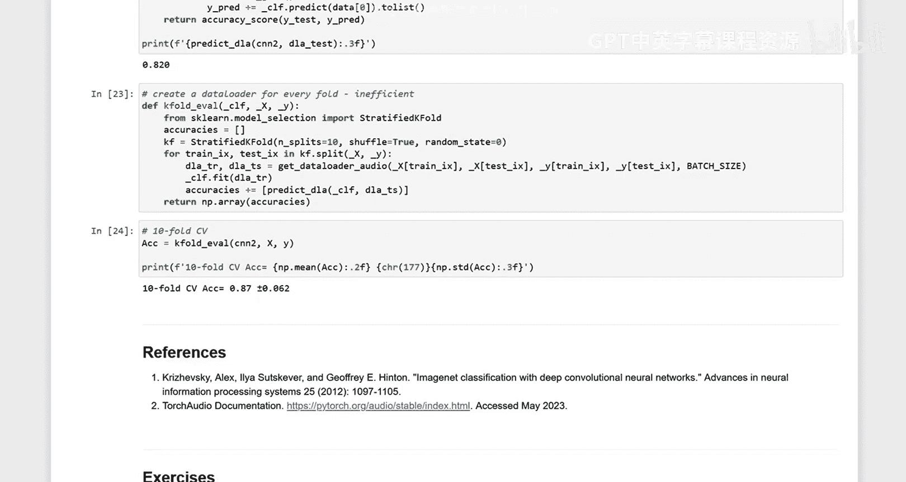

#  053：音频信号分类技术 🎵


在本节课中，我们将学习如何将卷积神经网络应用于音频信号分类。音频数据本质上是时间轴上的一维序列，通常我们会使用循环神经网络来处理这类序列数据。然而，我们也可以利用频域分析技术，将音频信号转换为图像（频谱图），从而使用卷积神经网络进行分类。

## 从音频到图像：频谱图转换 🎼

上一节我们介绍了卷积神经网络的基本原理，本节中我们来看看如何将其应用于音频数据。核心思路是将一维的音频时间序列信号，通过频域分析，转换为二维的频谱图像。

具体方法是：对音频信号进行短时傅里叶变换，生成**频谱图**。频谱图的横轴代表时间，纵轴代表频率，颜色强度代表该频率在对应时间点的能量大小。这样，一个音频片段就被表示成了一幅图像。

以下是使用 `torchaudio` 库提取频谱图的关键步骤代码：

```python
import torchaudio

# 假设 waveform 是加载的音频张量，sample_rate 是采样率
spectrogram = torchaudio.transforms.MelSpectrogram(sample_rate=sample_rate)(waveform)
```

在生成的频谱图中，左侧是原始的音频时间序列信号，右侧是其对应的频谱图。我们可以像处理普通图像一样，对这些频谱图进行分类。

## 处理可变长度音频 ⏱️

音频信号的长度各不相同，这给模型输入带来了挑战。一个9秒的音频和一个2秒的音频生成的频谱图宽度不同。我们需要将所有输入归一化为固定长度。

解决方案通常有两种：
1.  **截断**：对于超过设定时长的音频，进行截断。
2.  **填充**：对于不足设定时长的音频，进行填充（例如重复音频或静音）。

为了做出合理决策，我们可以绘制音频时长的直方图。例如，通过观察直方图，我们可能决定将所有音频统一为10秒的固定时长。对于较短的音频进行填充，对于较长的音频进行截断。

## 特征提取：梅尔频率倒谱系数 🎚️

为了在频域更好地表示音频信号，我们通常不使用原始的频谱图，而是使用**梅尔频率倒谱系数**。MFCC 考虑了人耳对声音频率的非线性感知，是语音和音频分析中常用的特征。

以下是使用 `torchaudio` 提取 MFCC 特征的示例：

```python
mfcc_transform = torchaudio.transforms.MFCC(sample_rate=sample_rate, n_mfcc=20, melkwargs={'n_fft': 400, 'hop_length': 160})
mfcc = mfcc_transform(waveform)
```

通过设置合适的采样率、帧移和 MFCC 系数个数，我们可以将每个音频数据点转换为一个固定尺寸的图像。例如，使用10秒音频、20个MFCC系数，可以得到一个 `20 x 100` 的图像（假设每100毫秒一帧）。

## 构建卷积神经网络模型 🧠

由于大部分特征提取工作已由 MFCC 预处理完成，我们用于分类频谱图的 CNN 结构可以相对简单。

以下是模型架构的一个示例：
*   **卷积层1**：输入通道为1（灰度图），输出通道为8，卷积核大小为5。
*   **卷积层2**：输入通道为8，输出通道为16，卷积核大小为5。
*   每个卷积层后使用 `ReLU` 激活函数和最大池化层。
*   展平特征后，接入一个包含32个神经元的全连接层。
*   **输出层**：使用 `tanh` 激活函数，输出2个类别（例如猫和狗）的分数。`tanh` 函数在音频信号处理中表现良好，当然你也可以尝试其他激活函数。

模型前向传播过程中，需要注意计算经过卷积和池化后的特征图尺寸，以确保全连接层的输入维度正确。

## 模型训练与评估 📊

在模型设计阶段，建议使用小规模数据（如50%训练，50%测试）进行快速原型测试和迭代，以验证模型架构的有效性。

在示例中，一个简单的50/50划分测试达到了82%的准确率。进行更严谨的**十折交叉验证**后，准确率达到了87%。这表明模型具有良好的性能，同时仍有很大的优化空间，例如调整网络深度、卷积核大小、学习率等超参数。

## 总结 🎯

本节课中我们一起学习了音频信号分类的完整流程：
1.  我们将一维音频信号通过**频谱图**或**MFCC**转换为二维图像。
2.  我们解决了音频**长度不一**的问题，通过截断或填充将其归一化。
3.  我们构建了一个相对简单的**卷积神经网络**来对生成的频谱图像进行分类。
4.  我们采用了**快速原型测试**和**交叉验证**来评估和迭代模型。




这种方法成功地将适用于图像的CNN模型迁移到了音频分类任务中，为处理序列数据提供了另一种强大的思路。