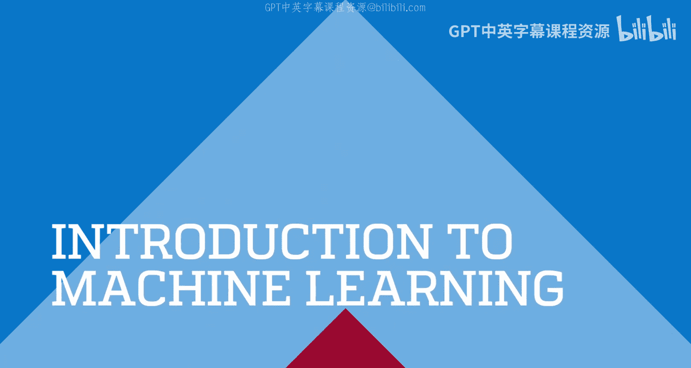
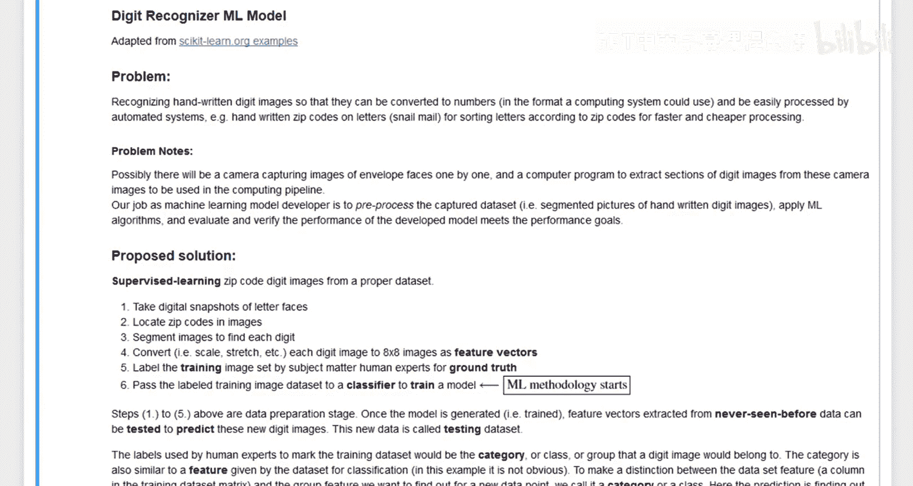

# 约翰霍普金斯大学《应用机器学习｜Applied Machine Learning》中英字幕 p01 0_应用机器学习导论.zh_en -BV13xuqzYErx_p1-

🎼。

Welcome to the Applied Mach learning course， my name is Erangguan。

 this semester I will be your instructor in this online course。

Machine learning is the art of solving a computation problem using a computer and the program。

 but without an explicit program。The machine learning algorithm works on the input data set and then generates a model that can be used to predict or detect unseen data。

The input data we will use for machine learning is already labeled or categorized by subject matter experts。

 This is called the ground truth。Machine learning is so pervasive today。

 it's around us everywhere such as cybersecurity， filtering emails。

 product recommendations such as Netflix or Amazon， medical diagnosis and stock trading。

Before jumping into the problem and the solution， let's first look at the environment that we' are using。

We will use Ananaconda environment， which is a collection of Python3 libraries。

 We will download Ananaconda from the Ananaconda website and then install it in our environment。

 Apple or Windows systems are supported。 Linux is definitely recommended。 for preparation。

 I suggest looking at the Jupyter notebook tutorial to learn a bit how to use the Jupyter notebook。

 and also for reference to be used later on， and providing two links for the p Psyit Learnn library and the Numby library。

 Psyit Learnn library is a machine learning library。

 which is developed by tens of thousands of researchers engineers around the world from big organizations or from universities alike Numy is a mathematical library similar to matap highly optimized internally。

 it has C plus+ libraries。 its implementation is very fast as opposed to coding it directly。

 As an example， when we go to the。Learn website， as can be seen from the lists。 Many。

 many machine learning algorithms are supported in this notebook， we a look at a specific problem。

 As everybody knows， the number of letters coming and going from households or organizations can be in the numbers of billions a year。

 Clearly an automatic solution automatic sorting and processing of letters is required so that we wouldn't be hiring tens of thousands of post workers。

 Imagine you want to sort the letters by looking at the digits on the envelope。

 how would you approach such a problem a direct solution to this problem could be taking the pictures of letters using a conveyor belt like machine and I processing these pictures to locate the zip codes。

 digits hundred and digits on the letters segmenting these images and extracting the digits if possible。

 not that it is okay to make mistakes because。Our prediction system will correct these mistakes and then later on once the images are captured。

 extracting features from these images， and I' using the our prediction system training these images with the ground truth a certain portion of the dataset has to be labeled by subject matter human experts so that this ground truth can be used as a reference as a baseline as a feedback to the learning program once the system is trained with these labeled images。

 then we can predict the unlabeled images as test imagine a possible deployment of the system could be once the model once the trained model is developed。

 deploying the system at the site and then collecting letter images and then passing through this model and then detecting or in other words predicting what the digits are。

