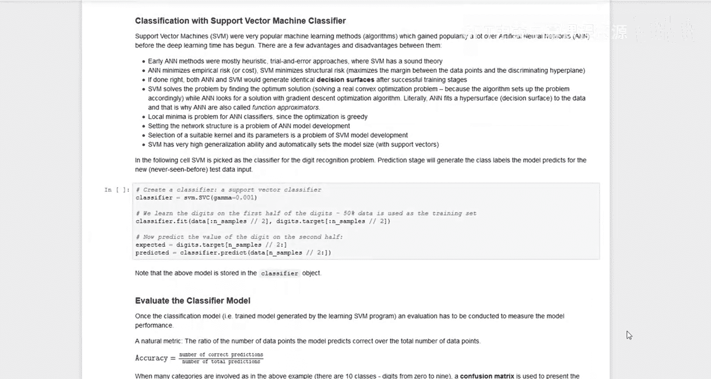

# 约翰霍普金斯大学《应用机器学习｜Applied Machine Learning》中英字幕 p03 2_数据集.zh_en -BV13xuqzYErx_p3-

🎼。

Let's look at our first machine learning program。We will use Matplotlip。

 which is a very popular and very capable plotting library in Python。

 and we will use Matplotlib as in line。 The other possible option for Matplotlip is notebook。

 where it displays the plot as a separate widget， as opposed to in line。

 as we we will use in this notebook。 We are importing Sit learnn。

 as key learn is the shortcut forsyit learnn。And we will import data sets。

 support vector machine and metrics。 First thing we are doing is loading our data。

  clearly machine learning is all about data analytics。

 so we need some kind of data and in order to ease teaching in order to have a quick start SaitLn has many datas many data sets built in the first data set we will look at is images of digits these digit images are collected more than 20 years ago and these are actual handwritten digits in order to ease automation of USB zip code sorting Now our feature engineering is about getting the data and then making into a matrix of a data that will be input to the machine learning program There can be two types of variables at a minimum the first one is numerical where each data value is a number it can be integer。

It can be floating point or where the data values are nominal or categorical there can be other data types as we will see as we go along such as Boolean text。

 date and so on as any one of us knows how to program we represent the variables by declaring its type for example in Java you have to declare as integer or floating point or long or double each one of them is represented differently on the machine the type the format of the data is utmost important in machine learning we have to represent a data right for example。

 these are digit images they are basically pixel colors Now how are we going to take this and then make it into a data so that the machine learning program can really understand it and learn it or just learn it without understanding as we will see in the following weeks。

Let's run this notebook from the very start。 It's a good practice to start from a reset kernel。

 So I will restart and clear the output。 It also resets the kernel。

Now everything gone and this is an actual notebook in the lecture content。

 the HTML version of this notebook is provided。 Let's run the first cell。Shift answer runs the cell。

 It basically imports all the libraries。 Now， let's load our data set。Okay， we loaded our data。

 It's a very good practice to check actually what we loaded。 Let's do that。Insert are below。

And then enter digits。So this is the data structure that we loaded from that data set。 As you see。

 it is JO like data structure， but actually it's not。 It's basically a dictionary with keys。

And with additional data structures like array， dictionary and other things。

 And I know this array is a nuumpy array because array is the name of a regular array or a vector in nuumpy。

 If it wasn't， then it wouldn't write the object name here or the class name here。

 but it would be a square bracket。 Now， I'm looking at the digits。

Because I want to see what that data structure is。 What information do I have。

 And this is kind of a standard information for all the data sets in psyitLn library。

 So the data is array of information。 And as you see it is a two dimensional information。

 How do I know because of these two square brackets。 So this is one row， this is the second row。

 it goes like this。 So actually it's a matrix。 This data is a matrix。

The target is the target labels of the data and it's a single integer for all the rows in the data structure the data is represented as rows which are the individual data points and columns as features you can talk about the size of the matrix number of features。

 how many you have M like in Mary as the number of columns you have that many features how many data points you have how many instances that you want to classify you want to learn it's the number of rows。

 say there are n as in Nancy rows Now the target is are the labels because this data particularly is labeled by experts so that we can quickly use and start our learning process how many should we have we have to have the target values as many as the number of data points。

 not every time a target。Is an integer like here。 We might have names。 In this case。

 the name is just an area of integers again， but it didn't have to be in another data set。

 These target names could be some flower names， for example。Now， as you see。

 the images are also stored in this dataset。 We will not use this images key for any kind of data analytics。

 It can be displayed on screen so that we can associate or this particular image is classified as digit5 in order to display that this images provided in this dataset。

 it was an optional case。 Now we have extra other information description。

 This description contains the source of the data where it came from It's almost 20 years old。

 and there are some publication references for this dataset。Next。

 we will look at the classifier to classify digits using this dataset set。

