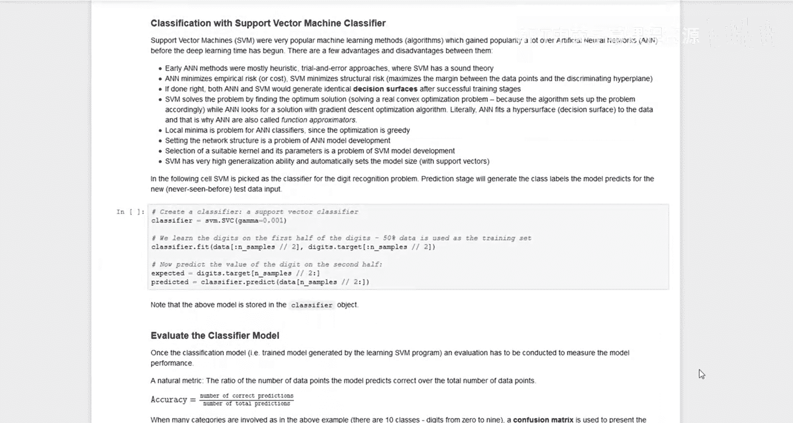

# 应用机器学习：03：数据集


在本节课中，我们将学习机器学习程序的基础，特别是如何加载、理解和准备数据集。我们将使用一个经典的手写数字数据集作为例子，并介绍数据集的关键组成部分。

## 导入库与设置环境

首先，我们需要导入必要的Python库。我们将使用`matplotlib`进行绘图，并使用`scikit-learn`（简称`sklearn`）来加载和处理数据集。

```python
import matplotlib.pyplot as plt
import sklearn as sk
from sklearn import datasets, svm, metrics
```

我们设置`matplotlib`以行内方式显示图表，这适用于Jupyter Notebook环境。

```python
%matplotlib inline
```

## 加载数据集

机器学习始于数据。为了便于教学和快速入门，`scikit-learn`内置了许多经典数据集。我们加载的第一个数据集是手写数字图像集。

```python
digits = datasets.load_digits()
```

这个数据集收集于20多年前，包含真实的手写数字图像，最初用于自动化邮政编码分拣。

## 探索数据集结构

加载数据后，检查其结构是一个好习惯。这有助于我们理解数据的组织形式。

```python
print(digits)
```

输出显示，`digits`是一个类似字典的对象，包含多个键。这是`scikit-learn`中数据集的典型结构。

以下是数据集包含的主要组成部分：

*   **`data`**: 这是一个二维数组（矩阵），包含了所有数据点的特征值。每一行代表一个数据点（例如，一张数字图片），每一列代表一个特征（例如，一个像素的灰度值）。
*   **`target`**: 这是一个一维数组，包含了每个数据点对应的标签（即正确答案）。在这个数据集中，标签是0到9的整数，代表数字本身。
*   **`target_names`**: 这是目标标签的含义说明。对于数字数据集，它就是`[0, 1, 2, 3, 4, 5, 6, 7, 8, 9]`。在其他数据集中，这里可能是类别名称，比如花的种类。
*   **`images`**: 这是一个三维数组，以原始的8x8像素图像格式存储数据，主要用于可视化展示，而非直接用于模型训练。
*   **`DESCR`**: 这是一个字符串，描述了数据集的来源、作者和引用信息。

## 理解数据维度

数据表示是机器学习的核心。我们需要将原始数据（如图像）转换为模型能够处理的数值矩阵。

对于`digits.data`矩阵：
*   行数（`n_samples`）代表数据点的数量。
*   列数（`n_features`）代表每个数据点的特征数量。

我们可以用以下代码查看维度：

```python
print(f"数据形状: {digits.data.shape}")
print(f"标签形状: {digits.target.shape}")
```

输出将类似于：
```
数据形状: (1797, 64)
标签形状: (1797,)
```
这表示我们有1797个样本，每个样本由64个特征（8x8图像展平后的像素值）描述，并且有1797个对应的标签。

## 特征工程与数据类型

将原始数据转换为模型输入矩阵的过程是特征工程的一部分。数据类型至关重要，机器学习模型通常处理数值型数据。

主要的数据类型包括：
*   **数值型**：每个值都是数字，可以是整数或浮点数。
*   **分类型/名义型**：数据值代表类别（如“红”、“蓝”、“绿”）。
*   其他类型如布尔值、文本、日期等，通常需要转换为数值或分类表示后才能用于大多数模型。

在本数据集中，图像像素已被转换为0-16之间的整数灰度值，属于数值型数据。

## 可视化数据

为了更直观地理解数据，我们可以使用`images`数组来显示原始图片。

```python
# 显示前4个数字图像及其标签
_, axes = plt.subplots(1, 4)
for ax, image, label in zip(axes, digits.images[:4], digits.target[:4]):
    ax.set_axis_off()
    ax.imshow(image, cmap=plt.cm.gray_r, interpolation='nearest')
    ax.set_title(f'标签: {label}')
plt.show()
```

这段代码会显示前四个手写数字的图像及其对应的真实标签。

## 总结




本节课中，我们一起学习了机器学习中数据集的基础知识。我们使用`scikit-learn`加载了手写数字数据集，并探索了其核心结构：包含特征值的`data`矩阵、存储正确答案的`target`标签数组，以及其他辅助信息。我们理解了数据维度（样本数与特征数）的重要性，并初步接触了特征工程的概念，即如何将原始数据（如图像）转换为适合机器学习模型处理的数值格式。最后，我们通过可视化确认了数据与标签的对应关系。掌握这些是构建任何机器学习模型的第一步。