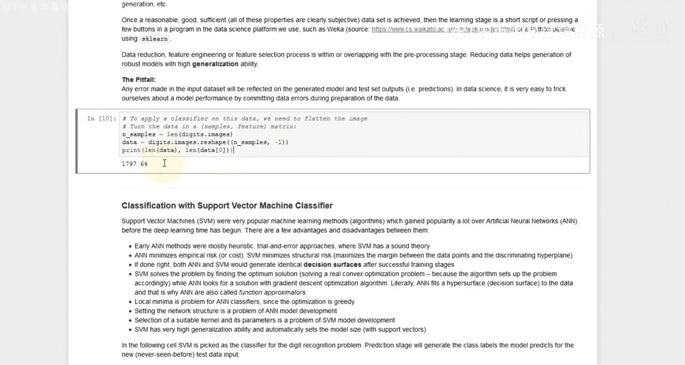

# 约翰霍普金斯大学《应用机器学习｜Applied Machine Learning》中英字幕 p04 3_数据预处理.zh_en -BV13xuqzYErx_p4-

🎼。

Let's look at the number of images in the training dataset。

By looking at the length of the images and labels that is populated by the digits images and target。

 which is the actual label， we see that there are 1797 images。

Let's draw the first 40 data points In this case， each data point is an image Figure size is 20 by 10 for index in image label tuple enumerate all the images and labels。

 subplot each one of them and then turn the axis off and then show the image plot image show takes the image as a matrix which is captured here from the images and labels and then shows it as an image its color map is gray gray labels and interpolation is nearest and the title is training for each of the plot。

 so there are basically4 by 10 subplots in this figure and each one of them as a title as training the actual label As you see the data is presented to us labels changing from0 to9 for every image in order So somebody picked these images labeled them and then entered into the data set。

1 by one in order， As we will see in the following weeks。

 the order of the data for training is very important because most of the times the learning algorithms are not fully deterministic。

 for example， in random forest algorithm。 So the order of the data affects the model output every time the more random data input order is required。

 Now let's see how the image looks like as the image and the label。 As you see。

 this is the first data point， which is a matrix， how do I know again， row row H rows。

 This is a matrix， and the last element is the label that is associated to this data point。

 This data point can be used as a matrix like this。

 or it can be vectorized into a 1 to 64 dimension vector。 and this is the second data point。

 It's a very good practice to look at the data points as we ingest the data。Now。

 let's check the image and then examine the indices。 You see each size is 8。

 meaning there are8 many rows and an eight many values in every row。

 This check is important because if we make a mistake in the data ingest。

 then that mistake will be carried over。 Those errors will be carried over to the model because nobody in this pipeline will tell us we have a mistake in the pipeline。

 correct， It is not like program compiling we have to avoid errors with some good practice and checking the output at every level。

Once we ingest the data into our pipeline， the next step is preprocessing every data mining machine learning data science book will tell you your model is as good as your input data。

 It will also tell you 90% of the effort and 90 there is a very subjective number。

 you can call 70 I can call 95 that much effort will go into the preprocessing of the data。

 The utmost important characteristic of the developed model is its generalization ability。

 We do not want to fit our model in into the training data set。 We do not want every little detail。

 every little wrinkle in our dataset affect our model。

 We want general model so that we want our model to be affected by the generality of the input data set not by its outliers or exceptions as we go along in this core。

We will see how we can improve the generalization ability of a learning model。 One of the pitfalls。

 very common pitfalls in data science machine learning is it's very easy to trick ourselves about the model performance by committing data errors mistakes which I just mentioned during our preparation of the data any kind of errors will be reflected in the model output and we will never know those errors until a new data point never seen before。

 unpredicted data point is seen which can easily tro our model because it wasn't general enough because we made data errors in the generalization in the training of the model a few examples of stages in preprocess data set correcting the errors。

 correcting the number formats for example， correcting erroneously input values for example。

 something like February 21 or 2119。As the year or some semantic errors like a person having a PhD degree at a very young age。

 we can also improve our data set or improve the data set for certain machine learning algorithms by imputing missing values for model generation Now let's see how we flatten our images。

 meaning take8 by8 matrixrices and make it into a vector of 1 by 64 so that we can input that information in a machine learning algorithm。

 We run the cell， we look at the size of the output matrix。 This is a matrix data is a matrix。

 Each row is a data point。 we have 1797 rows which is the number of images in the dataset and we have 64 columns which is the number of features and as you can imagine each feature from 0 to 63 or 1 to 64 in matrix indices will。

Respond to one of the pixels in the 8 by 8 images。

