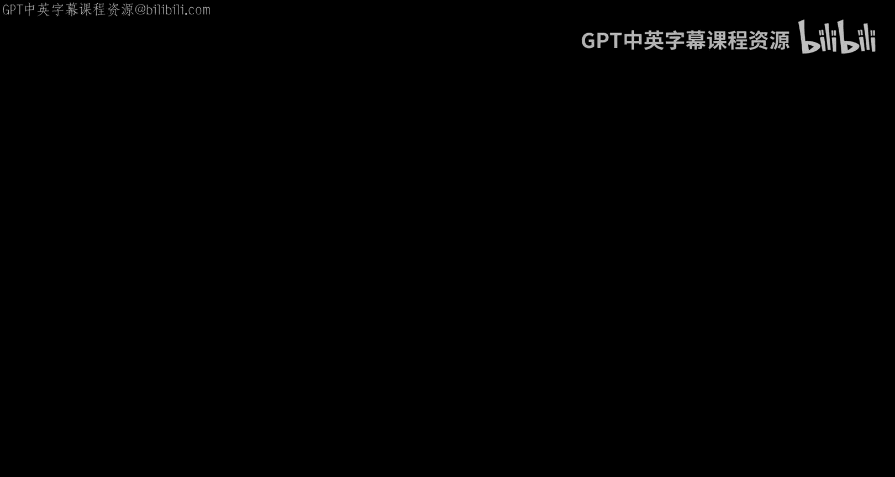
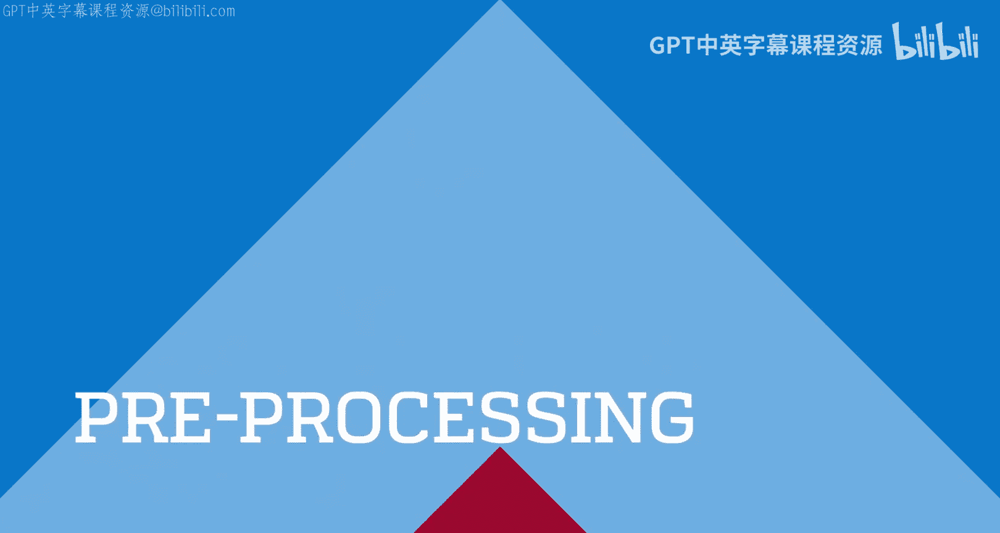
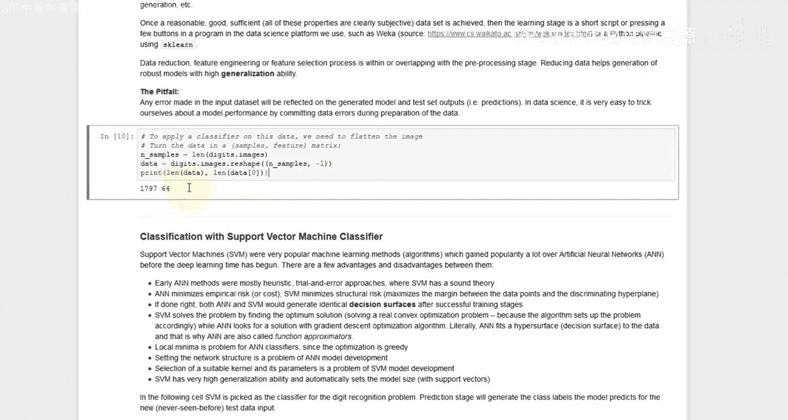

# 应用机器学习：04：数据预处理






在本节课中，我们将学习数据预处理的基础知识。我们将以手写数字图像数据集为例，探讨如何检查数据、理解其结构，以及为何在将数据输入机器学习模型之前，进行预处理是至关重要的一步。

## 检查数据集

首先，让我们查看训练数据集中图像的数量。通过检查由数字图像填充的 `images` 和 `labels` 数组的长度，我们可以得知数据集中共有 **1797** 张图像。

接下来，我们绘制前40个数据点。在这里，每个数据点都是一张图像。我们将创建一个20x10大小的图形，遍历所有图像和标签，为每一张图像创建一个子图，关闭坐标轴，然后显示图像。

以下是绘制图像的代码示例：
```python
# 假设 images 和 labels 是已加载的数据
import matplotlib.pyplot as plt

fig = plt.figure(figsize=(20, 10))
for index, (image, label) in enumerate(zip(images[:40], labels[:40])):
    ax = fig.add_subplot(4, 10, index + 1)
    ax.axis('off')
    ax.imshow(image.reshape(8, 8), cmap='gray', interpolation='nearest')
    ax.set_title(f'Training: {label}')
plt.show()
```
如你所见，数据以从0到9的标签顺序呈现。这意味着有人标记了这些图像，并按顺序将它们输入了数据集。

在后续的学习中我们会发现，训练数据的**顺序**非常重要。因为许多学习算法（例如随机森林）并非完全确定性的，数据的输入顺序会影响模型的输出。因此，通常需要更随机的数据输入顺序。

## 理解数据结构

现在，让我们看看单个图像及其标签的具体形式。第一个数据点是一个矩阵，我们可以通过检查其形状来确认。例如，`image.shape` 会返回 `(8, 8)`，表示这是一个8行8列的矩阵。最后一个元素是与该数据点关联的标签。

这个数据点可以以矩阵形式使用，也可以被**向量化**成一个1x64维的向量。检查数据的维度和结构是良好的实践，因为如果在数据摄取阶段出错，这个错误会一直传递到模型中，而不会在流程中被自动发现。这与程序编译不同，我们必须通过在每个阶段检查输出来避免错误。

## 数据预处理的重要性

一旦数据被摄入我们的流程，下一步就是**预处理**。每一本数据挖掘、机器学习或数据科学的书都会告诉你：**你的模型好坏取决于你的输入数据**。同时，绝大部分（这个比例很主观，可能是70%、90%或95%）的努力都会投入到数据预处理中。

开发模型最重要的特性是其**泛化能力**。我们不希望模型仅仅拟合训练数据集中的每一个细节和“皱纹”。我们希望模型能捕捉输入数据的普遍规律，而不是被异常值或特例所影响。在本课程中，我们将学习如何提高学习模型的泛化能力。

数据科学和机器学习中一个非常常见的陷阱是，我们很容易在数据准备阶段犯错，从而“欺骗”自己关于模型的性能。任何类型的错误都会反映在模型输出中，而我们只有在遇到前所未见的、新的数据点时才会发现这些错误，这很容易导致模型失效，因为它不够“泛化”。

预处理阶段的一些任务示例包括：
*   **纠正错误**：例如，修正数字格式或错误输入的值（如将年份误写为“2119”）。
*   **修正语义错误**：例如，一个非常年轻的人拥有博士学位。
*   **填补缺失值**：为某些机器学习算法改进数据集。

## 数据向量化（扁平化）

现在，让我们看看如何将图像“扁平化”，即把8x8的矩阵转换成1x64的向量，以便输入到机器学习算法中。

运行以下代码，我们查看输出矩阵的大小：
```python
# 假设 images 是一个包含多个8x8矩阵的数组
n_samples = len(images)
data = images.reshape((n_samples, -1)) # -1 让 NumPy 自动计算列数
print(data.shape) # 输出应为 (1797, 64)
```
`data` 现在是一个矩阵，每一行代表一个数据点。我们有1797行（数据集中图像的数量）和64列（特征的数量）。可以想象，矩阵索引中从0到63（或1到64）的每个特征，都对应8x8图像中的一个像素。

## 总结




本节课中，我们一起学习了数据预处理的基础。我们首先检查了数据集的规模和结构，理解了数据顺序的重要性。接着，我们探讨了为何数据预处理是机器学习流程中耗时最多且至关重要的环节，其核心目标是提升模型的**泛化能力**。最后，我们通过将图像矩阵**扁平化**为特征向量的实际操作，完成了数据准备的关键一步，为后续的模型训练做好了准备。记住，细心检查和处理数据，是构建可靠模型的第一步。