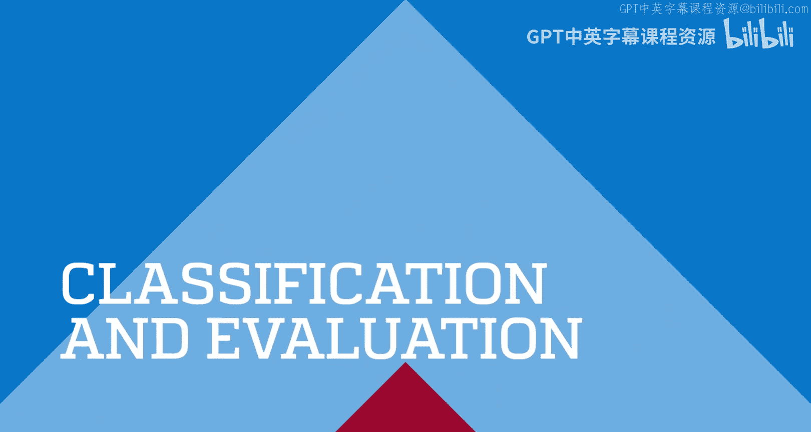
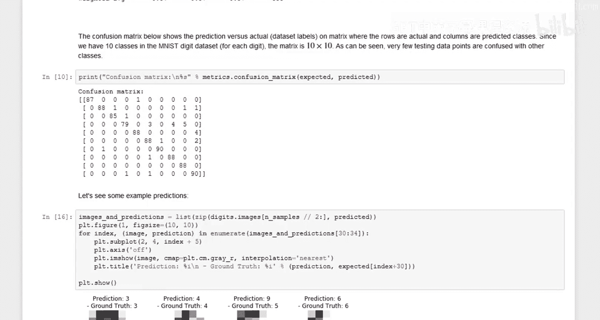

# 约翰霍普金斯大学《应用机器学习｜Applied Machine Learning》中英字幕 p05 4_分类与模型评估.zh_en -BV13xuqzYErx_p5-

🎼。

Support vector machines are very popular and once upon a time considered the best machine learning algorithms support vector machines were invented after artificial neural networks and they were so popular because support vector machines can be trained much faster the algorithm complex is bego and squared opposed to the N cubed for artificial neural network algorithms。

They are very fast trained and their generalization ability even surpasses the artificial neural networks。

This list I'm leaving to the readers to go and read a comparison between support vector machines and the artificial neural networks。

 These are both numerical algorithms。 They approach the machine learning problem from different angles。

 Support vector machine looks for a discriminating plane。

 whereas artificial neural networks minimize an error。

 the error between the input values and the output values。

 ANNs are function approximators Support vector machines are an optimize the approach reducing marginal risk。

Now， let's run our support vector classifier。 First。

 define the SM classifier with a radial basis function with gamma 0。

001 and thenfi the data and then look at the expected and predicted information。

 Let's create another cell and see what the values are。

 The expected values are coming from the actual data set in Python slash slash 2 is an integer division。

 It will always result in an integer。 halflf of the data is used for training。

 The other half is used for testing。As you see， it's a Python slice。

 all the data sets up to half of it is used for fitting column and samples over to。

The other half from n samples divide by 2 to the end is used for testing。

 Let's look look what predicted contains。 How many data points there should be in the expected and predicting。

 It should be n samples 1797 divide by 2。 How do we measure the performance of the classifier before this limit delete the cell。

 which is cut so that it will not clutter our screen。 How do we measure the performance。

 The basic measurement is accuracy。 number of correct predictions。

 number of divide by number of total predictions。 There are many other metrics will which will be covered in the following weeks。

 When there are 10 classes， The best metric is a confusion matrix where each column shows the predicted class and each row shows the actual class。

 Luckily， psyche learn has all these functionalities to display the confusion matrix properly。

 Now that we trained our classifier and even。Tested with half of the remaining data。

 Let's look at what the performance is This is the report of the classification。

 for all the10 classes it reports precision recall F1 score support accuracy macroav and weighted average we will cover all these metrics in detail in the following weeks Now let's look at the actual confusion matrix This was the report for each class class 0 for example。

 succeeded with 100% accuracy because its precision is1 it's never missed anything but some other classes are mixed up40 because recall is 0。

99 This is the confusion matrix As you see the diagonal elements are the class actual class predicted matching。

The confusion matrix columns are the predicted values or predicted labels。

 and the rows are the actual independent variables or labels， for example， take012。

34 digit 4 for digit4，1% of the data points which actually belong to digit0 are classified as digit 4 88% of the digit4s are classified as digit 4 and no other classes came into the digit4。

 however， when we look at the row of digit4， some of these classes which belong actually to digit4 are confused with digit 94% of the actual digit4s are mixed up or predicted as digit9s if you can imagine the shape of the digit 4 like this actually it is very close to digit 9。

 Similarlyly， digit9 is。ISo confused by digit。0，1，2，3，4。

5 and 3 confusion matrix shows how the class mixups against each other。

 There' is also other useful of information。 Vily checking what is predicted which the ground truth belong to what and what kind of mixups have been made。

 And of course， this is just random selections。 for example， in this case， prediction was 8。

 ground truth was 8。 It's doing a good job， right， I mean。

 it's hard to visually even predict this image as 8， Prection 8， ground truth 8。

 prediction 4 ground truth 4， Pre 9， ground truth 9。

We can check some other predictions on ground truth comparison， visual comparison。

 We will change the index with 20 to 24， but be careful because this index is used in expected and it is coming from this enumeration。

 We have to add an offset of 20 in order to match up。So I'm adding that。 Okay。

 now these are all correct， too。 I'm looking for examples where there's a misprediction。 So30。To 34。

Added3。 O， I found one。 Prection was 9。 ground truth 5。

 So it was predicted as 9 because of these great peak cells。 But if you ask this to a person， he。

 she would say this is 5。 Well， suffice it to say this deep learners has to be trained more or should be built as a better artificial neural network。

 Things can be improved。 By the way， not that this was a hard classification problem in the first place。

 because there it was 50 per cent training and 50 per cent testing。

 It is always difficult with only half of the data being used for training and the other half for testing。

 This concludes classification and evaluation in the following weeks， we will see metrics。

 We will see data pre processing， and we will see different classification and clustering problems。

