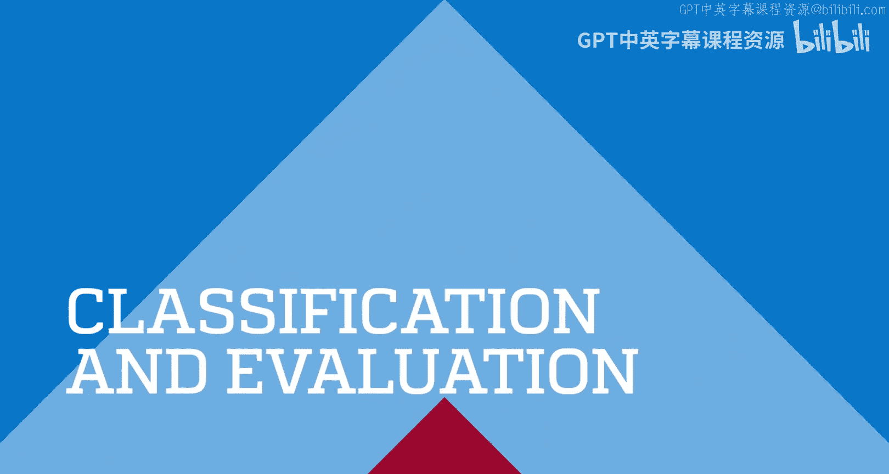
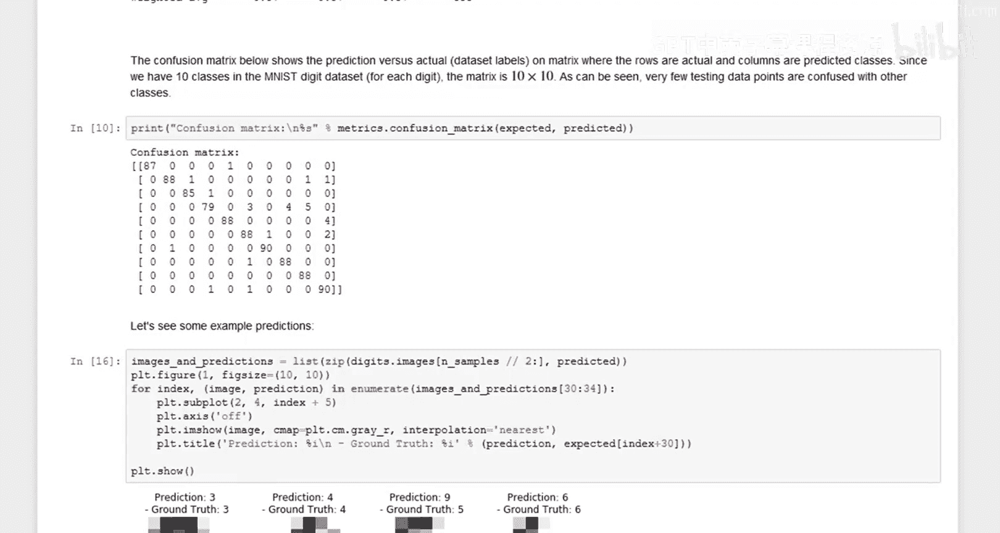

# 应用机器学习：05：分类与模型评估




在本节课中，我们将学习支持向量机（SVM）的基本概念，并通过一个手写数字识别的实例，演示如何使用Scikit-learn库训练一个分类器。我们还将介绍如何评估分类器的性能，包括使用准确率、分类报告和混淆矩阵等工具。

## 支持向量机简介 🎼

支持向量机是一种非常流行的机器学习算法。它诞生于人工神经网络之后，并因其训练速度更快而广受欢迎。支持向量机的算法复杂度为 **O(n²)**，而早期的人工神经网络算法复杂度为 **O(n³)**。这使得支持向量机训练速度极快，并且其泛化能力在某些方面甚至超越了人工神经网络。

上一节我们介绍了分类问题的背景，本节中我们来看看支持向量机与人工神经网络的核心区别。这两种都是数值算法，但它们从不同角度解决机器学习问题：
*   **支持向量机** 寻找一个最优的**判别超平面**来分隔不同类别的数据。
*   **人工神经网络** 则致力于**最小化误差**，即输入值与输出值之间的差异，属于函数逼近器。

简而言之，支持向量机采用优化方法以降低边际风险，而人工神经网络则专注于函数近似。

## 训练支持向量机分类器

现在，让我们动手运行一个支持向量机分类器。我们将使用Scikit-learn库和手写数字数据集。

首先，我们定义分类器并拟合数据。以下是核心代码步骤：

```python
# 导入必要的库
from sklearn import svm
from sklearn import datasets

# 加载数据
digits = datasets.load_digits()
n_samples = len(digits.data)

# 划分训练集和测试集（各50%）
data_train = digits.data[:n_samples // 2]
target_train = digits.target[:n_samples // 2]
data_test = digits.data[n_samples // 2:]
target_test = digits.target[n_samples // 2:]

# 创建并训练SVM分类器（使用径向基核函数）
clf = svm.SVC(gamma=0.001)
clf.fit(data_train, target_train)

# 进行预测
predicted = clf.predict(data_test)
```

代码说明：
*   `n_samples // 2` 是Python中的整数除法，确保我们使用一半的数据进行训练，另一半进行测试。
*   `svm.SVC(gamma=0.001)` 创建了一个使用径向基核函数的支持向量分类器。
*   `fit` 方法用于在训练数据上训练模型。
*   `predict` 方法用于对测试数据进行预测。

## 评估分类器性能

训练并测试分类器后，我们需要评估其性能。最基本的评估指标是**准确率**，即正确预测的数量除以预测总数。

以下是计算准确率和查看预测结果的示例：

```python
# 计算准确率
accuracy = clf.score(data_test, target_test)
print(f"模型准确率：{accuracy:.2%}")

# 查看部分预测值与真实值
print("预测值：", predicted[:10])
print("真实值：", target_test[:10])
```

然而，对于有10个类别（数字0-9）的多分类问题，更有效的评估工具是**混淆矩阵**。在混淆矩阵中，每一列代表预测的类别，每一行代表真实的类别。

幸运的是，Scikit-learn提供了方便的功能来生成分类报告和混淆矩阵。

```python
from sklearn.metrics import classification_report, confusion_matrix

# 生成详细的分类报告
print("分类报告：")
print(classification_report(target_test, predicted))

# 生成混淆矩阵
print("混淆矩阵：")
print(confusion_matrix(target_test, predicted))
```

分类报告为每个类别提供了**精确度**、**召回率**和**F1分数**等指标。混淆矩阵则直观地展示了类别之间的混淆情况。例如，对角线上的数字表示被正确分类的样本数，而非对角线上的数字则显示了错误分类的情况（如将数字4预测为数字9）。

## 结果分析与可视化

通过混淆矩阵，我们可以深入分析分类器的错误模式。例如，我们可能发现数字“4”和数字“9”容易相互混淆，这可能是因为它们的书写形状在某些情况下比较相似。

我们还可以将预测错误的样本可视化，以便更直观地理解模型的局限。

```python
import matplotlib.pyplot as plt

# 查找预测错误的样本索引
misclassified_idx = [i for i, (p, t) in enumerate(zip(predicted, target_test)) if p != t]

# 可视化前几个错误样本
fig, axes = plt.subplots(1, 4, figsize=(10, 3))
for ax, idx in zip(axes, misclassified_idx[:4]):
    ax.imshow(data_test[idx].reshape(8, 8), cmap=plt.cm.gray_r)
    ax.set_title(f'预测: {predicted[idx]}\n真实: {target_test[idx]}')
    ax.axis('off')
plt.show()
```

通过可视化，我们可能发现一些对人类而言很清晰，但模型却判断错误的样本（例如一个书写较潦草的数字“5”被预测为“9”）。这说明了模型仍有改进空间，也表明本次实验本身具有一定挑战性——我们仅使用了50%的数据进行训练。

## 总结

本节课中我们一起学习了支持向量机分类器的基本原理与应用。我们使用Scikit-learn训练了一个手写数字识别模型，并通过准确率、分类报告和混淆矩阵等多种方式评估了其性能。我们还学习了如何通过可视化分析模型的错误。




需要指出的是，本次实验仅使用一半数据训练，这增加了任务的难度。在接下来的课程中，我们将深入探讨更多的评估指标、数据预处理技术，以及不同的分类与聚类问题，以构建更强大、更稳健的机器学习模型。