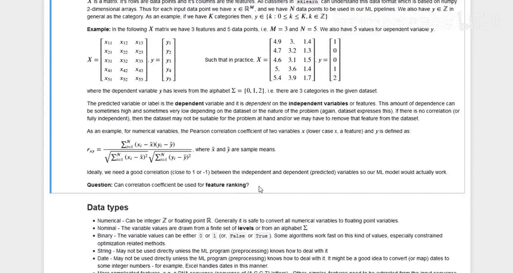

# 应用机器学习：07：数据特征


## 概述
在本节课中，我们将学习机器学习中数据特征的核心概念。数据是机器学习的基石，其表示方式、特征类型以及与目标变量的相关性至关重要。我们将探讨如何表示数据、不同类型的特征，以及如何根据算法需求进行特征转换。

## 数据表示
在机器学习中，我们通常将数据表示为一个矩阵 **X**。这个矩阵的维度是 **n × m**，其中 **n** 代表数据点的数量，**m** 代表每个数据点的特征数量。例如，如果我们有5个数据点，每个点有3个特征，那么 **X** 就是一个5行3列的矩阵。

我们的目标变量（或称因变量）存储在向量 **y** 中。在分类问题中，我们不将目标变量放入 **X** 矩阵，因为我们的任务就是预测它。因此，**X** 矩阵包含所有独立的特征，而 **y** 向量则包含对应的标签或目标值。

## 特征类型
数据特征有多种类型，主要包括：
*   **标称型**：表示类别，没有顺序关系（如天气类型：晴天、雨天、多云）。
*   **二元型**：只有两个可能值（如是/否，真/假）。
*   **字符串型**：文本序列。
*   **日期型**：时间戳。
*   **数值型**：包括整数和浮点数。

在计算机中，这些特征有其机器表示方式：
*   数值型通常用整数或浮点数表示（例如32位或64位浮点数）。
*   字符串在Java等语言中对应`String`类型。
*   标称型变量虽然可能表现为长字符串（如“炎热天气”），但通常会被映射为整数（如0, 1, 2），并有一个查找表来对应其原始含义。将所有数值变量转换为浮点数通常是安全的，有时还能因为GPU的优化而获得更快的处理速度。

## 特征转换
不同的机器学习算法偏好不同类型的特征。因此，特征转换是一个关键步骤。

上一节我们介绍了特征的基本类型，本节中我们来看看如何在它们之间进行转换。

**标称型转数值型**
基于概率、频率或熵的算法（如朴素贝叶斯）通常偏好标称型变量，因为便于计数。而基于距离、成本或函数拟合的算法（如支持向量机、K均值聚类、神经网络）则更偏好数值型变量。

当需要将标称变量转换为数值变量时，最常用且安全的方法是**独热编码**。如果一个标称变量有 **L** 个不同的取值水平，我们就创建 **L** 个新的二元（0/1）变量，每个变量对应一个水平。

例如，一个表示“天气”的变量有3个水平（热、温、冷），独热编码会生成3个新特征：
```python
# 原始数据: [“热”, “温”, “冷”]
# 独热编码后:
# “热” -> [1, 0, 0]
# “温” -> [0, 1, 0]
# “冷” -> [0, 0, 1]
```
需要注意的是，如果水平数量很多（例如1000个），这种方法会生成大量特征，可能造成空间浪费。尽管如此，它仍然是最直接的方法。

**数值型转标称型**
将数值变量转换为标称变量通常涉及**分箱**操作。基本思路是：对于一个数值变量的取值范围（例如-100到+100），我们决定将其划分为若干个区间（例如20个“箱”），然后将每个数值映射到对应的箱中。这样，连续的数值就被转换成了离散的类别。

例如，年龄这个连续值可以被分箱为“儿童”、“青年”、“中年”、“老年”等类别。之后，这些新的标称变量还可以通过独热编码再次转换回数值表示，以供算法使用。

这些转换有助于算法更好地工作。即使我们不手动进行这些操作，许多算法在其内部“黑箱”中也会自动完成类似的处理。

## 数据源与可重复性
我们将在另一个模块中详细探讨在线数据源，学习如何访问网页并下载数据集。

关于数据的一个重要注意事项是：当在团队间共享物理数据集文件时，该文件的每一个细节都必须完全相同。为了确保实验的可重复性，必须保存一个脚本。这个脚本使用原始数据来生成最终用于实验的物理数据文件。无论运行多少次，这个脚本都应该生成完全一致的数据文件。

## 特征与目标的关系
独立特征与目标变量之间的关系是构建机器学习模型的基础。衡量这种关系的一个常用指标是**皮尔逊相关系数**。

假设 **x** 是一个独立变量，**y** 是因变量。皮尔逊相关系数 **r** 的计算公式如下：

**r = Σ[(xi - x̄)(yi - ȳ)] / (√Σ(xi - x̄)² * √Σ(yi - ȳ)²)**

其中，**x̄** 和 **ȳ** 分别是 **x** 和 **y** 的均值。这个系数的值介于-1和1之间，表示两个变量之间的线性相关程度。

当我们对特征进行排序时，通常与目标变量相关性最高的独立变量会被赋予更高的排名。




## 总结
本节课中，我们一起学习了机器学习中数据特征的核心知识。我们了解了如何用矩阵 **X** 和向量 **y** 标准地表示数据，认识了标称型、数值型等不同特征类型及其机器表示。更重要的是，我们探讨了根据算法需求进行特征转换的方法，包括使用独热编码将标称型转为数值型，以及通过分箱将数值型转为标称型。我们还强调了数据可重复性的重要性，并介绍了用皮尔逊相关系数来衡量特征与目标变量之间的关系。理解并妥善处理数据特征是构建有效机器学习模型的关键第一步。