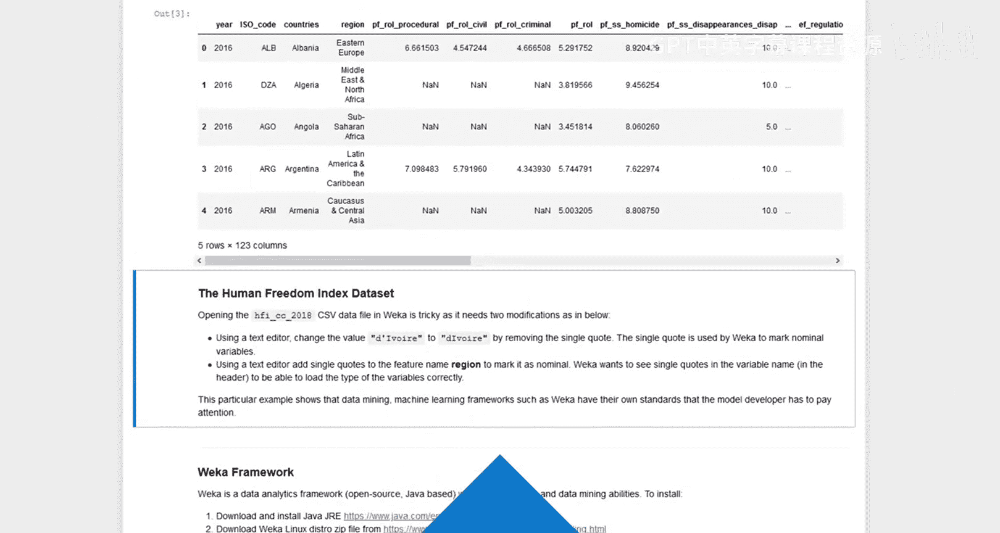

# 约翰霍普金斯大学《应用机器学习｜Applied Machine Learning》中英字幕 p08 7_在线数据源简介.zh_en -BV13xuqzYErx_p8-

🎼。

Let's discuss online dataset sources as our approach to machine learning is data driven。

 any available data for our educational purposes is valuable to us。

There are many online dataset dataset sources，3 important ones are these UC I KDD online repository。

 kgggle and Kd nuggets。 Let's start from the back。 Let's look at Kd nuggets。

 Kd nuggets is a webp page where there is more than just data As you see on the menu， software， news。

 top stories， Op， To， jobs companies courses， data sets education when it comes to applied machine learning。

 data mining or AI。 This webage provides a lot of information。

 We will not get a particular data from this repository。

 So let's go back to our module Now let's look at UC KDD website。 U KDD website is relatively old。

 but still a wellknow and frequently used web page。 we will download a particular data from here。

 Let's look at by data type， and let's get。Multtivariate data of 1990 US consensus data this is the data webpage and if we click on this data set as you see you are not seeing it but if you go to this website you will see at the bottom this link is a data file in text extension now let's download this with Sa link as I will download it here I will change the extension to CSV because it's comma separated file and in fact let's look at what it has。

Now， I will go to that downloads directory。 I download the data from and pull the file inside my editor。

 This is not bad plus plus you can use any editors。 This file is pretty big。 It's around 350 MBby。

 so your editor must be capable of handling such big data files。As you see， the first line is header。

 It's comma separated， meaning every individual value is separated by a comma。

 and the first line carries the names of the column names。 However， many columns here。

 The data points continue similarly。 So how many data points we have。 I went to the last line。

 and it is around 2458285。 So that's the number of data points I have in this dataset set。😔。

As you see， the first one is case， I D。 The second one is the age。 It goes like that。 Now。

 we will save this file in CV extension， and then we will load it to Jupyter notebook later。 Now。

 let's download the other two files。 This time， I will go to the Kagggle web page。

 Kagggle is a very accomplished web page with many。

 many data sets Well curated host competitions to be able to log into Kagle。

 You need a email address。Make sure that your email address is a disposable email address。

 if you like， Of course， in Chagggle webpage， we will download graduate admissions data。

 The easiest way is searching that data。The data set we are looking for is under the third one。

 graduate admissions。 How do I know it's just I picked this particular one。

 And there are actually two versions of it。 Admission predictt version 1。1 and admission predict。

 We will download the admission predict。 and probably by the time you check this module in the following months and years。

 there might be 1。21。3 admission predict versions。 We will download the data from this web page。

 As you see， there is also a notebook。Looking at the data， you can also fall off。

What the other host of this data is doing。We will just get get the data and use it for our purposes。

 I will click this， and now it is downloaded in my downloads directory。 It size is 13 kiloB。

 and its content is like this。 serial nogerary score Chance of admit The numerical variable。

 It goes like that， and there are 400 data points in the dataset。 Now。

 we will look at the thirdr data set。 The name of this data set is human freedom index。

Human Free here。 and it's called HFICC 2018。 I will click on the data。As you see。

 you can also explore the data using kgggle resources。 download。 Okay。

 it's downloaded by my browser in a zip file I will open the zip and copy to my datasets directory and for your information Here is the content of the data。

 So this is the， again， the header it's thev。 and it goes like that。 My editor shows line by line。

This blue is a single line。 The last column is called。H F quartile first is year。 second is isocode。

 and as you can guess， Hf is human freedom。 So if you're interested in the score。

 that is the third one。 This particular one has 7。56 and so Now we download the data。

 Let's go back to the Jupyter notebook。 I will run the cell。 where I use pandas and load the Cv。

 and then I will check the number of rows and number of columns。

 meaning number of data points and number of features。

 and then look at the first few lines of my data set， that's the F dot head。 Df is for data frame。

 its pandas class to keep to carry the data points。 D F is a matrix。 but of course， in memory。

 its data structure is completely different。 But for our purposes， we are not interested in that。

 we can take this and then convert into a nu。By matrix in the following modules。

 we will see how that's done。 Now as you see， this information is similar to the information when we looked at the data in the notpad and here it's much well organized。

 The first one is case ID H and alldo and last one is D Y RR and it goes like that。

It has This particular display has 5 rows and 69 columns。 Now。

 the second dataset set was admission Pre from kgggel。 And let's load that again。 If you notice。

 I just run this cell， but of course， you will see the results that was previously run。

 and it's exactly the same unless I have a bug， of course， it has 400 rows，9 columns。

Including the dependent variables， chance of admit。 When we use the stta as an X matrix。

 we will remove this column。As you see， panda's data frame also has its own serial number。Cerial I D。

 It is like an index。Let's round the third one。 This was the human Freedom index again。

 downloaded from Kagggle。 The reason I chose these particular data sets are because they were interesting。

 maybe to me， this is admission prediction is gery called toughel score and un chance of admit to colleges。

And the human Freedom index has hundred and 23。Different columns that carry information about a lot of things。

 And the number of points is 1458。 We will use this data set in Wca environment。

 We will continue examining the data set and then generate a few classifiers in Wica framework in the next video。

