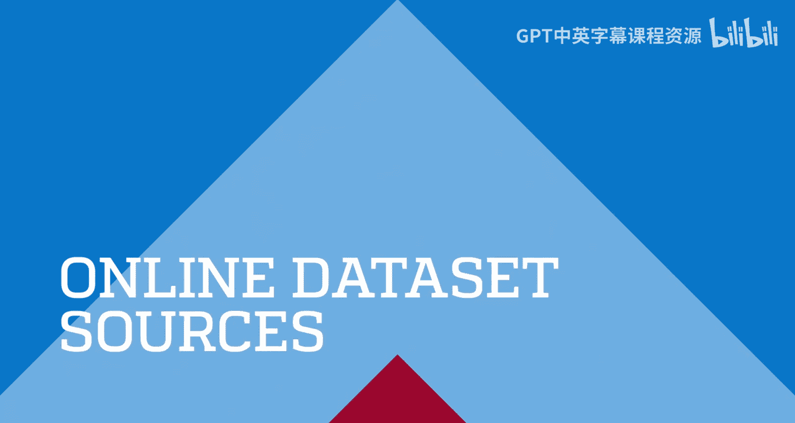
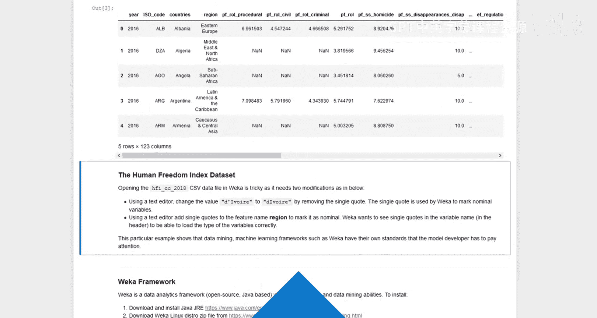

# 应用机器学习：08：在线数据源简介




在本节课中，我们将学习如何从互联网上获取用于机器学习的数据集。数据是驱动机器学习的关键，因此了解并利用公开可用的数据源至关重要。我们将介绍三个重要的在线数据源，并演示如何下载和初步查看数据集。

## 在线数据源概述

我们的机器学习方法是数据驱动的，任何可用于教育目的的数据对我们来说都很有价值。互联网上存在许多在线数据集资源，其中三个重要的来源是：UCI KDD在线知识库、Kaggle和KDnuggets。

上一节我们介绍了数据源的重要性，本节中我们来看看这三个具体的数据源。

## KDnuggets网站

首先，让我们看看KDnuggets。KDnuggets是一个网页，它提供的不仅仅是数据。从菜单中可以看到，它包含软件、新闻、头条故事、观点、工作、公司、课程、数据集和教育资源。在应用机器学习、数据挖掘或人工智能领域，这个网站提供了大量信息。然而，我们通常不会从这个资源库下载特定的数据集。

## UCI KDD知识库

接下来，我们看看UCI KDD网站。UCI KDD网站相对较老，但仍然是一个众所周知且经常使用的网页。我们将从这里下载一个特定的数据集。

以下是下载步骤：
1.  浏览数据类别，选择“多元数据”。
2.  找到“1990年美国人口普查数据”。
3.  在数据页面底部，找到数据文件的链接（通常为`.txt`扩展名）。
4.  使用“链接另存为”功能下载文件。
5.  由于它是逗号分隔的文件，我们可以将文件扩展名改为`.csv`。

现在，让我们查看一下这个数据集。文件大约350MB，因此你的编辑器需要能够处理这样的大文件。第一行是标题行，数据以逗号分隔。第一行包含列名，后面是数据点。这个数据集大约有2,458,285个数据点。

我们将把这个`.csv`文件保存好，稍后加载到Jupyter Notebook中。

## Kaggle平台

现在，让我们下载另外两个数据集，这次从Kaggle平台获取。Kaggle是一个非常完善的网站，拥有大量精心整理的数据集，并举办竞赛。要登录Kaggle，你需要一个电子邮件地址。

以下是下载步骤：
1.  在Kaggle上搜索“graduate admissions data”。
2.  选择“Admission_Predict”版本的数据集（例如Version 1.1）。
3.  从数据页面下载CSV文件。

下载的文件大约13KB，包含400个数据点。列包括：`Serial No.`、`GRE Score`、`TOEFL Score`、`University Rating`、`SOP`、`LOR`、`CGPA`、`Research`、`Chance of Admit`。其中，`Chance of Admit`是我们后续可能的目标变量（因变量）。

接下来，下载第三个数据集“Human Freedom Index”（HFI.CSV 2018）。同样从Kaggle下载，文件可能以ZIP压缩包形式提供，解压后即可获得CSV文件。这个数据集包含许多列，记录了不同年份和国家的自由指数等信息，共有1,458行数据。

## 在Jupyter Notebook中加载数据

我们已经下载了数据，现在回到Jupyter Notebook中加载并查看它们。

首先，使用pandas加载第一个大型人口普查数据集：

```python
import pandas as pd
df_large = pd.read_csv('path/to/your/census_data.csv')
print(df_large.shape)  # 查看行数和列数
print(df_large.head()) # 查看前几行数据
```

`df_large.shape`会输出类似`(2458285, 69)`的结果，表示有2,458,285行和69列。`df_large.head()`会以整齐的表格形式显示前5行数据。

接着，加载研究生录取数据集：

```python
df_admit = pd.read_csv('path/to/your/Admission_Predict.csv')
print(df_admit.shape)
print(df_admit.head())
```

这个数据集有400行和9列。pandas的DataFrame有自己的索引（类似`Serial No.`）。当我们后续将其作为特征矩阵`X`使用时，需要移除`Chance of Admit`这一列。

最后，加载人类自由指数数据集：

```python
df_hfi = pd.read_csv('path/to/your/HFI.csv')
print(df_hfi.shape)
print(df_hfi.head())
```

这个数据集有1,458行和123列，包含了关于自由的丰富信息。

## 总结



本节课中，我们一起学习了三个重要的在线数据源：UCI KDD、Kaggle和KDnuggets。我们演示了如何从UCI KDD和Kaggle下载数据集，包括1990年美国人口普查数据、研究生录取预测数据和人类自由指数数据。最后，我们使用pandas库在Jupyter Notebook中成功加载并初步查看了这些数据集的结构。在接下来的课程中，我们将在Weka环境中继续检查这些数据集，并生成一些分类器模型。