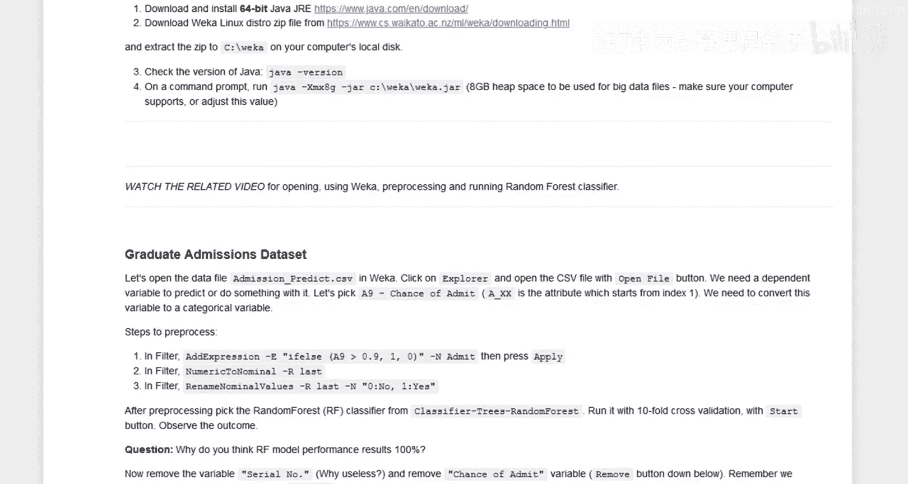

# 约翰霍普金斯大学《应用机器学习｜Applied Machine Learning》中英字幕 p09 8_Weka工具导论.zh_en -BV13xuqzYErx_p9-

🎼。

Let's take a look at the Wca framework The first thing we will do is in a command prompt。

 check the version of the Java development environment we downloaded。

Make sure you install the 64 B version of Java because as you can imagine in machine learning the data size might be very。

 very big。 And if you have only 32 B since the man Java you will be limited to2 gig of memory and generally today's computers come with much more memory than that。

 let's go to the command prompt and I've already run it Java dash version So my version is 1。

8231 and the 64 B server。 This is what I want to see。

 then I've already downloaded the Linux distribution， I will just run Weca directly。

 Now Wika is coming up。It tells me this because there's a package manager which can download many。

 many other libraries programs that Wica keeps so I'm leaving it to you to explore the features of Wica like this。

This is Weca's main。Graphal user interface chooser。For our purposes today， we will use the Explorr。

 Let's open Explorer。 And now， as you see， it's ready to go。I will open a file directly。

 My files are under。D EP， my lectures。Data sets。And I will import C SV because I downloaded this before。

And the first thing I will download is human Free index， Not cleaned。

 because this is the version that I downloaded directly。 And let's see if we can open it or not。 O K。

 it failed。 You see， we were able to open this by pandas。😊，But Wicca doesn't like it。

 And there's a reason why it doesn't。Let's O。 and then let's move on。

 and let's open the file to see what the problem is。There you go。 Now。

 the reason there is a problem is entries like this， because this is nominal。 Clearly。

 Wika doesn't understand this is nominal because in the headher， it doesn't say this is nominal。

 Vika wants to see quotes in the name of the variable。 following the instruction in the notebook。

 we will add single codes around the name region in the header。And here is the region。

I'm adding this， and then I'm saving this as。Clean。Save going back to the wca。

And then I'm opening clean problem。We will follow the other modification by changing this ivo to this。

 removing the single code by adding codes around the region。

 we specified this particular variable as nominal。 Wecca will understand this。

 But then the code is somewhere else。Let's search the code。 You see， because of this code。

 Wica in the opening up this file has problem。 I just delete this code。 That's it。

 Let's see if there's another one。 There's another one。 let's see， okay， third 1， This was third 1，4。

1，5。 that's all。 Now I will save this again， now， let's see if Wica can open it now。 Okay， you see。

 unfortunately， we， we have to understand what what Wica wants to see in the data file。

 This particular data file is the human freedom index。

 And Wica is an excellent tool to show all this information。

 And as you see it's creating histogram by showing metadata about the data。 This particular one is。

 even though it's numeric， it can show that as distinct values，9 distinct values， minimum 2008。

 maximum 2016。 It goes like that。 I'm moving。Variable by variable。

 and then showing the histograms here。 So I invite you to do the same thing and explore the data。

 understand the data。 Now， we will leave this data at this point。

 The purpose of this demonstration was， even though we download the data from Kagggle。 It's clean。

 The quotes were not suitable to be opened up by the Wiicker immediate。 We notice by experience。

 So we opened an editor made sure the quotes match what Wier would would like to see。

And then Wica was able to open the C SV file directly。 Now。

 we are ready to machine learn with this data。 However。

 we will continue our Wica demonstration with another data file。

 We will open the graduate admission dataset set with Wica and then apply some filters and develop some classifiers。

 Let's see how this goes。 So back to this will open another file Ad predict。

 which we download it from Kagel。 It's able to open it directly because that C SV file doesn't have any problems that Wica wouldn't like。

 As you see， there are 400 instances， meaning data points。

 It name is admission predict pulled from the file name。 There are 9 attributes。

 Wica calls features as attributes。 And these are the features。

 serial number Jerry score Tel score Uni rating。 These are histograms basically counts of particular values。

 sometimes。😊，That are natural bins， like in this Jerry score。 Sometimes we have to be ourselves。

 Research has only two values。 only two distinct values，0 or one。 Ch of amin。 It is numerical。

 There are 60 different values。 It doesn't mean that it's nominal。 It's just 60 different values。

 and then a histogram is built。 So now let's process this further。

 First thing we have to do is create a variable， which is nominal。

 so that this file can be used for classification。 At this point， we can only do some regression。

 because the chance of admin， which is the interesting variable that we want to predict is numerical and takes values between 0。

34 to 0。97。 These are like probabilities between 0 and1。 We want to convert all these to nominal。

And I suggest using 0。9， which is around somewhere here， as will be admitted， and the rest。

 as will not be admitted。 So let's see how we do it。 We will go to filter。

 and we will use add expression。 as you see， there are lots of different filters。

 Well use add expression。 And then we will enter this argument here。So this will be my expression。

 It is unfortunately webca format and we have to look up each time for a particular filter。

 how it would be applied if else a9， which is that particular column chance of admit is greater than 0。

9 if yes then it will be created as1 or the value will be set to 0。

 I will click on enter edit configuration and then copy paste what I copy it from the dash ae for expression in codes if else a9 greater than 0。

9 goes like that it's not complete Of course codes this corresponds to the expression that we provide in the Jupyter notebook and then we'll press apply okay you see it created a new column Ad and then it assigned most of the values a 0 because they were less than 0。

9 and some of the values as。Now we have to convert this to nominal because it's still numeric。

 you see it's still numeric。 we will apply another filter。

 so we will pick numeric to nominal and then we will use dash R last edit configuration。

 We will just use the last variable to convert to nominal。

 we could give a range so that it would convert to nominal multiple variables at the same time。

 Remember a variable a feature and attribute a column。 all of them are same right。

 an independent variable Theyre all correspond to the same entity apply。Suddenly change。

 You see now it's nominal。 And Vicca shows wherever that nominal label is 0 in the data as well。

 And now I can say that by looking at the G score actually。

 I can draw a pattern that the chance of admit goes up。 Tal score similar。 Uni areating S O P L O R。

 C G and all the research， chance of if you have not done research。

 there is a good chance you will not be admitted。 Ch of admit。 here is the balance。

 And we can call this particular dataset set on balance because we have many zeros as not admitted and once very few ones as admitted。

 We will just change the name from 01 to yes and no， rename nominal values。

 this is only to help us see the variable values nicely。Again， the last variable。

 And it is like a dictionary，0 as no and then one as yes， O， and then apply。 Okay。

 now add is no and yes。 It's a truly nominal variable now。

 And then everything remains same except for the information as data is now labeled as yes and no。

 I would suggest exporting by saving in our format， and then seeing this particular change。

 seeing what changes we made。 But I will not do that。 Now， according to the instructions。

 we will classify with it all these steps per processing is done。

 And then we will go classification section， and we will do a tenfold cross cross validation。

 Let's see what's happening。 Classify tab。 choose3s random forest， which is a popular classification。

 It is already the set cross validation to 10。 and then I will just。Start。

 it automatically picks the last variable as the dependent variable， which is nominal amin。 Start。

 It did run 10 times， and then it accumulated all the results。 Okay。

 now why it's 00 percent classification。 Everything is correct。

 with it super let's go back to the instructions。 It asks you why it's 0 percent。

 It is 10 percent because we have a biasased model。 Even though in our data set。

 Ad is used as dependent variable， We have chance of admit。 which is directly correlated to the a。

 and it is in your data。 Your model has it。 We have to remove it。 We are not evaluating the model。

 right， We will just remove chance of admit。 Okay， now look a serial number from one to 400。

 This is different for every data point。 I bet this is completely useless to prove it。

 let's go to classify again， let's start。 O， Now it's 97%。 It makes more sense。 It did some error。

Our data is good enough。 We can have very high accuracy。

 but it's not like S cubed biased data so that we will have 100 percent。

 I would be very suspicious if I see an accuracy of 100%。

 Now let's go back and remove serial numbers。 I'm claiming nothing will change here。

 All the results will be same by the way， I can click on these two to see the previous results and the current results。

 So I will be able able to compare after I change the data when I run the classification again I pick the serial no。

 remove it and now I have seven variables and the dependent variable admit I classify it went down right from 97 to 96。

5 but maybe it's only random error。 maybe the error of the variation is large enough to cover from let's say 94 to 99 let me run again run again run again run again run again Well it looks like some of those serial numbers were。

Fitted in the data so that it was helping the classifier to determine There is a good chance the classifier found out which serial numbers were actually having the yes answer。

 Ad answer。 Now， let's try to answer what the module was asking。 First of all。

 it was 100 person before， because we were using a variable which we were not supposed to use。

 Second， we remove the serial number。 It went down。 Yes。

 but the serial number was a unique value for every data point。

 Probably the randomfor was finding out which serial numbers were receiving the yes。

 We have to remove serial number。 it will not help us。

 It's a unique value for every data point we have。 That's why the randomfor model performances less than 100 person now。

 but this is not a bad thing。 This concludes our module。

