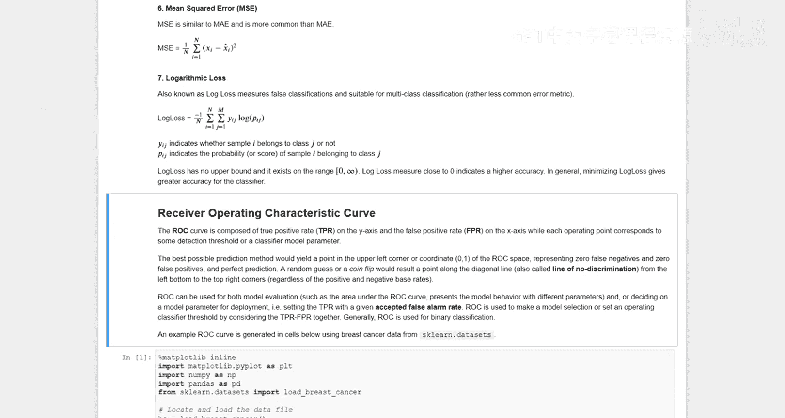

# 约翰霍普金斯大学《应用机器学习｜Applied Machine Learning》中英字幕 p11 10_模型评估方法.zh_en -BV13xuqzYErx_p11-

🎼。

Theyear students。In this module， we will look at model evaluation。Clearly。

 we are building an analytical model， an AI model， a machine learning model。

Do we think we built the right model， How can we test or evaluate it。

 How can we predict the performance of the model when we deploy it。

Supposedly we are building a predictor machine learning model。

But can we predict this predictor machine learning model's performance when we deploy it？

In order to build the model， as we know， we need data we divide the data into three pieces The first piece is training When we build the model we will train using that training dataset set and then the testing again building the machine learning model we will use the testing to check the error of the training and then a third piece most of the times it might be used sometimes it's not crucial is the validation data set if we have model parameters。

 then we will use the validation data set to tune those model parameters。

 noticeice that all three pieces are mutually exclusive and then they add up to the 100 percent of the dataset that we have When we build the model we fine tune the model using the validation dataset these fine tuning happens if。

Particular machine learning algorithm has parameters。

 Sometimes these parameters can be set by ad hoc values。

 but sometimes we have to tune those parameters。 for example， a good example from random forest。

 say the depth of the trees may not be tuned we can set it to say5 and that set however。

 for a support vector machine example， we use a kernel radial basis function kernel。

 the gamma parameters has a say in the wiggly of the discrimination plane So we will use the validation data set to tune the gamma parameter of a support vector machine in the random forest example。

 we can use all the data for training and testing only skipping the validation but a support vector machine requires they will use the validation dataset set to tune the gamma parameter。

 the biggest mistake would be running training and testing。

Multiple times and then finding out the gamma parameter without a validation dataset by picking the best accuracy that we achieve with that training testing iterations。

 This is definitely a wrong approach because it biases our model with the dataset that we have When we deploy it in the field。

 This model as a chance that it will fail。 It will not be general enough。 As you guess， by now。

 by model evaluation， they are making sure that our machine learning model is general。

 That's the utmost important feature or characteristic of any machine learning model is the generality。

 What is the simplest classifier that we can come up with。Clsify 0。

 no matter what it's the simplest classifier， right， It doesn't use any data as training。

 The classifier says whatever you data give me， I will classify as 0。

 there is no even and if else condition。 Imagine if we have five classes that we are trying to predict。

 And if this simplest classifier classify 0 all the time， what is the performance of that model。

 assuming each class has equal representation in the data set。

 meaning 20 person of the data points are class 0，20% of the class data points are class 1。

20% class 2 and so on。 Well， clearly， it will be 20% success。 Every time I classify as0。

 I'm hitting one of the class  zeros。 Well， I know that one fifth of the data set is all class 0。

 then my performance is20% accuracy accuracy， It's not0。 If I have two binary class。

Equal representation， meaning balanced dataset，50% accuracy。

 That's my smallest value that I can achieve with the simplest classifier that I have。

 Imagine you're having 10% accuracy in a binary classification scheme where the dataset is balanced。

 What would it tell you， Yes， you have a bug in your program。Now that we say generalization。

 the model's generalability is the utmost important feature of the machine learning model。

 The second concept that we are handling is the false alarm rate。

 when it comes to machine learning models， we have two metrics。

 probability of detect truepoive rate or probability of false alarm， false positiveive rate。

 if we maximize our false positiveive rate， maximizing false alarm rate。

 We can also maximize the trueosive rate。 We will see in a moment these are working against each other。

 We do not want a high false alarm rate。 Imagine a cyber security problem where every file is marked with a virus。

 say you are building a predictive cyber security model and on your model marks each of the file with a virus。

 Well you catching all the viruses。All of them are marked as there's a virus。

 It is similar to that simplistic classifier where our model classifies everything with zero。 Well。

 okay my probability of detection is 100 percent I'm detecting everything but then my false alarm rate is also 100% because the ones that that do not have a virus are also marked with a virus Can we compromise the false alarm rate versus the probability of detection so that we can have a manageable false alarm rate and then a good probability of detect we will see that momentarily in a receiver operating characteristic curve we have model evaluation methods clearly training testing validation train and then look at the test with everything you have This is called reclassification It's a good first test to do reclassification I trained my model with all the data I have and I tested my model with all the data。

I have。 you should expect a high reclassification performance almost 100 percent。 If it's 100%。

 it means you overfit your model。 If it's 90%， it's good。 if it's 10% you have a bug in your program。

 The common approach is kfold crossval。 we shuffle the data。

 we pick 10% of the data each time for testing and 90% of the data for testing。

 This is  ten0fold crossval If it's fivefold before fold the data into five to any percent testing 80% training。

 they are not overlapping， they are mutually exclusive and on the average accuracy is the one that to report。

 this is the best approach Kfold crossval。 Leave one out crossval can be used when the data set is very。

 very small。Say I have only 10 data points in bioinformatics example， I have a long gene。

 I'm using a support vector machine， which is excellent。When the data is unbalanced。For example。

 you deal with cancer data， 99% of the patients live one% of the patients die。

 It means your predictive classes cancer survivability is unbalanced。

 99% of the data is labeled as survive0，1 person is labeled as one dies of cancer Well。

 in order to evaluate this correctly， in order to evaluate with kvol course Val for example。

 we have to do stratification， meaning your test set should contain equal amounts from each class。

 the most important aspect of model evaluation is measuring the expected real world performance if we build the model general enough。

 then when we evaluate the model， we will also expect an expected real world performance from those evaluations。

Just to give an idea。 and， of course， these are these maybe somewhat circumstantial support vector machines。

 They have very good generalization ability。 They are basically optimized for that。

 random forest ensemble classifiers， any ensemble classifier is also have very good generalization。

 principal component analysis because we reduce the dimensions of the data set。 Again， good。

 deep learning neural networks with dropout ratio and L2 regularization。 They also generalize well。

 and， of course， human beings are excellent generalizer machines。 Let me look at evaluation metrics。

 the math part of it。😊，We will see the classification as number of correct predictions divide by total number of predictions。

 if your data set sizes n， if you correctly predicted 90% of the data points。

 then your accuracy is 90%。The confusion matrix。Is a very good indicator how your model behaves The top side is the ground root。

 This can be also the labels like the data labeled with a， the label， the data labeled with B。

 and on the vertical side is how my model actually behaves on the testings testing dataset set。

 If I use a Kfold course validation， then I can accumulate all these into one confusion matrix。 Now。

 historically type 1 and type 2 errors are important。

 when I have an unbalanced data set like the cancer dataset set。

 I have to fix my class A as the cancer is there and I'm detecting it。

 So type 1 miss like patient as cancer。Predicted patient has the cancer。

 The first element in this confusion matrix gives you the probability of detection。

 And that's the most important metric in my model。 Why because I'm detecting the cancer or not。

 if the patient has it or not， Imagine if I detect here patient has cancer。 Preic a。

 and the patient doesn't have cancer in reality。 What's my cost。 Well， we will alarm the patient， oh。

 you have cancer， we have to start treatment process。 But other than that， there's no cancer。

 the patient doesn't have the cancer。 So other than a really bad false alarm rate。

 I'm not missing anything。 But if I miss like here in the to one element of this matrix。

 The cancer has the patient。 truth A is here， cancer is there， and I predict。

the patient doesn't have the cancer。 Oh， this is really bad。 This is type 1 errors。

 missing the positive， mispredicting class A， because the patient had the cancer， and I missed it。

 Like I sent the patient to home。 You don't have any cancer。 but then in a few months。

 The symptoms got worse。 but now I miss the treatment timeline。

 and the model gave a gravely incorrect information。 Type 1 errors are very， very high cost。

 Type 2 errors are costs high cost。 but not that much。 I'm alarming everyone。

 I' probably spending unnecessary money for treatment for additional diagnosis， but at the end。

 I'm not missing that disease。 that melody。 Type 1 errors are the most costly errors I'm committing。

A few other mat pieces， true positive， true negative， false positive， false negative。

 We can build a true table to mark these。 Basically。

 if my prediction is a and if the ground truth is a count them。 That's your true positive rate。

 I'm sorry， true positive number。 the true positive rate is the rate when I make it into a rate。

 meaning take the true positive number， how many I have 10， how many true positive I have。

This column。That's all the cases where the patient has the cancer。 Now I， I made it into a rate。

 true negative rate， similarly，20 divided by this column。

I can also use precisionion recall from information retrieval。

F1 score can combine throughos rate to negative rate in somewhat an accuracy like metric。 However。

 it's more important to use F1 score because accuracy thinks。

Truth A and truth B are equally important。 Basically。

 count how many times you predict it's right and then divide。Total well。

 it is giving less value to the type 1。 It is giving equal value to type 1 and type 2。 However。

 f1 score is giving high value to type 1， low value to type 2， I can control it so。

If I'm dealing with a cancer detection， cancer prediction like machine learning model。

 I have to use F1 score， not accuracy。Area under curve。

 we will see that shortly in a receiver operating characteristic approach mean absolute error is the error between the original and the predicted。

 and this is of course， values for the regression problems， and also we have logmic loss。

 a more sophisticated metric for measuring the error of the model。Next。

 we will look at the receiver operating character secure。

