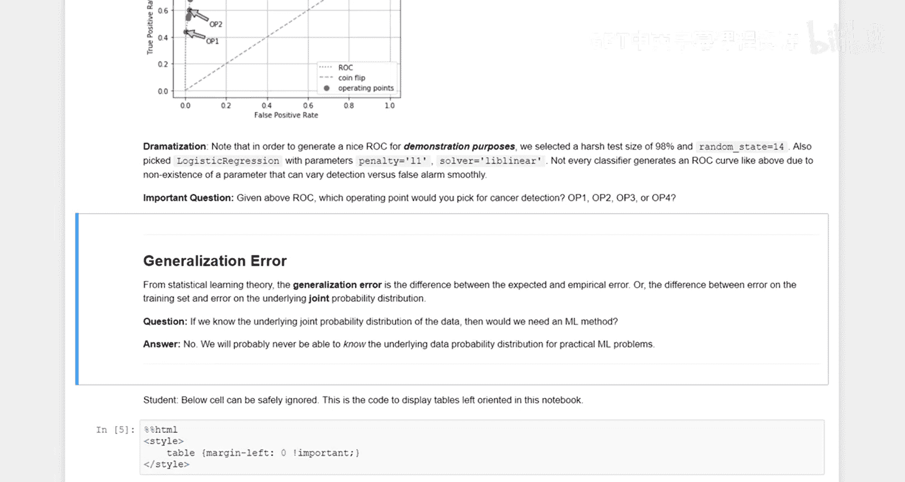

# 约翰霍普金斯大学《应用机器学习｜Applied Machine Learning》中英字幕 p12 11_受试者工作特征曲线.zh_en -BV13xuqzYErx_p12-

🎼。

Historically， detection， prediction and analytical approaches for classification were not called machine learning or artificial intelligence。

 neither did we have certain terms like F1 score or the confusion matrix。And of course。

 historically means this was like 30， 40 years ago， however。

 imagine a radar target detection problem the problem has a particular object on the radar screen and if we can detect that object coming towards the radar。

 can we detect an object on the radar screen， what are the metrics what are the evaluation methods？

We were talking about probability of detect， probability of miss or false alarm rate。 Now。

 in order to compromise between the probability of detection and probability of false alarm。

 we use a tool called receiver operating characteristic here。 The name is totally historical。

 As I explained receiver are the radio receivers from electrical and electronics engineering field。

 I will jump to the actual plot and come back how we generated。This is an narrow C curve。

 My Y axis this troossive rate probability of detection。

My X axis is false positive rate problem to your false alarm。

 This is a binary classification problem。 The line here。

From 00 to 11 is the line that shows what would be my probability of detection if I just determine if there's a target or not by a coin flip a little bit more less simplistic classifier like randomly select 0 or1。

 remember in the previous video we were saying the simplest classifier there can be is always take 0。

 Now we moved one step forward again， incredibly simplistic， randomly pick0 or1 and of course。

 a true random generation is impossible， So it is kind of arbitrary。 Now， if this is R O C。

If I have round climb parameters like a threshold setting a particular signal level。

 If that signal level is higher than my threshold， then I decide I'm picking as a target is out there。

 If my signal is less than threshold than I'm saying there is no target。

 So the operating point is determined by that simplest threshold in the next module。

 we will see how a perceptron behaves。 It is the very same thing。

The perceptron training finds out a particular division line between the data points。 In this case。

 that threshold， a single value in one dimensional space represents that plane。

 So if my input signal is higher than the threshold， then I decide I have a class1 case。

 If my signal level is lower than the threshold Then I decide I have a class 0 case。 Thus。

 these operating points are determined by that threshold by moving the threshold between low and high values。

 I move along the R C line。 in a more sophisticated example。 These parameters are model parameters。

 For example， in a support vector machine， they are the gamma values in a deep learner there are any parameter that you can think of size of the batch number of iterations。

 all those in a random。First they can be the death of the trees or minimum number of items per node in a logistic regression。

 it can be another threshold that we will see in a moment。 Now， let's see。What we do with this RO C。

 we will generate a lot of results and then each result will be used to generate the truepo rate and the false positiveive rate。

 and of course， if I have multiple data points in my testing set。

 I can compute accordingly each one of them is contributing to the TPR and FPR。

In this example we use breast cancer data from the Sit learn data sets and you know we are developing a regular classifier model。

 pull the data frame name the columns add the dependent variable cancer at the end。

 this will be malignant or benign， its nominal， so all my features here， all my columns。

 except for the cancer column， the last column will be used for model development。And of course。

 X my dataset set for training， the whole matrix actually。

 I have not discriminated between the testing and training。 This X will be the entire data set。

 I'm picking everything but cancer。 I cannot put the ground truth in my dataset， Of course。

 otherwise， it will be a perfect classification。 It's like fortune telling or knowing the reality。

 knowing the truth。In the Y values， remember， these are the ground truths values for computing the error of the testing。

 I'm not getting any column， except for the cancer。And of course。

 x and y are in sync for every index， x， it will be the relevant y on that index with the cancer value malignant or not。

I'm running multiple data points， and I'm fitting a logistic regression before that。

 I'm using standard scalealar。 This is very typical。

 I'm scaling every value here to a value between 0 and 1， so that。The logistic regression。

 which is a probabilistic。AClifier。Can use each of them as a probabilityty and I give equal importance。

I can also use a support vector machine， which is a distance based classifier。 As you see。

 we are running 2，4，6，8，9 times because we are just varying the parameter C from 0。

2 to100 as reflected here 0。2 to 100 in Python， you can write with the E notation so you don't have to deal with loss of zeros。

 These are my operating points this parameter C， which is also called a hyperparameter is used to mark the operating points on the Rc Here is my classifier random state non penalty L1 you can play with this L2 solver because logistic regression used in optr that solver is the name of the optimizer。

Class weight is balanced。 Clearly， you can check this for yourself。

 Our cancer malignant and benign are not balanced。 It's an unbalanced dataset set so by passing class weight balance。

 it is the logistic regression psy learn Lo regression program applies proper penalty to each class so that it will be reflected in the cost I'm getting the C from。

This tripleple list， multi class auto maximum iteration， iterations，10000， similar to deep learning。

 Lo regression is solves is solving an optimization problem。 So the more iterations。

The better convergence it will be。 But， of course， I cannot set this  to00 million。 I will wait for。

 and it will be definitely the case of diminishing returns。

 The more iterations doesn't mean that I am getting better and better results。

 It is basically like wandering around in a small space with very， very small improvements， maybe。

 or it can be oscillating。😊，And， of course， maximum iterations is a magic number。

 You will just have to run this。 See your results。 increasere this。 see the results。

 How much accuracy you are having。 Is there any change and then decide on the max maximum number of iterations。

 Now， I computed all the operating points。 Here is the TPR FR for each of the operating points。

 I have 9 operating points。 Let's plot them。 These are just to plot for plotting the points nicely on this curve sorting and such。

😊，And I'm annotating certain points operating point1，2，3，4， I have nine red dots， and of course。

 every time you run this， if you start from a different seat，Like random say none。

It will generate a different one。 However， I'm fixing them so the random state and everything so that every time I run this notebook。

 I will have the exact same set of results。 Now the question is。

 say we're predicting cancer Well the data sets is breast cancer data Will you pick operating one Will you pick operating 234 which operating points or in other words。

 which C you will pick and then generate this model and then deploy to the field to detect cancer。

 The answer is probability of detection is very important for cancer。

 I would pick operating point4 with a 35% false alarm rate there will be a lot of false alarm rates。

 I will be doing a lot of rediagnosis making some patients angry。

 but I'm catching all the cancer that I can and of course you can argue the difference between you know on the。

The difference between operating3 and operating 4 is not that much。 I can agree with that。

 but my point is go as high as on the probability of detection for a problem like cancer detection what could be the counterarment false alarm rate imagine you are predicting the attack from the other parties a nuclear attack if your detection results in some nuclear missiles fired Well then false alarm rate might cause a high false alarm rate might cause the end of the world why because you didn't detect it right。

 it was a false alarm and then you fired your missiles toward World War end of the world Probably I would pick operating one with the lowest false alarm rate as possible for a nuclear attack detection Probably there's a very good chance I'm not detecting it right。

 but of course these are all circumstantial you will compute this R C。based on your model。

 based on your dataset and then based on your hyperparameters。

 and then leave this decision to the higher pay grades。

 you leave the decision to the decision makers our job as the model developer is laying out the capabilities of the model。

 the hyperparameter behaviors and then leaving the decision about picking which operating point should it run to the decision makers。

If this was a cybersecurity problem， there would be a knob controlling the C。

 and then your security officer would put the knob somewhere， let's say 5%， 10%。

 it will load a lot of work to the analysts if you have a lot of false alarm rates。

 so there's a cost。 and then when you're dealing with false alarm rates。

 you may miss the actual thing， so the ideal position should be somewhere in between up1 and Op 4。

What are we doing， We are maximizing the generalization ability of our machine learning model。 Well。

 why， because we do not know the underlying joint property distribution of the data。

We will never know this since we didn't create this universe or you know since we do not have the monitor the observation to have that data。

 we will never ever have an idea about the underlying joint probability distribution。

 We will always have an estimate of that probability distribution。 By the way。

 this statement is totally mathematical。 we can never know the underlying real population of the data。

 population in terms of probability distribution function。 Thus we will never know what to model。

 In fact， machine learning model's estimate the underlying probability distribution of the data。

 and then build the model accordingly， if we knew the underlying data probability distribution。

 we wouldn't need any machine learning problem。 we would just pick one of the data points according to that probability distribution function。

Using regular statistical approaches。That's all for this module。

