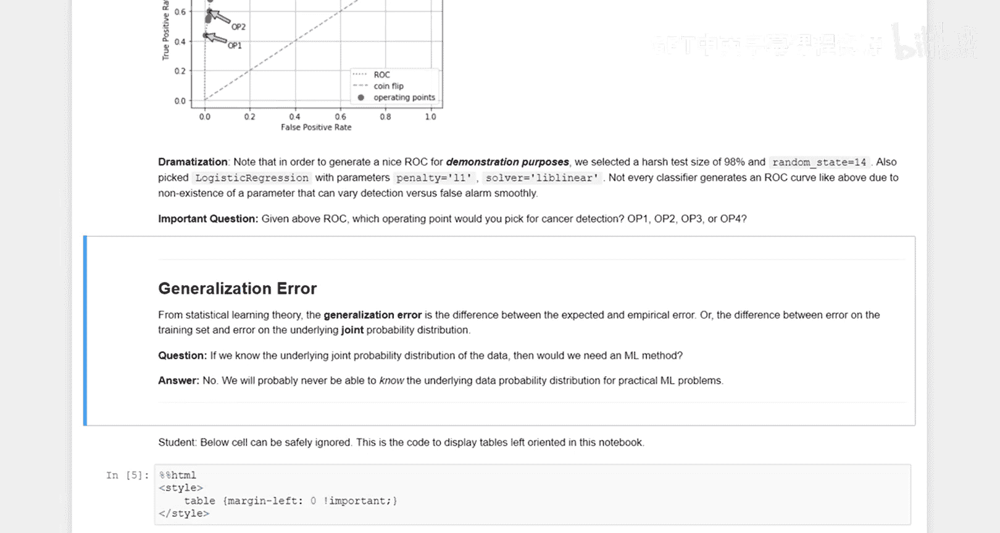

# 应用机器学习：12：受试者工作特征曲线（ROC）详解


## 概述
在本节课中，我们将学习受试者工作特征曲线（ROC）的概念、生成方法及其在评估分类模型性能中的应用。我们将通过一个乳腺癌诊断的实例，理解如何利用ROC曲线在**真阳性率（TPR）** 和**假阳性率（FPR）** 之间进行权衡，并据此为不同应用场景选择合适的模型操作点。

---

## ROC曲线的历史背景与基本概念

上一节我们讨论了分类问题的基本评估指标。本节中，我们来看看一个更古老的评估工具——ROC曲线。

历史上，分类问题的检测、预测和分析方法并不被称为机器学习或人工智能，也没有F1分数或混淆矩阵这类术语。大约在30到40年前，例如在雷达目标检测问题中，评估指标是**检测概率（Probability of Detection）**、**漏检概率（Probability of Miss）** 和**虚警率（False Alarm Rate）**。

为了在检测概率和虚警率之间取得平衡，人们使用了名为“受试者工作特征”的工具。这个名字源于电气工程领域的无线电接收器（Receiver），具有历史渊源。

## ROC曲线的构成与解读

让我们直接跳到ROC曲线图，再回头解释它是如何生成的。

下图是一条典型的ROC曲线：
*   **Y轴** 是**真阳性率（TPR）**，也称为检测概率。
*   **X轴** 是**假阳性率（FPR）**，即虚警率。

图中从(0,0)到(1,1)的虚线代表一个随机分类器的性能，例如通过抛硬币或随机选择0或1来决定分类结果。这是一个非常简单的基线。

**ROC曲线上的每一个点都对应一个特定的分类器阈值或模型参数设置。** 例如，在一个简单的阈值分类器中：
*   如果输入信号高于阈值，则判定为类别1（有目标）。
*   如果输入信号低于阈值，则判定为类别0（无目标）。

通过调整阈值的高低，我们就能沿着ROC曲线移动，得到不同的(TPR, FPR)操作点。在更复杂的模型中（如支持向量机、深度学习网络、随机森林或逻辑回归），这些“操作点”由模型的**超参数**控制，例如SVM中的gamma值、随机森林中树的深度，或逻辑回归中的正则化强度参数`C`。

## 实战：生成乳腺癌分类模型的ROC曲线

理解了ROC曲线的原理后，我们通过一个实际案例来学习如何生成它。我们将使用`scikit-learn`中的乳腺癌数据集，并训练一个逻辑回归模型。

以下是生成ROC曲线操作点的核心步骤代码：

```python
# 导入必要的库并加载数据
from sklearn.datasets import load_breast_cancer
import pandas as pd
from sklearn.linear_model import LogisticRegression
from sklearn.preprocessing import StandardScaler

data = load_breast_cancer()
df = pd.DataFrame(data.data, columns=data.feature_names)
df['cancer'] = data.target  # 添加目标变量：恶性（1）或良性（0）

# 准备特征（X）和标签（y）
X = df.drop('cancer', axis=1).values  # 所有特征列
y = df['cancer'].values  # 真实标签（ground truth）

# 标准化特征，使逻辑回归中每个特征具有同等重要性
scaler = StandardScaler()
X_scaled = scaler.fit_transform(X)

# 定义不同的超参数C值，用于生成多个操作点
C_values = [0.2, 0.5, 1.0, 2.0, 5.0, 10.0, 20.0, 50.0, 100.0]
tpr_list = []
fpr_list = []

for C in C_values:
    # 创建并训练逻辑回归模型
    model = LogisticRegression(C=C, 
                               penalty='l1', 
                               solver='saga', 
                               class_weight='balanced', 
                               max_iter=10000, 
                               random_state=42)
    model.fit(X_scaled, y)
    
    # 预测概率（而非直接预测类别）
    y_pred_proba = model.predict_proba(X_scaled)[:, 1]
    
    # 此处简化计算，实际中应使用验证集计算TPR和FPR
    # 假设我们根据0.5阈值计算（仅为演示，真实ROC需遍历所有阈值）
    y_pred = (y_pred_proba >= 0.5).astype(int)
    # ... 计算该C值下的TPR和FPR，并添加到列表中 ...
    # tpr, fpr = calculate_metrics(y, y_pred)
    # tpr_list.append(tpr)
    # fpr_list.append(fpr)
```

代码说明：
1.  **数据准备**：我们分离特征（`X`）和真实标签（`y`）。将真实标签放入特征中会导致“数据泄露”，造成完美分类的假象。
2.  **特征标准化**：使用`StandardScaler`将特征缩放到相近的范围，这对逻辑回归等基于距离或概率的模型很重要。
3.  **模型训练**：我们循环不同的正则化参数`C`值。`C`是控制模型复杂度的超参数，较小的`C`意味着更强的正则化（可能欠拟合），较大的`C`意味着更弱的正则化（可能过拟合）。
    *   `class_weight='balanced'`用于处理数据集中恶性与良性样本数量不均衡的问题。
    *   `max_iter`定义了优化算法的最大迭代次数，需要根据收敛情况调整。
4.  **生成操作点**：每个`C`值对应一个训练好的模型，我们可以用该模型在测试集上预测，并计算出一组(TPR, FPR)，这就是ROC曲线上的一个点。

运行上述代码后，我们会得到9个红色的操作点，绘制在ROC坐标系中。

## 如何根据ROC曲线选择操作点？

现在面临关键问题：在乳腺癌预测的案例中，我们应该选择操作点1还是操作点4？换句话说，应该选择哪个`C`值对应的模型投入实际使用？

这个选择没有固定答案，完全取决于**应用场景的成本权衡**：

*   **对于癌症检测**：我们可能倾向于选择**操作点4**。因为它具有更高的真阳性率（TPR），意味着能检测出更多的癌症患者。尽管这会导致较高的假阳性率（FPR，例如35%），即会有很多健康人被误诊而需要重新检查（带来成本和焦虑），但我们的首要目标是尽可能不漏掉真正的患者。
*   **对于核攻击预警**：我们则可能倾向于选择**操作点1**。因为它具有极低的假阳性率。一次错误的核攻击预警后果可能是灾难性的。因此，我们宁可承受较低的检测概率（可能漏掉真实攻击），也要确保极高的预警可靠性。

以下是不同场景下选择操作点的考量：
*   **网络安全威胁检测**：安全官会根据可承受的误报工作量来调节“旋钮”（即选择操作点）。过高的FPR会让分析员疲于处理大量误报，而过低的TPR又会放过真实威胁。
*   **通用原则**：我们的目标是**最大化模型的泛化能力**。但由于我们永远无法知道数据背后真实的联合概率分布，只能通过模型去估计它。ROC曲线正是展示了模型在不同严格程度下（由超参数控制）的泛化性能表现。

**作为模型开发者，我们的职责是**：通过ROC曲线清晰地展示模型在不同超参数下的性能边界（TPR与FPR的权衡），然后将最终选择哪个操作点（即如何设定模型严格度）的决策权，交给了解业务成本和风险的相关负责人。

---




## 总结
本节课中我们一起学习了受试者工作特征曲线（ROC）。我们了解了它的历史起源，掌握了其**真阳性率（TPR）** 和**假阳性率（FPR）** 的核心构成。通过乳腺癌诊断的实例，我们实践了如何通过调整逻辑回归的超参数`C`来生成ROC曲线上的不同操作点。最重要的是，我们认识到ROC曲线的价值在于**可视化模型性能的权衡**，而具体操作点的选择需基于实际应用中对误报和漏报代价的深入分析。ROC曲线是连接机器学习模型开发与业务决策的桥梁。