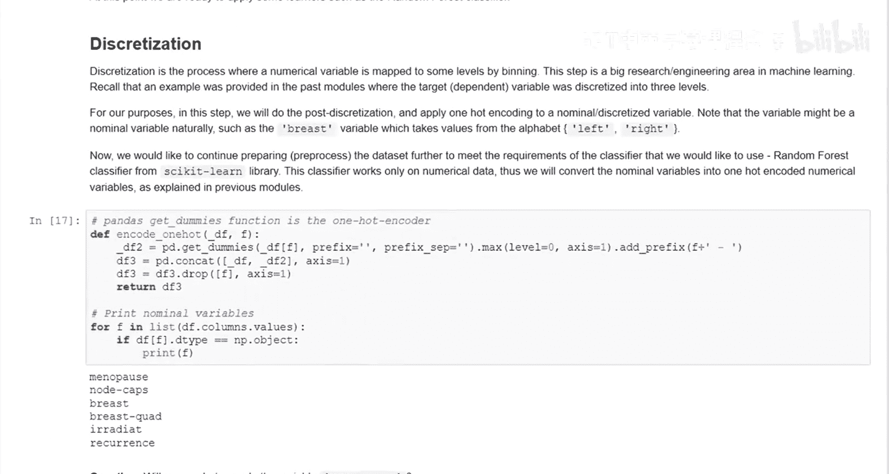

# 约翰霍普金斯大学《应用机器学习｜Applied Machine Learning》中英字幕 p14 13_数据格式与清洗.zh_en -BV13xuqzYErx_p14-

🎼。

Dear students， today in this module， we will look at the preprocessing of datasets。

 as you may be aware by now and as quoted by many textbooks。The machine learning program。

 the machine learning model pipeline， is as good as its input data。And more so。

 the textbooks and colleagues will tell you a 60 to 90% of the effort of a machine learning model development goes into the data preparation。

 this data preparation not only includes cleaning the data。

 making sure the machine learning pipeline can ingest the data but also preprocessing the data so our model is defined you can assume that sophisticated machine learning algorithms can easily work with unclean data。

However， when we clean the data ourselves。We will have more control。

We will also understand what the data is。Called data exploration， so we understand the data。

 we learn the data better， and then we can apply the machine learning algorithms much better。

Now let's see this whole thing in a worked example。In this example。

We intentionally made the data bad。 We added duplicates of data lines。

 We added missing values marked both as question mark and not a number。

 and also had some incorrect entries。 Now， when it comes to machine learning pipelines。

 not all of them are created equally or exactly same。 for example， in Wup。

Nominal variables like like this categorical value is in courts， however。It might be in double codes。

 It might be in single codes。 and during the ingestion of the data。

 we can provide this information to the program。 What is our code and interpretation might be different。

 For example， if we put codes。This number can be input as a string， but maybe we do not want that。

 Maybe we want。The numbers being real numbers so that our work can be better In another example。

 using commas or semicos in a comma separated values file， for example。Is this a single value？😮。

1 semicolon 50 semicolon red， or is this three different values for a CSsv。

 We have to make sure these confusing pieces will be cleaned so that our machine learning pipeline would ingest the data good and then our model would work。

 In most cases， you might not see an error is generated， but when you run a model。

 the performance will be low， or in some cases， Weca or circuit learnarn or pandas ingest will tell you what is not right。

 However， that excuse that problem report may not reflect the exact reason。

 we have to dig in the file to understand what's happening。 Let's do that for our example。

This is the data file we will use in this module， moduleule 3， breast cancer， CSV。

I downloaded using not class plus。 This is an open source free editor。 You can use your own editor。

 Of course。 As you see， the first line is the header。 Sometimes we do not have headers。

 So we have to read in this file to pandas， for example， and create some feature names。

 each of these。Let's say column separated by a comma in this case。Our features， right。

And it looks like our。Depenent feature。Is at the last column occurrencence。

 We cannot just input this whole file in a machine learning program just like that。

 At least we have to separate these9 variables into an X matrix and the last column recurrence。

 which is our dependent variable， has the cancer recurred or not。In a y vector。Now， as I go through。

These， this is interesting。 I have an age-5。I have Nuns when I click I can see all the Nuns。

 I have to impute these Nuns， or I can leave them as none and leave it to thes learn to impute something here。

And I might have question marks， Let's look for them。There are some question， marks。

And this is an exploration， right， This question， probably it will be a question mark in another data set。

 but this could be something else as well。 Another thing I notice is numbers are numbers without codes。

And the values with codes are nominal variables。And these are levels for that particular nominal variable。

 right and left。This is corresponding to the breast column。Okay， now I explored。

I will close this window and go back to my notebook。

Here I used pandas and seaborn to download the load the data to my notebook and I plotted this particular plot of seaborne plus according to the degree malignant nominal or in this case。

 a numerical variable， it has  one，2，3 as degree malignant。And。Each plot is tumor size and age。

And the color is the dependent variable or target variable。 This shows me。

How degree malignant affects the discrimination of recurrence and nonrecurrence。

It looks like when it's the malignant one， generally it's blue， nor record。

When it the malignant tree， General， its orange。This is a very good discriminating variable。

 don't you think？And also， my bad data shows up。I have a minus5 here as age。

 this must be an incorrect entry。I have 250 here must be an incorrect entry。I have to clean these。

Let's first check the duplicates， let's work with the duplicates first。

Paands has duplicated function， which will list all the duplicates for you。

It will list the extras for you。 in this case， I have three more of the same data point of exactly this line。

And。I have two more。Exactly this slime。Of course， recurrence has to be same as well。

 If recurrence is different， it looks like I have the same data point for both recurrence recur。

And res nonre。That's a contradiction entry， isn't it。I removed the duplicates。5ive of them removed。

 It's a very good practice to check every step for sanity。I removed5 data points to Petsargan。 Now。

 I will look at the missing values。 When it comes to missing values， I have two options。

1 for numerical， one for nominal。 for numerical values。

 I can impute the mean and for nominal variables， I can impute the mod。

 There are sophisticated imputing approaches。 For example， stochastic。

 I can use a stochastic approach by looking at the frequencies of all the levels。

I can impute randomly a level which reflects that distribution。 For the moment， we will just move on。

 Our goal is primitively showing all the options in data pre processing。Now。

 let's check if we have anyNs in our data set data frame。Any nuuns？ Give me any point。Any function。

Gives me any point， and the output is a booleion。I have nu for a age， no。Oh， yes， because it's true。

I have nuuns for menopause， false。And these are falses。I will impute。Whenever there is a non N。

 not a number by its mean Here I'm computing to three means using nu pi。

And I'm repeating the work with the data frame mean。These two。Are different functions， clearly。

But this notebook shows what can be done with pandas I it learn so that they will be aware of all these options。

 So it is not a mistake that nuumpier mean is used here and then repeated the same thing with the pandas data frame mean。

It is intentional just to show what are the capabilities。

Now I have the means printed here and I imputed the information using those means。For example。

 age here， whenever it's missing， 56 is imputed because the mean is 56。

Whenever the tu size is missing。2080s inputted。And then whenever the inverted node are missing， 3。

5 is imputed。 It's not visible in this list。Missing nominal variables。

 I will just compute the frequencies and then impute the mold。Now， first thing。

 I have to check the variable feature type。Whenever is float 64。It's basically a real number。

Whenever it's int 64， it's okay， it's an integer。I may want to change this converts to float。

 but for the moment， it's not that important。 These objects are nominal variables。 If you remember。

 these were in codes in the input data file。Now， I will check。For each of the objects。

What are the unique variables， If all the unique variables or levels， unique values are meaningful。

 then I don't have any missing thing。 For example， menopa， everything looks fine。Primmenopausle。

 greater than 40， less than 40。But for note caps， I have a missing value， one or more。No。

 yes should be the only answers， but I have question marks。Similar liberal squad， another one。

 and that's so。 do you think we can impute something in the recurrence？

That means we don't have the ground truth。 Most probably。

 I would drop if I have a missing value of recurrence in a particular data point。

 That's not useful to us because we don't know the ground truth for that data point。

 It is useful for clustering， but not for classification。Now。

 let's check how many value counts do I have for the node caps， No227， yes，56。And missing 10。

 I have to use。Either 227 for missing。Because that's the highest number or a statistical distribution accordingly。

 randomly pick with a random threshold of 56 divided by 283。

Which is the probability of 56 or probability of yes， and the other probability would be。

227 over 286，83。 sorry， this probability to distribution is reflected in the imputation。

I imputed the values。I checked for the incorrect entry of 250， I corrected it。

I also applauded it to see。Where is it。In age， it's weird。Tumor size is a nice distribution。

 inverted node， nice distribution。Degree， malignant。3 different points。

 I do not have to have the distribution。 We could color code these plots to show the intensity。

For example， how many recurrence events happening here。

 we could show it as a S color coded for better visualization。Now， 250 gun minus5 remains。

In most cases， we have to use a subject matter expert to do this right。

Who says 250 is a wrong data point， well， in this example， I can。But in some examples， I cannot。

 because I am not the subject matter expert in this field。Here we see how to color code。

The data points。I updated the plotting to have a gaian kernel density estimation。

So that the Z direction。Or let's say the Z variable。Is used as the colors for each of these nodes。

And it is computed according to the density estimation。

 So you can imagine there is a probability to distribution here， for example。

Or a pro to distribution here。This dot is a discrete probabilityty point， single value。

 and it is more red， more higher values compared to these other two。

That means recurrence events happen when we have degree malignant as 3。

Then the malignant is 2 or one。Recurrence events happen less。Similarly， this is light color。

 This is even lighter。 that means。The mean of the distribution is somewhere here。And。

It is more towards nonrecurrent events。So this is one way of doing it。

Now that our cleaning is complete。We will do the scriptization， as explained in the next module。

