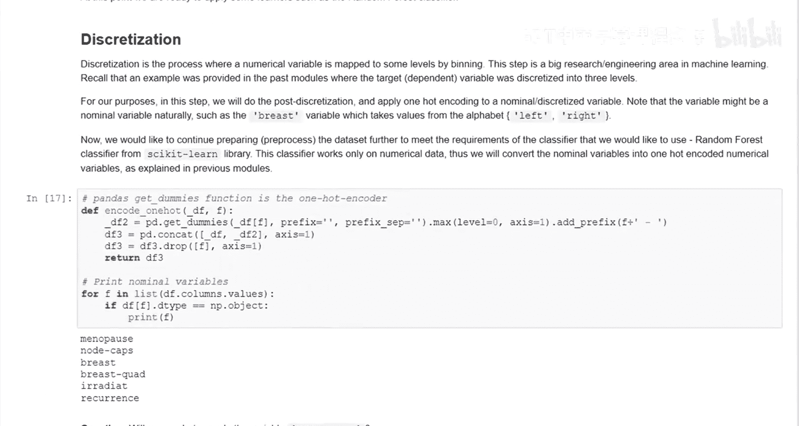

# 应用机器学习：13：数据格式与清洗 🧹

在本节课中，我们将学习数据预处理的核心步骤。机器学习模型的效果很大程度上取决于输入数据的质量。数据准备工作，包括数据清洗和格式化，通常占据了模型开发流程60%到90%的精力。我们将通过一个具体例子，学习如何识别和处理数据中的常见问题。

## 数据质量的重要性

上一节我们强调了数据的重要性，本节中我们来看看数据质量不佳的具体表现。机器学习模型的性能与输入数据直接相关。许多教科书和从业者都指出，机器学习模型开发中60%到90%的努力都投入在数据准备上。

数据准备不仅包括清洗数据，确保机器学习流程能正确读取数据，还包括对数据进行预处理，以便模型能更好地工作。虽然一些复杂的算法能处理不干净的数据，但当我们亲自清洗数据时，能获得更多控制权，也能更好地理解数据本身。这个过程称为数据探索，它能帮助我们更深入地了解数据，从而更有效地应用机器学习算法。

## 一个包含问题的数据集示例

现在，让我们通过一个具体例子来看整个过程。在这个例子中，我们故意制造了一些有问题的数据。

以下是数据集中可能存在的问题：
*   **重复数据行**：存在完全相同的数据记录。
*   **缺失值**：缺失值被标记为问号（`?`）或 `NaN`（Not a Number）。
*   **错误条目**：包含明显不合理或错误的数值。

## 数据格式的挑战

不同的机器学习流程对数据格式的要求可能不同。例如，名义变量（分类值）的表示方式可能不一致。

以下是一些常见的格式问题：
*   **分类值表示**：分类值可能用引号包裹（如 `"courts"`），也可能没有。在读取数据时，我们需要向程序提供正确的解释信息。
*   **数字类型**：数字可能被存储为字符串，但我们可能希望将其作为实数处理。
*   **分隔符混淆**：在CSV文件中，使用逗号或分号可能导致歧义。例如，`1;50;red` 可能被误认为是一个值，而不是三个独立的值。

我们必须确保清理这些容易混淆的部分，这样我们的机器学习流程才能正确读取数据，模型才能正常工作。大多数情况下，程序可能不会报错，但模型的性能会很低。有时，`scikit-learn` 或 `pandas` 在读取数据时会提示问题，但这些提示可能无法准确反映根本原因，我们需要深入检查文件来理解发生了什么。

## 动手探索与清洗数据

让我们为示例数据集进行探索和清洗。我们将使用模块3中的 `breast-cancer.csv` 数据文件。

### 初步数据观察

使用文本编辑器打开文件，可以看到第一行是表头。有时数据没有表头，这时我们需要在读取数据（例如用 `pandas`）时手动指定特征名称。各列由逗号分隔，最后一列 `recurrence` 是我们的因变量，表示癌症是否复发。我们不能直接将整个文件输入机器学习程序，至少需要将前9个变量分离成 `X` 矩阵，将最后一列 `recurrence` 分离成 `y` 向量。

在浏览数据时，我们发现了一些问题：
*   `age` 列中有 `-5`。
*   存在 `NaN` 值。
*   存在用问号 `?` 标记的缺失值。
*   数字是纯数字，而带引号的值是名义变量（分类变量），例如 `breast` 列的 `left` 和 `right`。

### 数据可视化探索

在 `Jupyter Notebook` 中，我们使用 `pandas` 和 `seaborn` 加载数据并绘制图表。我们根据 `degree-malignant`（恶性程度）这个分类变量（数值为1、2、3）绘制了肿瘤大小与年龄的散点图，并用颜色表示目标变量（是否复发）。

图表显示，当恶性程度为1时，点多为蓝色（未复发）；恶性程度为3时，点多为橙色（复发）。这表明 `degree-malignant` 是一个很好的区分变量。同时，我们的问题数据也显现出来：年龄为 `-5` 和 `250` 的点很可能是错误条目，需要清理。

### 处理重复值

首先处理重复值。`pandas` 的 `duplicated()` 函数可以列出所有重复行。

在这个数据集中，我们发现：
*   有三行数据是完全重复的。
*   另有两行数据也是完全重复的。

需要注意的是，如果两行数据特征完全相同但复发结果不同，那就是矛盾的条目。我们移除了5个重复的数据点。在每一步操作后检查数据完整性是一个好习惯。

### 处理缺失值

接下来查看缺失值。处理缺失值有两种基本策略，分别针对数值型和分类型变量。

处理缺失值的基本方法如下：
*   **数值型变量**：可以用均值进行填充。
*   **分类型变量**：可以用众数进行填充。

当然，还有更复杂的填充方法，例如随机填充：根据所有类别出现的频率，按照该分布随机填充一个类别。目前，我们的目标是初步展示数据预处理中的所有选项。

我们检查数据框中是否存在 `NaN`。使用 `any()` 函数，发现 `age` 列存在 `NaN`。我们将用均值填充所有数值型变量的 `NaN`。这里演示了使用 `numpy` 的 `mean` 和 `pandas DataFrame` 的 `mean` 两种方法计算均值，目的是展示不同的工具选项。

填充后，例如 `age` 的缺失值被填为56（均值），`tumor-size` 的缺失值被填为28.0。

### 处理分类型变量的缺失值

对于分类型变量，我们需要先检查特征类型。`float64` 和 `int64` 是数值型，`object` 类型通常是名义变量（在原始数据文件中带引号）。我们检查每个 `object` 类型列的唯一值，如果所有唯一值都有意义，则没有缺失。例如 `menopause` 列看起来正常。但在 `node-caps` 列中，除了 `no` 和 `yes`，还有问号 `?`，这代表缺失值。

我们统计 `node-caps` 的值：`no` 出现227次，`yes` 出现56次，缺失10次。我们可以用出现次数最多的 `no` 来填充，或者按照 `yes` (56/283) 和 `no` (227/283) 的概率分布进行随机填充。我们按照概率分布进行了随机填充。

**注意**：对于因变量 `recurrence` 的缺失值，由于我们不知道真实情况，在分类任务中，通常最好直接删除该数据点。它对聚类可能有用，但对分类无用。

### 修正错误条目与最终检查

我们检查并修正了年龄为250的错误条目。同时绘制了各特征的分布图以进行最终检查：年龄分布（仍有-5的异常值）、肿瘤大小分布良好、淋巴结数量分布良好、恶性程度为三个离散值。

在大多数情况下，我们需要领域专家来判断某个值（如年龄250）是否错误。在本例中我们可以判断，但在其他领域可能不行。

为了更好的可视化，我们更新了图表，使用高斯核密度估计进行颜色编码。颜色深浅表示该区域数据点的密度或某种分布的概率。例如，在恶性程度为3的图中，点更红，表示复发事件更集中；而在恶性程度为1的图中，颜色更浅，表示非复发事件的分布更集中。这是分析数据的一种方式。

## 课程总结

本节课中我们一起学习了数据预处理的关键步骤。我们了解了数据质量对机器学习的重要性，并通过一个实例，逐步探索了数据，识别并处理了重复值、缺失值（包括数值型和分类型）以及明显错误条目。数据清洗完成后，数据就为下一步的标准化或归一化处理做好了准备，这将在下一个模块中讲解。记住，干净、格式一致的数据是构建优秀机器学习模型的坚实基础。