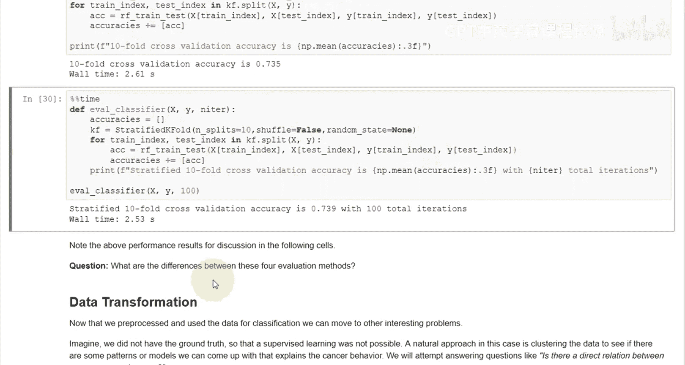

# 约翰霍普金斯大学《应用机器学习｜Applied Machine Learning》中英字幕 p15 14_数据离散化.zh_en -BV13xuqzYErx_p15-

🎼。

Let's see how we visualize pre process data points in our data set。

After a quick check to make sure our prepro indeed results a better data set。

 we will learn how to discretize nominal features in a dataset set by utilizing one hot encoding methods。

We did thistization in the previous modules。We converted it。

A numerical variable into a categorical variable by binning。And also。

 we can convert a nominal variable which are levels or categories to a numerical variable with one hot encoding for each of the levels。

 there will be a new column generated。Now， let's see which ones to one hot anchor。

And why we are doing it， because this particular classification random force that we are going to use likes numerical variables。

 we know that by experience and by reading the API of this particular implementation。

The ones that we we can convert to one hat encoding are the nominal variables。

 and remember their objects。So these six variables have levels。

 They are not numbers for each of the level， for example， in menopause。

 there are three levels for each of those levels， we will create。3 columns。 These are independent。

 supposedly independent columns。 But， of course， we know that they are not independent。

 but it doesn't matter。 This is the only way to encode。A nominal variable into numerical variables。

 values。So that we can use this data point and this feature in a numerical classifier。In this case。

Mnopause variable has G40 greater than 40， less than 40 premenopausal as three different levels。

And these are individual data points。Between 0 and 9， we are displaying。The first time。

Whenever there is a one in one particular variable， the other two is always 0。

 Thus the name one hot encoding。 We built this function。And called one hots。Here。

And then we are using for the remaining four variables。Question， are we going to。

And called recurrence。Well， we will not， because randomfor classifier in this case。

 likes the dependent variable as 0，1，2，3。 We do not have to one hot encode。

 If there are two levels itss binary classification。 In this case， it is binary。

 requiredcur or not required。However， not that。For a neural network， this is indeed one hot encoded。

 The output layer has two values。Either it will be requiredcur or not required。

 Exactly one had encoded。But in this case， we are not one at encoding the recurrence variable。

Now there are four ways to evaluate a classifier in our case， 80% random test train。

 meaning 80% goes of training， 20% goes of testing。

Leave one data point out each time and use everything else for training。 In this case。

 it's easy because the number of data points here is less than 300。

 If this was 1 million leave one out would be totally impractical， of course。

 but here I'm showing it for the sake of completeness。

 leave one out is another approach when there are very few data points。

Tempfold cross validation is the most common one。 each time one fold is kept for testing。

 The rest is used for training。As stratified is the more important version of the Tfold cross validation。

When the data is unbalanced， like in our case。Here， nonrecurd device，205， recur advanced 86。

 It's pretty unbalanced。 It's not like 200 versus 200 or 100 versus 100。 It is 200 versus 80。

 It's not terribly unbalanced， but it's unbalanced。

So we should do stratified cross validation where training and testing data sets are created in such a way that there is this much density of recurd and nonrecurd events reflected。

 So each fault will not be terribly biased to one side。

 but it will be biased as much as the original dataset set shows we define a function here for the randomfor classifier for testing。

We create， create the X and y。X is everything but recurrence that's our dependent variable。

 we cannot include it in the training， of course。Or， let's say。Training data set matrix。

 but we will include it in the labels， in the feedback， as why。

Sly to check the first 10 values of y is nor rence recurrence。

 we could easily convert this to 01 using categorical conversion。 It's not necessary。

Random forest classifier from psychic Lane will be able to use in this manner。

80% train test every time I run this， it will create a new evaluation measure。

 and let's demonstrate that， you see every time it changes。Run it 10 times。

These are the variations as well as 64， as high as 77。

 That's why we are doing tenfold cross validation to collect statistics。Rund  hundred times。

 collect statistics。Here is here is the accuracy。 It also makes sense to display the standard deviation。

 of course。Here， I used person person time in this cell。

 It has to be at the beginning of the cell to show how much。For my case， it took。This number。

26 seconds might be much longer in your setup， depending on your computation power。Here。

 my random forest uses four jobs in parallel。 I could increase this to 8 or more。

Number of estimator estimators， primitive estimators for random force is 200。

 which you can play with these parameters。 It will affect the performance of the classifier。

These parameters and estimators max said。 if you use a default one or some ballpark number。

 it would be okay because random forifier is very robust。 However。

 we can also hyperparameter tune this using a validation dataset set。 In this case。

 we don't have a validation dataset set。 So we just kept lack this。 randomand state means。

Every time the randomness of the random force classifier will be taken by a random seat。

 If I fixed this two 42， for example， every time I run it。In the 80% split， for example。

 if I set this to code tree。I have to run this cell， of course， now， because I have a nucleus fire。

And what's your guess？Every time it will generate the exact same result， right？

Because I fixed the randomness of the random forest。 I also fixed the experimentation。

Seeds are constant， 42 and 32 or whatever that corresponds to，42 and 33。

And this number 77 keeps same。I want to change this to none， again。And of course I have to run this。

 right， it doesn't pick up automatically the RF train test。

My changes won't be picked up automatically。 Run0 times collect statistics。

 we said leave one out testing。 It's not terribly important。 This just for demonstration purposes。

This is important tenfold cross validation。 This is more important， Stratified。

 tenfold cross validation。 So in my case， it's 73。And， of course。

 this will change if I keep the randomness。In the next module。

 we will look at the data transformation。

